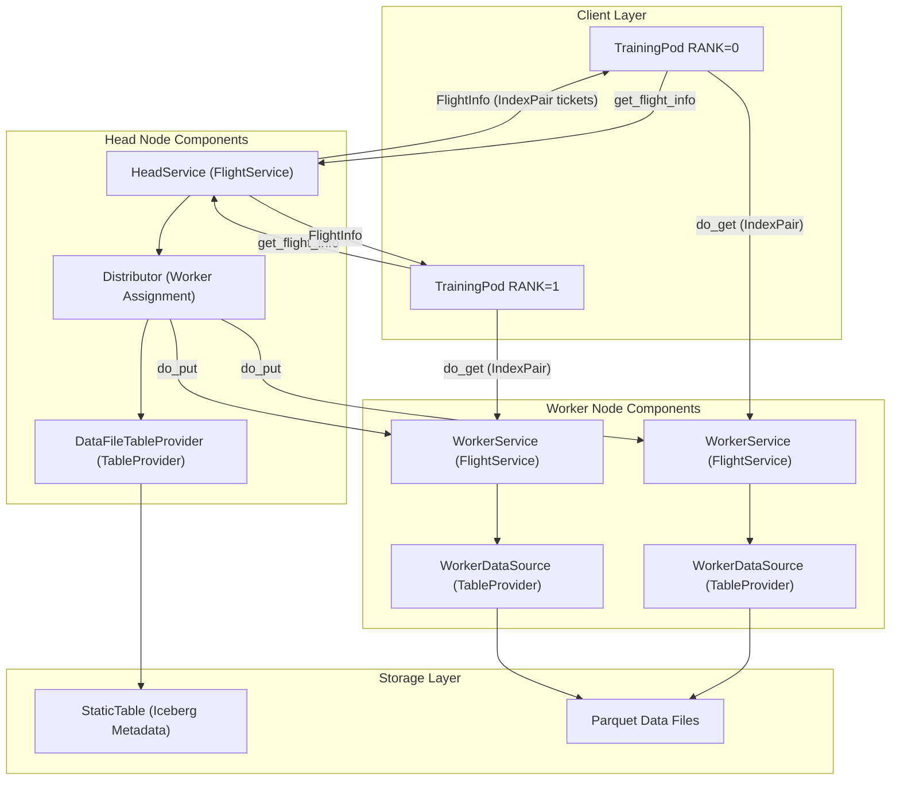
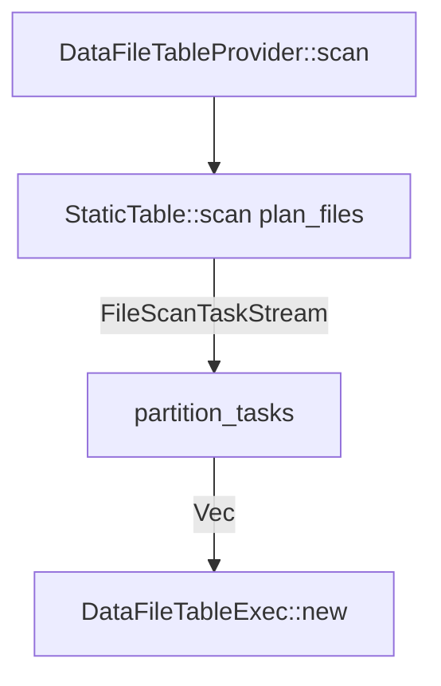

<!-- source: DeepWiki mcp.deepwiki.com · repo kubeflow/trainer · page 3.2 Distributed Data Cache System · fetched 2026-10-21 -->

# Distributed Data Cache System

<details>
<summary>Relevant source files</summary>

The following files were used as context for generating this wiki page:

- [charts/kubeflow-trainer/templates/data-cache/cluster-role.yaml](charts/kubeflow-trainer/templates/data-cache/cluster-role.yaml)
- [charts/kubeflow-trainer/tests/data-cache/cluster_role_test.yaml](charts/kubeflow-trainer/tests/data-cache/cluster_role_test.yaml)
- [cmd/data_cache/Dockerfile](cmd/data_cache/Dockerfile)
- [hack/data_cache/run_with_remote_table.sh](hack/data_cache/run_with_remote_table.sh)
- [manifests/base/runtimes/data-cache/kustomization.yaml](manifests/base/runtimes/data-cache/kustomization.yaml)
- [manifests/overlays/data-cache/cluster_role.yaml](manifests/overlays/data-cache/cluster_role.yaml)
- [manifests/overlays/data-cache/kustomization.yaml](manifests/overlays/data-cache/kustomization.yaml)
- [manifests/overlays/data-cache/namespace-rbac/kustomization.yaml](manifests/overlays/data-cache/namespace-rbac/kustomization.yaml)
- [manifests/overlays/data-cache/namespace-rbac/role_binding.yaml](manifests/overlays/data-cache/namespace-rbac/role_binding.yaml)
- [manifests/overlays/data-cache/namespace-rbac/service_account.yaml](manifests/overlays/data-cache/namespace-rbac/service_account.yaml)
- [manifests/third-party/leaderworkerset/kustomization.yaml](manifests/third-party/leaderworkerset/kustomization.yaml)
- [pkg/data_cache/Cargo.lock](pkg/data_cache/Cargo.lock)
- [pkg/data_cache/Cargo.toml](pkg/data_cache/Cargo.toml)
- [pkg/data_cache/OWNERS](pkg/data_cache/OWNERS)
- [pkg/data_cache/README.md](pkg/data_cache/README.md)
- [pkg/data_cache/cmd/head/main.rs](pkg/data_cache/cmd/head/main.rs)
- [pkg/data_cache/cmd/worker/main.rs](pkg/data_cache/cmd/worker/main.rs)
- [pkg/data_cache/src/config/config.rs](pkg/data_cache/src/config/config.rs)
- [pkg/data_cache/src/head/head_service.rs](pkg/data_cache/src/head/head_service.rs)
- [pkg/data_cache/src/head/provider.rs](pkg/data_cache/src/head/provider.rs)
- [pkg/data_cache/src/head/writer.rs](pkg/data_cache/src/head/writer.rs)
- [pkg/data_cache/src/health/mod.rs](pkg/data_cache/src/health/mod.rs)
- [pkg/data_cache/src/lib.rs](pkg/data_cache/src/lib.rs)
- [pkg/data_cache/src/worker/indexable_mem_table.rs](pkg/data_cache/src/worker/indexable_mem_table.rs)
- [pkg/data_cache/src/worker/worker_datasource.rs](pkg/data_cache/src/worker/worker_datasource.rs)
- [pkg/data_cache/src/worker/worker_service.rs](pkg/data_cache/src/worker/worker_service.rs)
- [pkg/data_cache/test/Cargo.lock](pkg/data_cache/test/Cargo.lock)
- [pkg/data_cache/test/Cargo.toml](pkg/data_cache/test/Cargo.toml)
- [pkg/initializers/dataset/cache.py](pkg/initializers/dataset/cache.py)
- [pkg/initializers/dataset/cache_test.py](pkg/initializers/dataset/cache_test.py)

</details>


## Purpose and Scope

The Distributed Data Cache System is a Rust-based in-memory data serving infrastructure that enables efficient, zero-copy streaming of training data to distributed ML workloads [pkg/data_cache/src/head/head_service.rs:34-82](), [pkg/data_cache/src/worker/worker_service.rs:38-86](). The system uses the Apache Arrow Flight protocol to provide high-throughput data access from Iceberg tables to training pods, implementing a head-worker topology where a coordinator node partitions data files across worker nodes for parallel serving [pkg/data_cache/src/head/provider.rs:41-48]().

This document covers the data cache architecture, communication protocols, and data distribution algorithms. For information about dataset and model initialization, see page 3.1. For integration with TrainJob lifecycle, see page 2.3.

Sources: [pkg/data_cache/src/head/head_service.rs:34-82](), [pkg/data_cache/src/worker/worker_service.rs:38-86](), [pkg/data_cache/Cargo.toml:1-36](), [pkg/data_cache/src/head/provider.rs:41-48]()

---

## System Architecture

The data cache implements a head-worker distributed architecture where a single head node coordinates multiple worker nodes [pkg/data_cache/src/head/head_service.rs:34-47](), [pkg/data_cache/src/worker/worker_service.rs:38-51](). The system uses Apache Arrow Flight RPC for efficient data transfer and Apache DataFusion for in-memory query processing [pkg/data_cache/Cargo.toml:10-18]().

### Component Overview

Title: "System Architecture and Code Entity Mapping"



Sources: [pkg/data_cache/src/head/head_service.rs:55-66](), [pkg/data_cache/src/worker/worker_service.rs:61-73](), [pkg/data_cache/src/head/provider.rs:57-68](), [pkg/data_cache/src/worker/worker_datasource.rs:46-60]()

### Technology Stack

| Component | Technology | Purpose |
|-----------|------------|---------|
| RPC Protocol | Apache Arrow Flight | Zero-copy data streaming with schema negotiation [pkg/data_cache/Cargo.toml:18]() |
| Query Engine | Apache DataFusion | SQL-based in-memory data processing [pkg/data_cache/Cargo.toml:10]() |
| Table Format | Apache Iceberg | Metadata management and schema evolution [pkg/data_cache/Cargo.toml:15-16]() |
| Serialization | Bincode | Efficient binary serialization for flight tickets [pkg/data_cache/Cargo.toml:21]() |
| DNS Resolution | Hickory Resolver | Service discovery for worker nodes [pkg/data_cache/Cargo.toml:22]() |
| Web Framework | Axum | Health check endpoints and worker status routing [pkg/data_cache/Cargo.toml:23-25]() |

The two binary executables are declared in `Cargo.toml`:

| Binary | Entry Point | Role |
|--------|------------|------|
| `head` | `cmd/head/main.rs` | Coordinator node [pkg/data_cache/Cargo.toml:31-32]() |
| `worker` | `cmd/worker/main.rs` | Data serving node [pkg/data_cache/Cargo.toml:35-36]() |

Sources: [pkg/data_cache/Cargo.toml:9-25](), [pkg/data_cache/Cargo.toml:30-36](), [pkg/data_cache/test/Cargo.toml:7-16]()

---

## Head Node Components

The head node acts as the coordinator, responsible for reading Iceberg metadata, partitioning data files across workers, and directing clients to appropriate worker endpoints [pkg/data_cache/src/head/head_service.rs:34-47](), [pkg/data_cache/src/head/provider.rs:41-48]().

### HeadService (Flight Protocol)

`HeadService` implements the `FlightService` trait to handle client requests via Apache Arrow Flight protocol [pkg/data_cache/src/head/head_service.rs:34-85](). The primary operation is `get_flight_info`, which returns worker endpoints and row ranges for distributed query execution [pkg/data_cache/src/head/head_service.rs:102-128]().

Title: "HeadService Flow and Code Entities"


Sources: [pkg/data_cache/src/head/head_service.rs:84-165]()

#### Request Parameters

The `get_flight_info` method expects a `FlightDescriptor` with path parameters [pkg/data_cache/src/head/head_service.rs:110-114]():
- `path[0]`: `local_rank` - Client's partition ID (0-based) [pkg/data_cache/src/head/head_service.rs:110-111]()
- `path[1]`: `total` - Total number of partitions [pkg/data_cache/src/head/head_service.rs:112-113]()

Sources: [pkg/data_cache/src/head/head_service.rs:102-115]()

#### Response Structure

The `FlightInfo` response contains schema information, flight endpoints with worker URIs, and serialized `IndexPair` tickets representing row ranges [pkg/data_cache/src/head/head_service.rs:115-128]().

Sources: [pkg/data_cache/src/head/head_service.rs:115-128]()

### DataFileTableProvider

`DataFileTableProvider` implements the DataFusion `TableProvider` trait, reading Iceberg table metadata and producing an execution plan that partitions files across workers [pkg/data_cache/src/head/provider.rs:41-48](), [pkg/data_cache/src/head/provider.rs:111-149]().

Title: "DataFileTableProvider Scan Execution Flow"



Sources: [pkg/data_cache/src/head/provider.rs:112-149]()

#### File Partitioning Algorithm

The `partition_tasks` function implements a greedy load-balancing algorithm that sorts tasks by `record_count` in descending order and assigns each task to the worker with the minimum total records [pkg/data_cache/src/head/provider.rs:174-180]().

Sources: [pkg/data_cache/src/head/provider.rs:170-183]()

### Distributor

The `Distributor` coordinates worker node communication and manages the distribution of file assignments to workers via Arrow Flight `do_put` operations [pkg/data_cache/src/head/head_service.rs:15-16](), [pkg/data_cache/src/head/head_service.rs:42-53]().

Sources: [pkg/data_cache/src/head/head_service.rs:15-16](), [pkg/data_cache/src/head/provider.rs:152-183]()

---

## Worker Node Components

Worker nodes receive file assignments from the head node, load data into memory, and serve query results to training pods via Arrow Flight [pkg/data_cache/src/worker/worker_service.rs:38-51]().

### WorkerService (Flight Protocol)

`WorkerService` implements the `FlightService` trait with `do_put` (receive file assignments) and `do_get` (serve query results) operations [pkg/data_cache/src/worker/worker_service.rs:52-57](), [pkg/data_cache/src/worker/worker_service.rs:93-167]().

```rust
// Defined in pkg/data_cache/src/worker/worker_service.rs
pub(crate) struct WorkerService {
    metadata_loc: String,
    table_name: String,
    schema_name: String,
    ctx: Arc<SessionContext>,
}
```

Sources: [pkg/data_cache/src/worker/worker_service.rs:86-91]()

#### do_get: Query Execution

The `do_get` operation deserializes an `IndexPair` ticket and executes a SQL query on the DataFusion `memtable`, excluding the `CACHE_INDEX_COLUMN` from the result set [pkg/data_cache/src/worker/worker_service.rs:149-172]():

```sql
SELECT * EXCEPT(cache_index) FROM memtable
WHERE cache_index >= {pair.start} AND cache_index <= {pair.end}
```

Sources: [pkg/data_cache/src/worker/worker_service.rs:149-172]()

### WorkerDataSource

`WorkerDataSource` implements the DataFusion `TableProvider` trait, loading assigned files from the Iceberg table and appending a `CACHE_INDEX_COLUMN` (`cache_index`) for global row ordering [pkg/data_cache/src/worker/worker_datasource.rs:46-100](), [pkg/data_cache/src/worker/worker_datasource.rs:129-148]().

#### IndexColumnExec: Cache Index Addition

`WorkerDataSource` validates that the source schema does not already contain a column named `cache_index` before pushing the `cache_index` field of type `UInt64` into the output schema [pkg/data_cache/src/worker/worker_datasource.rs:129-140]().

Sources: [pkg/data_cache/src/worker/worker_datasource.rs:94-148]()

---

## Configuration

### Environment Variables

The system is configured through environment variables used by binaries and the `CacheInitializer` [pkg/initializers/dataset/cache.py:64-72]():

| Variable | Type | Description |
|----------|------|-------------|
| `METADATA_LOC` | String | Iceberg metadata file location (URI) [pkg/initializers/dataset/cache.py:93]() |
| `SCHEMA_NAME` | String | Iceberg schema name [pkg/initializers/dataset/cache.py:95]() |
| `TABLE_NAME` | String | Iceberg table name [pkg/initializers/dataset/cache.py:94]() |
| `RUST_LOG` | String | Logging level (default: info) [cmd/data_cache/Dockerfile:19]() |

Sources: [cmd/data_cache/Dockerfile:19-19](), [pkg/data_cache/src/worker/worker_datasource.rs:103-109](), [pkg/initializers/dataset/cache.py:64-95]()

### IndexPair Serialization

The `IndexPair` struct represents row ranges in flight tickets and is serialized using `bincode` [pkg/data_cache/src/worker/worker_service.rs:15-15](), [pkg/data_cache/src/worker/worker_service.rs:157-158]().

Sources: [pkg/data_cache/src/worker/worker_service.rs:15-15](), [pkg/data_cache/src/worker/worker_service.rs:157-158](), [pkg/data_cache/src/config/config.rs:26-29]()

---

## Deployment Architecture

### LeaderWorkerSet Integration

The system is deployed as a cluster using Kubernetes `LeaderWorkerSet` (LWS) [pkg/initializers/dataset/cache.py:174-180](). The head node runs as the leader pod, while workers run as worker pods in the same set.

Sources: [pkg/initializers/dataset/cache.py:174-180](), [manifests/third-party/leaderworkerset/kustomization.yaml:18-20]()

### Docker Deployment

The system uses a multi-stage Docker build (`rust:1.98-bookworm` builder and `debian:bookworm-slim` runtime) to produce minimal runtime images containing the `head` and `worker` binaries [cmd/data_cache/Dockerfile:15-61]().

Sources: [cmd/data_cache/Dockerfile:15-61]()

---

