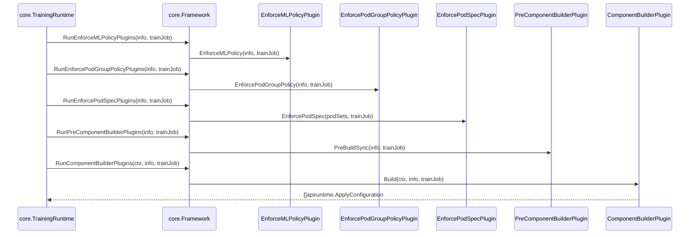
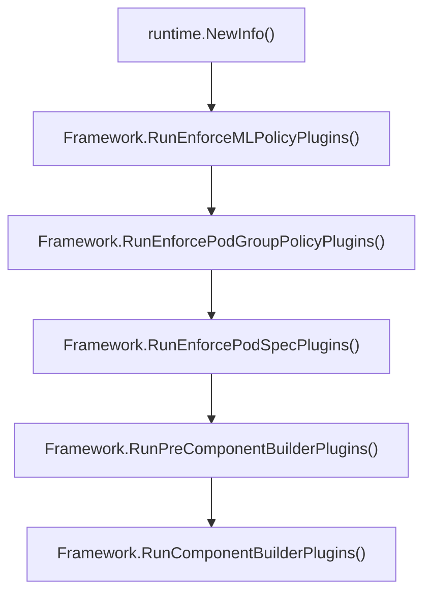

<!-- source: DeepWiki mcp.deepwiki.com · repo kubeflow/trainer · page 4.1 Plugin Architecture Overview · fetched 2026-10-21 -->

# Plugin Architecture Overview

Relevant source files

The following files were used as context for generating this wiki page:

- [pkg/runtime/core/clustertrainingruntime.go](pkg/runtime/core/clustertrainingruntime.go)
- [pkg/runtime/core/core.go](pkg/runtime/core/core.go)
- [pkg/runtime/core/core_test.go](pkg/runtime/core/core_test.go)
- [pkg/runtime/core/registry.go](pkg/runtime/core/registry.go)
- [pkg/runtime/core/snapshot.go](pkg/runtime/core/snapshot.go)
- [pkg/runtime/core/snapshot_test.go](pkg/runtime/core/snapshot_test.go)
- [pkg/runtime/core/trainingruntime.go](pkg/runtime/core/trainingruntime.go)
- [pkg/runtime/framework/core/framework_test.go](pkg/runtime/framework/core/framework_test.go)
- [pkg/runtime/framework/plugins/jobset/builder.go](pkg/runtime/framework/plugins/jobset/builder.go)
- [pkg/runtime/framework/plugins/jobset/builder_test.go](pkg/runtime/framework/plugins/jobset/builder_test.go)
- [pkg/runtime/indexer/indexer_test.go](pkg/runtime/indexer/indexer_test.go)
- [pkg/runtime/interface.go](pkg/runtime/interface.go)
- [pkg/util/trainingruntime/trainingruntime.go](pkg/util/trainingruntime/trainingruntime.go)
- [pkg/util/trainingruntime/trainingruntime_test.go](pkg/util/trainingruntime/trainingruntime_test.go)
- [pkg/util/trainjob/trainjob.go](pkg/util/trainjob/trainjob.go)
- [pkg/util/trainjob/trainjob_test.go](pkg/util/trainjob/trainjob_test.go)
- [proposals/2170-kubeflow-trainer-v2/README.md](proposals/2170-kubeflow-trainer-v2/README.md)

## Purpose and Scope

This document describes the plugin-based runtime framework that enables Kubeflow Trainer to support multiple ML frameworks, scheduling policies, and orchestration strategies through a unified extension mechanism. The plugin architecture allows the system to inject framework-specific configurations (PyTorch, MPI, JAX, XGBoost, Flux), apply gang scheduling policies, build Kubernetes resources, and validate `TrainJob` specifications without modifying core controller logic.

For information about specific ML framework plugins, see [ML Framework Plugins](). For details about predefined runtimes that use these plugins, see [Predefined Runtime Definitions](). For the overall system architecture, see [1.1. System Architecture]().

Sources: [pkg/runtime/framework/core/framework.go:38-95](), [pkg/runtime/runtime.go:36-61]()

---

## Core Architecture Components

The plugin system consists of three primary components that work together to transform a `TrainJob` specification into executable Kubernetes resources.

### Framework Orchestrator

The `core.Framework` struct defined at [pkg/runtime/framework/core/framework.go:38-49]() orchestrates plugin execution. It maintains categorized lists of plugins implementing different interfaces and executes them in a defined sequence during `TrainJob` reconciliation. It is initialized via the `core.New` function [pkg/runtime/framework/core/framework.go:51-95]() which populates these slices based on type assertions of the registered plugins.

### Runtime Info Object

The `runtime.Info` struct [pkg/runtime/runtime.go:36-47]() is a mutable state object that plugins modify during execution. It encapsulates the runtime configuration extracted from `TrainingRuntime` or `ClusterTrainingRuntime` and tracks modifications applied by plugins. The `TemplateSpec.PodSets` field [pkg/runtime/runtime.go:55-61]() provides an abstract representation of Pod specifications that plugins can modify without directly manipulating underlying `JobSet` YAML structures.

### Plugin Registry

The plugin registry stores factory functions mapped by plugin names [pkg/runtime/framework/plugins/registry.go]() (referenced in [pkg/runtime/core/trainingruntime.go:77]()). The registry is used by the `core.Framework` during initialization to instantiate all enabled plugins [pkg/runtime/framework/core/framework.go:60-65]().

Sources: [pkg/runtime/framework/core/framework.go:38-95](), [pkg/runtime/runtime.go:36-61](), [pkg/runtime/core/trainingruntime.go:70-86]()

---

## Plugin Interfaces

Plugins implement one or more interfaces defined in [pkg/runtime/framework/interface.go:30-84]() to participate in different phases of `TrainJob` processing.

### Interface Hierarchy

The following diagram maps high-level plugin interfaces to their concrete code entities and implementations in the codebase.

**PluginEntityMapping**

```mermaid
graph TB
    Plugin["framework.Plugin"]
    EnforceMLPolicy["framework.EnforceMLPolicyPlugin"]
    EnforcePodGroup["framework.EnforcePodGroupPolicyPlugin"]
    EnforcePodSpec["framework.EnforcePodSpecPlugin"]
    CustomValidation["framework.CustomValidationPlugin"]
    WatchExtension["framework.WatchExtensionPlugin"]
    PreComponentBuilder["framework.PreComponentBuilderPlugin"]
    ComponentBuilder["framework.ComponentBuilderPlugin"]
    TrainJobStatus["framework.TrainJobStatusPlugin"]
    
    Plugin --> EnforceMLPolicy
    Plugin --> EnforcePodGroup
    Plugin --> EnforcePodSpec
    Plugin --> CustomValidation
    Plugin --> WatchExtension
    Plugin --> PreComponentBuilder
    Plugin --> ComponentBuilder
    Plugin --> TrainJobStatus
    
    TorchPlugin["torch.Torch"]
    MPIPlugin["mpi.MPI"]
    JAXPlugin["jax.Jax"]
    PlainMLPlugin["plainml.PlainML"]
    XGBoostPlugin["xgboost.XGBoost"]
    FluxPlugin["flux.Flux"]
    CoSchedulingPlugin["coscheduling.CoScheduling"]
    VolcanoPlugin["volcano.Volcano"]
    JobSetPlugin["jobset.JobSet"]
    
    EnforceMLPolicy -.-> TorchPlugin
    EnforceMLPolicy -.-> MPIPlugin
    EnforceMLPolicy -.-> JAXPlugin
    EnforceMLPolicy -.-> PlainMLPlugin
    EnforceMLPolicy -.-> XGBoostPlugin
    EnforceMLPolicy -.-> FluxPlugin
    
    EnforcePodGroup -.-> CoSchedulingPlugin
    EnforcePodGroup -.-> VolcanoPlugin
    
    PreComponentBuilder -.-> JobSetPlugin
    ComponentBuilder -.-> JobSetPlugin
    ComponentBuilder -.-> CoSchedulingPlugin
    ComponentBuilder -.-> VolcanoPlugin
    ComponentBuilder -.-> MPIPlugin
    ComponentBuilder -.-> FluxPlugin
    
    CustomValidation -.-> TorchPlugin
    CustomValidation -.-> MPIPlugin
    CustomValidation -.-> JAXPlugin
    CustomValidation -.-> JobSetPlugin
    CustomValidation -.-> VolcanoPlugin
    CustomValidation -.-> XGBoostPlugin
    CustomValidation -.-> FluxPlugin
    
    WatchExtension -.-> JobSetPlugin
    WatchExtension -.-> CoSchedulingPlugin
    WatchExtension -.-> VolcanoPlugin
    WatchExtension -.-> MPIPlugin
    WatchExtension -.-> FluxPlugin
    
    TrainJobStatus -.-> JobSetPlugin
```

Sources: [pkg/runtime/framework/interface.go:30-84](), [pkg/runtime/framework/core/framework_test.go:78-133]()

### EnforceMLPolicyPlugin

Defined at [pkg/runtime/framework/interface.go:51-56](), this interface allows plugins to inject ML framework-specific configurations into the `runtime.Info` object.

- **Key Implementations**:
  - `torch.Torch`: Injects `PET_*` environment variables and configures execution parameters [pkg/runtime/framework/plugins/torch/torch.go:43-44]().
  - `mpi.MPI`: Configures MPI distributed execution parameters.

### EnforcePodGroupPolicyPlugin

Defined at [pkg/runtime/framework/interface.go:46-49](), this interface enables gang scheduling by adding appropriate labels and annotations to pods.

- **Key Implementation**:
  - `coscheduling.CoScheduling`: Adds the `scheduling.x-k8s.io/pod-group` label to `info.Scheduler.PodLabels` [pkg/runtime/framework/plugins/coscheduling/coscheduling.go:81-91]().

### EnforcePodSpecPlugin (PodNetwork & Spec Mutations)

Defined at [pkg/runtime/framework/interface.go:58-63](), this interface mutates the `PodSpec` of a `TrainJob`'s `PodSets` for pod-level settings, network configurations, and resource adjustments that are not driven directly by `MLPolicy` or `PodGroupPolicy`.

### PreComponentBuilderPlugin

Defined at [pkg/runtime/framework/interface.go:69-72](), this interface consolidates the `runtime.Info` object with the concrete runtime template before materialization.

- **Key Implementation**:
  - `jobset.JobSet`: Synchronizes abstract `PodSets` with the underlying `JobSet` template [pkg/runtime/framework/plugins/jobset/jobset.go:69]().

### ComponentBuilderPlugin

Defined at [pkg/runtime/framework/interface.go:76-79](), this interface creates Kubernetes resource `ApplyConfigurations`.

- **Key Implementations**:
  - `jobset.JobSet`: Builds the primary `JobSet` resource [pkg/runtime/framework/plugins/jobset/jobset.go:70]().
  - `coscheduling.CoScheduling`: Builds the `scheduler-plugins` `PodGroup` resource [pkg/runtime/framework/plugins/coscheduling/coscheduling.go:93-139]().

### CustomValidationPlugin

Defined at [pkg/runtime/framework/interface.go:34-37](), this interface validates `TrainJob` specifications during admission or reconciliation [pkg/runtime/framework/plugins/jobset/jobset.go:91-170]().

### WatchExtensionPlugin

Defined at [pkg/runtime/framework/interface.go:39-42](), this interface registers custom controller watches and event handlers.

Sources: [pkg/runtime/framework/interface.go:30-84](), [pkg/runtime/framework/plugins/jobset/jobset.go:68-72](), [pkg/runtime/framework/plugins/torch/torch.go:43-44](), [pkg/runtime/framework/plugins/coscheduling/coscheduling.go:59-91]()

---

## Plugin Execution Pipeline

The `core.Framework` executes plugins in a specific sequence during the `TrainJob` reconciliation loop managed by [pkg/runtime/core/trainingruntime.go:121-147]().

**PluginExecutionSequence**

Sources: [pkg/runtime/core/trainingruntime.go:121-147](), [pkg/runtime/framework/core/framework.go:98-174]()

### Execution Order Details

1. **`RunEnforceMLPolicyPlugins`**: Configures framework-specific parameters [pkg/runtime/framework/core/framework.go:100-107]().
2. **`RunEnforcePodGroupPolicyPlugins`**: Configures gang-scheduling parameters after pod counts are finalized [pkg/runtime/framework/core/framework.go:112-119]().
3. **`RunEnforcePodSpecPlugins`**: Mutates general pod spec settings and network policies [pkg/runtime/framework/core/framework.go:123-133]().
4. **`RunPreComponentBuilderPlugins`**: Synchronizes the `runtime.Info` object with the concrete template shape [pkg/runtime/framework/core/framework.go:152-159]().
5. **`RunComponentBuilderPlugins`**: Materializes Kubernetes resource apply configurations [pkg/runtime/framework/core/framework.go:163-173]().

Sources: [pkg/runtime/core/trainingruntime.go:121-147](), [pkg/runtime/framework/core/framework.go:98-174]()

---

## Runtime.Info Mutation Flow

The `runtime.Info` structure [pkg/runtime/runtime.go:36-47]() undergoes progressive modification as it flows through the pipeline.

**RuntimeInfoMutationPipeline**

Sources: [pkg/runtime/runtime.go:178-201](), [pkg/runtime/framework/core/framework.go:98-174]()

---

## Built-in Plugins Summary

| Plugin Name | Interfaces | Primary Purpose |
|-------------|-----------|-----------------|
| `jobset.JobSet` | `ComponentBuilder`, `PreComponentBuilder`, `WatchExtension`, `CustomValidation`, `TrainJobStatus` | Orchestrates training via `JobSet`; validates initializers [pkg/runtime/framework/plugins/jobset/jobset.go:68-72](). |
| `torch.Torch` | `EnforceMLPolicy`, `CustomValidation` | Injects PyTorch-specific environment variables and handles `torchrun` setup [pkg/runtime/framework/plugins/torch/torch.go:43-44](). |
| `coscheduling.CoScheduling` | `EnforcePodGroupPolicy`, `ComponentBuilder`, `WatchExtension` | Gang scheduling via `scheduler-plugins` PodGroups [pkg/runtime/framework/plugins/coscheduling/coscheduling.go:59-61](). |
| `volcano.Volcano` | `EnforcePodGroupPolicy`, `ComponentBuilder`, `WatchExtension`, `CustomValidation` | Gang scheduling via Volcano PodGroups [pkg/runtime/framework/plugins/volcano/volcano.go:65-67](). |

Sources: [pkg/runtime/framework/plugins/jobset/jobset.go:68-72](), [pkg/runtime/framework/plugins/torch/torch.go:43-44](), [pkg/runtime/framework/plugins/coscheduling/coscheduling.go:59-61](), [pkg/runtime/framework/plugins/volcano/volcano.go:65-67]()

---

