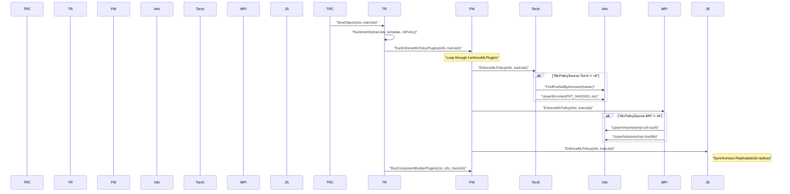

<!-- source: DeepWiki mcp.deepwiki.com · repo kubeflow/trainer · page 4.2 ML Framework Plugins · fetched 2026-10-21 -->

# ML Framework Plugins

<details>
<summary>Relevant source files</summary>

The following files were used as context for generating this wiki page:

- [pkg/constants/constants.go](pkg/constants/constants.go)
- [pkg/runtime/framework/plugins/mpi/mpi.go](pkg/runtime/framework/plugins/mpi/mpi.go)
- [pkg/runtime/framework/plugins/mpi/mpi_test.go](pkg/runtime/framework/plugins/mpi/mpi_test.go)
- [pkg/runtime/framework/plugins/plainml/plainml.go](pkg/runtime/framework/plugins/plainml/plainml.go)
- [pkg/runtime/framework/plugins/plainml/plainml_test.go](pkg/runtime/framework/plugins/plainml/plainml_test.go)
- [pkg/runtime/framework/plugins/torch/torch.go](pkg/runtime/framework/plugins/torch/torch.go)
- [pkg/runtime/framework/plugins/torch/torch_test.go](pkg/runtime/framework/plugins/torch/torch_test.go)
- [pkg/runtime/runtime_test.go](pkg/runtime/runtime_test.go)

</details>


ML Framework Plugins are specialized components that inject framework-specific configurations into training jobs. They implement the `EnforceMLPolicyPlugin` interface to configure environment variables, container ports, and other settings required by distributed training frameworks like PyTorch, MPI, JAX, XGBoost, and Flux.

This page provides a high-level overview of the ML plugin system and common patterns. For detailed implementation information, see the child pages:
- [Torch Plugin](#4.2.1) — Implementation details for PyTorch distributed training, including `PET_*` environment variables, `torchrun` integration, and `TorchTune` support.
- [MPI Plugin](#4.2.2) — Configuration for MPI-based distributed training, including SSH key generation, hostfile management, and launcher/worker orchestration.
- [JAX Plugin](#4.2.3) — Injection of JAX-specific coordination environment variables and distributed initialization settings.
- [PlainML Plugin](#4.2.4) — Fallback plugin for generic training configurations without specific framework logic.
- [XGBoost Plugin](#4.2.5) — Support for distributed XGBoost training using Rabit-based coordination and tracker configuration.
- [Flux Plugin](#4.2.6) — Integration with the Flux HPC framework for MiniCluster bootstrapping and topology-aware scheduling.

---

## Plugin Interfaces and Responsibilities

ML Framework Plugins implement several interfaces defined in the runtime framework to handle policy enforcement, validation, and auxiliary component building.

### Code Entity Association

The following diagram maps high-level plugin roles to their corresponding implementation classes and interfaces in the codebase.

**Plugin Interface Hierarchy**
```mermaid
classDiagram
    class "framework.Plugin" {
        <<interface>>
        +Name() string
    }
    
    class "framework.EnforceMLPolicyPlugin" {
        <<interface>>
        +EnforceMLPolicy(info *runtime.Info, trainJob *TrainJob) error
    }
    
    class "framework.CustomValidationPlugin" {
        <<interface>>
        +Validate(ctx, info, oldObj, newObj) (Warnings, ErrorList)
    }
    
    class "framework.ComponentBuilderPlugin" {
        <<interface>>
        +Build(ctx, info, trainJob) ([]ApplyConfiguration, error)
    }

    class "torch.Torch" {
        +Name() string
        +EnforceMLPolicy()
        +Validate()
    }
    
    class "mpi.MPI" {
        +Name() string
        +EnforceMLPolicy()
        +Validate()
        +Build()
    }

    class "plainml.PlainML" {
        +Name() string
        +EnforceMLPolicy()
    }

    class "framework.Plugin" <|-- "framework.EnforceMLPolicyPlugin"
    class "framework.Plugin" <|-- "framework.CustomValidationPlugin"
    class "framework.Plugin" <|-- "framework.ComponentBuilderPlugin"
    
    "framework.EnforceMLPolicyPlugin" <|.. "torch.Torch"
    "framework.CustomValidationPlugin" <|.. "torch.Torch"
    
    "framework.EnforceMLPolicyPlugin" <|.. "mpi.MPI"
    "framework.CustomValidationPlugin" <|.. "mpi.MPI"
    "framework.ComponentBuilderPlugin" <|.. "mpi.MPI"
    
    "framework.EnforceMLPolicyPlugin" <|.. "plainml.PlainML"
```
Sources: [pkg/runtime/framework/plugins/torch/torch.go:41-44](), [pkg/runtime/framework/plugins/mpi/mpi.go:59-62](), [pkg/runtime/framework/plugins/plainml/plainml.go:32]()

### Key Plugin Responsibilities

1. **EnforceMLPolicyPlugin**: Modifies the `runtime.Info` object to inject framework-specific configurations such as environment variables (`PET_NPROC_PER_NODE` for Torch), updating `PodSet.Count` based on `TrainJob.Spec.Trainer.NumNodes`, and adding container ports [pkg/runtime/framework/plugins/torch/torch.go:110-158](), [pkg/runtime/framework/plugins/mpi/mpi.go:111-140](), [pkg/runtime/framework/plugins/plainml/plainml.go:46-71]().
2. **CustomValidationPlugin**: Validates `TrainJob` specifications against framework requirements. For details on the Torch plugin validation, see [Torch Plugin](#4.2.1). For details on the MPI plugin validation, see [MPI Plugin](#4.2.2).
3. **ComponentBuilderPlugin**: Allows plugins to generate auxiliary Kubernetes resources. For details on how the MPI plugin builds SSH Auth secrets and hostfiles, see [MPI Plugin](#4.2.2).

Sources: [pkg/runtime/framework/plugins/torch/torch.go:41-87](), [pkg/runtime/framework/plugins/mpi/mpi.go:59-140](), [pkg/runtime/framework/plugins/plainml/plainml.go:32-71]()

---

## Plugin Execution Flow

ML Framework Plugins execute within the Framework's plugin pipeline during TrainJob reconciliation. The `TrainJobReconciler` triggers the framework to resolve `RuntimeInfo`, which in turn executes the plugins to mutate the desired state.

**Natural Language to Code Entity Mapping: Reconciliation Flow**

Sources: [pkg/runtime/framework/plugins/torch/torch.go:110-180](), [pkg/runtime/framework/plugins/mpi/mpi.go:111-195]()

---

## Available ML Framework Plugins

The following table summarizes the ML Framework Plugins registered in the system:

| Plugin Name | Implements | MLPolicySource Field | Primary Use Case | Child Page |
|-------------|-----------|---------------------|------------------|------------|
| **Torch** | `EnforceMLPolicyPlugin`, `CustomValidationPlugin` | `MLPolicySource.Torch` | PyTorch DDP, DeepSpeed, TorchTune LLM fine-tuning | [Torch Plugin](#4.2.1) |
| **MPI** | `EnforceMLPolicyPlugin`, `CustomValidationPlugin`, `ComponentBuilderPlugin` | `MLPolicySource.MPI` | OpenMPI/Intel MPI distributed training | [MPI Plugin](#4.2.2) |
| **JAX** | `EnforceMLPolicyPlugin`, `CustomValidationPlugin` | `MLPolicySource.JAX` | Distributed JAX training | [JAX Plugin](#4.2.3) |
| **PlainML** | `EnforceMLPolicyPlugin` | None (fallback) | Generic trainer without framework-specific config | [PlainML Plugin](#4.2.4) |
| **XGBoost** | `EnforceMLPolicyPlugin`, `CustomValidationPlugin` | `MLPolicySource.XGBoost` | Distributed XGBoost (Rabit) | [XGBoost Plugin](#4.2.5) |
| **Flux** | `EnforceMLPolicyPlugin`, `CustomValidationPlugin`, `ComponentBuilderPlugin` | `MLPolicySource.Flux` | HPC workload support | [Flux Plugin](#4.2.6) |

Sources: [pkg/runtime/framework/plugins/torch/torch.go:41-54](), [pkg/runtime/framework/plugins/mpi/mpi.go:54-78](), [pkg/runtime/framework/plugins/plainml/plainml.go:32-44]()

---

## Runtime.Info Modification Patterns

ML Framework Plugins modify the `runtime.Info` struct through standard patterns to ensure consistent propagation of `TrainJob` settings to the underlying Kubernetes objects.

### 1. Finding Target Containers
Plugins locate the trainer container using helper methods to inject environment variables or volume mounts:
```go
trainerContainer := info.FindContainerByPodSetAncestorContainerName(
    constants.AncestorTrainer, 
    constants.Node,
)
```
Sources: [pkg/runtime/framework/plugins/torch/torch.go:140](), [pkg/runtime/framework/plugins/plainml/plainml.go:65]()

### 2. Updating Node Count
All ML plugins synchronize the `PodSet.Count` from the `TrainJob` specification to control the number of replicas in the `JobSet`:
```go
trainerPS := info.FindPodSetByAncestor(constants.AncestorTrainer)
if trainerPS != nil && trainerPS.Count != nil && trainJob.Spec.Trainer != nil && trainJob.Spec.Trainer.NumNodes != nil {
    *trainerPS.Count = *trainJob.Spec.Trainer.NumNodes
}
```
Sources: [pkg/runtime/framework/plugins/torch/torch.go:116-119](), [pkg/runtime/framework/plugins/mpi/mpi.go:117-126](), [pkg/runtime/framework/plugins/plainml/plainml.go:56-60]()

### 3. Environment Variable Injection
Plugins use `apply.UpsertEnvVars` to inject distributed training parameters:
- **Torch**: Injects `PET_NNODES`, `PET_NPROC_PER_NODE`, `PET_NODE_RANK` (via `JobCompletionIndexFieldPath`), `PET_MASTER_ADDR`, and `PET_MASTER_PORT`. For details, see [Torch Plugin](#4.2.1).
- **PlainML**: Injects user-defined environment variables from `TrainJob.Spec.Trainer.Env`. For details, see [PlainML Plugin](#4.2.4).

Sources: [pkg/runtime/framework/plugins/torch/torch.go:145-166](), [pkg/runtime/framework/plugins/plainml/plainml.go:62-68]()

---

## Auto-Calculation of numProcPerNode

The **Torch** and **MPI** plugins provide logic to automatically determine process counts based on available hardware resources.

- **Torch**: When `numProcPerNode` is set to `auto`, it calculates the value based on GPU count per node. If no GPUs are present, it falls back to calculating based on CPU resources [pkg/runtime/framework/plugins/torch/torch.go:121-135](). For detailed Torch plugin configuration, see [Torch Plugin](#4.2.1).
- **MPI**: If `numProcPerNode` is set to 1 in the runtime definition, the plugin automatically increases it to match the number of GPUs detected in the trainer's resource requirements [pkg/runtime/framework/plugins/mpi/mpi.go:131-139](). For detailed MPI plugin configuration, see [MPI Plugin](#4.2.2).

Sources: [pkg/runtime/framework/plugins/torch/torch.go:121-135](), [pkg/runtime/framework/plugins/mpi/mpi.go:131-139]()

---

