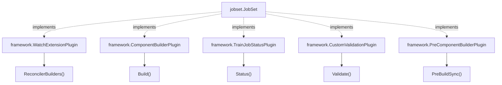
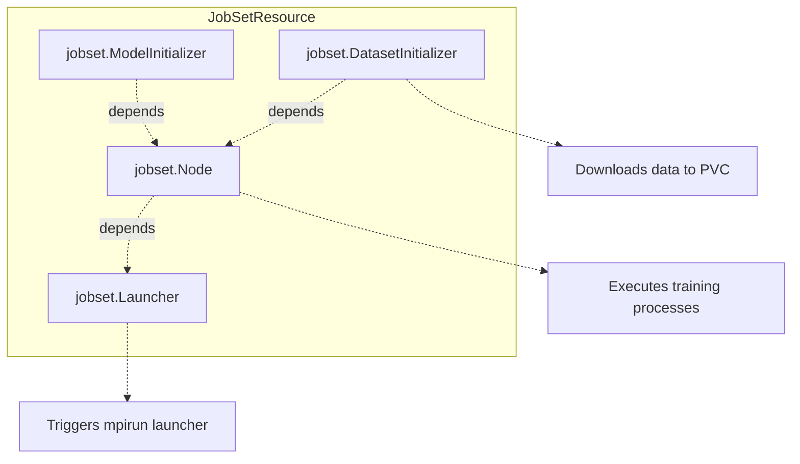
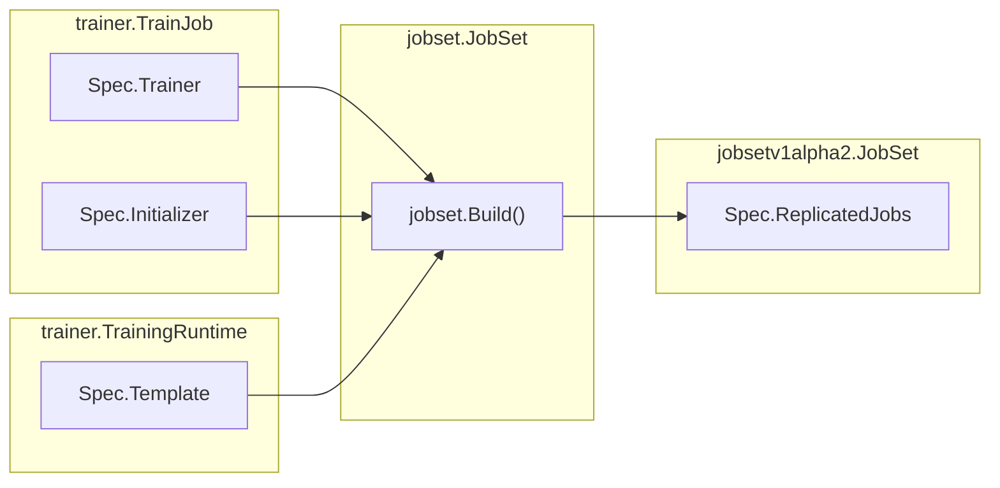

<!-- source: DeepWiki mcp.deepwiki.com · repo kubeflow/trainer · page 4.3 JobSet and Pod Orchestration · fetched 2026-10-21 -->

# JobSet and Pod Orchestration

Relevant source files

The following files were used as context for generating this wiki page:

- [pkg/apply/apply.go](pkg/apply/apply.go)
- [pkg/apply/apply_test.go](pkg/apply/apply_test.go)
- [pkg/runtime/framework/core/framework.go](pkg/runtime/framework/core/framework.go)
- [pkg/runtime/framework/interface.go](pkg/runtime/framework/interface.go)
- [pkg/runtime/framework/plugins/coscheduling/coscheduling.go](pkg/runtime/framework/plugins/coscheduling/coscheduling.go)
- [pkg/runtime/framework/plugins/jobset/jobset.go](pkg/runtime/framework/plugins/jobset/jobset.go)
- [pkg/runtime/framework/plugins/jobset/jobset_test.go](pkg/runtime/framework/plugins/jobset/jobset_test.go)
- [pkg/runtime/framework/plugins/volcano/volcano.go](pkg/runtime/framework/plugins/volcano/volcano.go)
- [pkg/runtime/runtime.go](pkg/runtime/runtime.go)

This document explains the `JobSet` integration within Kubeflow Trainer, focusing on how the `JobSet` plugin (`[pkg/runtime/framework/plugins/jobset/jobset.go:61-66]`) constructs `ReplicatedJob` definitions, manages multi-step training workflows, and orchestrates pod execution through Server-Side Apply (SSA) patterns.

## Overview

The `JobSet` plugin is the primary `ComponentBuilderPlugin` (`[pkg/runtime/framework/interface.go:76-79]`) responsible for generating the underlying `JobSet` resource (`sigs.k8s.io/jobset/api/jobset/v1alpha2`) that executes the training workload. It translates the high-level `TrainJob` specification and `TrainingRuntime` templates into a structured Kubernetes JobSet, handling initializers, trainer nodes, and launcher pods (for MPI/DeepSpeed).

Sources: `[pkg/runtime/framework/plugins/jobset/jobset.go:68-72]()`, `[pkg/runtime/framework/interface.go:76-79]()`

## Plugin Architecture and Interfaces

The `JobSet` struct defined in `[pkg/runtime/framework/plugins/jobset/jobset.go:61-66]()` implements multiple framework interfaces to integrate with the `TrainJobReconciler` execution pipeline:

Title: "JobSetPluginFrameworkMapping"

Sources: `[pkg/runtime/framework/plugins/jobset/jobset.go:61-89]()`, `[pkg/runtime/framework/interface.go:30-84]()`

## JobSet Multi-step Workflow

Kubeflow Trainer uses JobSet's `ReplicatedJobs` and dependency features to create a sequential or parallel execution graph. A typical distributed training job consists of initialization stages followed by the actual training stage.

Title: "JobSetReplicatedJobDependencyGraph"

### Execution Roles

| ReplicatedJob Name | Code Constant | Purpose | Dependency Logic |
| :--- | :--- | :--- | :--- |
| `dataset-initializer` | `constants.DatasetInitializer` | Downloads datasets to a shared volume. | Starts immediately. |
| `model-initializer` | `constants.ModelInitializer` | Downloads model checkpoints/weights. | Starts immediately. |
| `node` | `constants.Node` | The training workers (e.g., PyTorch nodes). | Depends on initializers completion. |
| `launcher` | `constants.Launcher` | Orchestrator for MPI/DeepSpeed. | Depends on `node` pods being ready. |

Sources: `[pkg/runtime/framework/plugins/jobset/jobset.go:91-170]()`, `[pkg/runtime/framework/plugins/jobset/jobset_test.go:88-202]()`

## Construction and Merging Logic

The `Build()` function in the `JobSet` plugin (`[pkg/runtime/framework/plugins/jobset/jobset.go:69-70]()`) is responsible for merging the `TrainingRuntime` template with the user-provided `TrainJob` configuration.

### PodSet Synchronization

The plugin iterates through `info.TemplateSpec.PodSets` (defined in `[pkg/runtime/runtime.go:55-61]()`) and synchronizes them with the `ReplicatedJobs` in the JobSet `ApplyConfiguration`:
1. **Replica Count:** Setting `Parallelism` and `Completions` based on `PodSet.Count`. If the `ReplicatedJob` name is `node`, it respects the `TrainJob` trainer's `NumNodes` setting (`[pkg/runtime/framework/plugins/jobset/jobset_test.go:88-142]()`).
2. **Volume Merging:** Using `apply.UpsertVolumes` (`[pkg/apply/apply.go:49-53]()`) to merge volumes from the runtime and initializers.
3. **Container Merging:** Injecting environment variables (like `STORAGE_URI`), ports, and volume mounts into each container (`[pkg/apply/apply.go:37-59]()`).

### The Builder Pattern

The `JobSet` builder provides a fluent API for final JobSet assembly:
* **Initializer integration:** Configures initializer containers with `STORAGE_URI` and environment variables from `TrainJob.Spec.Initializer`.
* **Trainer integration:** Overrides the training container (named `node`) with user-specified images, commands, and resource requirements from `TrainJob.Spec.Trainer`.

Title: "TrainJobToJobSetDataFlowMapping"

Sources: `[pkg/runtime/runtime.go:36-91]()`, `[pkg/apply/apply.go:37-84]()`, `[pkg/runtime/framework/plugins/jobset/jobset.go:69-70]()`

## Pod Network and DNS

Distributed training requires predictable network endpoints. The `JobSet` plugin generates these addresses during reconciliation.

The generated endpoints follow the pattern:
`{TrainJob.Name}-{ReplicatedJob.Name}-{ReplicaIndex}-{PodIndex}.{Subdomain}`

Example for a TrainJob named `mnist` and a node index `1`:
`mnist-node-0-1.mnist`

These endpoints are stored in `info.TemplateSpec.PodSets[].Endpoints` as an iterator (`iter.Seq[string]`), which other plugins (like Torch or MPI) consume to set `MASTER_ADDR` or generate hostfiles (`[pkg/runtime/runtime.go:77]`, `[pkg/runtime/framework/plugins/jobset/jobset_test.go:154-165]()`).

Sources: `[pkg/runtime/runtime.go:63-81]()`, `[pkg/runtime/framework/plugins/jobset/jobset_test.go:154-221]()`

## Server-Side Apply (SSA) Patterns

The `TrainJobReconciler` uses Server-Side Apply to manage the JobSet resource. This allows multiple controllers (Trainer, JobSet controller, and external managers like Kueue or Volcano) to collaborate on the same object without conflict.

* **Field Ownership:** The Trainer controller claims ownership of the JobSet using manager field validation.
* **Validation:** The plugin performs custom validation via `Validate()` (`[pkg/runtime/framework/plugins/jobset/jobset.go:91-170]()`) to ensure `RuntimePatches` do not attempt to modify immutable fields or reference non-existent `ReplicatedJobs`.
* **RBAC:** The controller manager requires extensive RBAC permissions for `jobset.x-k8s.io` resources (`[pkg/runtime/framework/plugins/jobset/jobset.go:76]()`).

Sources: `[pkg/runtime/framework/plugins/jobset/jobset.go:76-172]`, `[pkg/runtime/framework/plugins/jobset/jobset_test.go:53-100]()`

## Status Orchestration

The plugin translates JobSet's status into unified `TrainJobStatus` conditions.

| JobSet Condition | TrainJob Condition | Description |
| :--- | :--- | :--- |
| `Completed` | `TrainJobComplete` | All ReplicatedJobs finished successfully. |
| `Failed` | `TrainJobFailed` | One or more ReplicatedJobs failed. |

The plugin copies the granular status of each ReplicatedJob (Ready, Succeeded, Failed, Active) into `TrainJob.Status.JobsStatus` for observability.

Sources: `[pkg/runtime/framework/plugins/jobset/jobset.go:61-89]()`

---

