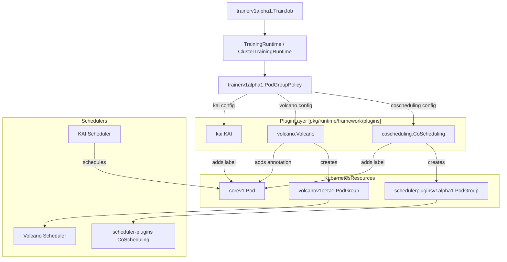
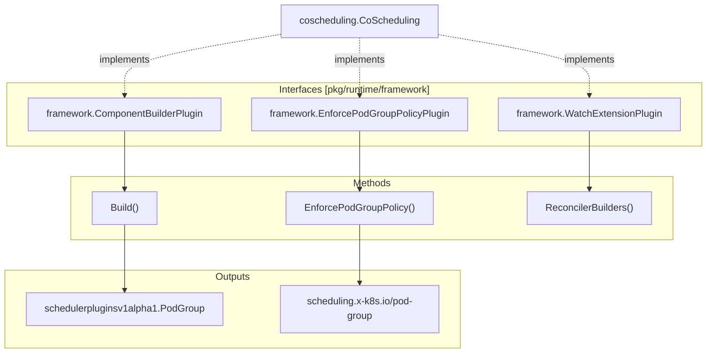
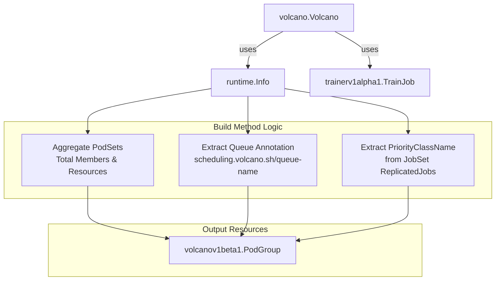

<!-- source: DeepWiki mcp.deepwiki.com · repo kubeflow/trainer · page 4.4 Gang Scheduling and PodGroups · fetched 2026-10-21 -->

# Gang Scheduling and PodGroups

<details>
<summary>Relevant source files</summary>

The following files were used as context for generating this wiki page:

- [docs/operator-guides/job-scheduling/slurm-bridge.md](docs/operator-guides/job-scheduling/slurm-bridge.md)
- [examples/README.md](examples/README.md)
- [examples/yaml/01-multi-node.yaml](examples/yaml/01-multi-node.yaml)
- [examples/yaml/04-volcano-integration.yaml](examples/yaml/04-volcano-integration.yaml)
- [examples/yaml/05-multi-step.yaml](examples/yaml/05-multi-step.yaml)
- [examples/yaml/README.md](examples/yaml/README.md)
- [pkg/runtime/framework/plugins/coscheduling/coscheduling_test.go](pkg/runtime/framework/plugins/coscheduling/coscheduling_test.go)
- [pkg/runtime/framework/plugins/volcano/volcano_test.go](pkg/runtime/framework/plugins/volcano/volcano_test.go)

</details>


## Purpose and Scope

This document describes the gang scheduling support in Kubeflow Trainer through `PodGroup` resources and specialized scheduler integrations. Gang scheduling ensures that all pods in a distributed training job are scheduled together as a unit, preventing resource deadlocks and partial scheduling failures when working with expensive accelerator resources. Three gang-scheduling plugins are supported: `CoScheduling` (from Kubernetes scheduler-plugins), `Volcano`, and the `KAI` Scheduler, alongside integrations with Kueue and Slurm Bridge.

Sources: [docs/operator-guides/job-scheduling/slurm-bridge.md:1-21](), [pkg/runtime/framework/plugins/coscheduling/coscheduling_test.go:1-41]()

---

## Gang Scheduling Overview

Gang scheduling addresses a critical challenge in distributed training: ensuring that all nodes required for a training job are scheduled atomically. Without gang scheduling, partial pod scheduling can lead to resource deadlocks where some pods are scheduled but cannot proceed without others, resulting in wasted resources and training failures.

Kubeflow Trainer implements gang scheduling through the `PodGroupPolicy` specification in runtime configurations. A `PodGroup` is a scheduling primitive that groups pods together and ensures they are scheduled as a unit with a specified minimum number of members.

### Gang Scheduling Architecture

The following diagram illustrates the relationship between the `trainerv1alpha1.TrainJob` controller, runtime framework plugins, and underlying scheduling resources, bridging natural language concepts to Go code entities.

Title: Gang Scheduling Data Flow


Sources: [examples/yaml/04-volcano-integration.yaml:37-64](), [pkg/runtime/framework/plugins/coscheduling/coscheduling_test.go:122-183]()

---

## PodGroupPolicy Configuration

The `PodGroupPolicy` field in `TrainingRuntime` and `ClusterTrainingRuntime` specs enables gang scheduling. Only one plugin configuration can be specified at a time.

### Configuration Structure

The configuration is defined in the `PodGroupPolicy` struct within the Trainer API, as demonstrated in Volcano and Slurm-enabled runtime manifests.

```yaml
apiVersion: trainer.kubeflow.org/v1alpha1
kind: ClusterTrainingRuntime
metadata:
  name: torch-distributed-gang
spec:
  mlPolicy:
    numNodes: 1
    torch: {}
  podGroupPolicy:
    # Option 1: CoScheduling plugin
    coscheduling:
      scheduleTimeoutSeconds: 60
    
    # Option 2: Volcano plugin
    volcano: {}

    # Option 3: KAI Scheduler plugin
    kai: {}
```

### CoScheduling Configuration

| Field | Type | Default | Description |
|-------|------|---------|-------------|
| `scheduleTimeoutSeconds` | `int32` | `60` | Maximum duration to schedule `PodGroup` for gang scheduling. |

### Volcano Configuration

Volcano integration supports advanced features like priority queues, resource management, and topology-aware scheduling.

| Field | Type | Description |
|-------|------|-------------|
| `Queue` | `string` | Specified via `scheduling.volcano.sh/queue-name` annotation in the runtime. |
| `PriorityClass` | `string` | Extracted from the Pod template spec within ReplicatedJobs. |

Sources: [examples/yaml/04-volcano-integration.yaml:37-49](), [pkg/runtime/framework/plugins/volcano/volcano_test.go:124-177]()

---

## CoScheduling Plugin Implementation

The `coscheduling.CoScheduling` plugin integrates with the Kubernetes `scheduler-plugins` implementation. It implements framework interfaces to inject scheduling metadata and create required resources.

### Plugin Structure

Title: CoScheduling Plugin Code Entities


Sources: [pkg/runtime/framework/plugins/coscheduling/coscheduling_test.go:35-41](), [pkg/runtime/framework/plugins/coscheduling/coscheduling_test.go:122-183]()

### Pod Label Assignment

The `EnforcePodGroupPolicy` method adds the required label `scheduling.x-k8s.io/pod-group` (represented by `schedulerpluginsv1alpha1.PodGroupLabel`) to the runtime scheduler object. These labels are later propagated to all training pods by the JobSet controller.

Sources: [pkg/runtime/framework/plugins/coscheduling/coscheduling_test.go:151-155]()

---

## Volcano Plugin Implementation

The `volcano.Volcano` plugin provides gang scheduling through the Volcano scheduler, with support for priority classes, resource management, and topology-aware scheduling.

### Plugin Logic and Data Flow

Title: Volcano Plugin Code Entities and Data Flow


Sources: [pkg/runtime/framework/plugins/volcano/volcano_test.go:43-52](), [pkg/runtime/framework/plugins/volcano/volcano_test.go:124-177]()

### Resource Aggregation

Both plugins calculate the total resource requirements for the entire gang by aggregating requests from all `PodSets` defined in the `runtime.Info` object and managing CPU/memory allocations.

Sources: [pkg/runtime/framework/plugins/volcano/volcano_test.go:90-112](), [pkg/runtime/framework/plugins/coscheduling/coscheduling_test.go:184-210]()

### Priority and Queue Management

The Volcano plugin explicitly supports:
1. **Queue Assignment**: Configured via the `scheduling.volcano.sh/queue-name` annotation on the `TrainJob` or `TrainingRuntime`.
2. **Priority Classes**: Extracts the `PriorityClassName` from the `JobSet` template and applies it to the `PodGroup` [pkg/runtime/framework/plugins/volcano/volcano_test.go:76-80]().
3. **Validation**: Validates priority classes and ensures atomic group scheduling through `volcanov1beta1.PodGroup` specifications [pkg/runtime/framework/plugins/volcano/volcano_test.go:152-173]().

Sources: [pkg/runtime/framework/plugins/volcano/volcano_test.go:76-88](), [pkg/runtime/framework/plugins/volcano/volcano_test.go:152-173]()

---

## Slurm Bridge Integration

Kubeflow Trainer supports scheduling distributed training jobs on hybrid Kubernetes and Slurm clusters using the `Slurm Bridge`. This integration utilizes the `CoScheduling` plugin's `PodGroup` API [docs/operator-guides/job-scheduling/slurm-bridge.md:3-9]().

### Workflow
1. **PodGroup Creation**: Trainer creates a `PodGroup` for the `TrainJob` and adds every generated Pod to that group [docs/operator-guides/job-scheduling/slurm-bridge.md:7-9]().
2. **Slurm Submission**: The Slurm Bridge submits the group as a single external Slurm job.
3. **Binding**: Once Slurm allocates nodes, Slurm Bridge binds the Kubernetes Pods to those specific nodes [docs/operator-guides/job-scheduling/slurm-bridge.md:8-9]().

Sources: [docs/operator-guides/job-scheduling/slurm-bridge.md:1-21]()

---

## PodGroup Lifecycle and Watches

To ensure the `TrainJob` status is updated when a `PodGroup` changes (e.g., when it becomes scheduled or fails), the plugins implement watch extensions and ownership references.

### Immutable Creation

The plugins check for the existence of the `PodGroup` before attempting creation. If it already exists, creation is skipped unless the `TrainJob` is suspended.

Sources: [pkg/runtime/framework/plugins/volcano/volcano_test.go:178-203]()

---

## Integration with Kueue and External Controllers

Kubeflow Trainer supports integration with external resource managers and queueing systems like Kueue [examples/yaml/README.md:21-21](). When a `TrainJob` is managed by an external system, the controller respects the `spec.suspend` field.

The framework provides interfaces which allow plugins to modify runtime parameters before final objects are built, ensuring scheduling metadata (like labels for KAI or annotations for Volcano) are correctly applied to the generated `JobSet`.

Sources: [examples/yaml/README.md:17-24](), [pkg/runtime/framework/plugins/volcano/volcano_test.go:178-185]()

---

