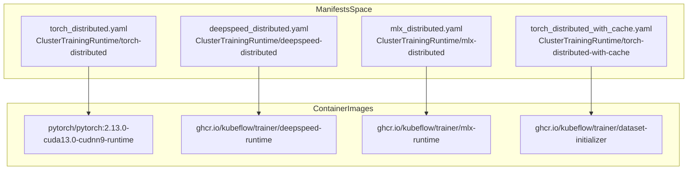
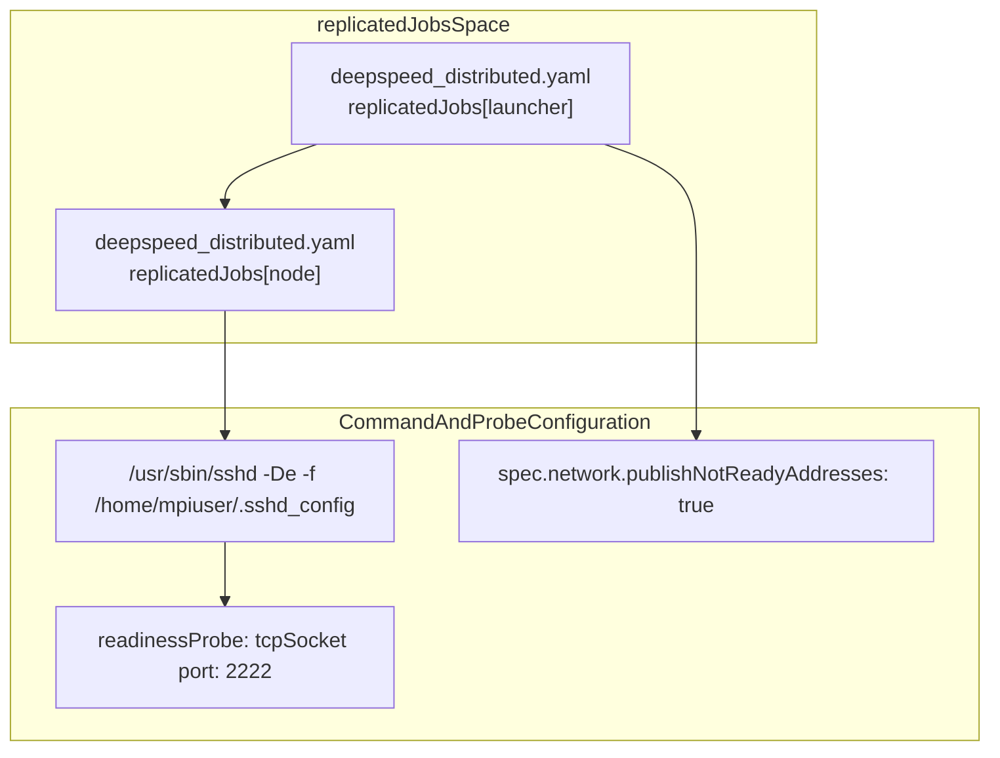

<!-- source: DeepWiki mcp.deepwiki.com · repo kubeflow/trainer · page 4.5 Predefined Runtime Definitions · fetched 2026-10-21 -->

# Predefined Runtime Definitions

Relevant source files

The following files were used as context for generating this wiki page:

- [charts/kubeflow-trainer/README.md.gotmpl](charts/kubeflow-trainer/README.md.gotmpl)
- [charts/kubeflow-trainer/files/runtimes/deepspeed-distributed.yaml](charts/kubeflow-trainer/files/runtimes/deepspeed-distributed.yaml)
- [charts/kubeflow-trainer/files/runtimes/mlx-distributed.yaml](charts/kubeflow-trainer/files/runtimes/mlx-distributed.yaml)
- [charts/kubeflow-trainer/files/runtimes/torch-distributed-with-cache.yaml](charts/kubeflow-trainer/files/runtimes/torch-distributed-with-cache.yaml)
- [charts/kubeflow-trainer/files/runtimes/torch-distributed.yaml](charts/kubeflow-trainer/files/runtimes/torch-distributed.yaml)
- [charts/kubeflow-trainer/tests/runtimes/deepspeed_distributed_test.yaml](charts/kubeflow-trainer/tests/runtimes/deepspeed_distributed_test.yaml)
- [charts/kubeflow-trainer/tests/runtimes/mlx_distributed_test.yaml](charts/kubeflow-trainer/tests/runtimes/mlx_distributed_test.yaml)
- [charts/kubeflow-trainer/tests/runtimes/torch_distributed_test.yaml](charts/kubeflow-trainer/tests/runtimes/torch_distributed_test.yaml)
- [charts/kubeflow-trainer/tests/runtimes/torch_distributed_with_cache_test.yaml](charts/kubeflow-trainer/tests/runtimes/torch_distributed_with_cache_test.yaml)
- [cmd/runtimes/deepspeed/Dockerfile](cmd/runtimes/deepspeed/Dockerfile)
- [cmd/runtimes/deepspeed/requirements.txt](cmd/runtimes/deepspeed/requirements.txt)
- [cmd/runtimes/mlx/Dockerfile](cmd/runtimes/mlx/Dockerfile)
- [cmd/runtimes/mlx/requirements.txt](cmd/runtimes/mlx/requirements.txt)
- [examples/jax/image-classification/mnist.ipynb](examples/jax/image-classification/mnist.ipynb)
- [examples/pytorch/image-classification/mnist.ipynb](examples/pytorch/image-classification/mnist.ipynb)
- [manifests/base/runtimes/data-cache/torch_distributed_with_cache.yaml](manifests/base/runtimes/data-cache/torch_distributed_with_cache.yaml)
- [manifests/base/runtimes/deepspeed_distributed.yaml](manifests/base/runtimes/deepspeed_distributed.yaml)
- [manifests/base/runtimes/mlx_distributed.yaml](manifests/base/runtimes/mlx_distributed.yaml)
- [manifests/base/runtimes/torch_distributed.yaml](manifests/base/runtimes/torch_distributed.yaml)

This page provides a high-level overview of the built-in `ClusterTrainingRuntime` resources supplied by Kubeflow Trainer. These predefined configurations bundle ML framework orchestration parameters, container images, dependencies, and pod templates to support distributed training across PyTorch, DeepSpeed, MLX, JAX, XGBoost, and data-cached variants. Platform administrators can deploy these runtimes globally or adapt them for namespace-scoped use via `TrainingRuntime` objects.

For runtime API specifications, see [TrainingRuntime and ClusterTrainingRuntime APIs](#2.2). For details on the runtime reconciliation pipeline, see [TrainJob Lifecycle and Controller](#2.3).

Sources: [manifests/base/runtimes/torch_distributed.yaml:15-38](), [manifests/base/runtimes/deepspeed_distributed.yaml:15-77]()

## Overview of Predefined Runtimes

The predefined `ClusterTrainingRuntime` resources included in the codebase cover major deep learning frameworks and specialized distributed workflows:

| Runtime Name | Framework | Trainer Type | Base Image | Primary Use Case | Multi-Node Support |
|-------------|-----------|--------------|------------|------------------|-------------------|
| `torch-distributed` | PyTorch | `CustomTrainer` | `pytorch/pytorch:2.13.0-cuda13.0-cudnn9-runtime` | General PyTorch DDP training | Yes |
| `deepspeed-distributed` | DeepSpeed | `CustomTrainer` | `ghcr.io/kubeflow/trainer/deepspeed-runtime` | Large model training with ZeRO optimization | Yes (via OpenMPI) |
| `mlx-distributed` | MLX | `CustomTrainer` | `ghcr.io/kubeflow/trainer/mlx-runtime` | Apple Silicon and CUDA distributed training | Yes (via OpenMPI) |
| `jax-distributed` | JAX | `CustomTrainer` | `nvcr.io/nvidia/jax:25.10-py3` | JAX/Flax XLA parallel training | Yes |
| `xgboost-distributed` | XGBoost | `CustomTrainer` | `ghcr.io/kubeflow/trainer/xgboost-runtime` | Distributed Gradient Boosting via Rabit | Yes |
| `torchtune-llama3.2-1b` | TorchTune | `BuiltinTrainer` | `ghcr.io/kubeflow/trainer/torchtune-trainer` | LLM fine-tuning (Llama 3.2 1B) | Yes (See [TorchTune Runtime Definitions](#4.5.1)) |
| `torch-distributed-with-cache` | PyTorch | `CustomTrainer` | `pytorch/pytorch:2.13.0-cuda13.0-cudnn9-runtime` | PyTorch DDP training with zero-copy data cache | Yes |

Sources: [manifests/base/runtimes/torch_distributed.yaml:15-38](), [manifests/base/runtimes/deepspeed_distributed.yaml:15-77](), [manifests/base/runtimes/mlx_distributed.yaml:15-77](), [manifests/base/runtimes/data-cache/torch_distributed_with_cache.yaml:15-69]()

## Runtime Architecture

The following diagram maps the predefined runtime YAML definitions to their corresponding container image entities used in the cluster control plane.

### Runtime Manifest to Container Entity Mapping

Sources: [manifests/base/runtimes/torch_distributed.yaml:15-38](), [manifests/base/runtimes/deepspeed_distributed.yaml:15-47](), [manifests/base/runtimes/mlx_distributed.yaml:15-47](), [manifests/base/runtimes/data-cache/torch_distributed_with_cache.yaml:15-44]()

## PyTorch and TorchTune Runtimes

### torch-distributed
The `torch-distributed` runtime provides foundational support for PyTorch Distributed Data Parallel (DDP) training workloads. It configures the `torch` ML policy block and uses the `pytorch/pytorch:2.13.0-cuda13.0-cudnn9-runtime` image inside a single `node` replicated job [manifests/base/runtimes/torch_distributed.yaml:18-38]().

### TorchTune Runtimes
TorchTune runtimes target parameter-efficient LLM fine-tuning using `BuiltinTrainer`. They orchestrate multi-step workflows incorporating dataset initialization, model weight preparation, and distributed training recipes. For complete details, see [TorchTune Runtime Definitions](#4.5.1).

Sources: [manifests/base/runtimes/torch_distributed.yaml:15-38]()

## MPI-based Runtimes (DeepSpeed and MLX)

The `deepspeed-distributed` and `mlx-distributed` runtimes leverage an OpenMPI architecture with SSH-based worker coordination [manifests/base/runtimes/deepspeed_distributed.yaml:24-28](), [manifests/base/runtimes/mlx_distributed.yaml:24-28](). They define separate `launcher` and `node` replicated jobs where workers run an SSH daemon (`sshd`) with readiness checks on port `2222` [manifests/base/runtimes/deepspeed_distributed.yaml:37-64](), [manifests/base/runtimes/mlx_distributed.yaml:37-64]().

### MPI Runtime Orchestration Entity Mapping

Sources: [manifests/base/runtimes/deepspeed_distributed.yaml:37-64](), [manifests/base/runtimes/mlx_distributed.yaml:37-64]()

### deepspeed-distributed
Optimized for large-scale model training via ZeRO memory optimization. It sets `runLauncherAsNode: true` under the `mpi` MLPolicy and depends on worker readiness [manifests/base/runtimes/deepspeed_distributed.yaml:22-28](). The container environment includes `torch`, `deepspeed`, and `mpi4py` [cmd/runtimes/deepspeed/requirements.txt:1-5]().

Sources: [manifests/base/runtimes/deepspeed_distributed.yaml:15-77](), [cmd/runtimes/deepspeed/requirements.txt:1-5]()

### mlx-distributed
Provides distributed execution for MLX-based architectures using `publishNotReadyAddresses` to support peer networking [manifests/base/runtimes/mlx_distributed.yaml:31-32](). The runtime container bundles `mlx`, `mlx-data`, and `mlx-lm` libraries [cmd/runtimes/mlx/requirements.txt:1-4]().

Sources: [manifests/base/runtimes/mlx_distributed.yaml:15-77](), [cmd/runtimes/mlx/requirements.txt:1-4]()

## JAX and XGBoost Runtimes

### jax-distributed
The `jax-distributed` runtime supports XLA-parallel workloads in JAX and Flax. It coordinates processes by injecting environment variables such as `JAX_COORDINATOR_ADDRESS`, `JAX_PROCESS_ID`, and `JAX_NUM_PROCESSES` which are consumed during `jax.distributed.initialize()` [examples/jax/image-classification/mnist.ipynb:101-109]().

Sources: [examples/jax/image-classification/mnist.ipynb:101-109]()

### xgboost-distributed
The `xgboost-distributed` runtime uses XGBoost's Rabit protocol for tree-based distributed gradient boosting, mapped via the `trainer.kubeflow.org/framework: xgboost` label selector.

Sources: [manifests/base/runtimes/torch_distributed.yaml:19-20]()

## Data Cache Enhanced Runtimes

### torch-distributed-with-cache
The `torch-distributed-with-cache` runtime integrates the distributed data caching subsystem. It defines a multi-step workflow starting with a `dataset-initializer` job that provisions the cache image before initiating training [manifests/base/runtimes/data-cache/torch_distributed_with_cache.yaml:28-53]().

**Execution Flow:**
1. **dataset-initializer**: Uses the `kubeflow-trainer-cache-initializer` service account to mount storage and execute the dataset setup using `ghcr.io/kubeflow/trainer/dataset-initializer` [manifests/base/runtimes/data-cache/torch_distributed_with_cache.yaml:38-44]().
2. **node**: The PyTorch training pods which declare a dependency on the `dataset-initializer` reaching `Complete` status [manifests/base/runtimes/data-cache/torch_distributed_with_cache.yaml:50-53]().

Sources: [manifests/base/runtimes/data-cache/torch_distributed_with_cache.yaml:15-69](), [charts/kubeflow-trainer/tests/runtimes/torch_distributed_with_cache_test.yaml:44-64]()

---

