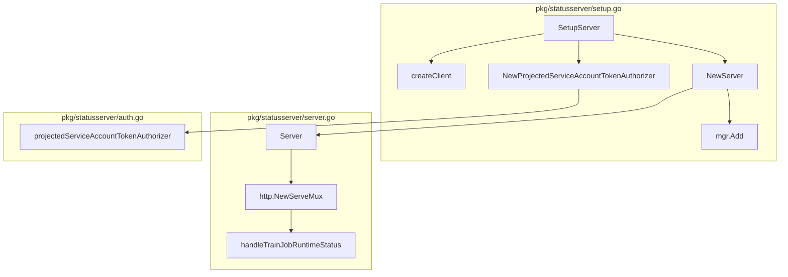
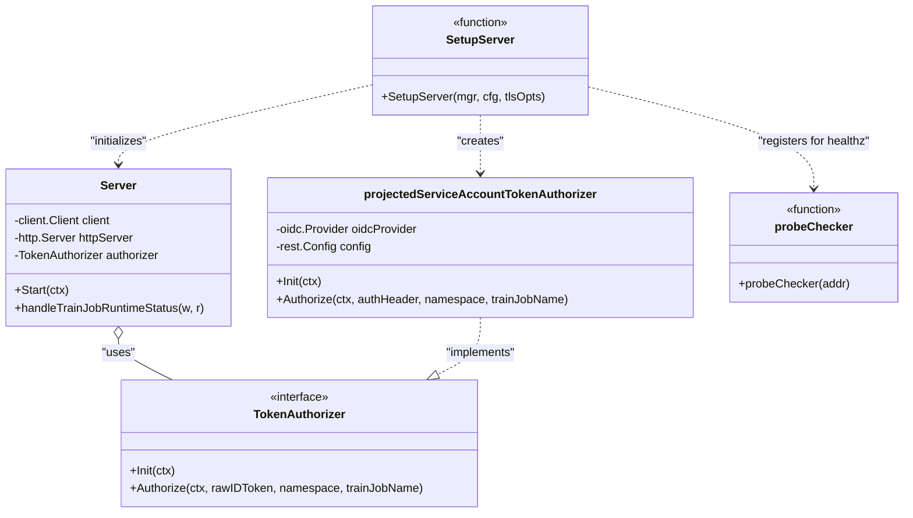

<!-- source: DeepWiki mcp.deepwiki.com · repo kubeflow/trainer · page 4.6 TrainJob Status Server · fetched 2026-10-21 -->

# TrainJob Status Server

Relevant source files

The following files were used as context for generating this wiki page:

- [pkg/runtime/framework/plugins/trainjobstatus/trainjobstatus_test.go](pkg/runtime/framework/plugins/trainjobstatus/trainjobstatus_test.go)
- [pkg/statusserver/auth.go](pkg/statusserver/auth.go)
- [pkg/statusserver/auth_test.go](pkg/statusserver/auth_test.go)
- [pkg/statusserver/server.go](pkg/statusserver/server.go)
- [pkg/statusserver/server_test.go](pkg/statusserver/server_test.go)
- [pkg/statusserver/setup.go](pkg/statusserver/setup.go)
- [pkg/statusserver/setup_test.go](pkg/statusserver/setup_test.go)
- [pkg/statusserver/utils_test.go](pkg/statusserver/utils_test.go)
- [test/integration/statusserver/server_test.go](test/integration/statusserver/server_test.go)
- [test/integration/statusserver/suite_test.go](test/integration/statusserver/suite_test.go)

The TrainJob Status Server is a specialized runtime component within Kubeflow Trainer (located in `pkg/statusserver`) that facilitates real-time monitoring of training progress. It provides an HTTP-based API for training processes (running within Pods) to report granular metrics, progress percentages, and estimated time remaining directly to the `TrainJob` status.

Sources: [`pkg/statusserver/server.go:1-59`](), [`pkg/statusserver/setup.go:40-62`]()

## Purpose and Architecture

While Kubernetes natively tracks Pod and Job phases, it does not capture application-level training progress (e.g., loss, accuracy, or epoch completion). The Status Server bridges this gap by allowing the trainer process to push updates. This component is integrated into the controller manager and provides visibility with zero external dependencies like Prometheus or MLFlow.

The server is initialized within the controller manager's `SetupServer` function if the `TrainJobStatus` feature gate is enabled [pkg/statusserver/setup.go:40-62]().

### Data Flow

1. **Training Process**: The user code (e.g., using the Kubeflow Trainer Python SDK or raw HTTP POST) sends an HTTPS request to the Status Server.
2. **Status Server**: Validates the request using OIDC-based token authorization via `TokenAuthorizer.Authorize` [pkg/statusserver/auth.go:31-34](), [pkg/statusserver/server.go:154-162]().
3. **Controller**: The server updates the `TrainJob` custom resource's `status.trainerStatus` field using a dedicated client with configurable rate limits [pkg/statusserver/setup.go:46-51](), [pkg/statusserver/server.go:188-190]().
4. **Persistence**: The state is reflected in the `TrainJob` status subresource, where it can be consumed by SDKs or dashboards.

### Code Entity Map: Server Initialization

The following diagram illustrates how the Status Server is constructed and registered as a `Runnable` with the `ctrl.Manager`.

Sources: [`pkg/statusserver/setup.go:40-62`](), [`pkg/statusserver/server.go:67-110`](), [`pkg/statusserver/auth.go:54-58`]()

## API Specification

The Status Server implements the `UpdateTrainJobStatus` endpoint [pkg/statusserver/server.go:87](). The request body is parsed into `trainer.UpdateTrainJobStatusRequest` [pkg/statusserver/server.go:165]() to update the `TrainerStatus` in the `TrainJob` object.

### HTTP Endpoints
The server handles route patterns using `http.NewServeMux()` [pkg/statusserver/server.go:86-88]():
* `POST /apis/trainer.kubeflow.org/v1alpha1/namespaces/{namespace}/trainjobs/{name}/status`: The primary endpoint for status updates, handled by `handleTrainJobRuntimeStatus` [pkg/statusserver/server.go:87](), [pkg/statusserver/server.go:149-197]().
* `/`: Default fallback handler [pkg/statusserver/server.go:88]().

### TrainerStatus Fields

The `TrainerStatus` struct (sent via `UpdateTrainJobStatusRequest` [pkg/statusserver/server.go:165]()) contains the actual payload of the training progress.

| Field | Type | Description |
| :--- | :--- | :--- |
| `ProgressPercentage` | `*int32` | Completion progress (0-100). |
| `EstimatedRemainingSeconds` | `*int64` | Estimated time until completion. |
| `Metrics` | `[]Metric` | List of key-value pairs for training metrics. |
| `LastUpdatedTime` | `metav1.Time` | Timestamp when the status was observed. |

Sources: [`pkg/statusserver/server.go:165-181`](), [`pkg/statusserver/utils_test.go:54-81`]()

## TrainJobStatus Plugin

The `TrainJobStatus` plugin is responsible for injecting the necessary credentials and configuration into the trainer containers so they can communicate with the Status Server.

### Credential Injection
The plugin performs the following:

1. **Environment Variables**: Injects environment variables (`KUBEFLOW_TRAINER_STATUS_URL`, `KUBEFLOW_TRAINER_STATUS_CA_CERT`, and `KUBEFLOW_TRAINER_STATUS_TOKEN`) into trainer containers [pkg/runtime/framework/plugins/trainjobstatus/trainjobstatus_test.go:110-119]().
2. **Volumes**: Creates a projected volume containing the ServiceAccount token with specific audience (`TokenAudience(namespace, name)`) and the CA certificate ConfigMap [pkg/runtime/framework/plugins/trainjobstatus/trainjobstatus_test.go:129-154]().
3. **Targeting**: The plugin specifically targets containers where the PodSet ancestor is `constants.AncestorTrainer` [pkg/runtime/framework/plugins/trainjobstatus/trainjobstatus_test.go:86-90]().

Sources: [`pkg/statusserver/utils_test.go:25-52`](), [`pkg/runtime/framework/plugins/trainjobstatus/trainjobstatus_test.go:81-159`]()

## Configuration and Deployment

The Status Server is part of the controller manager and its behavior is controlled via the `StatusServer` configuration struct [pkg/statusserver/setup.go:40]().

### Runtime Configuration

| Field | Type | Description |
| :--- | :--- | :--- |
| `Port` | `*int32` | TCP port for the status server [pkg/statusserver/setup.go:70-73](). |
| `QPS` | `*float32` | Maximum QPS for the server's dedicated K8s client [pkg/statusserver/setup.go:109-111](). |
| `Burst` | `*int32` | Maximum burst for the server's dedicated K8s client [pkg/statusserver/setup.go:112-114](). |

The server uses a dedicated Kubernetes client created via `createClient` to ensure status updates do not consume the quota of the main reconciliation loop [pkg/statusserver/setup.go:46-51](), [pkg/statusserver/setup.go:106-125]().

### Probes and Health
The server integrates with the controller manager's health check system:
* `RegisterProbes`: Adds `status-server-healthz` and `status-server-readyz` checks to the manager [pkg/statusserver/setup.go:70-82]().
* `probeChecker`: Verifies the server is accepting TLS connections by performing a TLS dial with `InsecureSkipVerify: true` [pkg/statusserver/setup.go:86-104]().

Sources: [`pkg/statusserver/setup.go:40-125`](), [`pkg/statusserver/server.go:97-105`]()

## Security and Authentication

The Status Server enforces multiple security layers to ensure only authorized trainer Pods can update a `TrainJob`.

### TLS Encryption
All communication is encrypted via HTTPS [pkg/statusserver/server.go:133-136]().
* The server uses a TLS configuration set up via `cert.SetupTLSConfig` [pkg/statusserver/setup.go:41]() and `tlsconfig.Apply` [pkg/util/tlsconfig/tlsconfig.go:32-35]().
* The server is configured with explicit timeouts (`ReadTimeout: 10s`, `WriteTimeout: 10s`, `IdleTimeout: 120s`) to prevent resource exhaustion [pkg/statusserver/server.go:44-47](), [pkg/statusserver/server.go:102-104]().
* A request body size limit of 64kB (`maxBodySize = 1 << 16`) is enforced via `bodySizeLimitMiddleware` [pkg/statusserver/server.go:49-50](), [pkg/statusserver/server.go:94]().

### Token Authorization
Requests are authorized using Projected Service Account Tokens via the `TokenAuthorizer` interface [pkg/statusserver/auth.go:31-34]().
1. **OIDC Discovery**: The `projectedServiceAccountTokenAuthorizer` discovers the cluster's OIDC issuer URL by reading the service account token at `/var/run/secrets/kubernetes.io/serviceaccount/token` [pkg/statusserver/auth.go:132-158]().
2. **Audience Validation**: The token must have an audience scoped to the specific TrainJob status endpoint: `trainer.kubeflow.org/v1alpha1/namespaces/<ns>/trainjobs/<name>/status` (generated by `TokenAudience`) [pkg/statusserver/auth.go:91-95](), [pkg/statusserver/utils_test.go:25-52]().
3. **Namespace Bound**: The authorizer verifies the token is bound to a pod in the same namespace as the TrainJob by inspecting the `kubernetes.io.namespace` claim in the decoded JWT token [pkg/statusserver/auth.go:103-113]().

Sources: [`pkg/statusserver/auth.go:31-158`](), [`pkg/statusserver/server.go:154-162`](), [`pkg/statusserver/setup.go:40-62`]()

## Implementation Detail: Entity Association

The following diagram shows the relationship between the configuration entities, interfaces, and the runtime server implementation.

Sources: [`pkg/statusserver/setup.go:40-62`](), [`pkg/statusserver/server.go:54-59`](), [`pkg/statusserver/auth.go:31-41`](), [`pkg/statusserver/setup.go:86-104`]()

---

