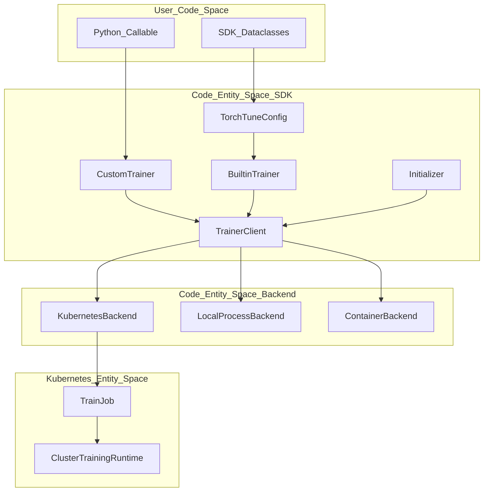
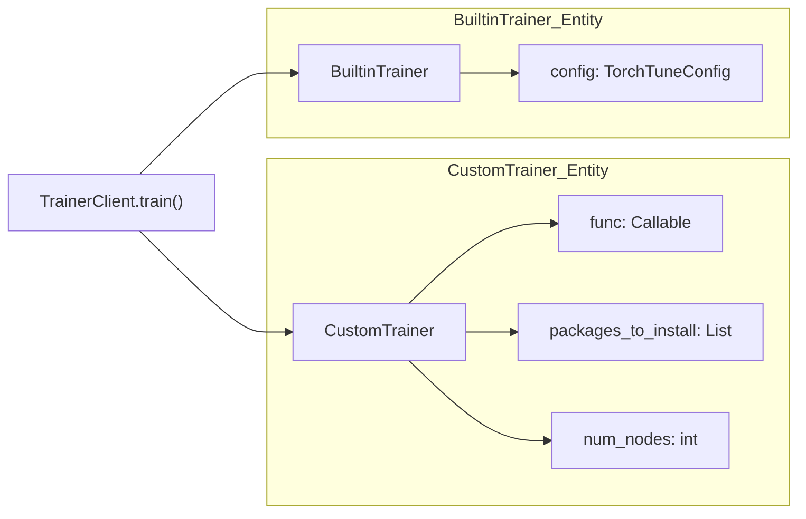
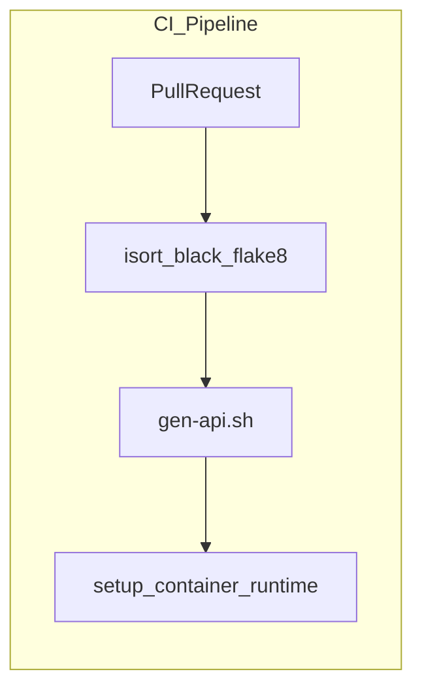

<!-- source: DeepWiki mcp.deepwiki.com · repo kubeflow/trainer · page 5 Python SDK and Client Usage · fetched 2026-10-21 -->

# Python SDK and Client Usage

Relevant source files

The following files were used as context for generating this wiki page:

- [api/python_api/pyproject.toml](api/python_api/pyproject.toml)
- [docs/user-guides/index.md](docs/user-guides/index.md)
- [docs/user-guides/trainjob-progress.md](docs/user-guides/trainjob-progress.md)

## Purpose and Scope

The Kubeflow Trainer Python SDK provides high-level APIs for programmatic interaction with the training platform, abstracting Kubernetes complexity from data scientists and ML engineers. It enables users to submit training jobs, configure distributed training, and manage LLM fine-tuning workflows without directly manipulating YAML manifests or Kubernetes resources.

The SDK includes a generated Python API client based on the OpenAPI specification [hack/python-api/gen-api.sh:44-53](), ensuring type-safe interaction with the `TrainJob` custom resource. The package is defined in `api/python_api/pyproject.toml` [api/python_api/pyproject.toml:1-11]() and depends on `pydantic` for data validation [api/python_api/pyproject.toml:27-27](). The SDK version is synchronized with the global project version [VERSION:1-1]() and managed in the package init file [api/python_api/kubeflow_trainer_api/__init__.py:16-16]().

As a parent page, this section provides a high-level overview of the Python SDK architecture and core components. For detailed technical specifications, refer to the following child pages:
- **5.1 TrainerClient API Reference**: API reference for `TrainerClient` methods including `train()`, `list_runtimes()`, `get_runtime_packages()`, `get_job_logs()`, `wait_for_job_status()`, `delete_job()`, and `ActiveDeadlineSeconds` support.
- **5.2 CustomTrainer and BuiltinTrainer**: Explain `CustomTrainer` for user-defined functions and `BuiltinTrainer` for config-driven training with `TorchTuneConfig`. Covers the `train()` API, framework selection, and `num_nodes` configuration.
- **5.3 SDK Types and Generated API Models**: Document SDK dataclasses including `Initializer`, `HuggingFaceDatasetInitializer`, `HuggingFaceModelInitializer`, `TorchTuneConfig`, `LoraConfig`, and the generated Python API client (`kubeflow_trainer_api`).
- **5.4 LLM Trainer V2 Design**: Explain LLM Trainer V2 design proposal, TorchTune integration, recipe-config abstraction, and PEFT support.
- **5.5 Local and Container Backend Configuration**: Document `LocalProcessBackendConfig` for local testing without Kubernetes, `ContainerBackendConfig` for Docker/Podman multi-node distributed training, and how to switch between backends.

Sources: [api/python_api/pyproject.toml:1-39](), [hack/python-api/gen-api.sh:41-53](), [api/python_api/kubeflow_trainer_api/__init__.py:16-16](), [VERSION:1-1]()

---

## SDK Architecture Overview

The SDK provides a layered abstraction between user code and execution environments, supporting both local development and remote Kubernetes orchestration. The core API models are generated from the `swagger.json` specification [hack/python-api/gen-api.sh:41-42]().

### System Entity Mapping

The following diagram bridges the Natural Language concepts to the specific Code Entities used in the SDK implementation.

Title: SDK to Backend Entity Mapping

**Architecture Layers:**

| Layer | Components | Purpose |
|-------|-----------|---------|
| **User Code** | Training functions, configurations | Define training logic and hyperparameters. |
| **SDK Layer** | `TrainerClient`, `CustomTrainer`, `BuiltinTrainer` | High-level API abstractions for job lifecycle. |
| **Backend Layer** | `KubernetesBackend`, `LocalProcessBackend`, `ContainerBackend` | Execution environment adapters for K8s, local processes, or containers (Docker/Podman). |
| **Kubernetes** | `TrainJob`, `TrainingRuntime` | Actual training resource orchestration and scheduling via generated models. |

Sources: [api/python_api/pyproject.toml:1-11](), [hack/python-api/gen-api.sh:37-53](), [api/python_api/kubeflow_trainer_api/__init__.py:16-16]()

---

## Core SDK Components

### TrainerClient

`TrainerClient` is the primary entry point for the SDK. It handles the translation of Python objects into `TrainJob` custom resources (when using the Kubernetes backend) or local execution units.

- **Submitting Jobs**: Using the `train()` method with selected backends or runtimes [examples/torchtune/llama3_2/alpaca-trainjob-yaml.ipynb:81-126]().
- **Monitoring & Logs**: Interacting with runtime packages and retrieving real-time logs via `get_job_logs()` and `wait_for_job_status()` [examples/torchtune/llama3_2/alpaca-trainjob-yaml.ipynb:146-184]().
- **Status Updates**: Reporting custom training progress and metrics using `update_trainjob_status()` [docs/user-guides/trainjob-progress.md:143-166]().

For detailed API definitions and method signatures, see [TrainerClient API Reference](#5.1).

Sources: [examples/torchtune/llama3_2/alpaca-trainjob-yaml.ipynb:81-184](), [docs/user-guides/trainjob-progress.md:143-166]()

### Training Paradigms

The SDK supports two distinct training approaches to balance flexibility and ease of use:

Title: Training Paradigm Selection

1. **CustomTrainer**: Designed for users who want to submit their own Python functions. The SDK packages the function and its dependencies for distributed execution. For details, see [CustomTrainer and BuiltinTrainer](#5.2).
2. **BuiltinTrainer**: A config-driven approach for standard tasks like LLM fine-tuning. It leverages integrations like `torchtune` to run standardized recipes via `TorchTuneConfig`. For details, see [CustomTrainer and BuiltinTrainer](#5.2) and [LLM Trainer V2 Design](#5.4).

Sources: [examples/torchtune/llama3_2/alpaca-trainjob-yaml.ipynb:114-126]()

---

## SDK Types, Models, and Backends

The SDK exposes several structured dataclasses and API models (`Initializer`, `HuggingFaceDatasetInitializer`, `HuggingFaceModelInitializer`, `TorchTuneConfig`, `LoraConfig`) to configure data loading, model weights, and hyperparameter policies [api/python_api/pyproject.toml:1-11](). 

Furthermore, execution backends (`LocalProcessBackendConfig`, `ContainerBackendConfig`) allow users to test training workflows locally before deploying them onto a Kubernetes cluster. For complete type definitions, see [SDK Types and Generated API Models](#5.3) and [Local and Container Backend Configuration](#5.5).

Sources: [api/python_api/pyproject.toml:1-11]()

---

## SDK Development and Quality Assurance

The SDK is subject to automated testing and linting to ensure it correctly interfaces with the Kubernetes controller.

Title: Python SDK Development Workflow

1. **Code Generation**: The API models are automatically generated from OpenAPI specs using `openapi-generator-cli` [hack/python-api/gen-api.sh:46-53](). The script `gen-api.sh` ensures copyright headers are added to all generated files [hack/python-api/gen-api.sh:71-81]().
2. **Build System**: The package uses `hatchling` as the build backend [api/python_api/pyproject.toml:34-36](). Versioning is dynamic based on the `__init__.py` file [api/python_api/pyproject.toml:38-39]().
3. **Local Execution**: The SDK allows for local development through `LocalProcessBackendConfig`, `Docker`, and `Podman` backends. The `setup_container_runtime` utility handles detection of `docker` or `podman` on the host system [hack/scripts/container-runtime.sh:23-28](). For details, see [Local and Container Backend Configuration](#5.5).
4. **Linting**: The project enforces strict code style using `black`, `isort`, and `flake8` as defined in the pre-commit configuration [.pre-commit-config.yaml:25-38]().

Sources: [api/python_api/pyproject.toml:1-39](), [hack/python-api/gen-api.sh:1-81](), [.pre-commit-config.yaml:25-38]()

---

