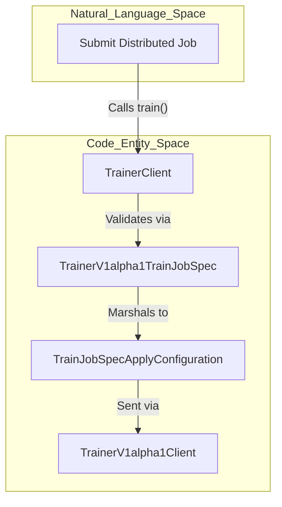
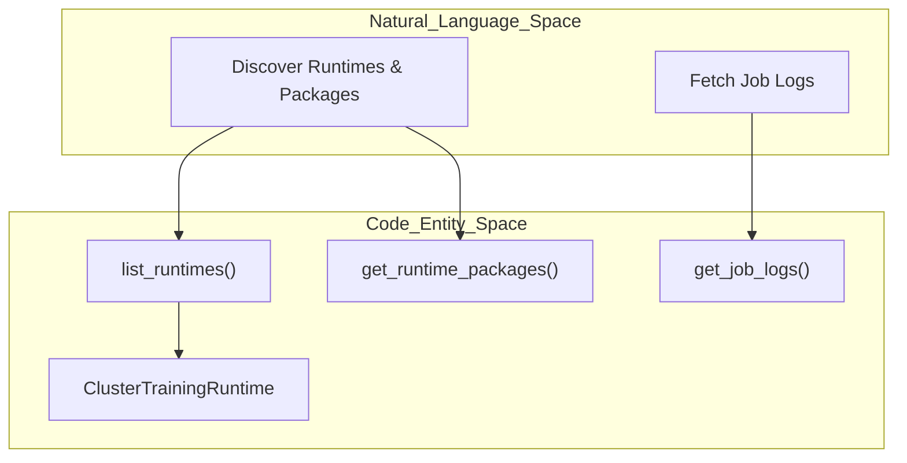
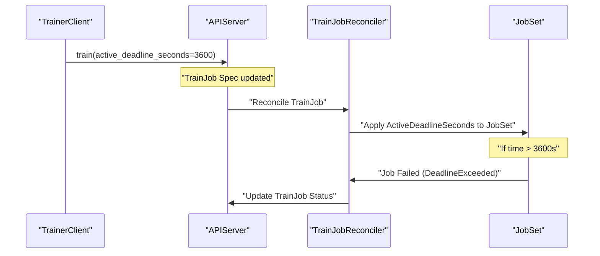

<!-- source: DeepWiki mcp.deepwiki.com · repo kubeflow/trainer · page 5.1 TrainerClient API Reference · fetched 2026-10-21 -->

# TrainerClient API Reference

<details>
<summary>Relevant source files</summary>

The following files were used as context for generating this wiki page:

- [charts/kubeflow-trainer/files/runtimes/torch-distributed-with-cache.yaml](charts/kubeflow-trainer/files/runtimes/torch-distributed-with-cache.yaml)
- [charts/kubeflow-trainer/files/runtimes/torch-distributed.yaml](charts/kubeflow-trainer/files/runtimes/torch-distributed.yaml)
- [cmd/runtimes/deepspeed/requirements.txt](cmd/runtimes/deepspeed/requirements.txt)
- [docs/user-guides/pytorch.md](docs/user-guides/pytorch.md)
- [examples/jax/image-classification/mnist.ipynb](examples/jax/image-classification/mnist.ipynb)
- [examples/pytorch/image-classification/mnist.ipynb](examples/pytorch/image-classification/mnist.ipynb)
- [manifests/base/runtimes/data-cache/torch_distributed_with_cache.yaml](manifests/base/runtimes/data-cache/torch_distributed_with_cache.yaml)
- [manifests/base/runtimes/torch_distributed.yaml](manifests/base/runtimes/torch_distributed.yaml)

</details>


## Purpose and Scope

This document provides a technical API reference for the `TrainerClient`, which is the primary entry point for the Kubeflow Trainer Python SDK. The `TrainerClient` abstracts Kubernetes-native complexities, providing a simplified interface for distributed training job submission, runtime discovery, and lifecycle management. It interacts with the `TrainJob`, `TrainingRuntime`, and `ClusterTrainingRuntime` Custom Resource Definitions (CRDs) using generated Python models and the Kubernetes API.

The SDK version and models are synchronized with the system's OpenAPI specifications, ensuring that the Python models for `TrainJob`, `MLPolicy`, and `TrainerStatus` are strictly typed and aligned with the Go-based controller logic [api/python_api/kubeflow_trainer_api/models/trainer_v1alpha1_train_job_spec.py:43-54](). The Python package `kubeflow_trainer_api` is built to support Pydantic-based validation of the training specification [api/python_api/kubeflow_trainer_api/models/trainer_v1alpha1_train_job_spec.py:56-60]().

Sources: [api/python_api/kubeflow_trainer_api/models/trainer_v1alpha1_train_job_spec.py:43-60](), [pkg/client/applyconfiguration/trainer/v1alpha1/trainjobspec.go:25-50]()

---

## Overview and Architecture Bridge

The `TrainerClient` serves as the bridge between user-defined training logic and the Kubernetes-based orchestration layer. It leverages a Python API client generated from the system's OpenAPI specifications, which includes a comprehensive set of models for Trainer-specific resources like `TrainerV1alpha1TrainJobSpec` [api/python_api/kubeflow_trainer_api/models/trainer_v1alpha1_train_job_spec.py:43-43]().

### Natural Language to Code Entity Mapping: SDK Submission

The following diagram bridges high-level user job submission actions to the underlying code entities within the Kubeflow Trainer codebase, focusing on the `v1alpha1` apply configurations and Python client models.

**Diagram: SDK Job Submission Code Entity Mapping**


Sources: [api/python_api/kubeflow_trainer_api/models/trainer_v1alpha1_train_job_spec.py:43-75](), [pkg/client/applyconfiguration/trainer/v1alpha1/trainjobspec.go:25-50]()

---

## Initialization and Backend Configuration

The `TrainerClient` is initialized to target a specific execution environment. The Python API models, such as `TrainerV1alpha1TrainJobSpec`, ensure data validation against the `v1alpha1` schema using Pydantic [api/python_api/kubeflow_trainer_api/models/trainer_v1alpha1_train_job_spec.py:56-60]().

### Constructor Signature
```python
TrainerClient(
    backend: Optional[str] = "kubernetes",
    namespace: Optional[str] = "default",
    kubeconfig: Optional[str] = None,
)
```

**Backend Types:**
- `kubernetes`: Standard execution on a Kubernetes cluster using the `TrainJob` controller.
- `local-process`: Local execution for debugging.
- `docker`/`podman`: Multi-node distributed training using container runtimes.

Sources: [api/python_api/kubeflow_trainer_api/models/trainer_v1alpha1_train_job_spec.py:56-60]()

---

## Core Methods API Reference

### train()

Submits a `TrainJob` to the cluster. This method constructs a `TrainJobSpec` which is validated by `TrainerV1alpha1TrainJobSpec` [api/python_api/kubeflow_trainer_api/models/trainer_v1alpha1_train_job_spec.py:43-54]() and corresponds to the Go `TrainJobSpecApplyConfiguration` used by the controller [pkg/client/applyconfiguration/trainer/v1alpha1/trainjobspec.go:25-50]().

**Signature:**
```python
def train(
    self,
    name: str,
    trainer: Union[CustomTrainer, BuiltinTrainer],
    runtime_ref: Optional[RuntimeRef] = None,
    initializers: Optional[List[Initializer]] = None,
    active_deadline_seconds: Optional[int] = None,
) -> TrainJob
```

**Implementation Details:**
The method maps parameters to the `TrainJobSpecApplyConfiguration`. Key fields include:
- `runtimeRef`: Reference to the training runtime [pkg/client/applyconfiguration/trainer/v1alpha1/trainjobspec.go:27]().
- `trainer`: Configuration of the trainer [pkg/client/applyconfiguration/trainer/v1alpha1/trainjobspec.go:31]().
- `activeDeadlineSeconds`: Duration before termination [pkg/client/applyconfiguration/trainer/v1alpha1/trainjobspec.go:37-42]().
- `runtimePatches`: Custom patches applied to the Runtime [pkg/client/applyconfiguration/trainer/v1alpha1/trainjobspec.go:32-34]().

Sources: [pkg/client/applyconfiguration/trainer/v1alpha1/trainjobspec.go:25-117](), [api/python_api/kubeflow_trainer_api/models/trainer_v1alpha1_train_job_spec.py:43-54]()

---

### list_runtimes()

Retrieves all available training runtimes. This method aggregates results from both `TrainingRuntime` (namespaced) and `ClusterTrainingRuntime` (cluster-scoped) resources. Example runtimes include `torch-distributed` [manifests/base/runtimes/torch_distributed.yaml:18]() and `torch-distributed-with-cache` [manifests/base/runtimes/data-cache/torch_distributed_with_cache.yaml:18]().

Sources: [manifests/base/runtimes/torch_distributed.yaml:15-24](), [manifests/base/runtimes/data-cache/torch_distributed_with_cache.yaml:15-25]()

---

### get_runtime_packages()

Returns the specific configuration and metadata for available runtimes, allowing users to inspect the `mlPolicy` (e.g., `torch: {}`) [manifests/base/runtimes/torch_distributed.yaml:22-24]() or the pod templates before submission [docs/user-guides/pytorch.md:35-43]().

Sources: [manifests/base/runtimes/torch_distributed.yaml:21-38](), [docs/user-guides/pytorch.md:35-43]()

---

### get_job_logs()

Fetches logs from the underlying pods managed by the `TrainJob`. In distributed settings, this involves aggregating logs from multiple replicated jobs such as the `node` job [manifests/base/runtimes/torch_distributed.yaml:31]() or the `dataset-initializer` [manifests/base/runtimes/data-cache/torch_distributed_with_cache.yaml:29]().

**Signature:**
```python
def get_job_logs(self, name: str, follow: bool = False) -> str
```

Sources: [manifests/base/runtimes/torch_distributed.yaml:28-38](), [manifests/base/runtimes/data-cache/torch_distributed_with_cache.yaml:28-69]()

---

### wait_for_job_status()

A blocking call that watches for status transitions in the `TrainJob`. It monitors conditions and the `TrainerStatus` to determine if the job is `Succeeded`, `Failed`, or `Running`.

Sources: [docs/user-guides/pytorch.md:102-104]()

---

### delete_job()

Removes the `TrainJob` resource and its associated children.

**Signature:**
```python
def delete_job(self, name: str, opts: Optional[DeleteOptions] = None) -> None
```

Sources: [api/python_api/kubeflow_trainer_api/models/trainer_v1alpha1_train_job_spec.py:43-60]()

### Natural Language to Code Entity Mapping: Discovery and Monitoring

**Diagram: SDK Runtime Discovery Code Entity Mapping**


Sources: [docs/user-guides/pytorch.md:35-43](), [manifests/base/runtimes/torch_distributed.yaml:15-24]()

---

## ActiveDeadlineSeconds Support and Lifecycle Management

The `active_deadline_seconds` field provides a hard timeout for training jobs. Once reached, all running Pods are terminated and the TrainJob status becomes `Failed` with reason `DeadlineExceeded` [api/python_api/kubeflow_trainer_api/models/trainer_v1alpha1_train_job_spec.py:47](). This value is passed from the SDK to the `TrainJobSpec` [pkg/client/applyconfiguration/trainer/v1alpha1/trainjobspec.go:42]().

**Diagram: Deadline Enforcement Data Flow**


**Implementation Details:**
- **Python SDK:** The `TrainerV1alpha1TrainJobSpec` model includes `active_deadline_seconds` as an optional integer field with an alias `activeDeadlineSeconds` [api/python_api/kubeflow_trainer_api/models/trainer_v1alpha1_train_job_spec.py:47]().
- **Go Apply Configuration:** The `WithActiveDeadlineSeconds` method allows programmatic setting of this field during resource creation [pkg/client/applyconfiguration/trainer/v1alpha1/trainjobspec.go:106-109]().

Sources: [api/python_api/kubeflow_trainer_api/models/trainer_v1alpha1_train_job_spec.py:47-54](), [pkg/client/applyconfiguration/trainer/v1alpha1/trainjobspec.go:37-42](), [pkg/client/applyconfiguration/trainer/v1alpha1/trainjobspec.go:106-109]()

---

