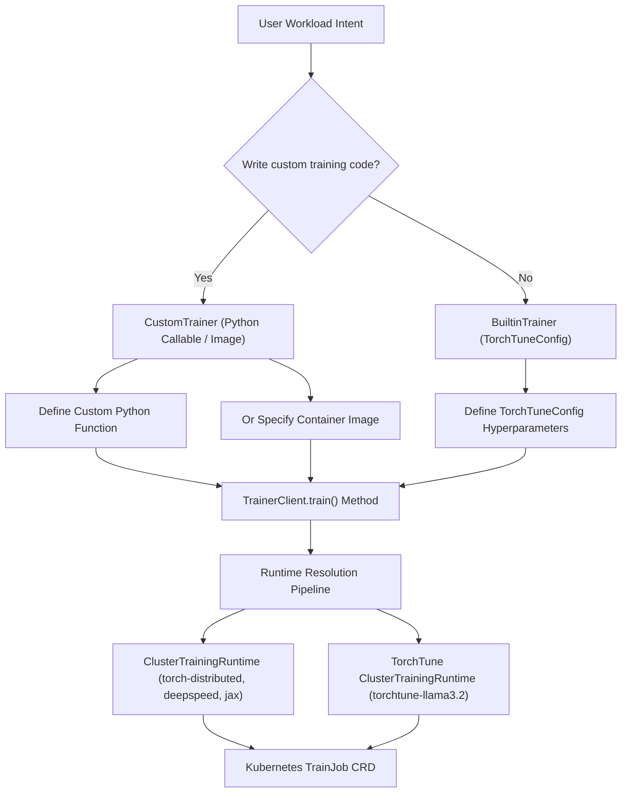
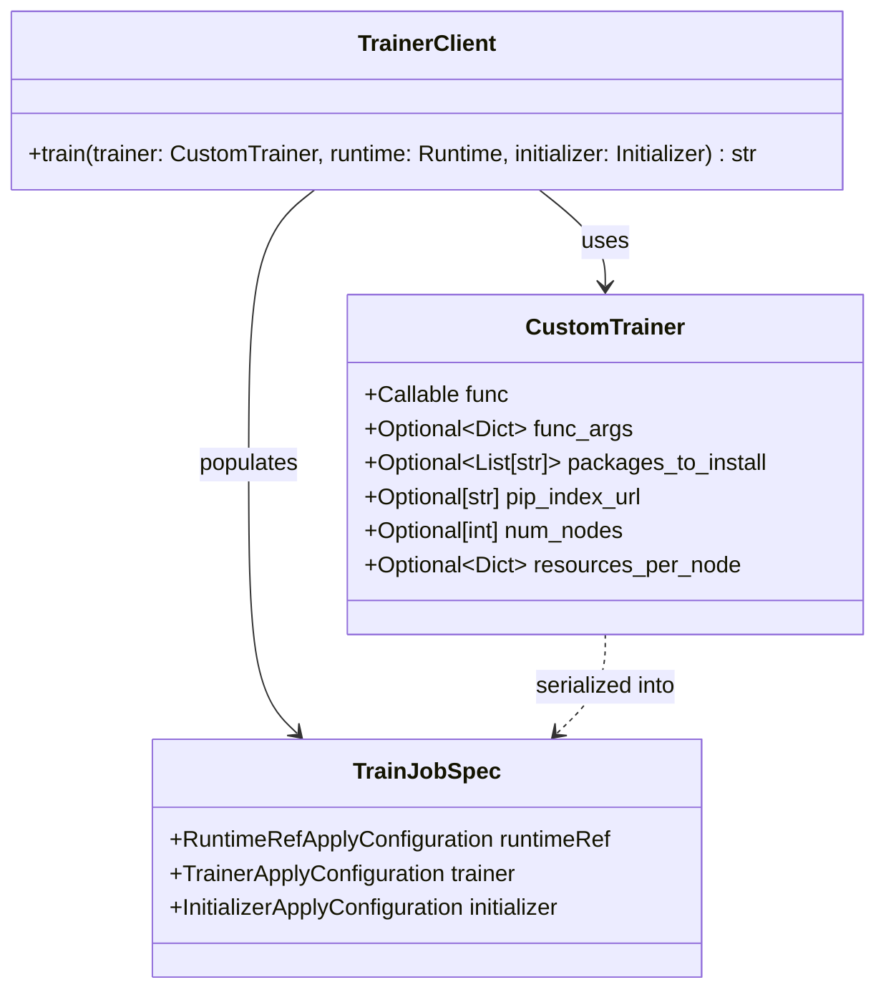
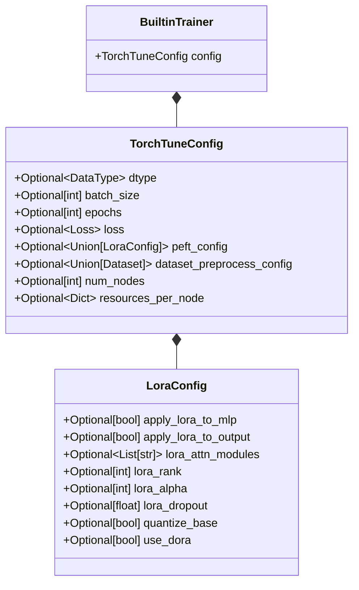
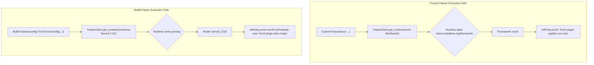

<!-- source: DeepWiki mcp.deepwiki.com · repo kubeflow/trainer · page 5.2 CustomTrainer and BuiltinTrainer · fetched 2026-10-21 -->

# CustomTrainer and BuiltinTrainer

Relevant source files

The following files were used as context for generating this wiki page:

- [charts/kubeflow-trainer/files/runtimes/torch-distributed-with-cache.yaml](charts/kubeflow-trainer/files/runtimes/torch-distributed-with-cache.yaml)
- [charts/kubeflow-trainer/files/runtimes/torch-distributed.yaml](charts/kubeflow-trainer/files/runtimes/torch-distributed.yaml)
- [cmd/runtimes/deepspeed/requirements.txt](cmd/runtimes/deepspeed/requirements.txt)
- [docs/user-guides/index.md](docs/user-guides/index.md)
- [docs/user-guides/trainjob-progress.md](docs/user-guides/trainjob-progress.md)
- [examples/jax/image-classification/mnist.ipynb](examples/jax/image-classification/mnist.ipynb)
- [examples/pytorch/image-classification/mnist.ipynb](examples/pytorch/image-classification/mnist.ipynb)
- [manifests/base/runtimes/data-cache/torch_distributed_with_cache.yaml](manifests/base/runtimes/data-cache/torch_distributed_with_cache.yaml)
- [manifests/base/runtimes/torch_distributed.yaml](manifests/base/runtimes/torch_distributed.yaml)

## Purpose and Scope

This document describes the two primary approaches for defining training workloads in the Kubeflow Trainer Python SDK: `CustomTrainer` and `BuiltinTrainer`. These classes determine how training code, configurations, and resources are packaged and executed within a `TrainJob`.

- For information about the `TrainerClient` API that invokes these trainers, see [5.1]().
- For information about SDK types and configuration dataclasses like `TorchTuneConfig`, see [5.3]().
- For information about underlying `TrainingRuntime` definitions, see [2.2]().

Sources: [docs/user-guides/pytorch.md:144-146]()

---

## Overview

Kubeflow Trainer supports two distinct training paradigms to balance custom execution flexibility with config-driven simplicity. The choice is determined by whether you need to provide a custom Python training function/container or use pre-built fine-tuning recipes.

| Trainer Type | Description | Primary Use Case |
|--------------|-------------|------------------|
| `CustomTrainer` | User-defined Python functions or container images | General-purpose distributed training with custom code [docs/user-guides/pytorch.md:144-146]() |
| `BuiltinTrainer` | Config-driven training with pre-built trainers | LLM fine-tuning with `torchtune` recipes |

### Trainer Type Selection Flow (Natural Language to Code Entity Space)

The following diagram bridges natural language workload intents to the corresponding Python SDK classes, methods, and underlying runtime code entities:

Sources: [docs/user-guides/pytorch.md:144-146](), [docs/user-guides/builtin-trainer/index.md:1-34]()

---

## CustomTrainer

### Purpose and Use Cases

`CustomTrainer` enables users to execute arbitrary Python training functions or container images in a distributed training environment [docs/user-guides/pytorch.md:144-146](). The SDK serializes the target function, packages dependencies, and configures a `TrainJob` that executes the code across multiple nodes.

**Use CustomTrainer when:**
- Writing custom training loops for PyTorch DDP/FSDP [docs/user-guides/pytorch.md:11-19](), DeepSpeed, JAX, MLX, or XGBoost.
- Requiring full programmatic control over model architecture, optimizers, and data loaders.
- Utilizing specialized or proprietary base container images.

### Implementation and API Structure

`CustomTrainer` maps internally to `TrainerV1alpha1Trainer`, populating the `spec.trainer` field of the `TrainJob` Custom Resource. The Go controller reconciles these settings via `TrainerApplyConfiguration` [pkg/client/applyconfiguration/trainer/v1alpha1/trainjobspec.go:23-48]().

The parameters configure cluster scale and resource allocation:
- `num_nodes`: Specifies the number of distributed nodes (mapped to `numNodes` in the ML policy) [docs/user-guides/pytorch.md:95-95]().
- `resources_per_node`: Allocates CPU, memory, or GPU accelerators per worker node [docs/user-guides/pytorch.md:96-98]().
- `num_proc_per_node`: Controls the number of processes spawned per node (e.g., via `torchrun`).

Sources: [pkg/client/applyconfiguration/trainer/v1alpha1/trainjobspec.go:23-48](), [docs/user-guides/pytorch.md:74-100]()

---

## BuiltinTrainer and TorchTuneConfig

### Purpose and Use Cases

`BuiltinTrainer` provides a declarative, configuration-driven approach for LLM fine-tuning using `torchtune` recipes. Instead of writing custom training loops, users declare hyperparameters, datasets, and PEFT strategies (such as LoRA or QLoRA), allowing the predefined runtime to manage the training lifecycle.

### Dataclass Hierarchy

### Validation and Recipe Resolution Rules

Admission webhooks validate TorchTune settings using `validateTorchTune()` [pkg/runtime/framework/plugins/torch/torchtune.go:35-104](). Key constraints enforced by the validation logic include:
- **Supported Models**: The runtime reference must resolve to a supported pretrained model [pkg/runtime/framework/plugins/torch/torchtune.go:40-44]().
- **Node Constraints**: For models other than `llama3_3_70b`, `numNodes` must be `1` [pkg/runtime/framework/plugins/torch/torchtune.go:46-50](). Multi-node training is not supported for LoRA fine-tuning [pkg/runtime/framework/plugins/torch/torchtune.go:79-85]().
- **Immutable Configs**: Certain configurations such as `output_dir`, `tokenizer.path`, and `checkpointer.checkpoint_dir` are managed by the runtime and cannot be overridden in `trainer.args` [pkg/runtime/framework/plugins/torch/torchtune.go:87-101]().

Recipes and configuration suffixes are dynamically resolved via `getRecipeAndConfig()` depending on `numNodes`, `numProcPerNode`, device GPU counts, and quantization flags [pkg/runtime/framework/plugins/torch/torchtune.go:108-133]().

Sources: [pkg/runtime/framework/plugins/torch/torchtune.go:35-133]()

---

## Framework Selection and Runtime Integration

Both trainer types integrate directly with `ClusterTrainingRuntime` or namespace-scoped `TrainingRuntime` objects. 

- **CustomTrainer Runtime Resolution**: Uses framework labels (e.g., `trainer.kubeflow.org/framework: torch`) to select the appropriate plugin for environment variable injection (such as `PET_*` or `torchrun` parameters).
- **BuiltinTrainer Runtime Resolution**: Selects specialized TorchTune runtimes equipped with pre-packaged recipe binaries and configuration mapping tools.

### Runtime Selection Pipeline and Code Entities

Sources: [pkg/client/applyconfiguration/trainer/v1alpha1/trainjobspec.go:27-29](), [pkg/runtime/framework/plugins/torch/torchtune.go:108-133]()

---

## Comparison Summary

| Feature | CustomTrainer | BuiltinTrainer |
|---------|---------------|----------------|
| **Core Abstraction** | User-defined callable / container image [docs/user-guides/pytorch.md:144-146]() | Configuration dataclass (`TorchTuneConfig`) |
| **Code Requirement** | Python function containing training logic | Zero code (config-driven) |
| **Supported Frameworks** | PyTorch, DeepSpeed, JAX, MLX, XGBoost | `torchtune` |
| **Flexibility** | Unconstrained / Full custom loops | Restricted to supported fine-tuning recipes |

Sources: [docs/user-guides/pytorch.md:144-195]()

---

