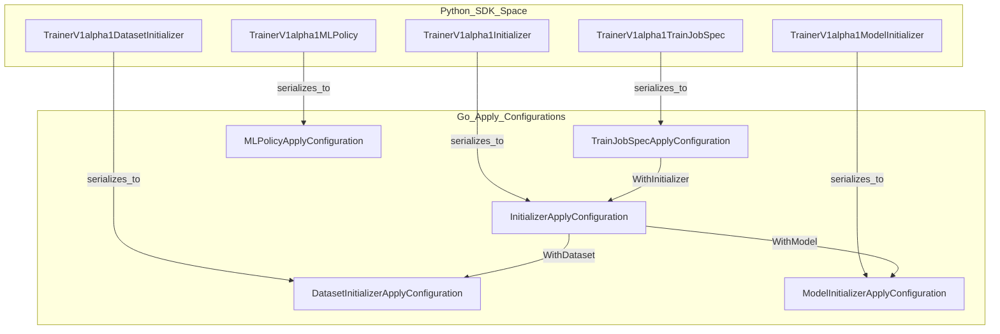
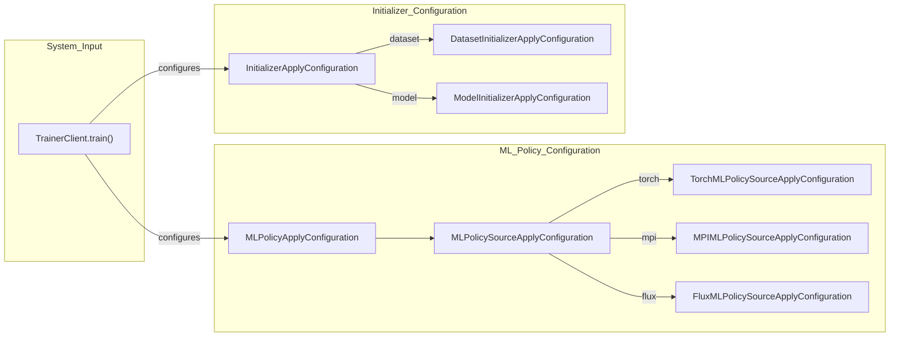

<!-- source: DeepWiki mcp.deepwiki.com · repo kubeflow/trainer · page 5.3 SDK Types and Generated API Models · fetched 2026-10-21 -->

# SDK Types and Generated API Models

Relevant source files

The following files were used as context for generating this wiki page:

- [.pre-commit-config.yaml](.pre-commit-config.yaml)
- [CHANGELOG/CHANGELOG-2.3.md](CHANGELOG/CHANGELOG-2.3.md)
- [VERSION](VERSION)
- [api/python_api/kubeflow_trainer_api/__init__.py](api/python_api/kubeflow_trainer_api/__init__.py)
- [api/python_api/kubeflow_trainer_api/models/__init__.py](api/python_api/kubeflow_trainer_api/models/__init__.py)
- [api/python_api/kubeflow_trainer_api/models/trainer_v1alpha1_train_job_spec.py](api/python_api/kubeflow_trainer_api/models/trainer_v1alpha1_train_job_spec.py)
- [charts/kubeflow-trainer/Chart.yaml](charts/kubeflow-trainer/Chart.yaml)
- [charts/kubeflow-trainer/README.md](charts/kubeflow-trainer/README.md)
- [hack/python-api/gen-api.sh](hack/python-api/gen-api.sh)
- [hack/scripts/container-runtime.sh](hack/scripts/container-runtime.sh)
- [pkg/client/applyconfiguration/trainer/v1alpha1/trainjobspec.go](pkg/client/applyconfiguration/trainer/v1alpha1/trainjobspec.go)
- [pkg/client/applyconfiguration/utils.go](pkg/client/applyconfiguration/utils.go)

## Purpose and Scope

This document provides comprehensive documentation of the Python SDK dataclasses, configuration types, and generated API client models used to configure training jobs in Kubeflow Trainer. These types define the structure for specifying runtimes, trainers, initializers, and various training parameters through the Python SDK.

The SDK types serve as a user-friendly abstraction layer over the underlying Kubernetes custom resources (`TrainJob`, `TrainingRuntime`, `ClusterTrainingRuntime`, and `OptimizationJob`). When users interact with the client, these configuration objects are serialized and translated into the appropriate Kubernetes resource specifications using the generated Python API client (`kubeflow_trainer_api`), which relies on Pydantic `^2.10.0` for validation and serialization [api/python_api/pyproject.toml:27-27]().

Sources: [pkg/client/applyconfiguration/trainer/v1alpha1/datasetinitializer.go:29-32](), [api/python_api/kubeflow_trainer_api/models/trainer_v1alpha1_dataset_initializer.py:42-44](), [api/python_api/pyproject.toml:27-27]()

---

## Core Configuration Types

### TrainJob Specification

The `TrainerV1alpha1TrainJobSpec` is the central model for defining a training job's desired state. It encapsulates the runtime reference, trainer logic, initialization steps, and lifecycle management fields.

| Field | Type | Description |
|-------|------|-------------|
| `runtime_ref` | `TrainerV1alpha1RuntimeRef` | Reference to the training runtime (e.g., `torch-distributed`). [pkg/client/applyconfiguration/utils.go:105-106]() |
| `trainer` | `TrainerV1alpha1Trainer` | Configuration of the trainer logic/framework. [pkg/client/applyconfiguration/utils.go:113-114]() |
| `initializer` | `TrainerV1alpha1Initializer` | Configuration for dataset and model setup. [pkg/client/applyconfiguration/utils.go:51-52]() |
| `active_deadline_seconds` | `int` | Duration before the system terminates the job. |
| `managed_by` | `str` | Indicates the controller managing the job (e.g., `trainer.kubeflow.org/trainjob-controller`). |
| `runtime_patches` | `List[TrainerV1alpha1RuntimePatch]` | Custom patches applied to the Runtime. [pkg/client/applyconfiguration/utils.go:103-104]() |

Sources: [pkg/client/applyconfiguration/utils.go:123-126](), [pkg/client/applyconfiguration/trainer/v1alpha1/initializer.go:21-31]()

### Initializer Dataclasses

The `Initializer` configuration aggregates dataset and model initialization logic. It is used to initialize assets and pre-process data before the main training task begins. The `DatasetInitializer` and `ModelInitializer` specifications override runtime Job templates that contain the specific ancestor step label: `trainer.kubeflow.org/trainjob-ancestor-step: dataset-initializer`.

**Initializer Structure:**

The `InitializerApplyConfiguration` contains two primary components:
- `dataset`: Configuration for dataset initialization and pre-processing [pkg/client/applyconfiguration/trainer/v1alpha1/initializer.go:27-28]().
- `model`: Configuration for pre-trained model initialization [pkg/client/applyconfiguration/trainer/v1alpha1/initializer.go:29-30]().

**Component Details:**

| Class | Field | Description |
|-------|-------|-------------|
| `DatasetInitializerApplyConfiguration` | `storageUri` | URI for the dataset provider (e.g., `s3://`, `gs://`, HuggingFace repository). [pkg/client/applyconfiguration/trainer/v1alpha1/datasetinitializer.go:33-36]() |
| `ModelInitializerApplyConfiguration` | `storageUri` | URI for the pre-trained model provider. [pkg/client/applyconfiguration/trainer/v1alpha1/modelinitializer.go:33-36]() |
| `DatasetInitializerApplyConfiguration` | `env` | List of environment variables to set in the dataset initializer container. [pkg/client/applyconfiguration/trainer/v1alpha1/datasetinitializer.go:37-39]() |
| `DatasetInitializerApplyConfiguration` | `secretRef` | Reference to a Kubernetes Secret with credentials to download assets. [pkg/client/applyconfiguration/trainer/v1alpha1/datasetinitializer.go:40-42]() |

Sources: [pkg/client/applyconfiguration/trainer/v1alpha1/datasetinitializer.go:26-43](), [pkg/client/applyconfiguration/trainer/v1alpha1/modelinitializer.go:26-43](), [pkg/client/applyconfiguration/trainer/v1alpha1/initializer.go:21-31](), [api/python_api/kubeflow_trainer_api/models/trainer_v1alpha1_dataset_initializer.py:41-48](), [api/python_api/kubeflow_trainer_api/models/trainer_v1alpha1_model_initializer.py:41-48]()

---

## Specialized Initializers and Trainer Configs

### HuggingFace Initializers

For workloads dealing with HuggingFace datasets and models, Kubeflow Trainer provides specialized initializer configuration classes:
- `HuggingFaceDatasetInitializer`: Configures data downloading directly from Hugging Face Hub, handling dataset parameters, token secrets, and revision locking.
- `HuggingFaceModelInitializer`: Configures model weights downloading, branch selections, and authentication via `secretRef`.

Sources: [pkg/client/applyconfiguration/trainer/v1alpha1/datasetinitializer.go:26-43](), [pkg/client/applyconfiguration/trainer/v1alpha1/modelinitializer.go:26-43]()

### TorchTune and LoRA Configurations

For fine-tuning Large Language Models via TorchTune integration:
- `TorchTuneConfig`: Specifies recipe selection (e.g., `lora_finetune_single_device` or distributed equivalents), dataset references, checkpoint paths, and output directories.
- `LoraConfig`: Encapsulates Low-Rank Adaptation (LoRA) parameters such as rank (`r`), alpha (`lora_alpha`), dropout, and target modules (e.g., `q_proj`, `v_proj`).

Sources: [pkg/client/applyconfiguration/trainer/v1alpha1/trainer.go:21-45]()

---

## ML Policy and Framework Sources

The `MLPolicy` defines the distribution strategy and framework-specific environment variables. It is the primary mechanism for scaling workloads.

| Policy Source | Implementation Detail |
|---------------|-----------------------|
| `Torch` | Configuration for PyTorch runtime. [pkg/client/applyconfiguration/utils.go:111-112]() |
| `MPI` | Configuration for MPI Runtime. [pkg/client/applyconfiguration/utils.go:75-76]() |
| `JAX` | Configuration for JAX Runtime (part of MLPolicySource). [pkg/client/applyconfiguration/utils.go:71-72]() |
| `XGBoost` | Configuration for XGBoost Runtime (part of MLPolicySource). [pkg/client/applyconfiguration/utils.go:71-72]() |
| `Flux` | Configuration for Flux HPC runtime. [pkg/client/applyconfiguration/utils.go:49-50]() |
| `Coscheduling` | PodGroup policy configuration for gang-scheduling timeouts. [pkg/client/applyconfiguration/trainer/v1alpha1/coschedulingpodgrouppolicysource.go:24-31]() |

Sources: [pkg/client/applyconfiguration/utils.go:69-72](), [pkg/client/applyconfiguration/trainer/v1alpha1/coschedulingpodgrouppolicysource.go:21-31]()

---

## SDK Type Relationships

### Diagram: SDK Configuration Type Hierarchy and Code Entities

This diagram bridges the Python SDK objects to the Kubernetes Custom Resources using the generated `applyconfiguration` types and Pydantic models.

Sources: [pkg/client/applyconfiguration/utils.go:123-126](), [pkg/client/applyconfiguration/trainer/v1alpha1/initializer.go:21-31](), [pkg/client/applyconfiguration/trainer/v1alpha1/datasetinitializer.go:41-42](), [pkg/client/applyconfiguration/trainer/v1alpha1/modelinitializer.go:41-42]()

---

## Configuration Flow

### Diagram: ML Policy and Initializer Data Flow

This diagram illustrates how framework-specific runtime policies and data initialization logic are partitioned in the configuration models and registered in `utils.go`.

Sources: [pkg/client/applyconfiguration/utils.go:69-72](), [pkg/client/applyconfiguration/trainer/v1alpha1/initializer.go:21-31](), [api/python_api/kubeflow_trainer_api/models/trainer_v1alpha1_dataset_initializer.py:41-48](), [pkg/client/applyconfiguration/trainer/v1alpha1/datasetinitializer.go:32-43]()

---

## Generated Python API Client

The Python SDK includes a generated API client (`kubeflow_trainer_api`) based on the OpenAPI specification under `api/python_api/`. The generation process builds Pydantic models for validation and serialization [api/python_api/pyproject.toml:27-27]().

**Key Model Components:**

The generated models include Kubernetes-native types and Trainer-specific types registered in `kubeflow_trainer_api.models`:
- `TrainerV1alpha1MLPolicy`: Aggregates distribution strategy and framework settings.
- `TrainerV1alpha1DatasetInitializer`: Configuration for data asset initialization [api/python_api/kubeflow_trainer_api/models/trainer_v1alpha1_dataset_initializer.py:41-48]().
- `TrainerV1alpha1ModelInitializer`: Configuration for pre-trained model initialization [api/python_api/kubeflow_trainer_api/models/trainer_v1alpha1_model_initializer.py:41-48]().
- `TrainerV1alpha1TrainJobSpec`: The root specification for a training job.

| Generated Model | Implementation Detail | Description |
|-----------------|-----------------------|-------------|
| `TrainerV1alpha1DatasetInitializer` | `pydantic.BaseModel` | Dataset initializer configuration [api/python_api/kubeflow_trainer_api/models/trainer_v1alpha1_dataset_initializer.py:41-48]() |
| `TrainerV1alpha1ModelInitializer` | `pydantic.BaseModel` | Model initializer configuration [api/python_api/kubeflow_trainer_api/models/trainer_v1alpha1_model_initializer.py:41-48]() |
| `IoK8sApiCoreV1EnvVar` | `pydantic.BaseModel` | Kubernetes EnvVar model [api/python_api/kubeflow_trainer_api/models/trainer_v1alpha1_dataset_initializer.py:36-36]() |
| `IoK8sApiCoreV1LocalObjectReference` | `pydantic.BaseModel` | Kubernetes LocalObjectReference [api/python_api/kubeflow_trainer_api/models/trainer_v1alpha1_dataset_initializer.py:37-37]() |

Sources: [api/python_api/pyproject.toml:27-27](), [api/python_api/kubeflow_trainer_api/models/trainer_v1alpha1_dataset_initializer.py:41-55](), [api/python_api/kubeflow_trainer_api/models/trainer_v1alpha1_model_initializer.py:41-55](), [pkg/client/applyconfiguration/utils.go:32-130]()

---

