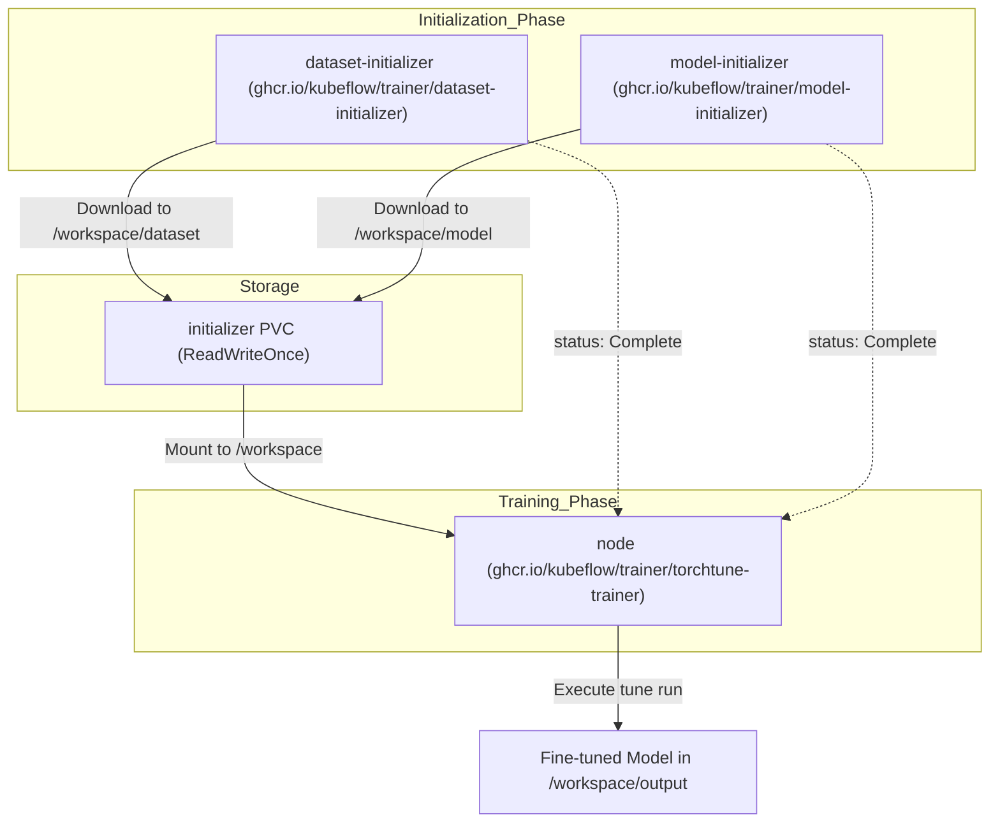
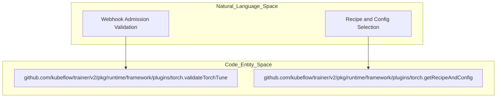
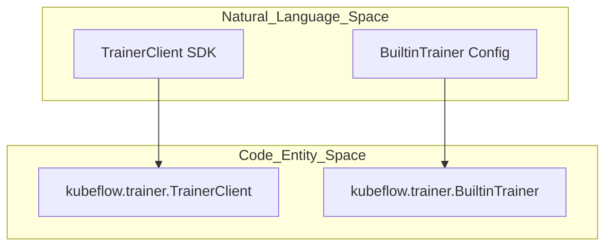
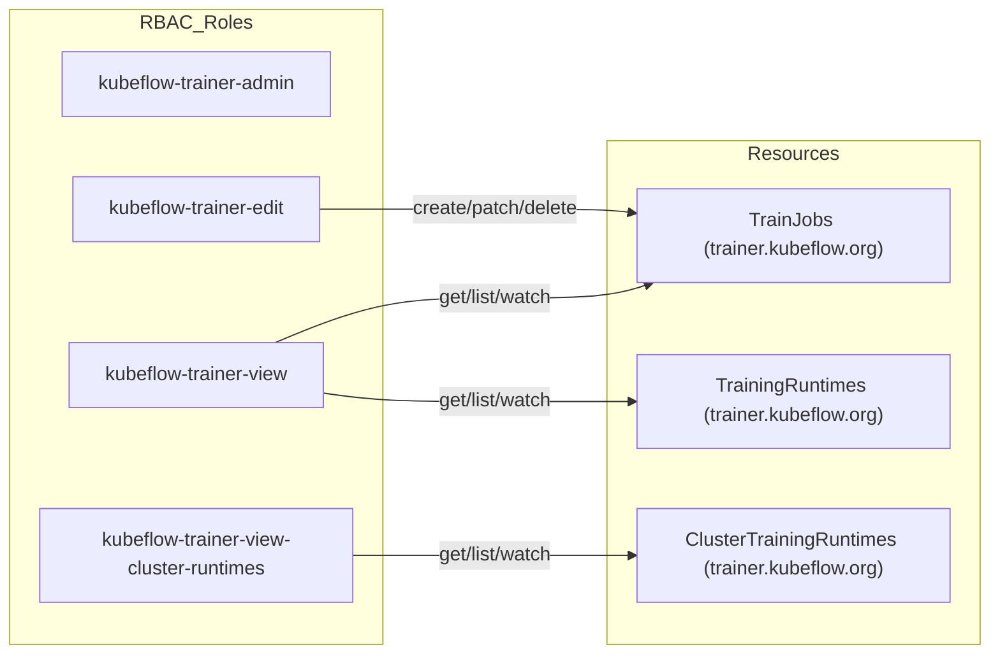

<!-- source: DeepWiki mcp.deepwiki.com · repo kubeflow/trainer · page 5.4 LLM Trainer V2 Design · fetched 2026-10-21 -->

# LLM Trainer V2 Design

Relevant source files

The following files were used as context for generating this wiki page:

- [examples/torchtune/qwen2_5/qwen2.5-1.5B-with-alpaca.ipynb](examples/torchtune/qwen2_5/qwen2.5-1.5B-with-alpaca.ipynb)
- [manifests/base/runtimes/kustomization.yaml](manifests/base/runtimes/kustomization.yaml)
- [manifests/base/runtimes/torchtune/kustomization.yaml](manifests/base/runtimes/torchtune/kustomization.yaml)
- [manifests/base/runtimes/torchtune/llama3_2/llama3_2_1B.yaml](manifests/base/runtimes/torchtune/llama3_2/llama3_2_1B.yaml)
- [manifests/base/runtimes/torchtune/llama3_2/llama3_2_3B.yaml](manifests/base/runtimes/torchtune/llama3_2/llama3_2_3B.yaml)
- [manifests/base/runtimes/torchtune/qwen2_5/qwen2_5_1.5B.yaml](manifests/base/runtimes/torchtune/qwen2_5/qwen2_5_1.5B.yaml)
- [manifests/overlays/kubeflow-platform/kubeflow-trainer-roles.yaml](manifests/overlays/kubeflow-platform/kubeflow-trainer-roles.yaml)
- [manifests/overlays/kubeflow-platform/patches/remove-namespace.yaml](manifests/overlays/kubeflow-platform/patches/remove-namespace.yaml)
- [manifests/overlays/runtimes/kustomization.yaml](manifests/overlays/runtimes/kustomization.yaml)
- [pkg/runtime/framework/plugins/torch/torchtune.go](pkg/runtime/framework/plugins/torch/torchtune.go)
- [pkg/runtime/framework/plugins/torch/torchtune_test.go](pkg/runtime/framework/plugins/torch/torchtune_test.go)

## Purpose and Scope
This document describes the design of LLM Trainer V2, which enables fine-tuning of Large Language Models (LLMs) using the Kubeflow Trainer platform. The design focuses on integrating **TorchTune** as the core fine-tuning runtime and providing a simplified Python SDK for data scientists to fine-tune LLMs without writing custom training scripts [examples/torchtune/qwen2_5/qwen2.5-1.5B-with-alpaca.ipynb:16-18]().

The V2 design leverages a multi-step execution model where model and dataset initialization are decoupled from the training process, allowing for flexible fine-tuning configurations and shared storage across distributed nodes [manifests/base/runtimes/torchtune/llama3_2/llama3_2_1B.yaml:27-105]().

Sources: [examples/torchtune/qwen2_5/qwen2.5-1.5B-with-alpaca.ipynb:16-23](), [manifests/base/runtimes/torchtune/llama3_2/llama3_2_1B.yaml:27-105]()

## Motivation and Goals
Fine-tuning LLMs on Kubernetes is challenging due to complex infrastructure requirements and the rapid evolution of techniques like LoRA, QLoRA, and FSDP. The V2 design aims to hide this complexity behind a "recipe-config" abstraction, enforced via controller-side validation and webhook admission rules [pkg/runtime/framework/plugins/torch/torchtune.go:35-104]().

### Goals
- Introduce `TrainingRuntime` and `ClusterTrainingRuntime` APIs to store blueprints for LLM fine-tuning [manifests/base/runtimes/torchtune/llama3_2/llama3_2_1B.yaml:15-21]().
- Provide a `BuiltinTrainer` in the Python SDK to support flexible LLM fine-tuning with configurable parameters [examples/torchtune/qwen2_5/qwen2.5-1.5B-with-alpaca.ipynb:100-111]().
- Create community-supported `ClusterTrainingRuntime` for foundational models including Llama 3.2 and Qwen 2.5 [manifests/base/runtimes/torchtune/kustomization.yaml:17-20]().
- Enable `TrainJob` to extend `TrainingRuntime` defaults through structured configurations [pkg/runtime/framework/plugins/torch/torchtune.go:58-60]().

Sources: [examples/torchtune/qwen2_5/qwen2.5-1.5B-with-alpaca.ipynb:90-112](), [manifests/base/runtimes/torchtune/kustomization.yaml:1-20](), [pkg/runtime/framework/plugins/torch/torchtune.go:35-104]()

## TorchTune Integration and Recipe-Config Abstraction
TorchTune is a PyTorch-native library for authoring, fine-tuning, and experimenting with LLMs. It is the primary engine for LLM Trainer V2. The Torch plugin provides admission validation (`validateTorchTune`) and dynamic configuration mapping (`getRecipeAndConfig`) [pkg/runtime/framework/plugins/torch/torchtune.go:35-133]().

### Key Concepts
1. **Recipes**: Modular native-PyTorch implementations of training logic. V2 runtimes utilize these recipes (e.g., `full_finetune_distributed`) [manifests/base/runtimes/torchtune/llama3_2/llama3_2_1B.yaml:91-91]().
2. **Configs**: Pre-defined configurations for specific models and hardware, such as `llama3_2/1B_full` or `qwen2_5/1.5B_full` [manifests/base/runtimes/torchtune/llama3_2/llama3_2_1B.yaml:93-93](), [manifests/base/runtimes/torchtune/qwen2_5/qwen2_5_1.5B.yaml:93-93]().
3. **CLI Overrides**: Parameters passed to the `tune run` command to mutate config values at runtime, such as dataset paths and output directories [manifests/base/runtimes/torchtune/llama3_2/llama3_2_1B.yaml:94-99]().
4. **Immutable Configs**: Controller validation (`validateTorchTune`) ensures that protected parameters such as `output_dir`, `tokenizer.path`, and `checkpointer.checkpoint_dir` cannot be overridden via `spec.trainer.args` [pkg/runtime/framework/plugins/torch/torchtune.go:87-101]().

Sources: [pkg/runtime/framework/plugins/torch/torchtune.go:35-133](), [manifests/base/runtimes/torchtune/llama3_2/llama3_2_1B.yaml:86-100]()

## Data Flow and Execution Architecture

The execution of an LLM Trainer V2 job follows a sequential multi-step workflow orchestrated via `replicatedJobs` and `dependsOn` fields [manifests/base/runtimes/torchtune/llama3_2/llama3_2_1B.yaml:36-77]().

### LLM Training Step-by-Step Flow

Sources: [manifests/base/runtimes/torchtune/llama3_2/llama3_2_1B.yaml:37-105](), [manifests/base/runtimes/torchtune/qwen2_5/qwen2_5_1.5B.yaml:37-106]()

### Bridging Natural Language Space to Code Entity Space for TorchTune Validation

Sources: [pkg/runtime/framework/plugins/torch/torchtune.go:35-133]()

### Multi-Step Orchestration
1. **Dataset Initializer**: Downloads data from sources like HuggingFace (`hf://tatsu-lab/alpaca`) into a shared volume [manifests/base/runtimes/torchtune/llama3_2/llama3_2_1B.yaml:46-53]().
2. **Model Initializer**: Downloads the base model (`hf://meta-llama/Llama-3.2-1B-Instruct`) into the same volume [manifests/base/runtimes/torchtune/llama3_2/llama3_2_1B.yaml:63-70]().
3. **Trainer Node**: Starts only after initializers complete successfully, running `tune run` with the appropriate configuration [manifests/base/runtimes/torchtune/llama3_2/llama3_2_1B.yaml:71-91]().

Sources: [manifests/base/runtimes/torchtune/llama3_2/llama3_2_1B.yaml:37-105]()

## SDK Design and PEFT Support

### BuiltinTrainer and Config API
The Python SDK allows users to bootstrap LLM fine-tuning by referencing a runtime and providing specific configurations through `BuiltinTrainer` [examples/torchtune/qwen2_5/qwen2.5-1.5B-with-alpaca.ipynb:90-112]().

| Entity | Code Reference | Role |
|--------|----------------|------|
| `TrainerClient` | `kubeflow.trainer.TrainerClient` | Main entry point for submitting jobs [examples/torchtune/qwen2_5/qwen2.5-1.5B-with-alpaca.ipynb:68-68](). |
| `BuiltinTrainer` | `kubeflow.trainer.BuiltinTrainer` | Encapsulates framework-specific logic like `TorchTuneConfig` [examples/torchtune/qwen2_5/qwen2.5-1.5B-with-alpaca.ipynb:100-100](). |
| `Initializer` | `kubeflow.trainer.Initializer` | Configures dataset and model initializers [examples/torchtune/qwen2_5/qwen2.5-1.5B-with-alpaca.ipynb:92-99](). |

### Bridging SDK Concepts to Python Client Implementation

Sources: [examples/torchtune/qwen2_5/qwen2.5-1.5B-with-alpaca.ipynb:68-111]()

### PEFT Support
The V2 design is optimized for Parameter-Efficient Fine-Tuning:
- **LoRA/QLoRA**: Supported via `torchtune` recipes and helper functions like `isLoraConfigEnabled` and `isUseQLoraFinetune` [pkg/runtime/framework/plugins/torch/torchtune.go:111-143]().
- **Validation Rules**: `validateTorchTune` ensures that multi-node LoRA configurations are correctly rejected, and QLoRA constraints per model are verified prior to admission [pkg/runtime/framework/plugins/torch/torchtune.go:62-85]().

Sources: [pkg/runtime/framework/plugins/torch/torchtune.go:62-143](), [examples/torchtune/qwen2_5/qwen2.5-1.5B-with-alpaca.ipynb:90-112]()

## Deployment and RBAC
The LLM Trainer V2 components are deployed with specific RBAC permissions to allow users to view and manage these runtimes and jobs [manifests/overlays/kubeflow-platform/kubeflow-trainer-roles.yaml:15-108]().

### RBAC Roles and Cluster Resources

Sources: [manifests/overlays/kubeflow-platform/kubeflow-trainer-roles.yaml:15-108]()

---

