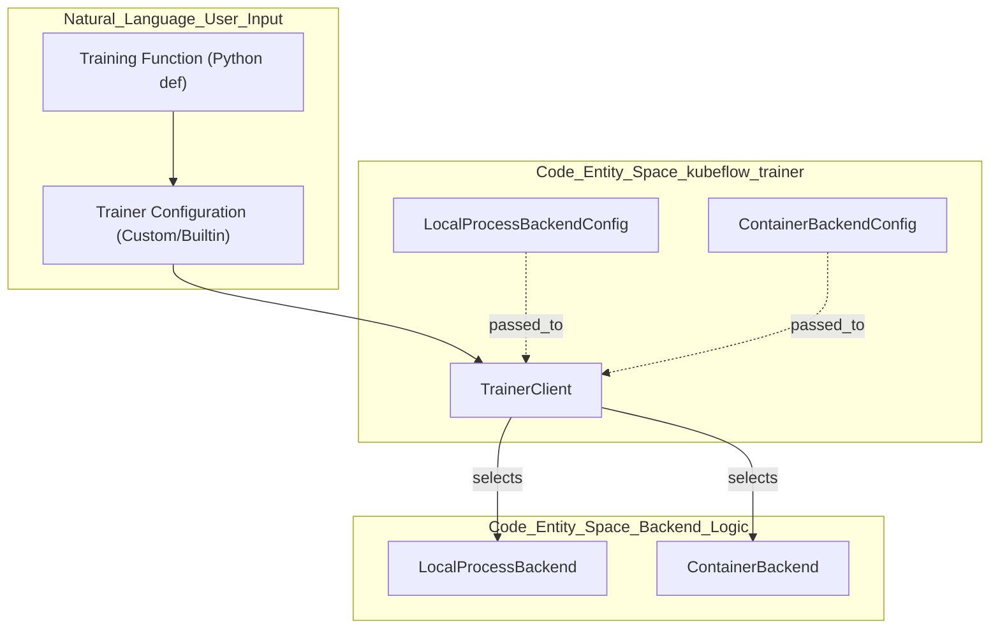
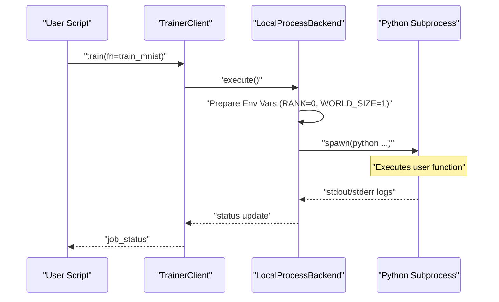
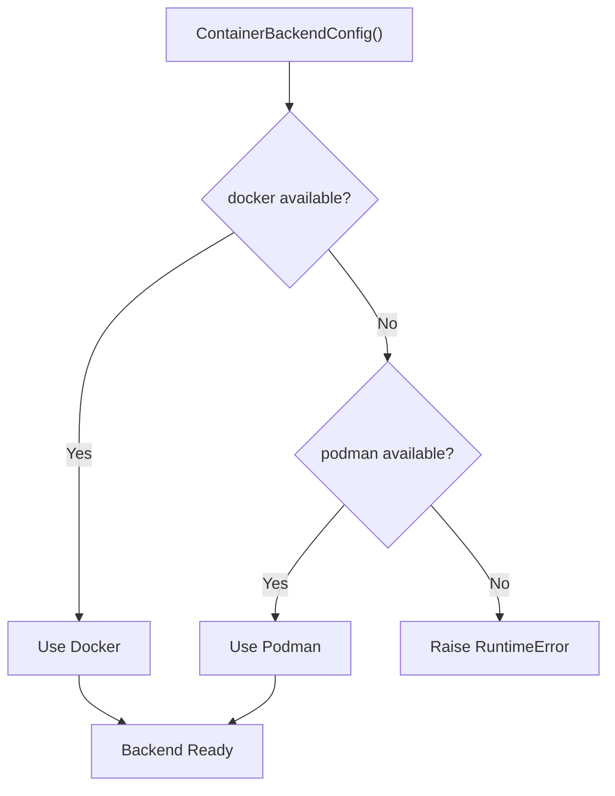

<!-- source: DeepWiki mcp.deepwiki.com · repo kubeflow/trainer · page 5.5 Local and Container Backend Configuration · fetched 2026-10-21 -->

# Local and Container Backend Configuration

Relevant source files

The following files were used as context for generating this wiki page:

- [docs/user-guides/index.md](docs/user-guides/index.md)
- [docs/user-guides/trainjob-progress.md](docs/user-guides/trainjob-progress.md)
- [examples/local/local-container-mnist.ipynb](examples/local/local-container-mnist.ipynb)
- [examples/local/local-training-mnist.ipynb](examples/local/local-training-mnist.ipynb)
- [examples/pytorch/audio-classification/audio-classification.ipynb](examples/pytorch/audio-classification/audio-classification.ipynb)
- [examples/pytorch/data-cache/fine-tune-with-cache.ipynb](examples/pytorch/data-cache/fine-tune-with-cache.ipynb)
- [examples/pytorch/speech-recognition/speech-recognition.ipynb](examples/pytorch/speech-recognition/speech-recognition.ipynb)

## Overview and Scope

This page documents the local backend implementations in the Kubeflow Trainer Python SDK that enable training execution outside of Kubernetes. These backends support rapid development, testing, and debugging workflows on local machines without requiring a Kubernetes cluster.

The Kubeflow Trainer SDK supports two local backend implementations that provide alternatives to the default Kubernetes backend:
- **`LocalProcessBackend`**: Executes training functions in native Python subprocesses. This is the fastest way to iterate as it requires no container runtime [examples/local/local-training-mnist.ipynb:12-18]().
- **`ContainerBackend`**: Executes training functions in Docker or Podman containers for containerized testing, simulating production environments more closely [examples/local/local-container-mnist.ipynb:12-18]().

Both backends implement the same `TrainerClient` interface, allowing seamless switching between local testing and Kubernetes deployment without code changes to the training function [examples/pytorch/speech-recognition/speech-recognition.ipynb:11-14]().

Sources: [examples/local/local-training-mnist.ipynb:12-18](), [examples/local/local-container-mnist.ipynb:12-18](), [examples/pytorch/speech-recognition/speech-recognition.ipynb:11-14]()

## Backend Architecture and Switching

The following diagram illustrates how the Python SDK abstracts the execution environment through different backend configurations and how users switch between them.

### Code Entity Mapping: SDK to Execution

Sources: [examples/local/local-training-mnist.ipynb:150-159](), [examples/local/local-container-mnist.ipynb:186-190]()

## LocalProcessBackend Configuration

### Purpose and Use Cases

The `LocalProcessBackend` executes training functions in isolated Python subprocesses. This backend is ideal for:
- Quick testing and debugging of training logic using native Python tools [examples/local/local-training-mnist.ipynb:12-18]().
- Rapid iteration without container overhead.
- Environments where only Python 3.9+ is available [examples/local/local-training-mnist.ipynb:12-18]().

### Configuration Options

The `LocalProcessBackendConfig` class provides the following configuration:

| Parameter | Type | Default | Description |
|-----------|------|---------|-------------|
| `cleanup_venv` | `bool` | `False` | Automatically remove virtual environments after job completion [examples/local/local-training-mnist.ipynb:152-159](). |

Sources: [examples/local/local-training-mnist.ipynb:152-159]()

### Subprocess Execution Flow

When `TrainerClient.train()` is called with this backend, the SDK performs preparation, environment injection, and process spawning.

### Code Entity Mapping: Local Execution Pipeline

Sources: [examples/local/local-training-mnist.ipynb:152-159](), [examples/pytorch/speech-recognition/speech-recognition.ipynb:110-130]()

## ContainerBackend Configuration

### Purpose and Use Cases

The `ContainerBackend` executes training functions inside Docker or Podman containers. This is useful for:
- Testing containerized workflows locally [examples/local/local-container-mnist.ipynb:8-18]().
- Simulating production environments (e.g., specific OS or driver versions).
- Validating that all dependencies are correctly captured in the container image.

### Configuration Options

The `ContainerBackendConfig` class allows for runtime selection:

| Parameter | Type | Default | Description |
|-----------|------|---------|-------------|
| `runtime` | `str` | `None` | Force specific runtime: `"docker"` or `"podman"` [examples/local/local-container-mnist.ipynb:186-188](). |

Sources: [examples/local/local-container-mnist.ipynb:186-188]()

### Container Runtime Detection

The `ContainerBackend` automatically detects available container runtimes [examples/local/local-container-mnist.ipynb:174-177](). The SDK requires specific extras for these runtimes during installation, such as `pip install kubeflow[docker]` or `pip install kubeflow[podman]` [examples/local/local-container-mnist.ipynb:38-41]().

### Runtime Detection Flow

Sources: [examples/local/local-container-mnist.ipynb:38-41](), [examples/local/local-container-mnist.ipynb:174-188]()

## Distributed Training Simulation

Both local backends simulate a distributed environment by injecting standard environment variables. This allows training functions written for distributed execution (using `torch.distributed`) to run locally without modification.

### Injected Environment Variables

| Variable | Value (Local) | Description |
|----------|---------------|-------------|
| `RANK` | `0` | Global process rank [examples/pytorch/speech-recognition/speech-recognition.ipynb:110-113](). |
| `LOCAL_RANK` | `0` | Rank on the local node [examples/pytorch/speech-recognition/speech-recognition.ipynb:110-111](). |
| `WORLD_SIZE` | `1` | Total number of processes [examples/pytorch/speech-recognition/speech-recognition.ipynb:110-113](). |

Sources: [examples/pytorch/speech-recognition/speech-recognition.ipynb:110-113]()

## Runtime Resolution and Data Cache Integration

When using a local backend, `client.list_runtimes()` returns runtimes compatible with the local context. For example, a `torch-distributed` runtime will report an `image='local'` and `trainer_type='CustomTrainer'` [examples/local/local-training-mnist.ipynb:191-203]().

While local backends typically run without Kubernetes resources, they can still interact with remote or locally-simulated services like the **Data Cache System**:
- Training functions can use `DataCacheDataset` to stream data via Arrow Flight [examples/pytorch/data-cache/fine-tune-with-cache.ipynb:89-96]().
- The endpoint is typically resolved via environment variables such as `TRAIN_JOB_NAME` to construct the service address (e.g., `grpc://{train_job_name}-cache-service:50051`) [examples/pytorch/data-cache/fine-tune-with-cache.ipynb:90-95]().
- The cache system utilizes Apache Arrow Flight for efficient data transfer [examples/pytorch/data-cache/fine-tune-with-cache.ipynb:80-82]().

Sources: [examples/local/local-training-mnist.ipynb:191-203](), [examples/pytorch/data-cache/fine-tune-with-cache.ipynb:80-96]()

## Limitations

| Feature | LocalProcessBackend | ContainerBackend |
|---------|---------------------|------------------|
| Multi-node simulation | ❌ No | ❌ No |
| GPU Support | ✅ Host GPU (via `cuda` or `mps`) | ✅ GPU Passthrough |
| K8s Resources (PVC, etc) | ❌ No | ❌ No |
| Package Isolation | ✅ Virtual Env | ✅ Container Image |

Sources: [examples/local/local-training-mnist.ipynb:86-91](), [examples/local/local-container-mnist.ipynb:88-90]()

---

