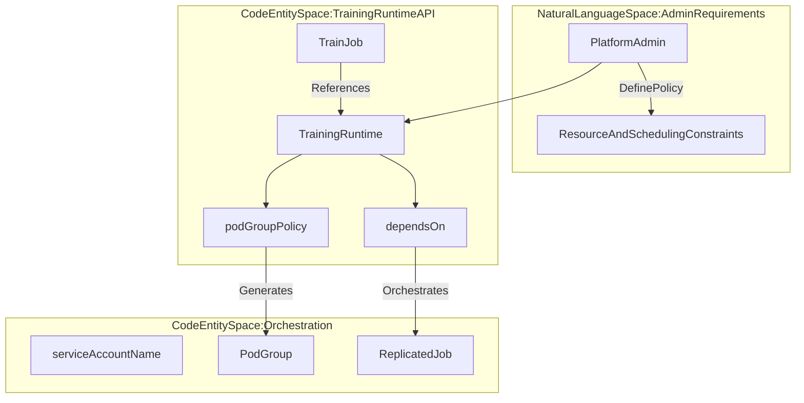

<!-- source: DeepWiki mcp.deepwiki.com · repo kubeflow/trainer · page 6 Training Examples and Use Cases · fetched 2026-10-21 -->

# Training Examples and Use Cases

<details>
<summary>Relevant source files</summary>

The following files were used as context for generating this wiki page:

- [examples/README.md](examples/README.md)
- [examples/pytorch/README.md](examples/pytorch/README.md)
- [examples/yaml/01-multi-node.yaml](examples/yaml/01-multi-node.yaml)
- [examples/yaml/04-volcano-integration.yaml](examples/yaml/04-volcano-integration.yaml)
- [examples/yaml/05-multi-step.yaml](examples/yaml/05-multi-step.yaml)
- [examples/yaml/README.md](examples/yaml/README.md)

</details>


This page provides a high-level overview of practical examples demonstrating Kubeflow Trainer usage across different ML frameworks, workloads, and deployment scenarios [examples/README.md:1-3](). These examples cover distributed training with PyTorch, JAX, DeepSpeed, MLX, XGBoost, and Flux, as well as LLM fine-tuning with TorchTune [examples/README.md:8-19](). Each example shows how to use the Python SDK to submit jobs to both Kubernetes clusters and local development environments, or use YAML manifests for platform administration [examples/README.md:21-74]().

As a PARENT page, this section maintains a high-level overview of example categories. For comprehensive implementation details, see the child pages:
- **[LLM Fine-tuning with TorchTune](#6.1)** — End-to-end examples for fine-tuning Llama 3.2 and Qwen 2.5 models using TorchTune with LoRA/QLoRA.
- **[Distributed Training Examples](#6.2)** — Examples for PyTorch DDP, DeepSpeed, JAX, MLX, XGBoost, Flux, and Megatron distributed training across frameworks, plus YAML-based examples for `kubectl` users [examples/yaml/README.md:1-24]().
- **[Local Development and Testing](#6.3)** — Guide for local testing with `LocalProcessBackendConfig`, container backends, and notebook-based workflows [examples/README.md:17]().

Sources: [examples/README.md:1-19](), [examples/yaml/README.md:1-24]()

## Overview of Example Categories

Kubeflow Trainer provides examples across three primary categories, designed for AI practitioners and platform administrators [examples/README.md:21-74]():

| Category | Frameworks | Use Cases | Example Locations |
|----------|-----------|-----------|-------------------|
| **Distributed Training** | PyTorch, JAX, DeepSpeed, MLX, XGBoost, Flux, Megatron | CNN training, multi-node coordination, text summarization, HPC workloads | `examples/pytorch/`, `examples/jax/`, `examples/deepspeed/`, `examples/mlx/`, `examples/xgboost/`, `examples/flux/`, `examples/megatron/`, `examples/yaml/` [examples/README.md:8-18]() |
| **LLM Fine-tuning** | TorchTune, MLX | Llama 3.2, Qwen 2.5 with LoRA/QLoRA | `examples/torchtune/`, `examples/mlx/language-modeling/` [examples/README.md:11-12]() |
| **Local Development** | PyTorch | Rapid iteration without Kubernetes (Native Process or Container) | `examples/local/` [examples/README.md:17]() |

Sources: [examples/README.md:8-18]()

### Training Logic Mapping

The following diagram bridges the high-level training logic defined in Python code to the underlying code entities that manage the lifecycle.

Title: "Training Logic to Code Entity Mapping"
```mermaid
graph TB
    subgraph "NaturalLanguageSpace:UserTrainingLogic"
        ["train_function"] -- "Logic" --> Init["InitializeDistributedContext"]
        Init --> Data["LoadAndShardDataset"]
        Data --> Model["CreateModelDDP"]
        Model --> Train["TrainingLoop"]
    end
    
    subgraph "CodeEntitySpace:KubeflowTrainerSDK"
        SDK_T["CustomTrainer"]
        SDK_C["TrainerClient.train"]
        SDK_B["BuiltinTrainer"]
    end
    
    subgraph "CodeEntitySpace:KubernetesController"
        CRD["TrainJob"]
        JS["JobSet"]
    end

    ["train_function"] -.-> SDK_T
    SDK_T --> SDK_C
    SDK_B --> SDK_C
    SDK_C --> CRD
    CRD --> JS
```
Sources: [examples/README.md:25-58]()

## LLM Fine-tuning with TorchTune

Kubeflow Trainer provides end-to-end examples for fine-tuning Large Language Models using the `BuiltinTrainer` and `TorchTuneConfig`. These examples utilize specialized initializers for HuggingFace models and datasets.

*   **Supported Models**: Llama 3.2 (1B/3B) and Qwen 2.5 models.
*   **Key Features**: Automated dataset and model downloading via `initializer` configurations. The SDK handles `HuggingFaceDatasetInitializer` and `HuggingFaceModelInitializer` which map to specialized init-containers.
*   **Runtimes**: Specialized `ClusterTrainingRuntimes` for LoRA fine-tuning like `torchtune-llama3.2-1b`.

For details, see [LLM Fine-tuning with TorchTune](#6.1).

Sources: [examples/README.md:12]()

## Distributed Training Examples

The repository includes a variety of multi-node distributed training scenarios across major ML frameworks.

*   **PyTorch**: Demonstrates Distributed Data Parallel (DDP) using `torch.distributed` and `DistributedSampler` [examples/yaml/01-multi-node.yaml:17-21]() launched via `torchrun` [examples/yaml/01-multi-node.yaml:18]().
*   **DeepSpeed**: Shows distributed coordination for tasks like T5 fine-tuning using `deepspeed.init_distributed` and `deepspeed.initialize`.
*   **MLX**: Demonstrates distributed training on GPUs using `mx.distributed.init` with MPI backend for MNIST and Llama fine-tuning.
*   **YAML Examples**: Standalone manifests for multi-node training using `torchrun` [examples/yaml/01-multi-node.yaml:30-59]() and `kubectl` [examples/yaml/README.md:1-13]().
*   **Scheduling**: Advanced YAML examples demonstrate integration with `Volcano` for gang scheduling [examples/yaml/04-volcano-integration.yaml:15-31]() and `JobSet` for multi-step workflows [examples/yaml/05-multi-step.yaml:15-25]().

For details, see [Distributed Training Examples](#6.2).

Sources: [examples/yaml/01-multi-node.yaml:15-59](), [examples/yaml/04-volcano-integration.yaml:15-31](), [examples/yaml/05-multi-step.yaml:15-25](), [examples/yaml/README.md:1-13]()

## Local Development and Testing

To speed up the development cycle, Kubeflow Trainer supports running training jobs outside of a Kubernetes cluster using the Python SDK [examples/README.md:17]().

*   **Local Process Backend**: Runs the training function in a local Python subprocess via `LocalProcessBackendConfig`. This is used for rapid debugging of training logic without any container overhead.
*   **Container Backend**: Supports running training in local Docker or Podman containers via `ContainerBackendConfig`. This helps in testing container workflows and environment variable injection locally.

For details, see [Local Development and Testing](#6.3).

Sources: [examples/README.md:17]()

## Platform Customization and Workflows

Platform administrators can use `TrainingRuntime` and `ClusterTrainingRuntime` to customize the training environment, including sequential execution steps and scheduling policies [examples/yaml/04-volcano-integration.yaml:21-23](), [examples/yaml/05-multi-step.yaml:18-20]().

Title: "Runtime Policy to Kubernetes Object Mapping"

Sources: [examples/yaml/04-volcano-integration.yaml:21-48](), [examples/yaml/05-multi-step.yaml:18-61]()

*   **Multi-Step Workflows**: Training runtimes can define sequential execution, such as running a `dataset-initializer` before the `node` (trainer) using the `dependsOn` field in `replicatedJobs` [examples/yaml/05-multi-step.yaml:18-20](), [examples/yaml/05-multi-step.yaml:58-61]().
*   **Runtime Patches**: Customizing pods with `nodeSelector`, `tolerations`, and `serviceAccountName` for specific infrastructure requirements [examples/yaml/README.md:19-20]().

Sources: [examples/yaml/05-multi-step.yaml:15-31](), [examples/yaml/04-volcano-integration.yaml:15-23](), [examples/yaml/README.md:19-20]()

---

