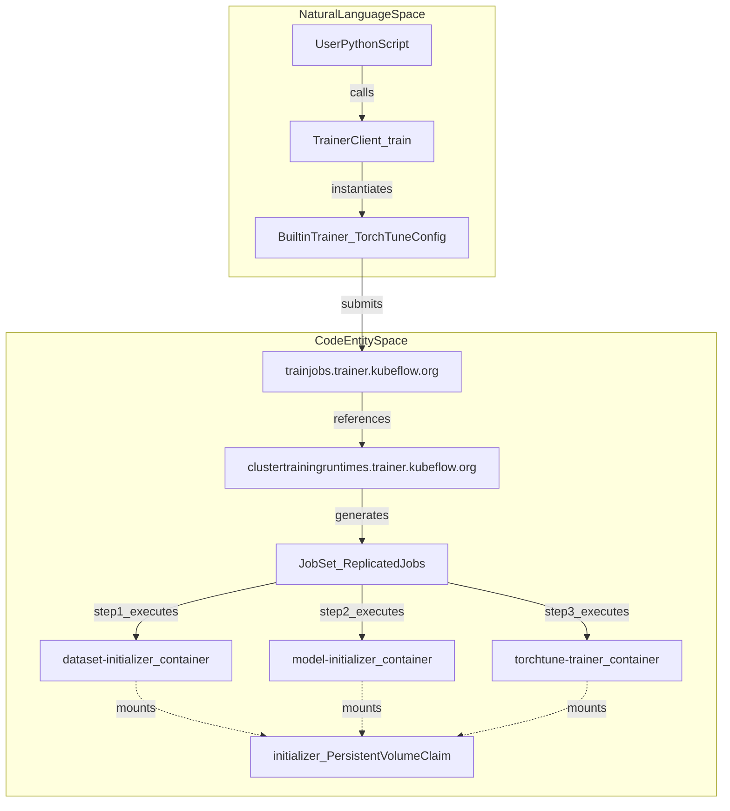
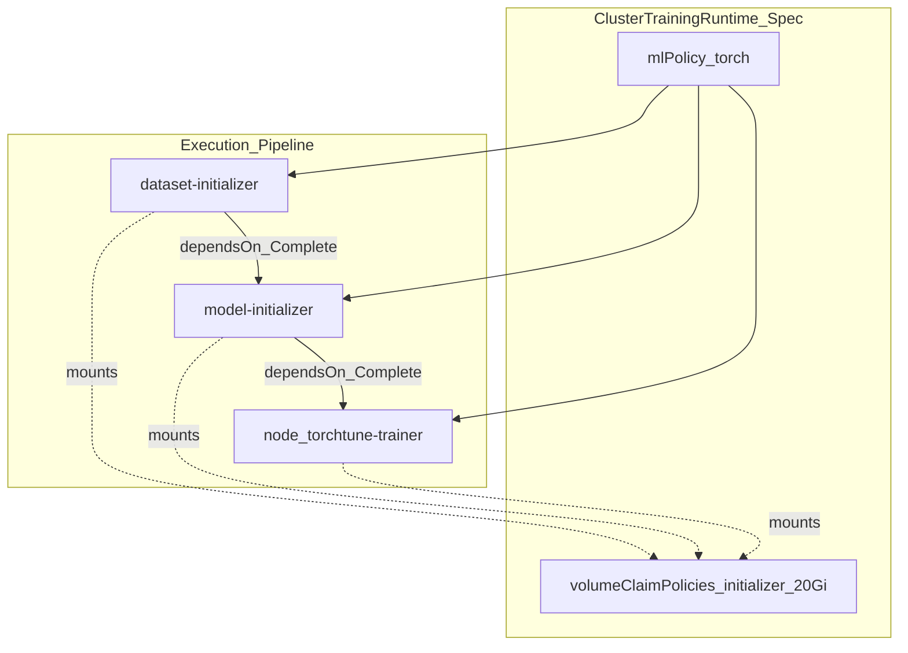

<!-- source: DeepWiki mcp.deepwiki.com · repo kubeflow/trainer · page 6.1 LLM Fine-tuning with TorchTune · fetched 2026-10-21 -->

# LLM Fine-tuning with TorchTune

<details>
<summary>Relevant source files</summary>

The following files were used as context for generating this wiki page:

- [examples/deepspeed/text-summarization/T5-Fine-Tuning.ipynb](examples/deepspeed/text-summarization/T5-Fine-Tuning.ipynb)
- [examples/mlx/image-classification/mnist.ipynb](examples/mlx/image-classification/mnist.ipynb)
- [examples/mlx/language-modeling/fine-tune-llama.ipynb](examples/mlx/language-modeling/fine-tune-llama.ipynb)
- [examples/pytorch/question-answering/fine-tune-distilbert.ipynb](examples/pytorch/question-answering/fine-tune-distilbert.ipynb)
- [examples/torchtune/llama3_2/alpaca-trainjob-yaml.ipynb](examples/torchtune/llama3_2/alpaca-trainjob-yaml.ipynb)
- [examples/torchtune/qwen2_5/qwen2.5-1.5B-with-alpaca.ipynb](examples/torchtune/qwen2_5/qwen2.5-1.5B-with-alpaca.ipynb)
- [manifests/base/runtimes/kustomization.yaml](manifests/base/runtimes/kustomization.yaml)
- [manifests/base/runtimes/torchtune/kustomization.yaml](manifests/base/runtimes/torchtune/kustomization.yaml)
- [manifests/base/runtimes/torchtune/llama3_2/llama3_2_1B.yaml](manifests/base/runtimes/torchtune/llama3_2/llama3_2_1B.yaml)
- [manifests/base/runtimes/torchtune/llama3_2/llama3_2_3B.yaml](manifests/base/runtimes/torchtune/llama3_2/llama3_2_3B.yaml)
- [manifests/base/runtimes/torchtune/qwen2_5/qwen2_5_1.5B.yaml](manifests/base/runtimes/torchtune/qwen2_5/qwen2_5_1.5B.yaml)
- [manifests/overlays/kubeflow-platform/kubeflow-trainer-roles.yaml](manifests/overlays/kubeflow-platform/kubeflow-trainer-roles.yaml)
- [manifests/overlays/kubeflow-platform/patches/remove-namespace.yaml](manifests/overlays/kubeflow-platform/patches/remove-namespace.yaml)
- [manifests/overlays/runtimes/kustomization.yaml](manifests/overlays/runtimes/kustomization.yaml)

</details>


This page provides comprehensive examples and documentation for fine-tuning Large Language Models (LLMs) using TorchTune with Kubeflow Trainer. TorchTune is PyTorch's native library for authoring, fine-tuning, and experimenting with LLMs.

**Scope**: This document covers end-to-end fine-tuning of Llama 3.2 (1B/3B) and Qwen 2.5 (1.5B) models using TorchTune with the `BuiltinTrainer` API and parameter-efficient fine-tuning (LoRA/QLoRA) configurations [manifests/base/runtimes/torchtune/llama3_2/llama3_2_1B.yaml:15-105](), [manifests/base/runtimes/torchtune/llama3_2/llama3_2_3B.yaml:15-105](), [examples/torchtune/llama3_2/alpaca-trainjob-yaml.ipynb:16-18](), [examples/torchtune/qwen2_5/qwen2.5-1.5B-with-alpaca.ipynb:16-18]().

## TorchTune Integration Overview

Kubeflow Trainer provides pre-configured `ClusterTrainingRuntime` resources for TorchTune that enable declarative LLM fine-tuning through the `BuiltinTrainer` API. Users specify dataset sources, model repositories, and fine-tuning configurations without writing boilerplate training code.

**Key Features**:
- **Config-driven workflows**: Fine-tune models by specifying high-level configurations via `TorchTuneConfig` rather than writing raw training loops [examples/torchtune/llama3_2/alpaca-trainjob-yaml.ipynb:114-125]().
- **Automatic recipe selection**: The system selects the appropriate TorchTune recipe (full fine-tuning, LoRA, QLoRA) based on configuration parameters [manifests/base/runtimes/torchtune/llama3_2/llama3_2_1B.yaml:87-93]().
- **Multi-step initialization**: Separates dataset download (`dataset-initializer`), model download (`model-initializer`), and training (`node`) into distinct container execution phases using `dependsOn` logic [manifests/base/runtimes/torchtune/llama3_2/llama3_2_1B.yaml:36-77]().
- **PEFT support**: Native support for Parameter-Efficient Fine-Tuning variants like LoRA and QLoRA to reduce GPU memory requirements.
- **HuggingFace integration**: Direct integration with HuggingFace Hub for fetching datasets and models via `HuggingFaceDatasetInitializer` and `HuggingFaceModelInitializer` [examples/torchtune/llama3_2/alpaca-trainjob-yaml.ipynb:105-113]().

Sources: [manifests/base/runtimes/torchtune/llama3_2/llama3_2_1B.yaml:1-105](), [examples/torchtune/llama3_2/alpaca-trainjob-yaml.ipynb:16-125]()

## Supported Models and Runtimes

The following pre-configured `ClusterTrainingRuntime` resources are available under `manifests/base/runtimes/torchtune/` for TorchTune fine-tuning:

| Runtime Name | Model | Model Size | Default Storage | Default GPUs | Config File Path |
|--------------|-------|------------|-----------------|--------------|------------------|
| `torchtune-llama3.2-1b` | `meta-llama/Llama-3.2-1B-Instruct` | 1B parameters | 20Gi | 2 | [manifests/base/runtimes/torchtune/llama3_2/llama3_2_1B.yaml:18-102]() |
| `torchtune-llama3.2-3b` | `meta-llama/Llama-3.2-3B-Instruct` | 3B parameters | 20Gi | 2 | [manifests/base/runtimes/torchtune/llama3_2/llama3_2_3B.yaml:18-102]() |
| `torchtune-qwen2.5-1.5b` | `Qwen/Qwen2.5-1.5B-Instruct` | 1.5B parameters | 20Gi | 2 | [manifests/base/runtimes/torchtune/kustomization.yaml:20-20]() |

Each runtime is pre-configured with:
- **Dataset initializer**: Downloads datasets from HuggingFace/S3 to `/workspace/dataset/data` using `ghcr.io/kubeflow/trainer/dataset-initializer` [manifests/base/runtimes/torchtune/llama3_2/llama3_2_1B.yaml:46-53]().
- **Model initializer**: Downloads pre-trained models to `/workspace/model` using `ghcr.io/kubeflow/trainer/model-initializer` [manifests/base/runtimes/torchtune/llama3_2/llama3_2_1B.yaml:63-70]().
- **Trainer container**: Executes TorchTune commands using `ghcr.io/kubeflow/trainer/torchtune-trainer` [manifests/base/runtimes/torchtune/llama3_2/llama3_2_1B.yaml:85-86]().
- **Volume claim policies**: Provisions a PersistentVolumeClaim template (`initializer`) shared across steps [manifests/base/runtimes/torchtune/llama3_2/llama3_2_1B.yaml:27-35]().

Sources: [manifests/base/runtimes/torchtune/llama3_2/llama3_2_1B.yaml:15-105](), [manifests/base/runtimes/torchtune/llama3_2/llama3_2_3B.yaml:15-105](), [manifests/base/runtimes/torchtune/kustomization.yaml:16-20]()

## TorchTune Workflow Architecture

The diagram below bridges the user's Python SDK entities (`TrainerClient`, `BuiltinTrainer`, `TorchTuneConfig`) to the underlying Kubernetes custom resources (`TrainJob`, `ClusterTrainingRuntime`) and container execution boundaries.


Sources: [examples/torchtune/llama3_2/alpaca-trainjob-yaml.ipynb:103-126](), [manifests/base/runtimes/torchtune/llama3_2/llama3_2_1B.yaml:37-105]()

**Workflow Steps**:

1. **Job Submission**: The user invokes `TrainerClient().train()` passing a `BuiltinTrainer` with a `TorchTuneConfig` [examples/torchtune/llama3_2/alpaca-trainjob-yaml.ipynb:103-126]().
2. **Runtime Resolution**: The controller resolves the specified `ClusterTrainingRuntime` (e.g., `torchtune-llama3.2-1b`) [manifests/base/runtimes/torchtune/llama3_2/llama3_2_1B.yaml:18]().
3. **JobSet Creation**: A `JobSet` object is created containing three `ReplicatedJobs`: `dataset-initializer`, `model-initializer`, and `node` [manifests/base/runtimes/torchtune/llama3_2/llama3_2_1B.yaml:36-77]().
4. **Sequential Execution**: 
   - `dataset-initializer` downloads and converts datasets to parquet [manifests/base/runtimes/torchtune/llama3_2/llama3_2_1B.yaml:37-53](), [examples/torchtune/llama3_2/alpaca-trainjob-yaml.ipynb:181-186]().
   - `model-initializer` downloads model weights [manifests/base/runtimes/torchtune/llama3_2/llama3_2_1B.yaml:54-70](), [examples/torchtune/llama3_2/alpaca-trainjob-yaml.ipynb:205-212]().
   - `node` executes `tune run` via the `torchtune-trainer` image [manifests/base/runtimes/torchtune/llama3_2/llama3_2_1B.yaml:85-93]().

Sources: [manifests/base/runtimes/torchtune/llama3_2/llama3_2_1B.yaml:36-105](), [examples/torchtune/llama3_2/alpaca-trainjob-yaml.ipynb:103-212]()

## Fine-tuning Recipes and Configurations

### Runtime Structure and Command Generation

The trainer node executes commands parameterized by the selected runtime template. The execution flow inside the training container relies on `tune` CLI commands.


Sources: [manifests/base/runtimes/torchtune/llama3_2/llama3_2_1B.yaml:22-105]()

#### Trainer Node Command Construction

The trainer node command is structured as follows:

1. **Base command**: `tune run --rdzv_endpoint=localhost:29500` [manifests/base/runtimes/torchtune/llama3_2/llama3_2_1B.yaml:87-90]().
2. **Recipe**: e.g., `full_finetune_distributed` [manifests/base/runtimes/torchtune/llama3_2/llama3_2_1B.yaml:91]().
3. **Config file**: e.g., `--config llama3_2/1B_full` [manifests/base/runtimes/torchtune/llama3_2/llama3_2_1B.yaml:92-93]().
4. **Overrides**: paths to tokenizer, checkpoint directory, and dataset directory [manifests/base/runtimes/torchtune/llama3_2/llama3_2_1B.yaml:94-99]().

Sources: [manifests/base/runtimes/torchtune/llama3_2/llama3_2_1B.yaml:87-99]()

## End-to-End Examples: Fine-tuning Llama 3.2 and Qwen 2.5

### Example 1: Fine-tuning Llama 3.2 1B with Alpaca Dataset

The following Python snippet demonstrates submitting a fine-tuning job for Llama 3.2 1B using the Kubeflow SDK [examples/torchtune/llama3_2/alpaca-trainjob-yaml.ipynb:103-126]():

```python
from kubeflow.trainer import *
from kubeflow_trainer_api import models
import os

client = TrainerClient()

job_name = client.train(
    runtime="torchtune-llama3.2-1b",
    initializer=Initializer(
        dataset=HuggingFaceDatasetInitializer(
            storage_uri="hf://tatsu-lab/alpaca/data"
        ),
        model=HuggingFaceModelInitializer(
            storage_uri="hf://meta-llama/Llama-3.2-1B-Instruct",
            access_token=os.environ["HF_TOKEN"]
        )
    ),
    trainer=BuiltinTrainer(
        config=TorchTuneConfig(
            dataset_preprocess_config=TorchTuneInstructDataset(
                source=DataFormat.PARQUET, split="train[:1000]"
            ),
            resources_per_node={
                "memory": "200G",
                "gpu": 1,
            },
        )
    )
)
```
Sources: [examples/torchtune/llama3_2/alpaca-trainjob-yaml.ipynb:103-126]()

### Example 2: Fine-tuning Qwen 2.5 1.5B with Alpaca Dataset

Similarly, fine-tuning Qwen 2.5 1.5B utilizes the `torchtune-qwen2.5-1.5b` runtime [examples/torchtune/qwen2_5/qwen2.5-1.5B-with-alpaca.ipynb:90-112]():

```python
job_name = client.train(
    runtime="torchtune-qwen2.5-1.5b",
    initializer=Initializer(
        dataset=HuggingFaceDatasetInitializer(
            storage_uri="hf://tatsu-lab/alpaca/data"
        ),
        model=HuggingFaceModelInitializer(
            storage_uri="hf://Qwen/Qwen2.5-1.5B-Instruct",
        )
    ),
    trainer=BuiltinTrainer(
        config=TorchTuneConfig(
            dataset_preprocess_config=TorchTuneInstructDataset(
                source=DataFormat.PARQUET, split="train[:1000]"
            ),
            resources_per_node={
                "memory": "128G",
                "gpu": 2,
            },
        )
    )
)
```
Sources: [examples/torchtune/qwen2_5/qwen2.5-1.5B-with-alpaca.ipynb:90-112]()

## Storage and Data Flow Considerations

The `volumeClaimPolicies` template provisions a PersistentVolumeClaim named `initializer` with the following characteristics:
- **AccessMode**: `ReadWriteOnce` (mounted on a single node workspace) [manifests/base/runtimes/torchtune/llama3_2/llama3_2_1B.yaml:32]().
- **Default Size**: `20Gi` [manifests/base/runtimes/torchtune/llama3_2/llama3_2_1B.yaml:35]().
- **Mount Path**: `/workspace` across all container steps (`dataset-initializer`, `model-initializer`, `node`) [manifests/base/runtimes/torchtune/llama3_2/llama3_2_1B.yaml:51-53,68-70,103-105]().

**Workspace Directory Layout**:
```
/workspace/
├── dataset/
│   └── data/          # Processed parquet dataset files
├── model/
│   └── original/      # Pre-trained checkpoint weights and tokenizer.model
└── output/            # Fine-tuned adapter checkpoints and logs
```

Once the trainer node finishes execution, the fine-tuned artifacts reside in `/workspace/output`, which can be accessed by downstream evaluation pods mounting the same storage volume [examples/torchtune/qwen2_5/qwen2.5-1.5B-with-alpaca.ipynb:216-219]().

Sources: [manifests/base/runtimes/torchtune/llama3_2/llama3_2_1B.yaml:27-105](), [examples/torchtune/qwen2_5/qwen2.5-1.5B-with-alpaca.ipynb:216-219]()

---

