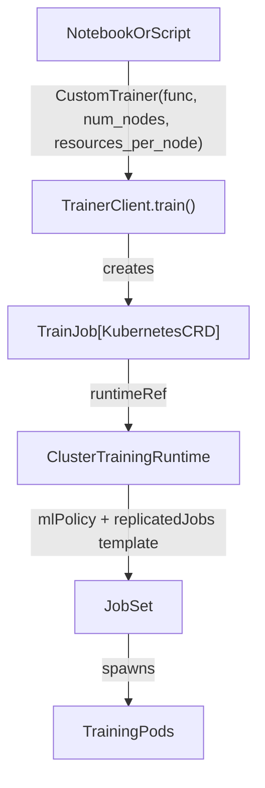
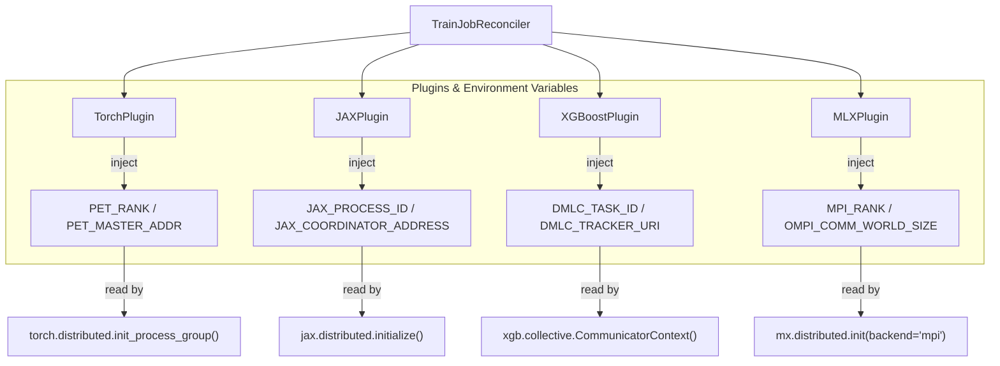

<!-- source: DeepWiki mcp.deepwiki.com · repo kubeflow/trainer · page 6.2 Distributed Training Examples · fetched 2026-10-21 -->

# Distributed Training Examples

Relevant source files

The following files were used as context for generating this wiki page:

- [docs/user-guides/megatron.md](docs/user-guides/megatron.md)
- [docs/user-guides/mlx.md](docs/user-guides/mlx.md)
- [docs/user-guides/pytorch-rocm.md](docs/user-guides/pytorch-rocm.md)
- [examples/README.md](examples/README.md)
- [examples/deepspeed/text-summarization/T5-Fine-Tuning.ipynb](examples/deepspeed/text-summarization/T5-Fine-Tuning.ipynb)
- [examples/jax/tpu_smoke_test.ipynb](examples/jax/tpu_smoke_test.ipynb)
- [examples/megatron/tensor-parallelism/megatron-core-gpt-tp.ipynb](examples/megatron/tensor-parallelism/megatron-core-gpt-tp.ipynb)
- [examples/mlx/image-classification/mnist.ipynb](examples/mlx/image-classification/mnist.ipynb)
- [examples/mlx/language-modeling/fine-tune-llama.ipynb](examples/mlx/language-modeling/fine-tune-llama.ipynb)
- [examples/pytorch/question-answering/fine-tune-distilbert.ipynb](examples/pytorch/question-answering/fine-tune-distilbert.ipynb)
- [examples/torchtune/llama3_2/alpaca-trainjob-yaml.ipynb](examples/torchtune/llama3_2/alpaca-trainjob-yaml.ipynb)
- [examples/yaml/01-multi-node.yaml](examples/yaml/01-multi-node.yaml)
- [examples/yaml/04-volcano-integration.yaml](examples/yaml/04-volcano-integration.yaml)
- [examples/yaml/05-multi-step.yaml](examples/yaml/05-multi-step.yaml)
- [examples/yaml/README.md](examples/yaml/README.md)

This page documents the concrete example notebooks, YAML manifests, and training scripts provided in the Kubeflow Trainer repository. It covers PyTorch DDP, DeepSpeed, JAX, MLX, XGBoost, Flux, Megatron-Core, PyTorch on AMD ROCm, and JAX on TPU. Each example demonstrates how specific frameworks initialize distribution, which `ClusterTrainingRuntime` they target, and how the Python SDK or YAML API maps training functions onto Kubernetes.

For local (non-Kubernetes) execution of the same training functions using the `LocalProcessBackendConfig` or `ContainerBackendConfig`, see [docs/user-guides/local-development.md]() (or section 6.3). For LLM fine-tuning using the `BuiltinTrainer` and `torchtune`, see [docs/user-guides/llm-finetuning.md]() (or section 6.1).

Sources: [examples/pytorch/image-classification/mnist.ipynb:11-15](), [examples/deepspeed/text-summarization/T5-Fine-Tuning.ipynb:8-17](), [examples/mlx/language-modeling/fine-tune-llama.ipynb:8-16]()

---

## Example Overview

| Framework | Notebook / File | Task | Runtime Name | ML Policy |
|---|---|---|---|---|
| PyTorch DDP | `examples/pytorch/image-classification/mnist.ipynb` | CNN Fashion MNIST | `torch-distributed` | `torch` |
| DeepSpeed | `examples/deepspeed/text-summarization/T5-Fine-Tuning.ipynb` | T5 Fine-Tuning | `deepspeed-distributed` | `deepspeed` |
| JAX | `examples/jax/image-classification/mnist.ipynb` | MNIST Classification | `jax-distributed` | `jax` |
| MLX | `examples/mlx/language-modeling/fine-tune-llama.ipynb` | Llama 3.2 LoRA | `mlx-distributed` | `mlx` |
| XGBoost | `examples/xgboost/distributed-training/xgboost-distributed.ipynb` | Synthetic Classification | `xgboost-distributed` | `xgboost` |
| Megatron-Core | `examples/megatron/tensor-parallelism/megatron-core-gpt-tp.ipynb` | GPT with Tensor Parallelism | `torch-distributed` | `torch` |
| Flux / LAMMPS | `examples/flux/lammps-train-gpus.yaml` | Molecular Dynamics (HPC) | `flux-distributed` | `flux` |
| PyTorch ROCm | `docs/user-guides/pytorch-rocm.md` | CNN MNIST on AMD ROCm | `torch-distributed` (Patched) | `torch` |
| JAX TPU | `examples/jax/tpu_smoke_test.ipynb` | TPU Matrix Multiplication | `jax-distributed` (Patched) | `jax` |

Sources: [examples/pytorch/image-classification/mnist.ipynb:11-15](), [examples/deepspeed/text-summarization/T5-Fine-Tuning.ipynb:8-17](), [examples/mlx/language-modeling/fine-tune-llama.ipynb:8-16](), [examples/jax/image-classification/mnist.ipynb:11-13](), [examples/megatron/tensor-parallelism/megatron-core-gpt-tp.ipynb:8-16](), [examples/xgboost/distributed-training/xgboost-distributed.ipynb:7-12](), [examples/flux/lammps-train-gpus.yaml:30-43](), [docs/user-guides/pytorch-rocm.md:114-118](), [examples/jax/tpu_smoke_test.ipynb:8-12]()

---

## Common SDK Pattern and Data Flow

All Kubernetes-based examples follow the same lifecycle using the `kubeflow.trainer` SDK:

1. **List Runtimes**: `TrainerClient().list_runtimes()` retrieves available `ClusterTrainingRuntime` objects [examples/xgboost/distributed-training/xgboost-distributed.ipynb:166-184]().
2. **Submit Job**: `TrainerClient().train(trainer=CustomTrainer(...), ...)` creates the `TrainJob` custom resource [examples/README.md:26-58]().
3. **Observe**: SDK methods like `get_job_logs()` and `wait_for_job_status()` provide monitoring feedback [examples/README.md:56-57]().

The following diagram bridges the natural language space of client-side execution to concrete code entities (`TrainerClient`, `CustomTrainer`, `TrainJob`, `ClusterTrainingRuntime`) within the architecture:

Title: "SDK to Kubernetes Resource Flow"

Sources: [examples/README.md:26-58](), [examples/README.md:67-72]()

---

## YAML-Based Examples for Platform Admins

For users who prefer `kubectl`, Kubeflow Trainer provides standalone YAML manifests demonstrating advanced Kubernetes features under `examples/yaml/` [examples/yaml/README.md:1-24]().

### Multi-Node and Scheduling
* **Multi-Node**: A multi-node training job configuration where the controller manager handles the distribution logic based on `runtimeRef`. The `torch-distributed` runtime uses `torchrun` and environment variables like `PET_NNODES` and `PET_NODE_RANK` [examples/yaml/01-multi-node.yaml:15-41]().
* **Runtime Patches**: Customizing Pod specifications such as `nodeSelector`, `tolerations`, service accounts, and labels via `runtimePatches` [examples/yaml/README.md:19-20]().
* **Kueue Integration**: Queue-based batch scheduling and workload management with [Kueue](https://kueue.sigs.k8s.io/) [examples/yaml/README.md:21]().
* **Volcano Gang Scheduling**: Volcano ensures all pods start together to avoid deadlocks. The `podGroupPolicy` is defined on the `ClusterTrainingRuntime` [examples/yaml/04-volcano-integration.yaml:17-23](), [examples/yaml/04-volcano-integration.yaml:47-48]().
* **Multi-Step Training**: Demonstrates a `dataset-initializer` step running before the trainer using the `dependsOn` field in the `replicatedJobs` template [examples/yaml/05-multi-step.yaml:46-61](). This utilizes `storageUri` to populate `STORAGE_URI` on the initializer container [examples/yaml/05-multi-step.yaml:84-87]().
* **Data Cache Integration**: A variant of the distributed runtime that includes a pre-defined `dataset-initializer` step communicating with the Kubeflow Trainer cache system [manifests/base/runtimes/data-cache/torch_distributed_with_cache.yaml:29-53]().

Sources: [examples/yaml/01-multi-node.yaml:15-41](), [examples/yaml/README.md:17-24](), [examples/yaml/04-volcano-integration.yaml:17-48](), [examples/yaml/05-multi-step.yaml:46-87](), [manifests/base/runtimes/data-cache/torch_distributed_with_cache.yaml:29-53]()

---

## Framework Specifics

### PyTorch DDP and DeepSpeed
**Runtimes:** `torch-distributed`, `deepspeed-distributed`

Both frameworks use the `TorchPlugin` or `DeepSpeedPlugin` to inject environment variables required by `torchrun` or the DeepSpeed launcher (e.g., `LOCAL_RANK`, `RANK`, `WORLD_SIZE`) [examples/pytorch/image-classification/mnist.ipynb:114-122](), [examples/deepspeed/text-summarization/T5-Fine-Tuning.ipynb:89-90](). PyTorch examples call `torch.distributed.init_process_group` with `nccl` for GPUs or `gloo` for CPUs [examples/pytorch/image-classification/mnist.ipynb:110-115](). DeepSpeed requires `torch`, `deepspeed`, and `mpi4py` [cmd/runtimes/deepspeed/requirements.txt:1-5]().

Sources: [examples/pytorch/image-classification/mnist.ipynb:110-122](), [examples/deepspeed/text-summarization/T5-Fine-Tuning.ipynb:89-90](), [cmd/runtimes/deepspeed/requirements.txt:1-5]()

### Megatron-Core — Tensor Parallelism
**Runtime:** `torch-distributed`

Megatron-Core utilizes `torchrun` for distributed orchestration, allowing it to run natively on the standard `torch-distributed` runtime [docs/user-guides/megatron.md:28-29](). It requires manual initialization of model parallelism via `parallel_state.initialize_model_parallel`, where `tensor_model_parallel_size` is controlled by the `TP_SIZE` environment variable passed via `CustomTrainer` [docs/user-guides/megatron.md:47-55]().

Sources: [docs/user-guides/megatron.md:28-55](), [examples/megatron/tensor-parallelism/megatron-core-gpt-tp.ipynb:8-16]()

### JAX — Distributed Training and TPU Support
**Runtime:** `jax-distributed`

JAX distributed training requires explicit process coordination. The `jax-distributed` runtime manages `JAX_*` environment variables, including `JAX_COORDINATOR_ADDRESS`, `JAX_NUM_PROCESSES`, and `JAX_PROCESS_ID` [examples/jax/image-classification/mnist.ipynb:101-109](). These are passed to `jax.distributed.initialize()` to bootstrap the cluster [examples/jax/image-classification/mnist.ipynb:105-109]().

For physical **Cloud TPUs**, the SDK supports `RuntimePatch` to inject GKE-specific node selectors, topologies, and tolerations [examples/jax/tpu_smoke_test.ipynb:101-156](). The `CustomTrainer` specifies physical TPU chips via `resources_per_node` (e.g., `google.com/tpu: 4`) and sets `JAX_PLATFORMS="tpu,cpu"` [examples/jax/tpu_smoke_test.ipynb:168-196]().

Sources: [examples/jax/image-classification/mnist.ipynb:101-109](), [examples/jax/tpu_smoke_test.ipynb:101-196]()

### XGBoost — Distributed Training
**Runtime:** `xgboost-distributed`

XGBoost uses the **Rabit/Collective** protocol for distributed coordination. The runtime automatically injects `DMLC_TRACKER_URI`, `DMLC_TRACKER_PORT`, `DMLC_TASK_ID` (rank), and `DMLC_NUM_WORKER` [examples/xgboost/distributed-training/xgboost-distributed.ipynb:53-62](). Rank 0 starts the `RabitTracker` to coordinate the workers while all workers participate via `xgb.collective.CommunicatorContext` [examples/xgboost/distributed-training/xgboost-distributed.ipynb:80-92]().

Sources: [examples/xgboost/distributed-training/xgboost-distributed.ipynb:53-92]()

### MLX — Distributed & CUDA Backend
**Runtime:** `mlx-distributed`

MLX distributed training uses the OpenMPI backend via `mpirun`. The runtime automatically creates OpenMPI hostfiles, starts SSH servers on worker nodes, and exposes `mx.distributed.size()` and `mx.distributed.rank()` [docs/user-guides/mlx.md:23-30](). The `mlx-distributed` runtime installs the CUDA driver and `mlx[cuda]` package, enabling multi-node GPU fine-tuning of models like Llama with `mlx_lm` [docs/user-guides/mlx.md:32-36]().

Sources: [docs/user-guides/mlx.md:23-36](), [docs/user-guides/mlx.md:70-82]()

### Flux — HPC Workloads
**Runtime:** `flux-distributed`

The Flux plugin bootstraps a MiniCluster inside Kubernetes. For HPC workloads like LAMMPS, the `TrainJob` specifies the `flux-distributed` runtime and wraps the command in a Flux-aware environment [examples/flux/lammps-train-gpus.yaml:30-43](). It supports topology-aware scheduling and MPI communication settings [examples/flux/lammps-train-gpus.yaml:50-51]().

Sources: [examples/flux/lammps-train-gpus.yaml:30-51]()

### PyTorch on AMD ROCm
**Runtime:** `torch-distributed` (Patched)

PyTorch on AMD ROCm uses ROCm-compatible images (e.g., `rocm/pytorch`) and requests `amd.com/gpu` resources [docs/user-guides/pytorch-rocm.md:19-22](). PyTorch `torch.distributed` with the `nccl` backend works transparently on ROCm via [RCCL](https://github.com/ROCm/rccl), AMD's NCCL drop-in replacement [docs/user-guides/pytorch-rocm.md:23](). Node tolerations and resource requests are injected using `k8s_options.RuntimePatch` [docs/user-guides/pytorch-rocm.md:60-103]().

Sources: [docs/user-guides/pytorch-rocm.md:19-103]()

---

## Framework Initialization Comparison

The following diagram bridges system-level runtime controller components to specific framework initialization functions (`dist.init_process_group`, `jax.distributed.initialize`, `CommunicatorContext`, `mx.distributed.init`), illustrating how environment variables bridge the gap between Kubernetes and framework code:

Title: "Framework Initialization Comparison"

Sources: [examples/jax/image-classification/mnist.ipynb:101-109](), [examples/pytorch/image-classification/mnist.ipynb:114-122](), [examples/xgboost/distributed-training/xgboost-distributed.ipynb:88-92](), [docs/user-guides/mlx.md:178-179]()

---

