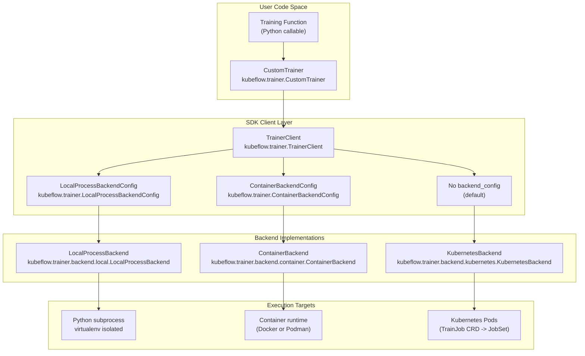
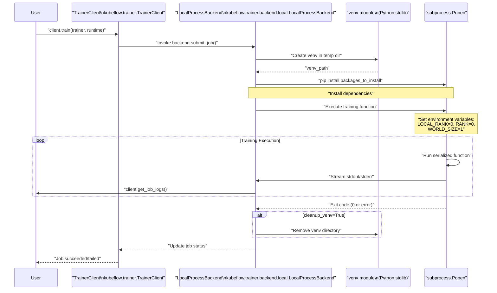
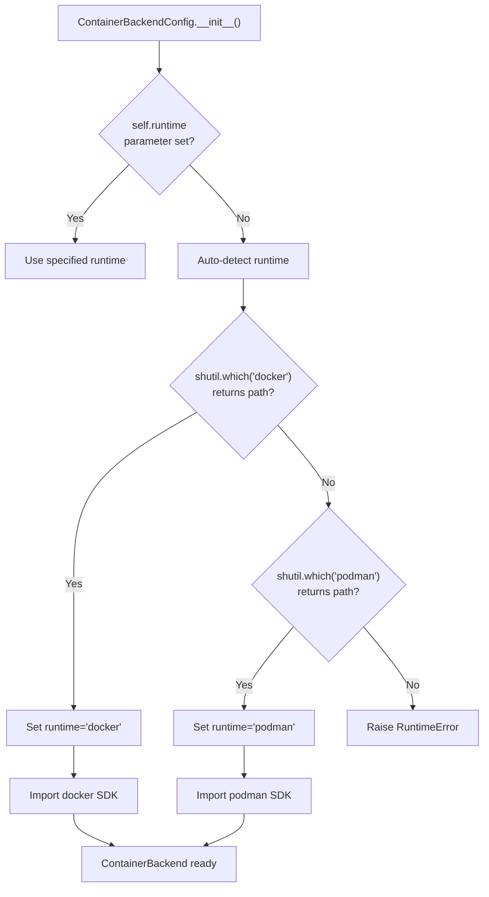

<!-- source: DeepWiki mcp.deepwiki.com · repo kubeflow/trainer · page 6.3 Local Development and Testing · fetched 2026-10-21 -->

# Local Development and Testing

<details>
<summary>Relevant source files</summary>

The following files were used as context for generating this wiki page:

- [.github/workflows/gh-workflow-approve.yaml](.github/workflows/gh-workflow-approve.yaml)
- [.github/workflows/github-stale.yaml](.github/workflows/github-stale.yaml)
- [.github/workflows/template-setup-clusters/action.yaml](.github/workflows/template-setup-clusters/action.yaml)
- [examples/local/local-container-mnist.ipynb](examples/local/local-container-mnist.ipynb)
- [examples/local/local-training-mnist.ipynb](examples/local/local-training-mnist.ipynb)
- [examples/pytorch/audio-classification/audio-classification.ipynb](examples/pytorch/audio-classification/audio-classification.ipynb)
- [examples/pytorch/data-cache/fine-tune-with-cache.ipynb](examples/pytorch/data-cache/fine-tune-with-cache.ipynb)
- [examples/pytorch/speech-recognition/speech-recognition.ipynb](examples/pytorch/speech-recognition/speech-recognition.ipynb)
- [hack/e2e-setup-cluster.sh](hack/e2e-setup-cluster.sh)
- [test/e2e/e2e_test.go](test/e2e/e2e_test.go)

</details>


## Purpose and Scope

This page guides developers through local testing and validation using Kubeflow Trainer's local execution backends: `LocalProcessBackendConfig` for native Python subprocess execution, `ContainerBackendConfig` for Docker and Podman container backends, and notebook-based development workflows [examples/local/local-training-mnist.ipynb:12-18](), [examples/local/local-container-mnist.ipynb:12-18](). It details how to progress smoothly from rapid local prototyping to distributed execution on Kubernetes [examples/pytorch/speech-recognition/speech-recognition.ipynb:11-14]().

Sources: [examples/local/local-training-mnist.ipynb:12-18](), [examples/local/local-container-mnist.ipynb:12-18](), [examples/pytorch/speech-recognition/speech-recognition.ipynb:11-14]()

---

## Backend Architecture Overview

Kubeflow Trainer abstracts underlying execution environments through a unified Python SDK configuration system. The `TrainerClient` interacts with different backend drivers while keeping the training function implementation identical across environments [examples/pytorch/speech-recognition/speech-recognition.ipynb:11-14]().

- **LocalProcessBackend**: Executes training callables inside an isolated Python virtual environment subprocess [examples/local/local-training-mnist.ipynb:12-18]().
- **ContainerBackend**: Executes training jobs within Docker or Podman containers to simulate production runtimes [examples/local/local-container-mnist.ipynb:12-18]().
- **KubernetesBackend**: Default backend that compiles configuration into `TrainJob` and `JobSet` Kubernetes resources.

Diagram 1: SDK Backend Configuration Flow (Bridging Natural Language Space to Code Entity Space)



Sources: [examples/local/local-training-mnist.ipynb:152-177](), [examples/local/local-container-mnist.ipynb:186-209](), [examples/local/local-training-mnist.ipynb:12-18]()

---

## Local Process Backend

The `LocalProcessBackendConfig` class provides native subprocess execution with virtual environment isolation, allowing rapid iteration without container management overhead [examples/local/local-training-mnist.ipynb:12-18]().

### Configuration

```python
from kubeflow.trainer import TrainerClient, LocalProcessBackendConfig

# Configure Local Process Backend
backend_config = LocalProcessBackendConfig(
    cleanup_venv=True  # Auto-cleanup virtual environments after job completes
)
```

**LocalProcessBackendConfig Parameters**

| Parameter | Type | Default | Description |
|-----------|------|---------|-------------|
| `cleanup_venv` | `bool` | `False` | Remove virtual environment after job completes [examples/local/local-training-mnist.ipynb:155-157]() |

Sources: [examples/local/local-training-mnist.ipynb:152-157]()

### Execution Flow

The `LocalProcessBackend` creates a temporary virtual environment, installs dependencies, and manages subprocess execution.

Diagram 2: Local Process Backend Execution Sequence



Sources: [examples/local/local-training-mnist.ipynb:152-228](), [examples/local/local-training-mnist.ipynb:12-18]()

### Environment Variables

`LocalProcessBackend` injects standard distributed environment variables into the subprocess:

| Variable | Value | Purpose |
|----------|-------|---------|
| `LOCAL_RANK` | `0` | Process-local rank |
| `RANK` | `0` | Global rank |
| `WORLD_SIZE` | `1` | Total process count |

Sources: [examples/pytorch/speech-recognition/speech-recognition.ipynb:110-113](), [examples/local/local-container-mnist.ipynb:93-101]()

---

## Container Backend

`ContainerBackendConfig` executes training within Docker or Podman containers to closely simulate production container images [examples/local/local-container-mnist.ipynb:12-18]().

### Configuration

```python
from kubeflow.trainer import TrainerClient, ContainerBackendConfig

# Auto-detects Docker or Podman
backend_config = ContainerBackendConfig()
```

Diagram 3: Container Backend Detection Logic (Bridging Natural Language Space to Code Entity Space)



Sources: [examples/local/local-container-mnist.ipynb:186-209]()

### Multi-Node Simulation

`ContainerBackend` supports multi-node simulation by orchestrating multiple container instances locally and passing rank configuration via environment variables [examples/local/local-container-mnist.ipynb:89-101]().

Sources: [examples/local/local-container-mnist.ipynb:89-101](), [examples/local/local-container-mnist.ipynb:12-18]()

---

## Common Development Workflow

1. **Define Training Function**: Write self-contained functions encapsulating training logic. All required libraries must be imported inside the function body to support serialization [examples/pytorch/speech-recognition/speech-recognition.ipynb:56-61]().
2. **Test with LocalProcessBackend**: Initialize `TrainerClient` with `LocalProcessBackendConfig` to rapidly verify correctness [examples/local/local-training-mnist.ipynb:152-177]().
3. **Scale to Kubernetes**: Omit `backend_config` to target a Kubernetes cluster via `TrainerClient` [examples/pytorch/speech-recognition/speech-recognition.ipynb:11-14]().

Sources: [examples/local/local-training-mnist.ipynb:59-132](), [examples/pytorch/speech-recognition/speech-recognition.ipynb:11-14]()

---

## Notebook-Based Development

Kubeflow Trainer supports interactive notebook workflows across multiple frameworks:

| Framework | Local Patterns | Code Reference |
|-----------|----------------|----------------|
| **PyTorch** | Uses `dist.init_process_group` with `gloo` or `nccl` | [examples/local/local-container-mnist.ipynb:89-101]() |
| **JAX** | Uses `jax.distributed.initialize` | [examples/pytorch/speech-recognition/speech-recognition.ipynb:110-126]() |
| **DeepSpeed** | Process discovery via environment variables | [examples/pytorch/data-cache/fine-tune-with-cache.ipynb:86-86]() |
| **MLX** | Uses `mlx.distributed.init` | [examples/pytorch/audio-classification/audio-classification.ipynb:12-15]() |
| **Data Cache** | Local simulation via `FlightClient` | [examples/pytorch/data-cache/fine-tune-with-cache.ipynb:148-156]() |

Sources: [examples/pytorch/audio-classification/audio-classification.ipynb:12-15](), [examples/pytorch/data-cache/fine-tune-with-cache.ipynb:148-156]()

---

## Backend Comparison

| Feature | LocalProcessBackend | ContainerBackend | KubernetesBackend |
|---------|---------------------|------------------|-------------------|
| **Environment** | Python subprocess | Docker/Podman | Kubernetes Pods |
| **Prerequisites** | Python 3.9+ | Docker/Podman | K8s Cluster |
| **Multi-node** | No | Yes (Simulated) | Yes (Native) |
| **Isolation** | Virtualenv | Container | Pod/Namespace |
| **Use Case** | Prototyping | Env Validation | Production |

Sources: [examples/local/local-training-mnist.ipynb:12-18](), [examples/local/local-container-mnist.ipynb:12-18]()

---

