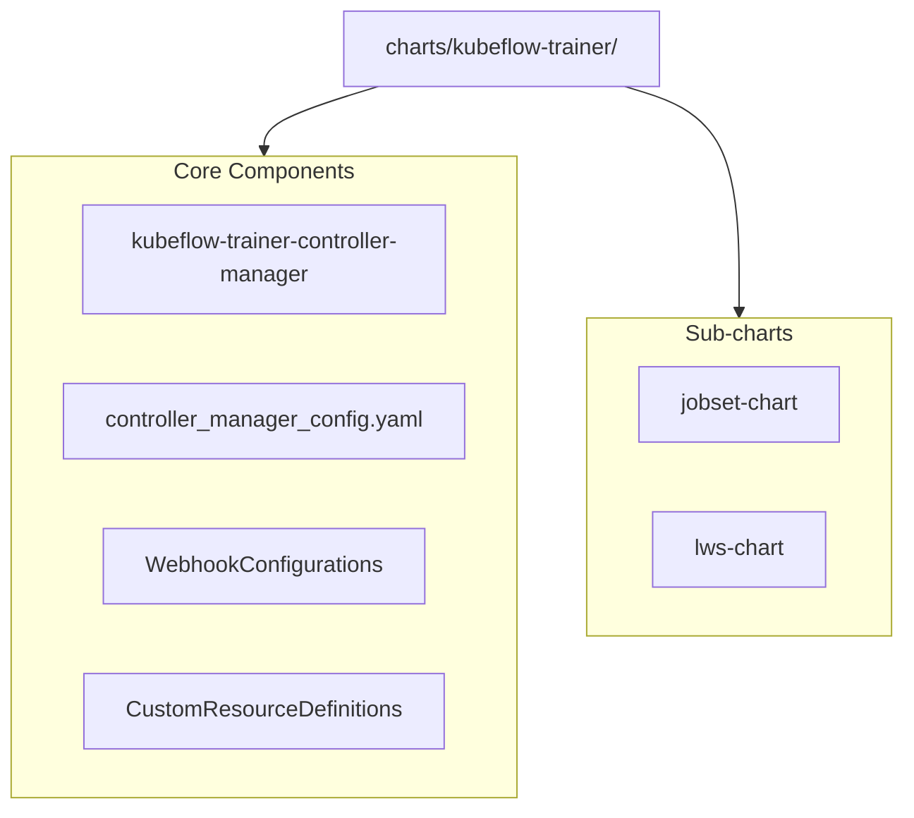
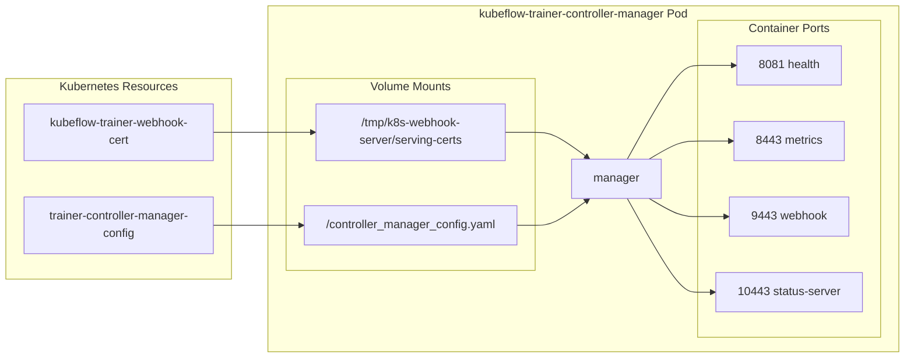
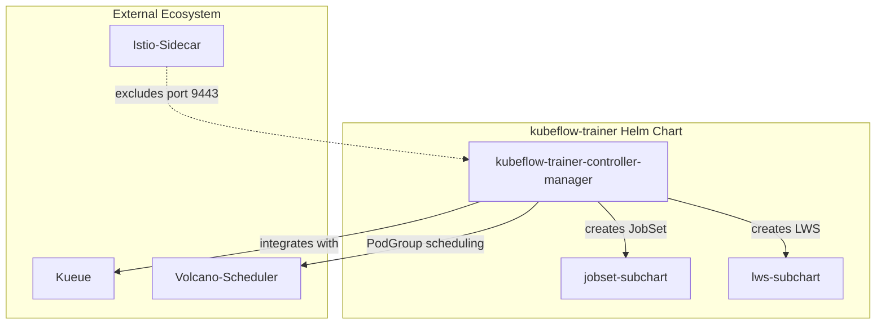

<!-- source: DeepWiki mcp.deepwiki.com · repo kubeflow/trainer · page 7 Deployment and Operations · fetched 2026-10-21 -->

# Deployment and Operations

<details>
<summary>Relevant source files</summary>

The following files were used as context for generating this wiki page:

- [.pre-commit-config.yaml](.pre-commit-config.yaml)
- [CHANGELOG/CHANGELOG-2.3.md](CHANGELOG/CHANGELOG-2.3.md)
- [VERSION](VERSION)
- [api/python_api/kubeflow_trainer_api/__init__.py](api/python_api/kubeflow_trainer_api/__init__.py)
- [charts/kubeflow-trainer/Chart.yaml](charts/kubeflow-trainer/Chart.yaml)
- [charts/kubeflow-trainer/README.md](charts/kubeflow-trainer/README.md)
- [charts/kubeflow-trainer/templates/manager/_helpers.tpl](charts/kubeflow-trainer/templates/manager/_helpers.tpl)
- [charts/kubeflow-trainer/templates/manager/deployment.yaml](charts/kubeflow-trainer/templates/manager/deployment.yaml)
- [charts/kubeflow-trainer/templates/manager/service.yaml](charts/kubeflow-trainer/templates/manager/service.yaml)
- [charts/kubeflow-trainer/tests/manager/deployment_test.yaml](charts/kubeflow-trainer/tests/manager/deployment_test.yaml)
- [hack/python-api/gen-api.sh](hack/python-api/gen-api.sh)
- [hack/scripts/container-runtime.sh](hack/scripts/container-runtime.sh)
- [manifests/base/manager/manager.yaml](manifests/base/manager/manager.yaml)
- [manifests/overlays/kubeflow-platform/kustomization.yaml](manifests/overlays/kubeflow-platform/kustomization.yaml)
- [manifests/overlays/kubeflow-platform/patches/jobset-controller-manager-istio.yaml](manifests/overlays/kubeflow-platform/patches/jobset-controller-manager-istio.yaml)
- [manifests/overlays/kubeflow-platform/patches/trainer-manager-istio-and-selectors.yaml](manifests/overlays/kubeflow-platform/patches/trainer-manager-istio-and-selectors.yaml)

</details>


This page provides an operational overview of installing, configuring, and managing Kubeflow Trainer in a Kubernetes cluster. As a parent page, it summarizes the core deployment architecture, Helm packaging, controller resources, and external ecosystem dependencies. 

For comprehensive deep dives and detailed operator guides, refer to the child pages:
- For Helm or Kustomize installations, values configuration, runtime enablement, dataCache setup, and RBAC roles, see [Helm Chart Installation and Configuration](#7.1).
- For controller manager settings, `controller_manager_config.yaml` options, concurrency, webhooks, certificates, and feature gates, see [Controller Manager Settings](#7.2).
- For version compatibility, sub-charts, and external scheduler integrations (JobSet, LeaderWorkerSet, Kueue, Volcano, YuniKorn), see [Ecosystem Dependencies](#7.3).

---

## What Gets Deployed

A complete Kubeflow Trainer installation deploys a set of core control plane components, admission webhooks, Custom Resource Definitions (CRDs), and optional sub-charts for job orchestration and distributed data caching [charts/kubeflow-trainer/README.md:10-45](), [charts/kubeflow-trainer/Chart.yaml:25-33]().

| Resource | Description | Code / Manifest Reference |
|---|---|---|
| `Deployment` (`kubeflow-trainer-controller-manager`) | The controller deployment managing `TrainJob`, `TrainingRuntime`, and `ClusterTrainingRuntime` | [charts/kubeflow-trainer/README.md:107-111](), [manifests/base/manager/manager.yaml:16-19]() |
| `MutatingWebhookConfiguration` / `ValidatingWebhookConfiguration` | Admission webhooks for validation and defaulting | [charts/kubeflow-trainer/README.md:130-132]() |
| `CustomResourceDefinition` (×3) | `trainjobs.trainer.kubeflow.org`, `trainingruntimes.trainer.kubeflow.org`, and `clustertrainingruntimes.trainer.kubeflow.org` | [charts/kubeflow-trainer/README.md:102]() |
| `ClusterRole` / `ClusterRoleBinding` / `ServiceAccount` | RBAC rules allowing controller manager to coordinate Jobs, Secrets, ConfigMaps, and JobSets | [charts/kubeflow-trainer/templates/manager/deployment.yaml:143](), [manifests/base/manager/manager.yaml:85]() |
| `ConfigMap` | Controller configuration rendered from `manager.config` | [charts/kubeflow-trainer/templates/manager/deployment.yaml:125-127]() |
| `Secret` | TLS serving certificates (`kubeflow-trainer-webhook-cert`) for admission webhooks | [charts/kubeflow-trainer/templates/manager/deployment.yaml:121-124](), [manifests/base/manager/manager.yaml:87-90]() |
| JobSet Sub-chart | Deploys JobSet controller dependencies (`jobset.install=true`) | [charts/kubeflow-trainer/Chart.yaml:26-29]() |
| LeaderWorkerSet Sub-chart | Deploys LWS controller when data cache is enabled (`dataCache.enabled=true`) | [charts/kubeflow-trainer/Chart.yaml:30-33]() |

For details on customizing manifests, overlays, and v2.3.0 CRD migration, see [Helm Chart Installation and Configuration](#7.1).

Sources: [charts/kubeflow-trainer/README.md:43-75](), [charts/kubeflow-trainer/Chart.yaml:25-33](), [charts/kubeflow-trainer/templates/manager/deployment.yaml:120-143](), [manifests/base/manager/manager.yaml:16-110]()

---

## Helm Chart Structure and Quick Installation

The official Helm chart is located at `charts/kubeflow-trainer/` and published to `ghcr.io/kubeflow/charts/kubeflow-trainer` [charts/kubeflow-trainer/README.md:26](). It targets Kubernetes `>= 1.31` and Helm `>= 3` [charts/kubeflow-trainer/README.md:15-16]().

Title: "Helm Chart Component Relationship"


### Quick Install Commands

**Install released version:**
```bash
export VERSION=v2.3.0
helm install kubeflow-trainer oci://ghcr.io/kubeflow/charts/kubeflow-trainer \
    --namespace kubeflow-system \
    --create-namespace \
    --version ${VERSION#v}
```

**Install with default runtimes enabled:**
```bash
helm install kubeflow-trainer oci://ghcr.io/kubeflow/charts/kubeflow-trainer \
    --namespace kubeflow-system \
    --create-namespace \
    --version 2.3.0 \
    --set runtimes.defaultEnabled=true
```

For advanced chart values, runtime enablement, dataCache setup, and Kustomize overlays, see [Helm Chart Installation and Configuration](#7.1).

Sources: [charts/kubeflow-trainer/README.md:22-75](), [charts/kubeflow-trainer/Chart.yaml:21-33]()

---

## Controller Manager Configuration and Layout

The `kubeflow-trainer-controller-manager` container exposes endpoints for health probes, Prometheus metrics, admission webhooks, and real-time status collection [manifests/base/manager/manager.yaml:50-62]().

Title: "Controller Manager Port and Volume Wiring"


For detailed breakdown of `controller_manager_config.yaml`, concurrency tuning, certificate management, status server ports, and feature gates, see [Controller Manager Settings](#7.2).

Sources: [charts/kubeflow-trainer/templates/manager/deployment.yaml:52-127](), [charts/kubeflow-trainer/templates/manager/service.yaml:27-38](), [manifests/base/manager/manager.yaml:50-108]()

---

## Ecosystem Dependencies

Kubeflow Trainer integrates tightly with external operators and scheduling frameworks to orchestrate distributed training workloads [charts/kubeflow-trainer/Chart.yaml:25-33]().

Title: "Ecosystem Dependency Integration"


For details on JobSet, LeaderWorkerSet, scheduler-plugins, Volcano, Kueue, KAI, YuniKorn integration, and legacy v1 operator migration, see [Ecosystem Dependencies](#7.3).

Sources: [charts/kubeflow-trainer/Chart.yaml:25-33](), [charts/kubeflow-trainer/README.md:86-103](), [manifests/overlays/kubeflow-platform/patches/jobset-controller-manager-istio.yaml:1-23]()

---

