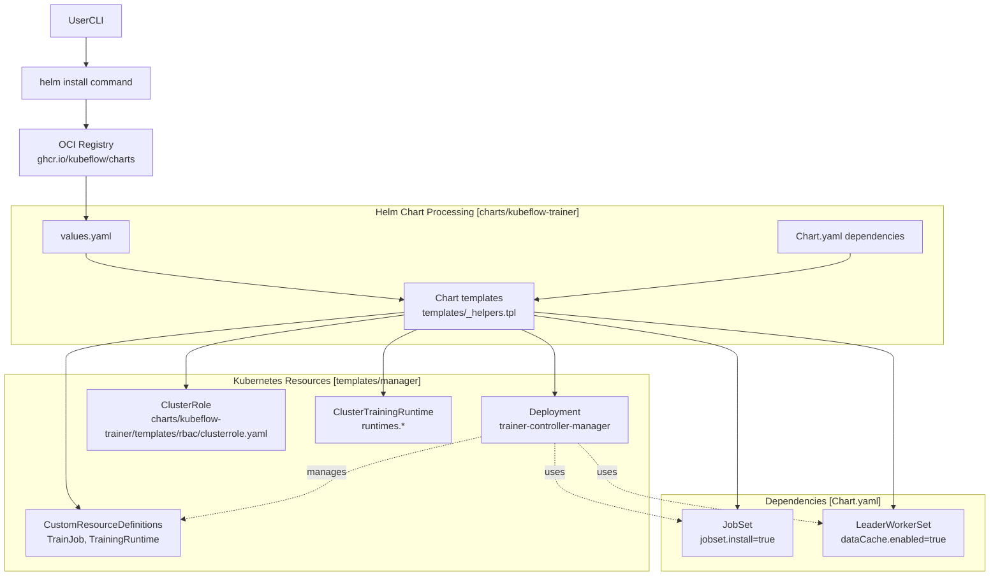
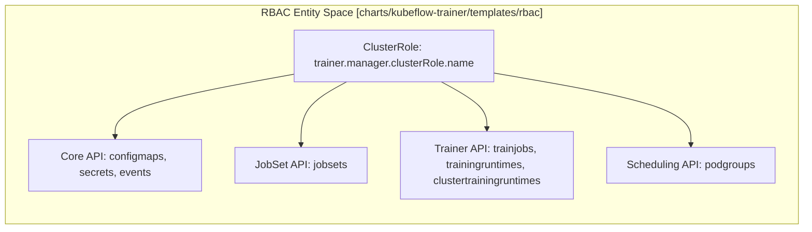

<!-- source: DeepWiki mcp.deepwiki.com · repo kubeflow/trainer · page 7.1 Helm Chart Installation and Configuration · fetched 2026-10-21 -->

# Helm Chart Installation and Configuration

<details>
<summary>Relevant source files</summary>

The following files were used as context for generating this wiki page:

- [.gitignore](.gitignore)
- [.pre-commit-config.yaml](.pre-commit-config.yaml)
- [CHANGELOG/CHANGELOG-2.3.md](CHANGELOG/CHANGELOG-2.3.md)
- [VERSION](VERSION)
- [api/python_api/kubeflow_trainer_api/__init__.py](api/python_api/kubeflow_trainer_api/__init__.py)
- [charts/kubeflow-trainer/Chart.yaml](charts/kubeflow-trainer/Chart.yaml)
- [charts/kubeflow-trainer/README.md](charts/kubeflow-trainer/README.md)
- [charts/kubeflow-trainer/templates/_helpers.tpl](charts/kubeflow-trainer/templates/_helpers.tpl)
- [charts/kubeflow-trainer/templates/manager/configmap.yaml](charts/kubeflow-trainer/templates/manager/configmap.yaml)
- [charts/kubeflow-trainer/templates/manager/public-configmap.yaml](charts/kubeflow-trainer/templates/manager/public-configmap.yaml)
- [charts/kubeflow-trainer/templates/rbac/clusterrole.yaml](charts/kubeflow-trainer/templates/rbac/clusterrole.yaml)
- [charts/kubeflow-trainer/templates/rbac/public_configmap_role.yaml](charts/kubeflow-trainer/templates/rbac/public_configmap_role.yaml)
- [charts/kubeflow-trainer/templates/rbac/public_configmap_role_binding.yaml](charts/kubeflow-trainer/templates/rbac/public_configmap_role_binding.yaml)
- [charts/kubeflow-trainer/templates/webhook/secret.yaml](charts/kubeflow-trainer/templates/webhook/secret.yaml)
- [charts/kubeflow-trainer/tests/manager/configmap_test.yaml](charts/kubeflow-trainer/tests/manager/configmap_test.yaml)
- [charts/kubeflow-trainer/tests/webhook/secret_test.yaml](charts/kubeflow-trainer/tests/webhook/secret_test.yaml)
- [charts/kubeflow-trainer/values.yaml](charts/kubeflow-trainer/values.yaml)
- [hack/e2e-run-notebook.sh](hack/e2e-run-notebook.sh)
- [hack/python-api/gen-api.sh](hack/python-api/gen-api.sh)
- [hack/scripts/container-runtime.sh](hack/scripts/container-runtime.sh)
- [manifests/base/rbac/kustomization.yaml](manifests/base/rbac/kustomization.yaml)
- [manifests/base/rbac/public_configmap_role.yaml](manifests/base/rbac/public_configmap_role.yaml)
- [manifests/base/rbac/public_configmap_role_binding.yaml](manifests/base/rbac/public_configmap_role_binding.yaml)
- [manifests/overlays/manager/kustomization.yaml](manifests/overlays/manager/kustomization.yaml)
- [pkg/features/features.go](pkg/features/features.go)
- [pkg/webhooks/clustertrainingruntime_webhook.go](pkg/webhooks/clustertrainingruntime_webhook.go)
- [pkg/webhooks/clustertrainingruntime_webhook_test.go](pkg/webhooks/clustertrainingruntime_webhook_test.go)
- [pkg/webhooks/setup.go](pkg/webhooks/setup.go)
- [pkg/webhooks/trainingruntime_webhook.go](pkg/webhooks/trainingruntime_webhook.go)
- [pkg/webhooks/trainingruntime_webhook_test.go](pkg/webhooks/trainingruntime_webhook_test.go)
- [pkg/webhooks/trainjob_webhook.go](pkg/webhooks/trainjob_webhook.go)
- [pkg/webhooks/trainjob_webhook_test.go](pkg/webhooks/trainjob_webhook_test.go)

</details>


This document provides detailed instructions for installing and configuring Kubeflow Trainer using the Helm chart or Kustomize. It covers installation methods, configuration options, runtime enablement, data cache setup, Kustomize overlays, RBAC roles, and CRD templates. For information about the controller manager's operational settings, see [Controller Manager Settings](7.2). For details on integrating external dependencies, see [Ecosystem Dependencies](7.3).

Sources: [charts/kubeflow-trainer/README.md:1-12](), [charts/kubeflow-trainer/values.yaml:15-34]()

---

## Prerequisites

The Helm chart and Kustomize manifests require the following prerequisites:

- **Helm**: Version 3.0 or higher [charts/kubeflow-trainer/README.md:15-15]()
- **Kubernetes**: Version 1.31 or higher [charts/kubeflow-trainer/README.md:16-16]()
- **Container Runtime**: Docker or containerd
- **Network**: Cluster networking must support pod-to-pod communication

Sources: [charts/kubeflow-trainer/README.md:13-16]()

---

## Installation Methods

### Basic Installation from OCI Registry

The Helm chart is published to GitHub Container Registry (GHCR) as an OCI artifact. Install the latest released version using:

```bash
export VERSION=v2.3.0
helm install kubeflow-trainer oci://ghcr.io/kubeflow/charts/kubeflow-trainer \
    --namespace kubeflow-system \
    --create-namespace \
    --version ${VERSION#v}
```

For development versions from the master branch, use the commit SHA-based tag [charts/kubeflow-trainer/README.md:32-40]():

```bash
helm install kubeflow-trainer oci://ghcr.io/kubeflow/charts/kubeflow-trainer \
    --namespace kubeflow-system \
    --create-namespace \
    --version 0.0.0-sha-48e7a93
```

Sources: [charts/kubeflow-trainer/README.md:20-40](), [charts/kubeflow-trainer/Chart.yaml:21-21](), [VERSION:1-1](), [api/python_api/kubeflow_trainer_api/__init__.py:16-16]()

### Installation Workflow and Code Entity Association

The following diagram bridges the natural language installation process to code entities and Helm templates (`_helpers.tpl`, `Chart.yaml`, and template files).



Sources: [charts/kubeflow-trainer/README.md:20-40](), [charts/kubeflow-trainer/values.yaml:25-34](), [charts/kubeflow-trainer/values.yaml:164-173](), [charts/kubeflow-trainer/Chart.yaml:25-33](), [charts/kubeflow-trainer/templates/rbac/clusterrole.yaml:17-127]()

---

## Core Configuration Structure

### Values.yaml Organization

The `values.yaml` file is organized into several major sections:

| Section | Purpose | Key Configuration |
|---------|---------|-------------------|
| `nameOverride` / `fullnameOverride` | Chart naming | Override default release names [charts/kubeflow-trainer/values.yaml:19-23]() |
| `crds.enabled` | CRD Management | Control if Helm installs CRDs [charts/kubeflow-trainer/values.yaml:25-29]() |
| `jobset` | JobSet dependency | Control JobSet installation [charts/kubeflow-trainer/values.yaml:31-36]() |
| `image` | Controller image | Registry, repository, tag, pull policy [charts/kubeflow-trainer/values.yaml:41-51]() |
| `manager` | Controller deployment | Replicas, resources, scheduling [charts/kubeflow-trainer/values.yaml:54-103]() |
| `manager.config` | Controller Manager Config | Health, Metrics, Webhook, LeaderElection, Concurrency [charts/kubeflow-trainer/values.yaml:115-157]() |
| `webhook` | Webhook behavior | Failure policy configuration [charts/kubeflow-trainer/values.yaml:159-162]() |
| `dataCache` | Data cache feature | Enable cache and LWS dependency [charts/kubeflow-trainer/values.yaml:164-185]() |
| `runtimes` | Predefined runtimes | Enable specific ML frameworks [charts/kubeflow-trainer/values.yaml:190-230]() |

Sources: [charts/kubeflow-trainer/values.yaml:15-230]()

### Image Configuration

The Helm chart uses a flexible image resolution system defined in `charts/kubeflow-trainer/templates/_helpers.tpl`:

```yaml
image:
  registry: ghcr.io
  repository: kubeflow/trainer/trainer-controller-manager
  tag: ""  # Defaults to the chart version
  pullPolicy: IfNotPresent
```

If `image.tag` is left empty, it defaults to the chart version (e.g., `v2.3.0`) via the `trainer.resolveImageTag` helper function [charts/kubeflow-trainer/templates/_helpers.tpl:72-78]().

Sources: [charts/kubeflow-trainer/values.yaml:41-51](), [charts/kubeflow-trainer/templates/_helpers.tpl:72-78](), [charts/kubeflow-trainer/Chart.yaml:21-21](), [VERSION:1-1]()

---

## Manager Configuration and RBAC Roles

### Deployment Settings

The manager deployment is configured through the `manager` section [charts/kubeflow-trainer/values.yaml:54-103](). Standard Kubernetes pod settings such as `replicas`, `nodeSelector`, `affinity`, `tolerations`, and `resources` are supported [charts/kubeflow-trainer/values.yaml:56-97]().

The manager enforces a secure default `securityContext` [charts/kubeflow-trainer/values.yaml:106-113]():
- `allowPrivilegeEscalation: false`
- `runAsNonRoot: true`
- `capabilities.drop: [ALL]`
- `seccompProfile.type: RuntimeDefault`

Sources: [charts/kubeflow-trainer/values.yaml:54-113]()

### Controller Manager Configuration

The controller manager configuration is defined under `manager.config` and is used to generate the `controller_manager_config.yaml` within a `ConfigMap` [charts/kubeflow-trainer/templates/manager/configmap.yaml:25-27]().

Key operational settings include:
- **Concurrency**: Reconciliation limits for different CRDs [charts/kubeflow-trainer/values.yaml:135-139]().
  - `TrainJob.trainer.kubeflow.org`: Default 5 [charts/kubeflow-trainer/templates/manager/configmap.yaml:56-56]()
  - `TrainingRuntime.trainer.kubeflow.org`: Default 1 [charts/kubeflow-trainer/templates/manager/configmap.yaml:57-57]()
  - `ClusterTrainingRuntime.trainer.kubeflow.org`: Default 1 [charts/kubeflow-trainer/templates/manager/configmap.yaml:58-58]()
- **Leader Election**: Enabled by default to support HA deployments [charts/kubeflow-trainer/values.yaml:128-134]().
- **Status Server**: Configuration for the TrainJob status server [charts/kubeflow-trainer/values.yaml:150-156]().
  - `port`: 10443 [charts/kubeflow-trainer/values.yaml:152-152]()
  - `qps`: 5 [charts/kubeflow-trainer/values.yaml:154-154]()
  - `burst`: 10 [charts/kubeflow-trainer/values.yaml:156-156]()
- **Client Connection**: Rate limiting for the manager's Kubernetes API client [charts/kubeflow-trainer/values.yaml:145-149]().

Sources: [charts/kubeflow-trainer/values.yaml:115-157](), [charts/kubeflow-trainer/templates/manager/configmap.yaml:25-79]()

### RBAC Roles and Permissions

The chart provisions a `ClusterRole` (`charts/kubeflow-trainer/templates/rbac/clusterrole.yaml`) that grants the controller permissions over core resources, CRDs, `jobset.x-k8s.io` jobsets, scheduling podgroups, and admission webhooks [charts/kubeflow-trainer/templates/rbac/clusterrole.yaml:17-127]().



Sources: [charts/kubeflow-trainer/templates/rbac/clusterrole.yaml:17-127]()

---

## CRD Templates and Dependency Management

### v2.3.0 CRD Management

Starting from version 2.3.0, the Trainer CRDs (`TrainJob`, `TrainingRuntime`, `ClusterTrainingRuntime`) are included directly as chart templates [charts/kubeflow-trainer/README.md:42-45](). Users can control CRD installation via `crds.enabled` [charts/kubeflow-trainer/values.yaml:25-29]():
- If `true` (default), Helm manages the CRDs as part of the release.
- If `false`, the user manages CRDs out-of-band.

Sources: [charts/kubeflow-trainer/README.md:42-45](), [charts/kubeflow-trainer/values.yaml:25-29]()

### JobSet Controller Dependency

The `JobSet` controller is a required dependency defined in `Chart.yaml` [charts/kubeflow-trainer/Chart.yaml:26-29](). 

```yaml
jobset:
  install: true  # Set to false if JobSet is already installed in the cluster
  fullnameOverride: jobset
```

Sources: [charts/kubeflow-trainer/values.yaml:31-36](), [charts/kubeflow-trainer/Chart.yaml:26-29]()

### LeaderWorkerSet for Data Cache

The distributed data cache feature depends on `LeaderWorkerSet` (LWS) [charts/kubeflow-trainer/Chart.yaml:30-33](). 

```yaml
dataCache:
  enabled: false  # Must be true to install LWS and cache components
  lws:
    install: true
```

Sources: [charts/kubeflow-trainer/values.yaml:164-173](), [charts/kubeflow-trainer/Chart.yaml:30-33]()

---

## Runtime Enablement and DataCache Setup

### Enabling ClusterTrainingRuntimes

`ClusterTrainingRuntimes` provide templates for different ML frameworks and are applied via a post-install/post-upgrade Helm hook [charts/kubeflow-trainer/README.md:49-50]().

- **Enable all default runtimes**: `--set runtimes.defaultEnabled=true` [charts/kubeflow-trainer/values.yaml:190-193]()
- **Enable specific runtimes**: 
  - `runtimes.torchDistributed.enabled`
  - `runtimes.deepspeedDistributed.enabled`
  - `runtimes.jaxDistributed.enabled`

Sources: [charts/kubeflow-trainer/README.md:47-75](), [charts/kubeflow-trainer/values.yaml:190-230]()

### Data Cache Setup

1. **Enable the feature**: Set `dataCache.enabled: true` [charts/kubeflow-trainer/values.yaml:167-167]().
2. **Configure the image**: Set `dataCache.cacheImage` parameters [charts/kubeflow-trainer/values.yaml:174-180]().
3. **Enable cache runtimes**: Set `dataCache.runtimes.torchDistributedWithCache.enabled: true` [charts/kubeflow-trainer/values.yaml:183-185]().

Sources: [charts/kubeflow-trainer/values.yaml:164-185]()

---

## Kustomize Overlays

Kubeflow Trainer supports installation via Kustomize using manifests located in `manifests/base` and overlays under `manifests/overlays/manager`.

The `manifests/overlays/manager` directory provides standard deployments including CRDs, RBAC, and the controller manager [manifests/overlays/manager/kustomization.yaml:15-28](). Image tags can be overridden directly in `kustomization.yaml`:

```yaml
images:
  - name: ghcr.io/kubeflow/trainer/trainer-controller-manager
    newTag: latest
```

Sources: [manifests/overlays/manager/kustomization.yaml:1-47]()

---

## Uninstallation

To remove the Kubeflow Trainer Helm release:

```bash
helm uninstall [RELEASE_NAME]
```

**Warning**: Helm does not delete Custom Resource Definitions (CRDs) upon uninstallation. These must be deleted manually if you wish to remove all trainer resources from the cluster [charts/kubeflow-trainer/README.md:82-82]().

Sources: [charts/kubeflow-trainer/README.md:76-84]()

---

