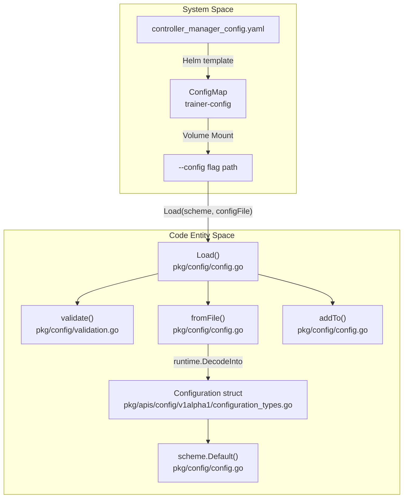
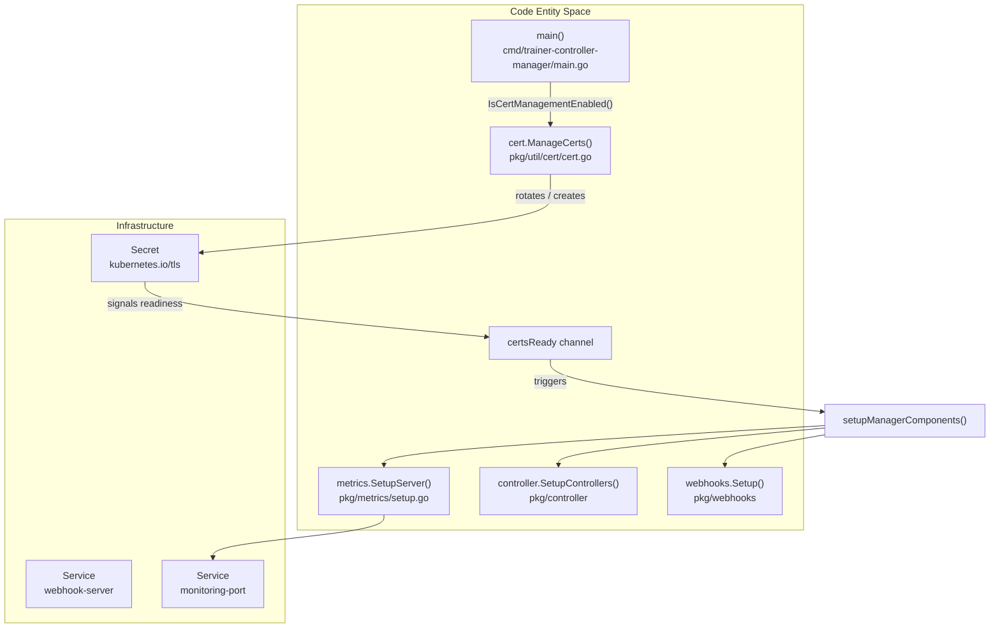

<!-- source: DeepWiki mcp.deepwiki.com · repo kubeflow/trainer · page 7.2 Controller Manager Settings · fetched 2026-10-21 -->

# Controller Manager Settings

Relevant source files

The following files were used as context for generating this wiki page:

- [charts/kubeflow-trainer/templates/manager/_helpers.tpl](charts/kubeflow-trainer/templates/manager/_helpers.tpl)
- [charts/kubeflow-trainer/templates/manager/deployment.yaml](charts/kubeflow-trainer/templates/manager/deployment.yaml)
- [charts/kubeflow-trainer/templates/manager/service.yaml](charts/kubeflow-trainer/templates/manager/service.yaml)
- [charts/kubeflow-trainer/tests/manager/deployment_test.yaml](charts/kubeflow-trainer/tests/manager/deployment_test.yaml)
- [cmd/trainer-controller-manager/main.go](cmd/trainer-controller-manager/main.go)
- [manifests/base/manager/controller_manager_config.yaml](manifests/base/manager/controller_manager_config.yaml)
- [manifests/base/manager/kustomization.yaml](manifests/base/manager/kustomization.yaml)
- [manifests/base/manager/manager.yaml](manifests/base/manager/manager.yaml)
- [manifests/overlays/kubeflow-platform/kustomization.yaml](manifests/overlays/kubeflow-platform/kustomization.yaml)
- [manifests/overlays/kubeflow-platform/patches/jobset-controller-manager-istio.yaml](manifests/overlays/kubeflow-platform/patches/jobset-controller-manager-istio.yaml)
- [manifests/overlays/kubeflow-platform/patches/trainer-manager-istio-and-selectors.yaml](manifests/overlays/kubeflow-platform/patches/trainer-manager-istio-and-selectors.yaml)
- [pkg/apis/config/v1alpha1/configuration_types.go](pkg/apis/config/v1alpha1/configuration_types.go)
- [pkg/apis/config/v1alpha1/defaults.go](pkg/apis/config/v1alpha1/defaults.go)
- [pkg/apis/config/v1alpha1/zz_generated.deepcopy.go](pkg/apis/config/v1alpha1/zz_generated.deepcopy.go)
- [pkg/config/config.go](pkg/config/config.go)
- [pkg/config/config_test.go](pkg/config/config_test.go)
- [pkg/config/validation.go](pkg/config/validation.go)
- [pkg/metrics/setup.go](pkg/metrics/setup.go)
- [pkg/util/cert/cert.go](pkg/util/cert/cert.go)

## Purpose and Scope

This page documents the configuration options, initialization lifecycle, and operational parameters for the Kubeflow Trainer controller manager (`trainer-controller-manager`). It covers `controller_manager_config.yaml`, reconciliation concurrency limits, admission webhook settings, automated certificate management, status server networking, metrics collection, and feature gates.

Sources: [cmd/trainer-controller-manager/main.go:71-111](), [pkg/config/config.go:36-113]()

---

## Configuration Overview

The controller manager configuration is defined by the `Configuration` Go struct (`config.trainer.kubeflow.org/v1alpha1`) and is loaded at startup via the `--config` flag [cmd/trainer-controller-manager/main.go:75-78](). If no configuration file path is provided, default values are applied via `scheme.Default` [pkg/config/config.go:123-124](). Command-line feature gates override corresponding configuration file settings [cmd/trainer-controller-manager/main.go:105-111](). In Kubernetes deployments, this configuration file is projected into the manager pod via a `ConfigMap` mounted at `/controller_manager_config.yaml` [charts/kubeflow-trainer/templates/manager/deployment.yaml:125-127]().

Sources: [pkg/config/config.go:115-138](), [cmd/trainer-controller-manager/main.go:71-111](), [charts/kubeflow-trainer/templates/manager/deployment.yaml:125-127]()

### Configuration Initialization Data Flow

Title: Configuration Initialization and Validation Flow

Sources: [pkg/config/config.go:36-138](), [pkg/apis/config/v1alpha1/configuration_types.go:29-75]()

---

## Configuration Structure

The schema supports modular configuration options for webhooks, leader election, metrics, health probes, concurrency, certificates, client connections, the status server, feature gates, and TLS options [pkg/apis/config/v1alpha1/configuration_types.go:29-75]().

| Section | Go Type | Purpose |
|---------|---------|--------------|
| `webhook` | `ControllerWebhook` | Admission webhook server binding and ports. |
| `leaderElection` | `LeaderElectionConfiguration` | High-availability lease coordination. |
| `metrics` | `ControllerMetrics` | Prometheus metrics scraping and authentication. |
| `health` | `ControllerHealth` | Health probe endpoints (`/healthz`, `/readyz`). |
| `controller` | `ControllerConfigurationSpec` | Per-resource GroupKind reconciliation concurrency. |
| `certManagement` | `CertManagement` | TLS certificate auto-generation and rotation. |
| `clientConnection` | `ClientConnection` | Kubernetes API client rate limiting (QPS and Burst). |
| `statusServer` | `StatusServer` | Runtime status reporting HTTP server settings. |
| `featureGates` | `map[string]bool` | Experimental feature toggles. |
| `tls` | `TLSOptions` | Global TLS settings across server listeners. |

Sources: [pkg/apis/config/v1alpha1/configuration_types.go:29-75](), [pkg/apis/config/v1alpha1/zz_generated.deepcopy.go:74-117]()

---

## Health and Metrics Servers

The manager exposes diagnostic endpoints for Kubernetes probes and Prometheus monitoring.

### Health Probes (`ControllerHealth`)
Health probes are configured via the `health` block [pkg/apis/config/v1alpha1/configuration_types.go:130-158]():
- `healthProbeBindAddress`: TCP address for health probes. Defaults to `:8081` [pkg/apis/config/v1alpha1/defaults.go:40-42]().
- `readinessEndpointName`: Readiness path. Defaults to `readyz` [pkg/apis/config/v1alpha1/defaults.go:43-45]().
- `livenessEndpointName`: Liveness path. Defaults to `healthz` [pkg/apis/config/v1alpha1/defaults.go:46-48]().

### Metrics Server (`ControllerMetrics`)
Metrics are served securely or insecurely via `metrics` configuration [pkg/apis/config/v1alpha1/configuration_types.go:95-117]():
- `bindAddress`: TCP address for metrics. Defaults to `:8443` [pkg/apis/config/v1alpha1/defaults.go:28-30]().
- `secureServing`: Enables HTTPS serving via `metrics.SetupServer` [pkg/apis/config/v1alpha1/defaults.go:31-33](), [pkg/metrics/setup.go:38-72]().
- `auth`: RBAC-based authentication and authorization (`MetricsAuthConfig`) using Kubernetes `TokenReview` and `SubjectAccessReview` APIs [pkg/apis/config/v1alpha1/configuration_types.go:114-128](), [pkg/metrics/setup.go:32-34]().

Sources: [pkg/config/config.go:71-76](), [pkg/apis/config/v1alpha1/defaults.go:28-48](), [pkg/metrics/setup.go:35-72]()

---

## Webhook and Certificate Management

Admission webhooks intercept create, update, and delete requests for `TrainJob`, `TrainingRuntime`, and `ClusterTrainingRuntime` resources.

### Webhook Server (`ControllerWebhook`)
- `port`: Serving port, defaulting to `9443` [pkg/apis/config/v1alpha1/defaults.go:25-27]().
- `host`: Optional bind hostname [pkg/apis/config/v1alpha1/configuration_types.go:87-93]().

### Certificate Management (`CertManagement`)
Automated TLS provisioning is handled by `cert.ManageCerts` using the `cert-controller` rotator [pkg/util/cert/cert.go:70-101]():
- `enable`: Defaults to `true` [pkg/apis/config/v1alpha1/defaults.go:52-54]().
- `webhookServiceName`: Target service name (`kubeflow-trainer-controller-manager`) [pkg/apis/config/v1alpha1/defaults.go:55-57]().
- `webhookSecretName`: Kubernetes Secret storing serving certs (`kubeflow-trainer-webhook-secret`) [pkg/apis/config/v1alpha1/defaults.go:58-60]().

### Server Setup and Certificate Data Flow

Title: Manager Component and Certificate Setup Pipeline

Sources: [cmd/trainer-controller-manager/main.go:123-186](), [pkg/util/cert/cert.go:70-101](), [pkg/metrics/setup.go:35-72]()

---

## Controller Concurrency Settings

The `ControllerConfigurationSpec` defines `groupKindConcurrency`, mapping a Kubernetes `GroupKind` string (e.g., `TrainJob.trainer.kubeflow.org`) to an integer concurrency limit [pkg/apis/config/v1alpha1/configuration_types.go:160-177](). During manager initialization, these limits are injected into `ctrl.Options.Controller.GroupKindConcurrency` to regulate parallel reconciliation loops [pkg/config/config.go:105-112]().

Sources: [pkg/apis/config/v1alpha1/configuration_types.go:160-177](), [pkg/config/config.go:105-112]()

---

## TrainJob Status Server

The runtime status server (`pkg/statusserver`) listens for status updates reported by training pods [cmd/trainer-controller-manager/main.go:149-156](). It is governed by `StatusServer` configuration:
- `port`: Default `10443` [pkg/apis/config/v1alpha1/defaults.go:73-75](), [manifests/base/manager/manager.yaml:60-62]().
- `qps`: Rate limit (`5`) [pkg/apis/config/v1alpha1/defaults.go:76-78]().
- `burst`: Burst limit (`10`) [pkg/apis/config/v1alpha1/defaults.go:79-81]().

Probes are registered prior to manager startup [cmd/trainer-controller-manager/main.go:149-156]() and activated if the `TrainJobStatus` feature gate is enabled.

Sources: [pkg/apis/config/v1alpha1/defaults.go:70-82](), [cmd/trainer-controller-manager/main.go:149-156](), [manifests/base/manager/manager.yaml:60-62]()

---

## Feature Gates

Feature gates allow enabling or disabling experimental modules via a `map[string]bool` in `Configuration.FeatureGates` [pkg/apis/config/v1alpha1/configuration_types.go:67-70]():
- `TrainJobStatus`: Controls whether the TrainJob status collection and runtime status server probes are registered [cmd/trainer-controller-manager/main.go:151-156]().

Feature gates set in configuration are loaded into `utilfeature.DefaultMutableFeatureGate` and can be overridden via the `--feature-gates` command-line flag [cmd/trainer-controller-manager/main.go:99-111]().

Sources: [pkg/apis/config/v1alpha1/configuration_types.go:67-70](), [cmd/trainer-controller-manager/main.go:99-111]()

---

## Client Connection Settings

The `ClientConnection` struct configures the Kubernetes API client rate limits (`rest.Config`) via `ApplyClientConnection` [pkg/config/config.go:142-151]():
- `qps`: Queries Per Second. Defaults to `50` [pkg/apis/config/v1alpha1/defaults.go:64-66]().
- `burst`: Maximum burst requests. Defaults to `100` [pkg/apis/config/v1alpha1/defaults.go:67-69]().

Sources: [pkg/config/config.go:142-151](), [pkg/apis/config/v1alpha1/defaults.go:61-69]()

---

