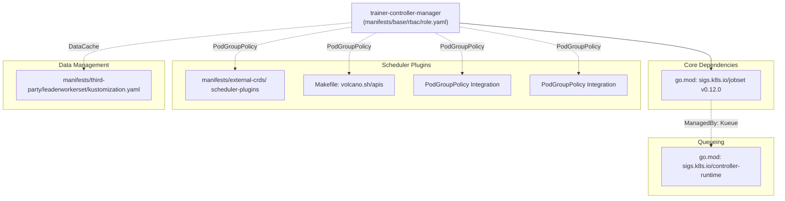
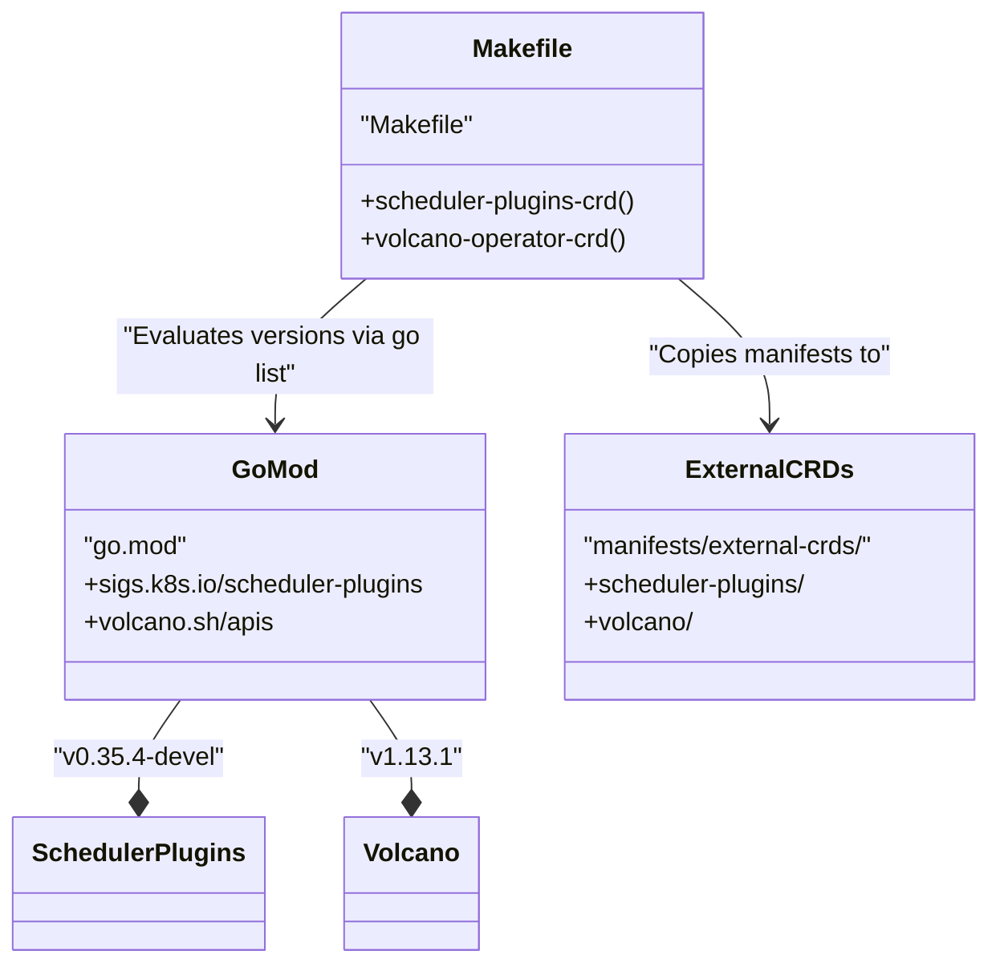

<!-- source: DeepWiki mcp.deepwiki.com · repo kubeflow/trainer · page 7.3 Ecosystem Dependencies · fetched 2026-10-21 -->

# Ecosystem Dependencies

<details>
<summary>Relevant source files</summary>

The following files were used as context for generating this wiki page:

- [Makefile](Makefile)
- [api/python_api/kubeflow_trainer_api/models/jobset_v1alpha2_failure_policy_rule.py](api/python_api/kubeflow_trainer_api/models/jobset_v1alpha2_failure_policy_rule.py)
- [charts/kubeflow-trainer/templates/data-cache/cluster-role.yaml](charts/kubeflow-trainer/templates/data-cache/cluster-role.yaml)
- [charts/kubeflow-trainer/tests/data-cache/cluster_role_test.yaml](charts/kubeflow-trainer/tests/data-cache/cluster_role_test.yaml)
- [docs/operator-guides/migration.md](docs/operator-guides/migration.md)
- [go.mod](go.mod)
- [go.sum](go.sum)
- [manifests/base/rbac/role.yaml](manifests/base/rbac/role.yaml)
- [manifests/base/runtimes/data-cache/kustomization.yaml](manifests/base/runtimes/data-cache/kustomization.yaml)
- [manifests/overlays/data-cache/cluster_role.yaml](manifests/overlays/data-cache/cluster_role.yaml)
- [manifests/overlays/data-cache/kustomization.yaml](manifests/overlays/data-cache/kustomization.yaml)
- [manifests/overlays/data-cache/namespace-rbac/kustomization.yaml](manifests/overlays/data-cache/namespace-rbac/kustomization.yaml)
- [manifests/overlays/data-cache/namespace-rbac/role_binding.yaml](manifests/overlays/data-cache/namespace-rbac/role_binding.yaml)
- [manifests/overlays/data-cache/namespace-rbac/service_account.yaml](manifests/overlays/data-cache/namespace-rbac/service_account.yaml)
- [manifests/third-party/jobset/kustomization.yaml](manifests/third-party/jobset/kustomization.yaml)
- [manifests/third-party/leaderworkerset/kustomization.yaml](manifests/third-party/leaderworkerset/kustomization.yaml)
- [pkg/controller/trainjob_controller.go](pkg/controller/trainjob_controller.go)

</details>


Kubeflow Trainer integrates with several Kubernetes ecosystem projects to provide job orchestration, gang scheduling, and distributed data management. This page documents these dependencies, their technical implementation via the plugin framework, their role in the training lifecycle, and the migration paths from legacy v1 operators.

---

## 1. Dependency Overview and Architecture Integration

Kubeflow Trainer relies on a required core orchestrator (`JobSet`) and optional ecosystem components for gang scheduling, advanced queuing, and data management. 

### System Integration Diagram

The following diagram maps the external ecosystem dependencies to the concrete components and code references within the `trainer-controller-manager` ecosystem.



**Sources:** [go.mod:24-31](), [manifests/third-party/leaderworkerset/kustomization.yaml:19-27](), [manifests/base/rbac/role.yaml:83-113]()

---

## 2. Core Dependency: JobSet

`JobSet` is the primary orchestrator used by Kubeflow Trainer to manage groups of Pods (`ReplicatedJobs`) for multi-node and multi-step distributed execution.

### Implementation Details
The `trainer-controller-manager` resolves a `TrainingRuntime`, applies `RuntimePatches`, and generates a `JobSet` resource rather than creating Pods directly. The project depends on `sigs.k8s.io/jobset` version `v0.12.0` [go.mod:26]().

- **CRD Management**: For integration testing and deployment, CRDs are mirrored from the upstream JobSet repository's `config/components/crd/bases` directory via the `jobset-operator-crd` target [Makefile:148-151]().
- **Integration Point**: The `JobSet` resource is managed via Server-Side Apply (SSA) by the controller logic [pkg/controller/trainjob_controller.go:143-154](). The controller requires full RBAC permissions for `jobsets` in the `jobset.x-k8s.io` API group [manifests/base/rbac/role.yaml:83-93]().
- **Functionality**: JobSet handles coordinated startup, failure policies, and network naming required for multi-node distributed frameworks.

**Sources:** [go.mod:26](), [Makefile:148-151](), [pkg/controller/trainjob_controller.go:143-154](), [manifests/base/rbac/role.yaml:83-93]()

---

## 3. Gang Scheduling Dependencies

Kubeflow Trainer supports multiple gang scheduling backends to ensure all training workers are scheduled simultaneously, preventing resource deadlocks in distributed training jobs.

### Supported Schedulers

| Dependency | Module Path / Reference | CRD / Integration Target |
|------------|-------------------------|--------------------------|
| **scheduler-plugins** | `sigs.k8s.io/scheduler-plugins` [go.mod:28]() | `manifests/external-crds/scheduler-plugins` [Makefile:157]() |
| **Volcano** | `volcano.sh/apis` [go.mod:31]() | `PodGroup` via `scheduling.volcano.sh` [manifests/base/rbac/role.yaml:103]() |
| **KAI Scheduler** | Integrated via `PodGroupPolicy` | Custom scheduling extension |
| **YuniKorn** | Integrated via `PodGroupPolicy` | Queue-based gang scheduling |
| **Slurm Bridge** | Coscheduling `PodGroupPolicy` | HPC Bridge integration |

### Code Entity Mapping: Scheduling Plugins



**Sources:** [go.mod:28-31](), [Makefile:143-160](), [manifests/base/rbac/role.yaml:103-113]()

---

## 4. Data Management: LeaderWorkerSet (LWS)

The Distributed Data Cache system leverages `LeaderWorkerSet` (LWS) to manage cache server groups providing high-throughput distributed data loading.

### Implementation Details
- **Purpose**: LWS provisions a "Leader" pod (coordinator) and multiple "Worker" pods (storage nodes) with stable network identities for the Rust-based data cache.
- **Integration**: Deployed via the `data-cache` overlay which layers over the standard controller installation [manifests/overlays/data-cache/kustomization.yaml:19-22]().
- **Deployment**: Uses LeaderWorkerSet version `v0.8.0` [manifests/third-party/leaderworkerset/kustomization.yaml:19-27]().
- **RBAC**: A dedicated ServiceAccount `kubeflow-trainer-cache-initializer` and associated RoleBinding are deployed to manage cache initialization [manifests/overlays/data-cache/namespace-rbac/role_binding.yaml:16-26](), [manifests/overlays/data-cache/namespace-rbac/service_account.yaml:16-19]().

**Sources:** [manifests/third-party/leaderworkerset/kustomization.yaml:19-27](), [manifests/overlays/data-cache/kustomization.yaml:19-22](), [manifests/overlays/data-cache/namespace-rbac/role_binding.yaml:16-26](), [manifests/overlays/data-cache/namespace-rbac/service_account.yaml:16-19]()

---

## 5. Advanced Integration: Kueue

Kubeflow Trainer integrates natively with Kueue for advanced cluster-level queueing, batch job scheduling, and multi-tenant resource sharing.

### Integration Flow
1. **Orchestration**: Trainer delegates workload execution to `JobSet`.
2. **Admission**: Kueue intercepts `JobSet` objects created by the Trainer controller. Because the underlying object is a `sigs.k8s.io/jobset` [go.mod:26](), Kueue manages its `suspend` field directly.
3. **Multi-Manager Coordination**: Controllers are built on `sigs.k8s.io/controller-runtime` [go.mod:25](), allowing smooth integration with external queue controllers via standard Kubernetes ownership rules and status propagation.

**Sources:** [go.mod:25-26]()

---

## 6. Migration from v1 Operators

Kubeflow Trainer v2 replaces legacy framework-specific operators (`PyTorchJob`, `TFJob`, and `MPIJob`) with unified APIs (`TrainJob`, `TrainingRuntime`, and `ClusterTrainingRuntime`).

### Migrating PyTorchJob to TrainJob

Legacy `PyTorchJob` resources defined master/worker replica specifications inline. In Kubeflow Trainer v2, these configurations are handled by referencing a cluster-level runtime (`torch-distributed`) while workload properties are passed directly to the `TrainJob` spec [docs/operator-guides/migration.md:32-89]().

```yaml
# New: TrainJob (v2)
apiVersion: trainer.kubeflow.org/v1alpha1
kind: TrainJob
metadata:
  name: pytorch-simple
spec:
  runtimeRef:
    name: torch-distributed
  trainer:
    numNodes: 2
    image: docker.io/kubeflowkatib/pytorch-mnist:v1beta1-45c5727
    command:
      - "python3"
      - "/opt/pytorch-mnist/mnist.py"
      - "--epochs=1"
```

### Migrating MPIJob to TrainJob

In legacy `MPIJob` resources, launcher and worker topologies were configured inside `mpiReplicaSpecs`. Kubeflow Trainer v2 separates the execution environment (via `ClusterTrainingRuntime`) from the workload definition (`TrainJob`) [docs/operator-guides/migration.md:91-219]().

**Sources:** [docs/operator-guides/migration.md:1-219]()

---

## 7. Build and Runtime Requirements

The project uses a standard Go toolchain and container-based integration framework:
- **Go Version**: Requires Go `1.26.0` [go.mod:3]().
- **Controller Runtime**: Built with `sigs.k8s.io/controller-runtime` v0.24.1 [go.mod:25]().
- **Kubernetes APIs**: Standardized on `k8s.io/api` v0.37.0 [go.mod:14]().
- **Tooling**: Leverages `controller-gen` v0.21.0 and `kind` for local development environments [Makefile:36-40](), [go.mod:27]().

**Sources:** [go.mod:1-31](), [Makefile:36-40]()

---

