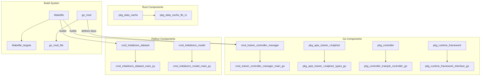
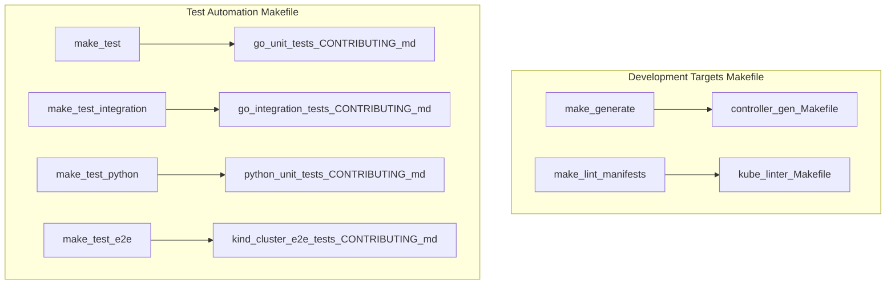

<!-- source: DeepWiki mcp.deepwiki.com · repo kubeflow/trainer · page 8 Development and Contribution · fetched 2026-10-21 -->

# Development and Contribution

Relevant source files

The following files were used as context for generating this wiki page:

- [.github/ISSUE_TEMPLATE/bug_report.yaml](.github/ISSUE_TEMPLATE/bug_report.yaml)
- [.github/ISSUE_TEMPLATE/config.yml](.github/ISSUE_TEMPLATE/config.yml)
- [.github/ISSUE_TEMPLATE/feature_request.yaml](.github/ISSUE_TEMPLATE/feature_request.yaml)
- [.github/PULL_REQUEST_TEMPLATE.md](.github/PULL_REQUEST_TEMPLATE.md)
- [.github/copilot-instructions.md](.github/copilot-instructions.md)
- [AGENTS.md](AGENTS.md)
- [CONTRIBUTING.md](CONTRIBUTING.md)
- [README.md](README.md)
- [cmd/trainer-controller-manager/Dockerfile](cmd/trainer-controller-manager/Dockerfile)
- [docs/README.md](docs/README.md)
- [proposals/2432-gpu-testing-on-llm-blueprints/README.md](proposals/2432-gpu-testing-on-llm-blueprints/README.md)

This document serves as the high-level overview guide for developers contributing to the Kubeflow Trainer codebase [CONTRIBUTING.md:1-3](). It covers multi-language development workflows, repository organization, build targets, testing strategies, CI/CD pipelines, release processes, and governance guidelines. 

For complete technical depth, this page links to specialized child pages for project structure, testing, CI/CD, release management, and contribution standards.

## Project Structure and Build System

Kubeflow Trainer is a multi-language project combining Go (`github.com/kubeflow/trainer/v2`) for the controller and custom resource APIs [go.mod:1-3](), Python for dataset/model initializers and the SDK [AGENTS.md:96](), and Rust for the distributed data cache service [AGENTS.md:97](). The repository layout organizes core logic into modular packages under `pkg/`, entrypoints under `cmd/`, and orchestration manifests under `charts/` and `manifests/` [AGENTS.md:40-91]().

Title: Multi-Language Component Architecture to Code Entities

Sources: [go.mod:1-3](), [Makefile:1-50](), [AGENTS.md:40-91](), [cmd/trainer-controller-manager/Dockerfile:16-34]()

For details on Go modules, Makefile targets, code generation, linting, and boilerplate, see [Project Structure and Build System](#8.1).

## Testing Strategy

The project implements a multi-layer testing framework spanning unit, integration, and end-to-end execution across Go, Python, and Rust components [CONTRIBUTING.md:69-118](), [AGENTS.md:98-100]().

Title: Development and Code Generation Pipeline

Sources: [Makefile:80-143](), [CONTRIBUTING.md:53-118](), [go.mod:24-30]()

For detailed documentation on unit tests, envtest integration tests, CPU/GPU E2E tests, papermill notebook testing, and multi-language suites, see [Testing Strategy](#8.2).

## CI/CD Pipeline

Continuous integration and delivery are orchestrated via GitHub Actions workflows [AGENTS.md:42](). Key automation gates include:
- Multi-platform container image builds using multi-stage Dockerfiles [cmd/trainer-controller-manager/Dockerfile:16-34]().
- Comprehensive test matrices across supported Go, Python, and Rust versions [.github/copilot-instructions.md:47-54]().
- Automated security scanning (OSV, Trivy, `govulncheck`) and lockfile validation.
- Artifact publishing to GitHub Container Registry (GHCR) and Docker Hub.

Sources: [cmd/trainer-controller-manager/Dockerfile:16-34](), [.github/copilot-instructions.md:47-54]()

For details on GitHub Actions workflows, security scanning, CVE detection, and artifact publishing, see [CI/CD Pipeline](#8.3).

## Release Process and Versioning

Releases follow semantic versioning coordinated across the Go controller, Python SDK, initializers, and runtime images [README.md:17-30](). Release automation handles version stamping, changelog generation via `git-cliff` based on Conventional Commits [CONTRIBUTING.md:130-136](), and publishing API modules to PyPI alongside container images.

Sources: [README.md:17-30](), [CONTRIBUTING.md:130-136]()

For details on release workflows, version management, changelog generation, and PyPI publishing, see [Release Process and Versioning](#8.4).

## Contributing Guidelines and Governance

Contributions must adhere to established quality gates and community standards:
- **Prerequisites**: Install Go (1.26+), Python (3.12+), Docker (23+), Kind (0.27+), and Kustomize (4.0.5+) [CONTRIBUTING.md:42-49]().
- **Pre-commit Hooks**: Run `pre-commit install` to enforce local formatting and linting gates [CONTRIBUTING.md:120-126]().
- **Commit Conventions**: Use Conventional Commits for pull request titles (`feat`, `fix`, `chore`) to automate changelog compilation [CONTRIBUTING.md:130-136]().
- **Enhancement Proposals**: Significant features require a Kubeflow Enhancement Proposal (KEP) submitted under `./proposals` [CONTRIBUTING.md:146-152]().
- **AI Policy**: AI assistant tooling may be used in accordance with the [Kubeflow AI Policy](https://www.kubeflow.org/docs/about/ai_policy/) [CONTRIBUTING.md:8-11]() and repository agent guidelines (`AGENTS.md`) [AGENTS.md:7-36]().

Sources: [CONTRIBUTING.md:1-171](), [.github/PULL_REQUEST_TEMPLATE.md:1-15](), [AGENTS.md:7-36]()

For details on OWNERS files, review processes, approval workflows, code of conduct, and issue/PR templates, see [Contributing Guidelines and Governance](#8.5).

## Detailed Development Guides

For deeper technical details, see the following child pages:
- [Project Structure and Build System](#8.1) — Explain repository structure, Go modules, Makefile targets, code generation, linting/boilerplate, and multi-language components (Go, Python, Rust). Also covers the `.agents/` directory with AI agent skills.
- [Testing Strategy](#8.2) — Document unit tests, integration tests with envtest, E2E tests (CPU and GPU), notebook testing with papermill, Helm unittest, and multi-language testing (Go, Python, Rust).
- [CI/CD Pipeline](#8.3) — Explain GitHub Actions workflows, multi-platform image builds, test matrices, OSV/Trivy security scanning, govulncheck CVE detection, lockfile validation, and artifact publishing to GHCR and Docker Hub.
- [Release Process and Versioning](#8.4) — Document release workflows, version management across components, changelog generation with git-cliff, and API module publishing to PyPI.
- [Contributing Guidelines and Governance](#8.5) — Explain OWNERS file structure, approval process, contribution guidelines, code of conduct, AI policy reference, roadmap/adopters, and issue/PR templates.

---

