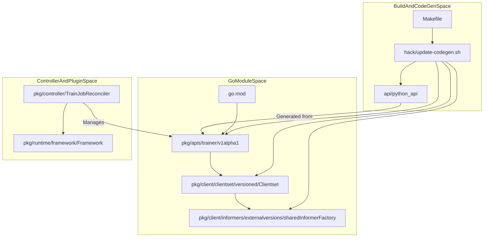

<!-- source: DeepWiki mcp.deepwiki.com · repo kubeflow/trainer · page 8.1 Project Structure and Build System · fetched 2026-10-21 -->

# Project Structure and Build System

<details>
<summary>Relevant source files</summary>

The following files were used as context for generating this wiki page:

- [.agents/docs/api-conventions.md](.agents/docs/api-conventions.md)
- [.agents/docs/api_changes.md](.agents/docs/api_changes.md)
- [.agents/skills/add-new-crd/SKILL.md](.agents/skills/add-new-crd/SKILL.md)
- [.gitattributes](.gitattributes)
- [.golangci.yaml](.golangci.yaml)
- [Makefile](Makefile)
- [api/python_api/kubeflow_trainer_api/models/jobset_v1alpha2_failure_policy_rule.py](api/python_api/kubeflow_trainer_api/models/jobset_v1alpha2_failure_policy_rule.py)
- [go.mod](go.mod)
- [go.sum](go.sum)
- [hack/.custom-gcl.yaml](hack/.custom-gcl.yaml)
- [hack/swagger/main.go](hack/swagger/main.go)
- [manifests/base/rbac/role.yaml](manifests/base/rbac/role.yaml)
- [manifests/third-party/jobset/kustomization.yaml](manifests/third-party/jobset/kustomization.yaml)
- [pkg/controller/trainjob_controller.go](pkg/controller/trainjob_controller.go)
- [pkg/util/testing/client.go](pkg/util/testing/client.go)
- [pkg/util/testing/compare.go](pkg/util/testing/compare.go)

</details>


## Purpose and Scope

This document details the project structure and build system for Kubeflow Trainer, a multi-language distributed AI training platform on Kubernetes. It covers repository layout, Go module configuration in `go.mod` [go.mod:1-3](), Makefile target orchestration in `Makefile` [Makefile:25-33](), code generation pipelines, RBAC specifications in `manifests/base/rbac/role.yaml` [manifests/base/rbac/role.yaml:16-20](), and developer workflows including AI agent skills under `.agents/`.

Sources: `go.mod`, `Makefile`, `manifests/base/rbac/role.yaml`

## Multi-Language Project Architecture

Kubeflow Trainer integrates Go, Python, and Rust components into a unified framework. Go handles core orchestration, controllers, and Kubernetes API types (`pkg/controller/trainjob_controller.go` [pkg/controller/trainjob_controller.go:51-59]()); Python manages user-facing SDKs, dataset initializers, and model loaders; Rust powers the high-performance distributed data cache.

**Diagram: System-to-Code Architecture Mapping**

Sources: `go.mod`, `Makefile`, `pkg/controller/trainjob_controller.go`, `api/python_api/kubeflow_trainer_api/models/jobset_v1alpha2_failure_policy_rule.py`

## Go Module Structure and Dependencies

The Go module is defined in `go.mod` [go.mod:1-3]() under module path `github.com/kubeflow/trainer/v2` targeting Go 1.26.0.

### Core Dependencies

| Dependency | Version | Purpose |
|------------|---------|---------|
| `k8s.io/api` | v0.37.0 | Kubernetes API core primitives [go.mod:14-14]() |
| `k8s.io/apimachinery` | v0.37.0 | Runtime and schema management [go.mod:16-16]() |
| `k8s.io/client-go` | v0.37.0 | Kubernetes API client library [go.mod:18-18]() |
| `sigs.k8s.io/controller-runtime` | v0.24.1 | Operator control loop framework [go.mod:25-25]() |
| `sigs.k8s.io/jobset` | v0.12.0 | Multi-pod batch orchestration [go.mod:26-26]() |
| `sigs.k8s.io/scheduler-plugins` | v0.35.4-devel | Coscheduling and PodGroup policies [go.mod:28-28]() |
| `volcano.sh/apis` | v1.13.1-... | Volcano scheduler integration [go.mod:31-31]() |
| `k8s.io/code-generator` | v0.37.0 | Codegen utilities for types and clients [go.mod:19-19]() |

Sources: `go.mod`

## Makefile Build System and Tool Orchestration

The `Makefile` [Makefile:25-33]() defines environment variables, container runtimes, and local tool paths (`LOCALBIN`). Tool versions are pinned explicitly to guarantee build reproducibility.

### Tool Versions and Targets

- `CONTROLLER_GEN_VERSION`: v0.21.0 [Makefile:39-39]()
- `HELM_VERSION`: v3.18.6 [Makefile:41-41]()
- `ENVTEST_VERSION`: release-0.22 [Makefile:38-38]()
- `YQ_VERSION`: v4.45.1 [Makefile:45-45]()

Primary targets include `manifests` (invoking `controller-gen`), `lint-manifests` (invoking `kube-linter`), `jobset-operator-crd`, and `scheduler-plugins-crd` [Makefile:139-160]().

Sources: `Makefile`

## Code Generation Workflow and Client Architecture

Code generation produces Custom Resource Definitions, deepcopy functions, clientsets, informers, listers, and OpenAPI specifications.

**Diagram: Code Generation Execution Pipeline**
```mermaid
sequenceDiagram
    participant Make as "Makefile"
    participant CodegenScript as "hack/update-codegen.sh"
    participant ControllerGen as "controller-gen"
    participant OpenAPI as "openapi-gen"
    participant PythonGen as "openapi-generator"

    Make->>CodegenScript: "make generate"
    CodegenScript->>ControllerGen: "controller-gen object"
    ControllerGen-->>APIs: "zz_generated.deepcopy.go"
    CodegenScript->>CodegenScript: "hack/update-codegen.sh" (internal steps)
    CodegenScript->>OpenAPI: "openapi-gen"
    OpenAPI-->>SwaggerJSON: "api/openapi-spec/swagger.json"
    CodegenScript->>PythonGen: "openapi-generator generate"
    PythonGen-->>PythonAPI: "api/python_api/*"
    CodegenScript-->>ClientSet: "pkg/client/clientset/versioned/*"
    CodegenScript-->>InformerFactory: "pkg/client/informers/externalversions/*"

    rect rgb(250, 250, 200)
        APIs[pkg/apis/trainer/v1alpha1]
        ClientSet[pkg/client/clientset/versioned]
        InformerFactory[pkg/client/informers/externalversions]
        SwaggerJSON[api/openapi-spec/swagger.json]
        PythonAPI[api/python_api]
    end
```
Sources: `Makefile`, `api/python_api/kubeflow_trainer_api/models/jobset_v1alpha2_failure_policy_rule.py`

### Generated Clients and OpenAPI

The code generation process, triggered by `make generate` [Makefile:300-300](), executes `controller-gen` to produce `zz_generated.deepcopy.go` files for Go types. It also runs `hack/update-codegen.sh` which generates typed clientsets, scheme registries, generic informers, and shared informer factories under `pkg/client/`. Additionally, `openapi-gen` is used to create OpenAPI specifications in `api/openapi-spec/swagger.json`. This `swagger.json` is then consumed by `openapi-generator` to produce the Python API models located in `api/python_api/` [api/python_api/kubeflow_trainer_api/models/jobset_v1alpha2_failure_policy_rule.py:15-26]().

Sources: `Makefile`, `api/python_api/kubeflow_trainer_api/models/jobset_v1alpha2_failure_policy_rule.py`

## AI Agent Skills and API Conventions

The `.agents/` directory provides structured agent instructions and developer documentation. Skills under `.agents/skills/add-new-crd/SKILL.md` [.agents/skills/add-new-crd/SKILL.md:1-374]() define step-by-step procedures for adding new CRDs, covering Go type definitions with code generation markers, scheme registration, webhook and controller scaffolding, RBAC markers, testing wrappers, integration tests, and manifest generation. The `.agents/docs/api-conventions.md` [.agents/docs/api-conventions.md:1-2231]() and `.agents/docs/api_changes.md` [.agents/docs/api_changes.md:1-1561]() outline standards for API immutability, subresources, and versioning, serving as critical references for API development.

Sources: `.agents/skills/add-new-crd/SKILL.md`, `.agents/docs/api-conventions.md`, `.agents/docs/api_changes.md`

## External CRD Dependencies and Controller RBAC

Integration testing and local scaffolding rely on external CRDs fetched via Makefile targets into `manifests/external-crds/` [Makefile:145-160](). For instance, JobSet CRDs are copied from `sigs.k8s.io/jobset` [Makefile:147-152]() and scheduler-plugins CRDs from `sigs.k8s.io/scheduler-plugins` [Makefile:154-158](). The controller manager operates under the `ClusterRole` defined in `manifests/base/rbac/role.yaml` [manifests/base/rbac/role.yaml:16-20](), granting necessary permissions over core resources, JobSets (`jobset.x-k8s.io/jobsets` [manifests/base/rbac/role.yaml:83-93]()), Volcano PodGroups (`scheduling.volcano.sh/podgroups` [manifests/base/rbac/role.yaml:103-113]()), and `trainer.kubeflow.org` custom resources (`trainjobs`, `trainingruntimes`, `clustertrainingruntimes` [manifests/base/rbac/role.yaml:115-136]()).

Sources: `Makefile`, `manifests/base/rbac/role.yaml`, `manifests/third-party/jobset/kustomization.yaml`

---

