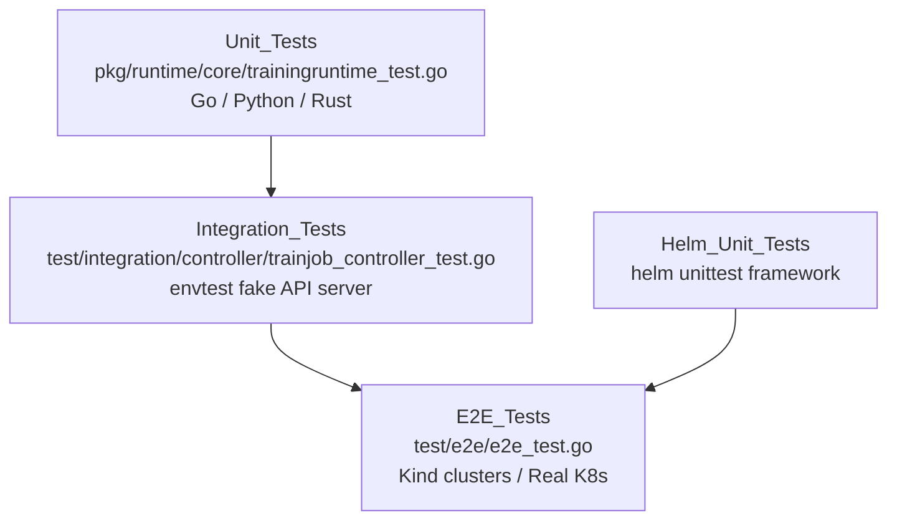
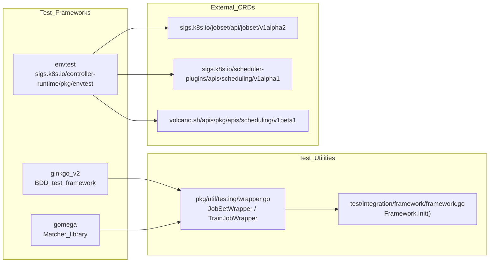
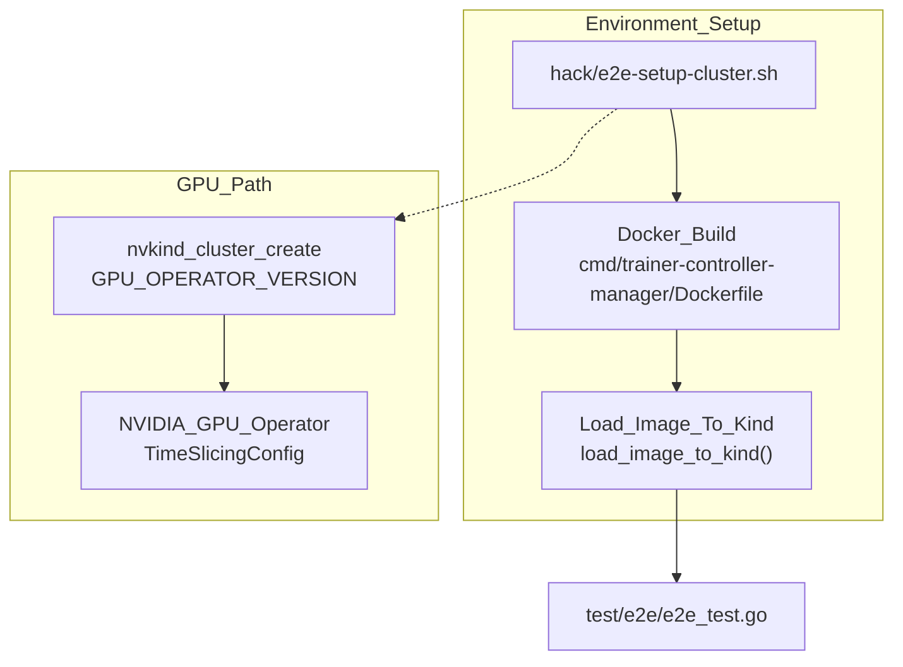

<!-- source: DeepWiki mcp.deepwiki.com · repo kubeflow/trainer · page 8.2 Testing Strategy · fetched 2026-10-21 -->

# Testing Strategy

Relevant source files

The following files were used as context for generating this wiki page:

- [.github/workflows/gh-workflow-approve.yaml](.github/workflows/gh-workflow-approve.yaml)
- [.github/workflows/github-stale.yaml](.github/workflows/github-stale.yaml)
- [.github/workflows/template-setup-clusters/action.yaml](.github/workflows/template-setup-clusters/action.yaml)
- [hack/e2e-setup-cluster.sh](hack/e2e-setup-cluster.sh)
- [pkg/runtime/core/trainingruntime_test.go](pkg/runtime/core/trainingruntime_test.go)
- [pkg/util/testing/wrapper.go](pkg/util/testing/wrapper.go)
- [test/e2e/e2e_test.go](test/e2e/e2e_test.go)
- [test/e2e/suite_test.go](test/e2e/suite_test.go)
- [test/integration/controller/trainjob_controller_test.go](test/integration/controller/trainjob_controller_test.go)
- [test/integration/framework/framework.go](test/integration/framework/framework.go)
- [test/util/constants.go](test/util/constants.go)

This page documents the testing strategy for Kubeflow Trainer, including test levels, frameworks, infrastructure, and CI/CD integration. The testing approach ensures system reliability across multiple programming languages (Go, Python, Rust) and deployment scenarios (unit, `envtest` integration, CPU/GPU E2E, Helm charts, notebooks).

For information about the CI/CD pipeline configuration, see [8.3](). For build system details, see [8.1]().

---

## Test Levels and Coverage

Kubeflow Trainer implements a multi-layered testing strategy covering unit tests, integration tests, E2E tests, Helm tests, and multi-language component tests.

### Testing Pyramid

The testing strategy follows a standard pyramid structure, with a broad base of unit tests, intermediate `envtest` integration tests, Helm tests, and a focused set of E2E tests running in real Kubernetes environments.

**Testing Pyramid Architecture**

**Sources:** [test/e2e/e2e_test.go:51-133](), [test/integration/controller/trainjob_controller_test.go:43-140](), [pkg/runtime/core/trainingruntime_test.go:77-154]()

### Test Coverage by Component

| Component | Unit Tests | Integration Tests | E2E Tests | Multi-Language Support |
|-----------|-----------|------------------|-----------|------------------------|
| Go Controller & Webhooks | ✓ (`testing`) | ✓ (`envtest`) | ✓ (Kind) | Go (`go test`) |
| Go Runtime Framework | ✓ (`pkg/runtime/core`) | ✓ (`envtest`) | ✓ (Kind) | Go (`go test`) |
| Python SDK & Initializers | ✓ (`pytest`) | - | ✓ (Notebooks/Papermill) | Python (`pytest`, `uv`) |
| Rust Data Cache | ✓ (`cargo test`) | - | ✓ (Kind) | Rust (`cargo`) |
| Helm Charts | ✓ (`helm unittest`) | - | ✓ (Helm install) | YAML / Helm |

---

## Go Testing Infrastructure

### Test Frameworks and Dependencies

The Go testing stack uses Ginkgo v2, Gomega, and controller-runtime `envtest` to validate the `TrainJob` controller, webhooks, and runtime builders.

**Go Test Entity Mapping**

**Sources:** [test/integration/framework/framework.go:56-75](), [pkg/util/testing/wrapper.go:37-40]()

### Unit Tests

Unit tests validate individual functions, methods, and component builders without an external API server.

**Implementation Details:**
- **Core Logic Validation**: Tests like `TestTrainingRuntimeNewObjects` in `pkg/runtime/core/trainingruntime_test.go` validate `TrainingRuntime` object construction, ensuring `JobSet` and `PodGroup` are built correctly based on `MLPolicy` [pkg/runtime/core/trainingruntime_test.go:77-154]().
- **Custom Object Building**: The `JobSetWrapper` in `pkg/util/testing/wrapper.go` provides a fluent API to build complex `JobSet` structures, including `DatasetInitializer`, `ModelInitializer`, and `Node` replicas [pkg/util/testing/wrapper.go:41-166]().

**Sources:** [pkg/runtime/core/trainingruntime_test.go:77-154](), [pkg/util/testing/wrapper.go:41-166]()

### Integration Tests with `envtest`

Integration tests simulate a Kubernetes API server using `envtest` with real CRDs for `TrainJob`, `TrainingRuntime`, and `JobSet`.

**Implementation Details:**
- **Test Framework**: The `Framework` struct in `test/integration/framework/framework.go` manages the lifecycle of the `envtest` test environment [test/integration/framework/framework.go:51-54]().
- **Environment Bootstrapping**: `Framework.Init()` loads CRDs from project manifests, including external dependencies like `scheduler-plugins`, `volcano`, and `jobset-operator` [test/integration/framework/framework.go:60-70]().
- **Manager Lifecycle**: `Framework.RunManager()` initializes the `controller-runtime` manager, sets up runtimes via `runtimecore.New`, and registers admission webhooks via `kubeflowwebhooks.Setup` [test/integration/framework/framework.go:77-125]().

**Sources:** [test/integration/framework/framework.go:51-141](), [test/integration/controller/trainjob_controller_test.go:43-60]()

---

## End-to-End Testing (CPU and GPU)

### Test Environment Setup

E2E tests execute against live Kubernetes clusters provisioned via `Kind` (Kubernetes in Docker) or GPU-enabled nodes. The setup script `hack/e2e-setup-cluster.sh` handles cluster configuration, image builds, and runtime loading.

**Cluster Provisioning Flow**

**Implementation Details:**
- **Image Building**: `hack/e2e-setup-cluster.sh` builds images for `trainer-controller-manager`, `dataset-initializer`, `model-initializer`, and framework runtimes (`torchtune-trainer`, `mlx-runtime`, `deepspeed-runtime`, `xgboost-runtime`) [hack/e2e-setup-cluster.sh:120-151]().
- **GPU Support**: When `CLUSTER_TYPE=gpu`, the script uses `nvkind` to provision GPU nodes and installs the NVIDIA GPU operator with time-slicing configurations [hack/e2e-setup-cluster.sh:60-112]().

**Sources:** [hack/e2e-setup-cluster.sh:17-170](), [test/e2e/e2e_test.go:40-133]()

### Go E2E Implementation

The Go E2E test suite (`test/e2e/e2e_test.go`) validates full `TrainJob` lifecycles across PyTorch, DeepSpeed, JAX, and XGBoost runtimes [test/e2e/e2e_test.go:40-173]().

**Sources:** [test/e2e/e2e_test.go:40-173]()

### Notebook Testing with Papermill

Kubeflow Trainer uses `papermill` to execute user guide notebooks as part of the E2E validation pipeline.

**Implementation Details:**
- **Dependency Setup**: The CI environment installs the Kubeflow SDK with notebook dependencies and overrides the `kubeflow_trainer_api` model package [.github/workflows/template-setup-clusters/action.yaml:58-66]().
- **Execution**: Notebooks are executed via `papermill`, verifying Python SDK interactions against a live cluster [.github/workflows/template-setup-clusters/action.yaml:68-69]().

**Sources:** [.github/workflows/template-setup-clusters/action.yaml:48-70]()

---

## Helm Chart Testing

Kubeflow Trainer includes unit tests for Helm templates using the `helm unittest` framework.

**Implementation Details:**
- **Template Validation**: Helm unit tests verify correct rendering of secrets, webhooks, and controller deployment configurations under `charts/kubeflow-trainer/tests/` [charts/kubeflow-trainer/tests/webhook/secret_test.yaml:15-36]().
- **Value Matrix Testing**: Tests assert correct output under varying `values.yaml` inputs, such as validating webhook secret creation or certificate management parameters [charts/kubeflow-trainer/tests/webhook/secret_test.yaml:25-36]().

**Sources:** [charts/kubeflow-trainer/tests/webhook/secret_test.yaml:1-36](), [charts/kubeflow-trainer/templates/webhook/secret.yaml:1-23]()

---

## Multi-Language Testing (Go, Python, Rust)

Kubeflow Trainer maintains a polyglot codebase and enforces language-specific test suites across its components:

- **Go**: Validated via `go test` for controllers, webhooks, and runtime plugins.
- **Python**: Validated via `pytest` for the Kubeflow Python SDK, custom trainers, and initialization modules.
- **Rust**: Validated via `cargo test` for the distributed data cache system, ensuring zero-copy Apache Arrow Flight data transfers.

**Sources:** [pkg/runtime/core/trainingruntime_test.go:77-154](), [test/e2e/e2e_test.go:40-173]()

---

## Summary of Test Utilities

| Utility / Helper | Purpose | Code Reference |
|----------------|---------|----------------|
| `Framework` | Manages `envtest` and controller-runtime manager lifecycle | [test/integration/framework/framework.go:51-54]() |
| `JobSetWrapper` | Fluent builder for testing JobSet generation | [pkg/util/testing/wrapper.go:37-40]() |
| `SortJobsStatus` | Sorts JobStatus slices for stable Gomega assertions | [test/util/constants.go:44-46]() |

**Sources:** [test/integration/framework/framework.go:51-54](), [pkg/util/testing/wrapper.go:37-40](), [test/util/constants.go:44-46]()

---

