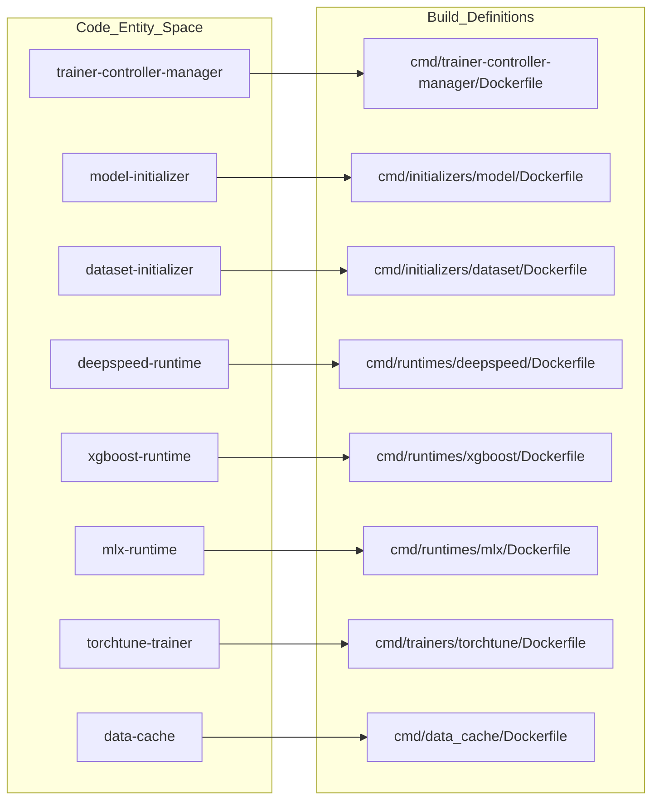
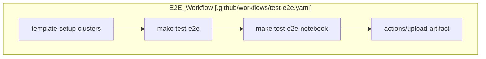

<!-- source: DeepWiki mcp.deepwiki.com · repo kubeflow/trainer · page 8.3 CI/CD Pipeline · fetched 2026-10-21 -->

# CI/CD Pipeline

Relevant source files

The following files were used as context for generating this wiki page:

- [.github/workflows/build-and-push-images.yaml](.github/workflows/build-and-push-images.yaml)
- [.github/workflows/check-pr-title.yaml](.github/workflows/check-pr-title.yaml)
- [.github/workflows/code-quality-check.yaml](.github/workflows/code-quality-check.yaml)
- [.github/workflows/govulncheck.yaml](.github/workflows/govulncheck.yaml)
- [.github/workflows/osv-scanner.yaml](.github/workflows/osv-scanner.yaml)
- [.github/workflows/publish-helm-charts.yaml](.github/workflows/publish-helm-charts.yaml)
- [.github/workflows/release.yaml](.github/workflows/release.yaml)
- [.github/workflows/template-publish-image/action.yaml](.github/workflows/template-publish-image/action.yaml)
- [.github/workflows/test-e2e.yaml](.github/workflows/test-e2e.yaml)
- [.github/workflows/test-go.yaml](.github/workflows/test-go.yaml)
- [.github/workflows/test-helm.yaml](.github/workflows/test-helm.yaml)
- [.github/workflows/test-python.yaml](.github/workflows/test-python.yaml)
- [.github/workflows/test-rust.yaml](.github/workflows/test-rust.yaml)
- [.github/workflows/validate-lockfile.yaml](.github/workflows/validate-lockfile.yaml)
- [.github/workflows/welcome-new-contributors.yaml](.github/workflows/welcome-new-contributors.yaml)

## Purpose and Scope

This document describes the Continuous Integration and Continuous Deployment (CI/CD) pipeline for Kubeflow Trainer, implemented using GitHub Actions workflows. The pipeline automates testing, building, security scanning, and artifact publication across Go, Python, and Rust codebases. It ensures that the distributed AI training platform remains stable across multiple Kubernetes versions and hardware architectures (CPU/GPU).

For information about the actual testing methodologies and frameworks used, see [8.2 Testing Strategy](). For details about the release process and versioning, see [8.4 Release Process and Versioning](). For build system targets and code generation, see [8.1 Project Structure and Build System]().

Sources: [.github/workflows/build-and-push-images.yaml:1-46](), [.github/workflows/test-e2e.yaml:1-27]()

---

## Workflow Architecture

The CI/CD pipeline consists of several GitHub Actions workflows that execute in response to different triggers (push, pull request, tags, schedule). These workflows handle code quality checks, multi-language testing, end-to-end validation, artifact building, and security scanning.

### Workflow Trigger Matrix

Title: "GitHub Actions Workflow Triggers"

```mermaid
graph TB
    subgraph "Event_Triggers"
        Push["Push Event<br/>master, release-*"]
        PR["Pull Request Event"]
        Tag["Tag Event<br/>v*"]
        Sched["Schedule<br/>Cron"]
    end
    
    subgraph "Quality_&_Test_Workflows"
        TestGo[".github/workflows/test-go.yaml"]
        TestPython[".github/workflows/test-python.yaml"]
        TestRust[".github/workflows/test-rust.yaml"]
        TestE2E[".github/workflows/test-e2e.yaml"]
        TestHelm[".github/workflows/test-helm.yaml"]
        CodeQual[".github/workflows/code-quality-check.yaml"]
    end

    subgraph "Security_&_Maintenance"
        OSV[".github/workflows/osv-scanner.yaml"]
        Govuln[".github/workflows/govulncheck.yaml"]
        ValLock[".github/workflows/validate-lockfile.yaml"]
    end
    
    subgraph "Build_&_Publish_Workflows"
        BuildImages[".github/workflows/build-and-push-images.yaml"]
        PublishHelm[".github/workflows/publish-helm-charts.yaml"]
        Release[".github/workflows/release.yaml"]
    end
    
    Push --> TestGo
    PR --> TestGo
    
    PR --> TestPython
    PR --> TestRust
    PR --> TestE2E
    PR --> TestHelm
    PR --> CodeQual
    PR --> ValLock
    
    Push --> BuildImages
    PR --> BuildImages
    Tag --> BuildImages
    
    Push --> PublishHelm
    Tag --> PublishHelm

    Push --> Release
    
    Sched --> OSV
    PR --> Govuln
```

Sources: [.github/workflows/build-and-push-images.yaml:17-29](), [.github/workflows/code-quality-check.yaml:17-20](), [.github/workflows/govulncheck.yaml:21-27](), [.github/workflows/osv-scanner.yaml:17-20](), [.github/workflows/publish-helm-charts.yaml:17-24](), [.github/workflows/release.yaml:17-24](), [.github/workflows/test-e2e.yaml:17-19](), [.github/workflows/test-go.yaml:17-19](), [.github/workflows/test-helm.yaml:17-20](), [.github/workflows/test-python.yaml:17-19](), [.github/workflows/test-rust.yaml:17-19](), .github/workflows/validate-lockfile.yaml, .github/workflows/welcome-new-contributors.yaml

---

## Multi-Platform Image Building and Publishing

The `build-and-push-images.yaml` workflow builds and publishes container images for all Kubeflow Trainer components using a matrix strategy. It targets multiple CPU architectures (`linux/amd64`, `linux/arm64`, and `linux/ppc64le` for the controller) to ensure compatibility across diverse Kubernetes clusters [.github/workflows/build-and-push-images.yaml:60-88]().

### Image Build Matrix

The workflow defines a matrix of components, each mapped to its specific `dockerfile` and supported `platforms`.

Title: "Component to Dockerfile Mapping"

| Component Name | Dockerfile Path | Supported Platforms |
| :--- | :--- | :--- |
| `trainer-controller-manager` | `cmd/trainer-controller-manager/Dockerfile` | `linux/amd64,linux/arm64,linux/ppc64le` |
| `model-initializer` | `cmd/initializers/model/Dockerfile` | `linux/amd64,linux/arm64` |
| `dataset-initializer` | `cmd/initializers/dataset/Dockerfile` | `linux/amd64,linux/arm64` |
| `deepspeed-runtime` | `cmd/runtimes/deepspeed/Dockerfile` | `linux/amd64,linux/arm64` |
| `xgboost-runtime` | `cmd/runtimes/xgboost/Dockerfile` | `linux/amd64,linux/arm64` |
| `mlx-runtime` | `cmd/runtimes/mlx/Dockerfile` | `linux/amd64` |
| `torchtune-trainer` | `cmd/trainers/torchtune/Dockerfile` | `linux/amd64,linux/arm64` |
| `data-cache` | `cmd/data_cache/Dockerfile` | `linux/amd64,linux/arm64` |

Sources: [.github/workflows/build-and-push-images.yaml:63-88]()

### Build and Publish Process

1. **Trigger:** The workflow triggers on pushes to `master`, `release-*` branches, version tags (`v*`), or manual dispatch [.github/workflows/build-and-push-images.yaml:17-29]().
2. **Authentication:**
   - **GHCR:** Logs into `ghcr.io` using the repository's `GITHUB_TOKEN` [.github/workflows/build-and-push-images.yaml:96-103]().
   - **Docker Hub:** Logs into `docker.io` using `DOCKERHUB_USERNAME` and `DOCKERHUB_TOKEN` secrets [.github/workflows/build-and-push-images.yaml:104-111]().
3. **Execution:** Uses the `template-publish-image` composite action which handles multi-platform support via Docker Buildx and QEMU [.github/workflows/build-and-push-images.yaml:115-124](), [.github/workflows/template-publish-image/action.yaml:86-113]().
4. **Optimization:** The composite action performs disk cleanup and moves the Docker data directory to `/mnt/docker` to prevent disk exhaustion on GitHub Runners [.github/workflows/template-publish-image/action.yaml:44-85]().
5. **Conditional Push:** Images are pushed to both `ghcr.io/kubeflow/trainer/...` and `docker.io/kubeflow/...` if `SHOULD_PUBLISH` is `true` [.github/workflows/build-and-push-images.yaml:57-60](), [.github/workflows/build-and-push-images.yaml:115-124](). On pull requests, it performs validation test builds without pushing [.github/workflows/build-and-push-images.yaml:125-135]().

Sources: [.github/workflows/build-and-push-images.yaml:17-135](), [.github/workflows/template-publish-image/action.yaml:1-113]()

---

## E2E Test Matrix and Infrastructure

The project uses a comprehensive End-to-End (E2E) testing suite that validates the controller and runtimes against multiple Kubernetes versions and hardware configurations.

### CPU and GPU E2E Matrix

The `test-e2e.yaml` workflow runs tests on Kind clusters.

- **CPU Matrix:** Tests against Kubernetes versions `1.32.3`, `1.33.1`, `1.34.0`, `1.35.0`, `1.36.1`, and `1.37.0` [.github/workflows/test-e2e.yaml:37-41]().
- **GPU Matrix:** Specifically targets version `1.33.1` using specialized runners labeled `oracle-vm-gpu-a10-2` [.github/workflows/test-e2e.yaml:77-91]().

### E2E Execution Flow

The E2E tests are driven by the `make test-e2e` and `make test-e2e-notebook` targets.

1. **Cluster Setup:** Uses the `template-setup-clusters` action to provision Kind clusters for CPU or GPU workloads [.github/workflows/test-e2e.yaml:46-51](), [.github/workflows/test-e2e.yaml:97-102]().
2. **Go E2E:** Runs the main functional test suite with automatic log dumping on failure [.github/workflows/test-e2e.yaml:52-55]().
3. **Notebook Validation:** Executes a suite of Jupyter notebooks using `papermill` to verify real-world usage of PyTorch, JAX, XGBoost, and local training backends [.github/workflows/test-e2e.yaml:56-66](), [.github/workflows/test-e2e.yaml:103-108]().
4. **Artifact Collection:** Uploads logs and output notebooks as artifacts [.github/workflows/test-e2e.yaml:68-75](), [.github/workflows/test-e2e.yaml:109-115]().

Title: "E2E Workflow Execution"

Sources: [.github/workflows/test-e2e.yaml:28-115]()

---

## Language-Specific Testing

### Go CI
The `test-go.yaml` workflow performs code generation checks, linting, and testing.
- **Generate Job:** Validates that auto-generated assets (CRDs, clients) are up-to-date using `go mod tidy`, `make generate`, `make fmt`, and `make vet` [.github/workflows/test-go.yaml:43-58](). It also runs `golangci-lint` [.github/workflows/test-go.yaml:59-61]().
- **Test Job:** Runs unit tests (`make test`) and integration tests (`make test-integration`), reporting coverage to Coveralls [.github/workflows/test-go.yaml:83-96]().

Sources: [.github/workflows/test-go.yaml:22-96]()

### Python CI
The `test-python.yaml` workflow ensures Python SDK quality.
- **Pre-commit:** Runs `pre-commit` hooks for linting [.github/workflows/test-python.yaml:21-27]().
- **Test Matrix:** Runs unit and integration tests using `make test-python` and `make test-python-integration` on Python 3.12 with `astral-sh/setup-uv` caching [.github/workflows/test-python.yaml:34-60]().
- **Lockfile Validation:** The `validate-lockfile.yaml` workflow ensures that dependency lockfiles across Python components are synchronized with `pyproject.toml`.

Sources: [.github/workflows/test-python.yaml:21-60](), .github/workflows/validate-lockfile.yaml

### Rust CI
The `test-rust.yaml` workflow validates the Rust-based data cache components by setting up the Rust stable toolchain, caching with `Swatinem/rust-cache`, and running `make test-rust` [.github/workflows/test-rust.yaml:21-41]().

Sources: [.github/workflows/test-rust.yaml:21-41]()

### Helm CI
The `test-helm.yaml` workflow validates deployment charts.
- **Unit Tests:** Runs `make helm-unittest` [.github/workflows/test-helm.yaml:37-39]().
- **E2E:** Installs the controller via Helm into a Kind cluster and runs the Go E2E suite [.github/workflows/test-helm.yaml:40-48]().
- **Uninstall Verification:** Verifies that `helm uninstall` correctly removes all resources, including pre-delete cleanup hooks and checking for leaked namespaced/clustered resources [.github/workflows/test-helm.yaml:53-71]().

Sources: [.github/workflows/test-helm.yaml:25-71]()

---

## Security Scanning and Vulnerability Detection

### OSV-Scanner Vulnerability Scan
The `osv-scanner.yaml` workflow scans dependencies daily or on workflow dispatch [.github/workflows/osv-scanner.yaml:17-20]().
- **Execution:** Downloads and verifies the checksum of `osv-scanner`, scanning `go.mod` [.github/workflows/osv-scanner.yaml:39-67]().
- **SARIF Upload:** Uploads SARIF results to the GitHub Security tab [.github/workflows/osv-scanner.yaml:69-75]().
- **Automated Fixes:** Parses JSON results to identify fixable vulnerabilities, attempts `go get` and `go mod tidy` upgrades, and records applied fixes [.github/workflows/osv-scanner.yaml:76-183]().

Sources: [.github/workflows/osv-scanner.yaml:1-183]()

### Govulncheck CVE Detection
The `govulncheck.yaml` workflow runs on pull requests affecting Go source files or dependency manifests (`go.mod`, `go.sum`) [.github/workflows/govulncheck.yaml:19-27]().
- **Regression Analysis:** Scans both the PR branch and the base branch, comparing reachable vulnerabilities to isolate new regressions introduced by the PR [.github/workflows/govulncheck.yaml:47-124]().
- **Reporting:** Posts a detailed summary of new CVEs to the GitHub Step Summary and PR logs [.github/workflows/govulncheck.yaml:125-170]().

Sources: [.github/workflows/govulncheck.yaml:1-170]()

### Code Quality and Linting
The `code-quality-check.yaml` workflow enforces project standards:
- **KubeLinter:** Scans Kubernetes manifests (`make lint-manifests`) [.github/workflows/code-quality-check.yaml:41-43]().
- **Helm Lint:** Validates Helm chart syntax and structure (`make helm-lint`) [.github/workflows/code-quality-check.yaml:44-46]().
- **Boilerplate:** Ensures all files contain correct Apache 2.0 license headers (`make verify-boilerplate`) [.github/workflows/code-quality-check.yaml:47-48]().

Sources: [.github/workflows/code-quality-check.yaml:21-48]()

---

## Artifact Publishing and Release

### Release Workflow
The `release.yaml` workflow manages the official release process when the `VERSION` file is updated on `master` or `release-*` branches [.github/workflows/release.yaml:17-24]().
1. **Prepare:** Creates/updates release branches and pins image tags in Kustomize manifests to the new version [.github/workflows/release.yaml:69-120]().
2. **Build:** Builds the Python package (`kubeflow-trainer-api`) using `uv build` and validates it with `twine` [.github/workflows/release.yaml:137-144]().
3. **Tag:** Creates and pushes the git tag [.github/workflows/release.yaml:151-172]().
4. **Publish:** Publishes container images via `build-and-push-images.yaml`, publishes Helm charts via `publish-helm-charts.yaml`, and pushes the Python package to PyPI [.github/workflows/release.yaml:173-204]().

Sources: [.github/workflows/release.yaml:17-204]()

### Helm Chart Publishing
The `publish-helm-charts.yaml` workflow automates the distribution of the `kubeflow-trainer` Helm chart to OCI registries.
- **Registry:** Packages and pushes charts to `oci://ghcr.io/kubeflow/charts` [.github/workflows/publish-helm-charts.yaml:67]().
- **Versioning:** Resolves chart versions from `Chart.yaml` for tags, or generates short SHA-based versions (`0.0.0-sha-...`) for master pushes [.github/workflows/publish-helm-charts.yaml:57-63]().

Sources: [.github/workflows/publish-helm-charts.yaml:15-67]()

---

