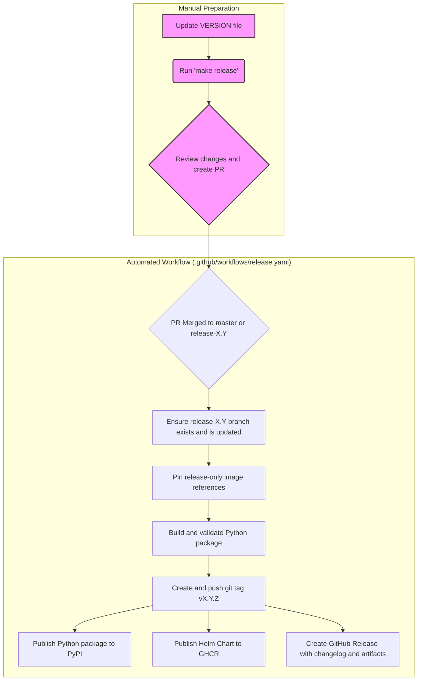

<!-- source: DeepWiki mcp.deepwiki.com · repo kubeflow/trainer · page 8.4 Release Process and Versioning · fetched 2026-10-21 -->

# Release Process and Versioning

<details>
<summary>Relevant source files</summary>

The following files were used as context for generating this wiki page:

- [.pre-commit-config.yaml](.pre-commit-config.yaml)
- [CHANGELOG/CHANGELOG-2.0.md](CHANGELOG/CHANGELOG-2.0.md)
- [CHANGELOG/CHANGELOG-2.1.md](CHANGELOG/CHANGELOG-2.1.md)
- [CHANGELOG/CHANGELOG-2.2.md](CHANGELOG/CHANGELOG-2.2.md)
- [CHANGELOG/CHANGELOG-2.3.md](CHANGELOG/CHANGELOG-2.3.md)
- [RELEASE.md](RELEASE.md)
- [VERSION](VERSION)
- [api/python_api/kubeflow_trainer_api/__init__.py](api/python_api/kubeflow_trainer_api/__init__.py)
- [charts/kubeflow-trainer/Chart.yaml](charts/kubeflow-trainer/Chart.yaml)
- [charts/kubeflow-trainer/README.md](charts/kubeflow-trainer/README.md)
- [cliff.toml](cliff.toml)
- [hack/python-api/gen-api.sh](hack/python-api/gen-api.sh)
- [hack/scripts/container-runtime.sh](hack/scripts/container-runtime.sh)
- [manifests/base/runtimes/xgboost_distributed.yaml](manifests/base/runtimes/xgboost_distributed.yaml)

</details>


This page documents the release process for Kubeflow Trainer, including versioning strategy, branch management, Python API publishing, container image distribution, Helm chart publishing, and changelog automation. The release system ensures that all components (controller manager, Python SDK, initializers, runtimes, data cache) are built, tested, and published consistently across multiple platforms and registries.

For information about the CI/CD pipeline and testing workflows, see [8.3 CI/CD Pipeline](). For contributing guidelines and code review processes, see [8.5 Contributing Guidelines and Governance]().

---

## Prerequisites

The following prerequisites are required for maintainers performing releases:

| Requirement | Description | Documentation |
|-------------|-------------|---------------|
| **Docker** | Required for changelog generation with `git-cliff` | [RELEASE.md:5-6]() |
| **GitHub Token** | Authenticate for changelog generation and repository management | [RELEASE.md:8-9]() |
| **PyPI Access** | Access to publish `kubeflow-trainer-api` via OIDC | [.github/workflows/release.yaml:191-193]() |
| **Registry Access** | Permissions to push to GHCR and Docker Hub | [.github/workflows/release.yaml:31-31]() |

Sources: [RELEASE.md:5-9](), [.github/workflows/release.yaml:31-193]()

---

## Versioning Policy

Kubeflow Trainer follows **Semantic Versioning** (SemVer) with the format `vMAJOR.MINOR.PATCH` [RELEASE.md:12-15]():

| Version Component | Description | Example |
|-------------------|-------------|---------|
| **MAJOR** | Breaking API changes or significant architectural changes | `v1.x.x` → `v2.0.0` |
| **MINOR** | New features, backwards-compatible additions | `v2.2.0` → `v2.3.0` |
| **PATCH** | Backwards-compatible bug fixes only | `v2.3.0` → `v2.3.1` |

The current version is tracked in the `VERSION` file at the repository root [VERSION:1-1]().

### Release Candidate Versions
Pre-releases follow the format `vX.Y.Z-rc.N` where `N` is the release candidate number [RELEASE.md:17-18](). The release workflow identifies these by checking if the version string contains `-rc.` via regex match in the `vars` step [.github/workflows/release.yaml:63-67]().

### Release Branches and Tags
- **Tags:** Releases are tagged as `vX.Y.Z` (e.g., `v2.3.0`) [RELEASE.md:22-22]().
- **Branches:** Release branches follow `release-X.Y` (e.g., `release-2.3`). `vX.Y.Z` releases are cut from their respective `release-X.Y` branch [RELEASE.md:24-28]().
- **Cherry-picking:** Changes intended for a release branch must be cherry-picked from `master` via PR [RELEASE.md:30-31](). The release workflow automates this if the `VERSION` file is updated on `master` [.github/workflows/release.yaml:76-93]().

Sources: [RELEASE.md:12-31](), [.github/workflows/release.yaml:63-93](), [VERSION:1-1]()

---

## Release Workflow Overview

The release process involves a manual preparation phase followed by automated CI/CD triggers defined in [.github/workflows/release.yaml]().

### Release Automation Architecture

Sources: [RELEASE.md:45-75](), [.github/workflows/release.yaml:34-204](), [cliff.toml:1-68]()

**Implementation Details:**
- **Changelog Generation:** The `make release` target uses `git-cliff` with configurations in `cliff.toml` to prepend new entries automatically to the correct minor series file [RELEASE.md:45-47](), [cliff.toml:1-68]().
- **Asset Pinning:** The automated workflow updates image tags (`newTag`) in kustomization overlays and the `CACHE_IMAGE` in the data-cache runtime to the specific release version [.github/workflows/release.yaml:99-110]().
- **Branch Management:** If the workflow is triggered on `master`, it ensures the `release-X.Y` branch exists and contains the version bump commit [.github/workflows/release.yaml:77-97]().

Sources: [RELEASE.md:45-47](), [.github/workflows/release.yaml:77-110](), [cliff.toml:1-68]()

---

## Python API Publishing

The Python API models are published as the `kubeflow-trainer-api` package [.github/workflows/release.yaml:191-199]().

### Generation and Versioning
The version for the Python package is derived from the `VERSION` file [api/python_api/kubeflow_trainer_api/__init__.py:16-16](). The `hack/python-api/gen-api.sh` script is used to regenerate models from the OpenAPI spec, injecting the current version into `__init__.py` [hack/python-api/gen-api.sh:31-69]().

### Python API Publishing Pipeline
```mermaid
graph TD
    subgraph "Code Entities"
        VERSION_File["VERSION"]
        GenAPIScript["hack/python-api/gen-api.sh"]
        PythonAPIInit["api/python_api/kubeflow_trainer_api/__init__.py"]
        PythonPackageDir["api/python_api/"]
    end

    subgraph "Release Workflow Steps"
        ReadVersion[Read VERSION]
        UpdatePythonAPI[Update Python API __version__]
        BuildPythonPackage[Build Python Package (uv build)]
        ValidatePythonPackage[Validate Python Package (uvx twine check)]
        PublishToPyPI[Publish to PyPI (pypa/gh-action-pypi-publish)]
    end

    VERSION_File --> ReadVersion
    ReadVersion --> GenAPIScript
    GenAPIScript --> UpdatePythonAPI
    UpdatePythonAPI --> PythonAPIInit
    PythonAPIInit --> PythonPackageDir
    PythonPackageDir --> BuildPythonPackage
    BuildPythonPackage --> ValidatePythonPackage
    ValidatePythonPackage --> PublishToPyPI
```
Sources: [hack/python-api/gen-api.sh:31-69](), [.github/workflows/release.yaml:121-204](), [api/python_api/kubeflow_trainer_api/__init__.py:16-16]()

**Key Steps:**
- **Package Building:** The release workflow uses `uv build api/python_api -o dist` to create distribution artifacts [.github/workflows/release.yaml:142-142]().
- **Validation:** Artifacts are checked using `uvx twine check dist/*` before publishing [.github/workflows/release.yaml:143-143](). Lockfiles are validated for sync and security regressions during PRs [.github/workflows/validate-lockfile.yaml:46-135]().
- **Publishing:** The package is uploaded to PyPI using the `pypa/gh-action-pypi-publish` action with OIDC trusted publishing [.github/workflows/release.yaml:191-204]().

Sources: [.github/workflows/release.yaml:138-204](), [.github/workflows/validate-lockfile.yaml:108-185](), [hack/python-api/gen-api.sh:65-69](), [api/python_api/kubeflow_trainer_api/__init__.py:16-16]()

---

## Helm Chart and Manifest Management

### Helm Chart Versioning
The Helm chart version is updated during the `make release` process to match the target release version [RELEASE.md:67-67](). The chart `version` in `charts/kubeflow-trainer/Chart.yaml` is set to the current release version (e.g., `2.3.0`) [charts/kubeflow-trainer/Chart.yaml:21-21](). Automated publishing is handled by the `publish-charts` job in the release workflow [.github/workflows/release.yaml:183-189]().

### Manifest Overlay Pinning
The release workflow performs automated `sed` replacements to ensure manifests point to the correct release images [.github/workflows/release.yaml:99-113]():
- `manifests/overlays/manager/kustomization.yaml` (updates `newTag` and `kubeflow_trainer_version` ConfigMap) [.github/workflows/release.yaml:101-104](), [.github/workflows/release.yaml:112-113]()
- `manifests/overlays/runtimes/kustomization.yaml` [.github/workflows/release.yaml:102-102]()
- `manifests/overlays/data-cache/kustomization.yaml` [.github/workflows/release.yaml:103-103]()
- `manifests/base/runtimes/data-cache/torch_distributed_with_cache.yaml` (updates `CACHE_IMAGE` to `data-cache:TAG`) [.github/workflows/release.yaml:108-109]()

Sources: [RELEASE.md:67-67](), [.github/workflows/release.yaml:99-189](), [charts/kubeflow-trainer/Chart.yaml:21-21]()

---

## Changelog Structure and Automation

The project uses a directory-based changelog structure under `CHANGELOG/`, with one file per minor series (e.g., `CHANGELOG-2.2.md`, `CHANGELOG-2.3.md`) [RELEASE.md:33-43]().

### Automated Generation
The `make release` target automates changelog updates using `git-cliff` configured via `cliff.toml` [RELEASE.md:45-47](), [cliff.toml:1-68](). This tool parses commit messages to group changes into sections such as features, bug fixes, and maintenance tasks.

Sources: [RELEASE.md:33-47](), [cliff.toml:1-68]()

---

## Vulnerability Management

Release cycles include automated vulnerability scanning and remediation:
- **OSV-Scanner:** Runs daily via `.github/workflows/osv-scanner.yaml` to detect vulnerabilities in Go dependencies [.github/workflows/osv-scanner.yaml:15-19]().
- **Auto-Fixer:** Attempts to automatically update vulnerable packages using `go get` and `go mod tidy`, creating Pull Requests for the fixes [.github/workflows/osv-scanner.yaml:88-194]().
- **Python Auditing:** PRs involving Python dependencies trigger `uv audit` in `.github/workflows/validate-lockfile.yaml` to compare vulnerability scans between the base and PR branches, detecting regressions in `uv.lock` files [.github/workflows/validate-lockfile.yaml:108-185]().

Sources: [.github/workflows/osv-scanner.yaml:15-194](), [.github/workflows/validate-lockfile.yaml:108-185]()

---

