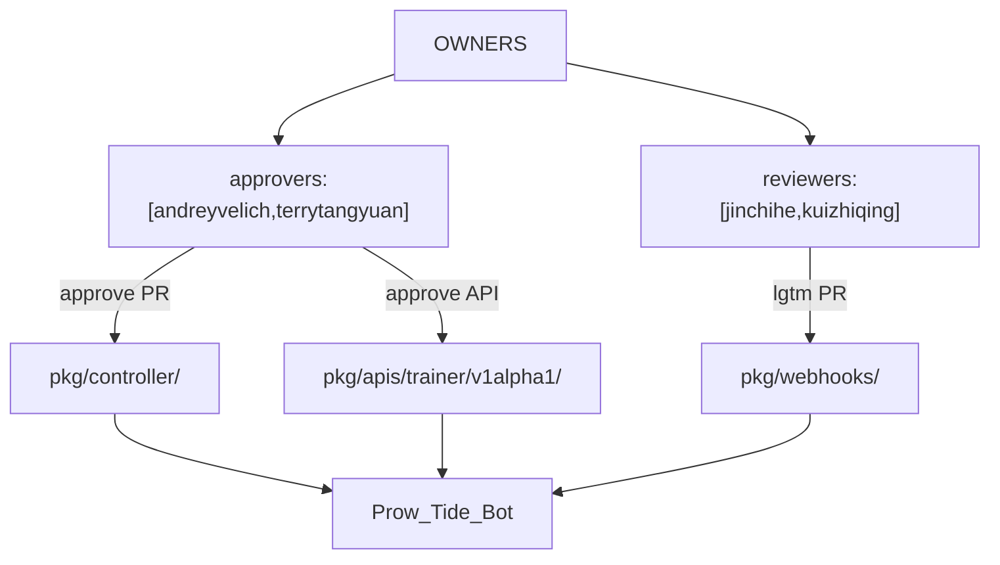
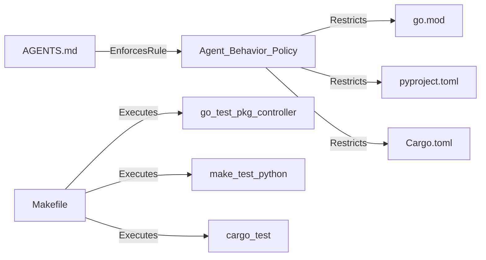
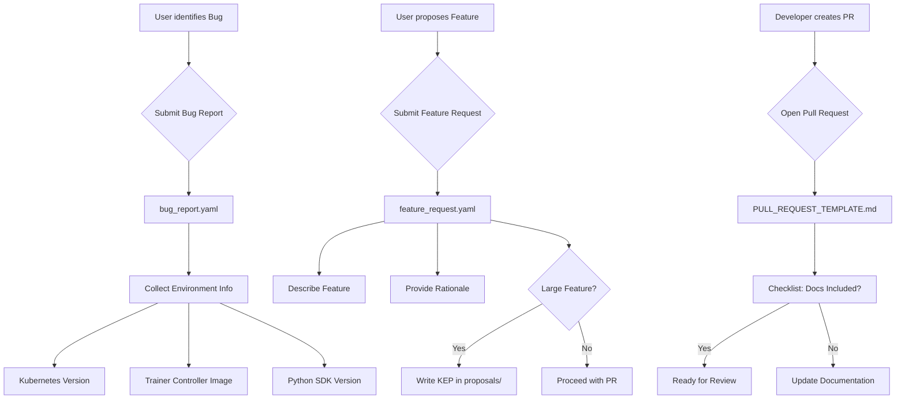

<!-- source: DeepWiki mcp.deepwiki.com · repo kubeflow/trainer · page 8.5 Contributing Guidelines and Governance · fetched 2026-10-21 -->

# Contributing Guidelines and Governance

Relevant source files

The following files were used as context for generating this wiki page:

- [.github/ISSUE_TEMPLATE/bug_report.yaml](.github/ISSUE_TEMPLATE/bug_report.yaml)
- [.github/ISSUE_TEMPLATE/config.yml](.github/ISSUE_TEMPLATE/config.yml)
- [.github/ISSUE_TEMPLATE/feature_request.yaml](.github/ISSUE_TEMPLATE/feature_request.yaml)
- [.github/PULL_REQUEST_TEMPLATE.md](.github/PULL_REQUEST_TEMPLATE.md)
- [.github/copilot-instructions.md](.github/copilot-instructions.md)
- [ADOPTERS.md](ADOPTERS.md)
- [AGENTS.md](AGENTS.md)
- [CODE_OF_CONDUCT.md](CODE_OF_CONDUCT.md)
- [OWNERS](OWNERS)
- [ROADMAP.md](ROADMAP.md)
- [docs/README.md](docs/README.md)
- [proposals/2432-gpu-testing-on-llm-blueprints/README.md](proposals/2432-gpu-testing-on-llm-blueprints/README.md)

This page covers the governance model, community structure, contribution process, code of conduct, AI assistant policies, roadmap milestones, project adopters, and issue/PR templates for the Kubeflow Trainer project. It defines the operational framework governing code contributions, automated checks, and architectural evolution across the polyglot codebase.

---

## Governance Model and OWNERS Structure

Kubeflow Trainer implements the standard Kubernetes governance model using the root `OWNERS` file [OWNERS:1-16](). This file establishes explicit authorization boundaries for pull request reviews and merges, partitioned into distinct tier definitions across the codebase packages like `pkg/controller/` and `pkg/apis/trainer/v1alpha1/`.

| Governance Role | `OWNERS` Field | Operational Capability | Code Scope |
|---|---|---|---|
| **Approver** | `approvers` | Executes `/approve` commands to grant final code review approval and allow merge operations [OWNERS:1]() | Core Controller & API Definitions |
| **Reviewer** | `reviewers` | Executes `/lgtm` commands to signal technical review completion; requires subsequent approver sign-off [OWNERS:10]() | Webhooks & Supporting Packages |
| **Emeritus Approver** | `emeritus_approvers` | Retains historical attribution for former project maintainers without active merge permissions [OWNERS:15]() | Historical & Advisory |

The current roster defined in the repository includes:
*   **Approvers**: `andreyvelich`, `astefanutti`, `Electronic-Waste`, `gaocegege`, `Jeffwan`, `johnugeorge`, `tenzen-y`, `terrytangyuan` [OWNERS:2-9]().
*   **Reviewers**: `akshaychitneni`, `jinchihe`, `kuizhiqing`, `robert-bell` [OWNERS:11-14]().
*   **Emeritus Approvers**: `zw0610` [OWNERS:16]().

### Diagram: Governance to Code Entity Mapping

Sources: [OWNERS:1-16](), [pkg/controller/](), [pkg/apis/trainer/v1alpha1/](), [pkg/webhooks/]()

---

## Code of Conduct and AI Policy Reference

Kubeflow Trainer adheres strictly to established community and automation standards:
*   **Code of Conduct**: The project follows the [CNCF Code of Conduct](https://github.com/cncf/foundation/blob/main/code-of-conduct.md) [CODE_OF_CONDUCT.md:3](). Violations or instances of unacceptable behavior must be reported directly to the [Kubeflow Steering Committee](https://github.com/kubeflow/community/tree/master/committee-steering) [CODE_OF_CONDUCT.md:5-6]().
*   **AI Agent and Contributor Policy**: Defined in `AGENTS.md`, AI agents and human contributors must make atomic, minimal, and reversible modifications [AGENTS.md:9-11](). Agents must run local analysis tasks using standard build orchestration via the `Makefile` before proposing commits [AGENTS.md:12](). Prohibited actions include bypassing validation tests, modifying CI/CD pipelines without authorization, and introducing unverified dependencies into `go.mod`, `pyproject.toml`, or `Cargo.toml` [AGENTS.md:18-24]().

### Diagram: Contribution Policy Enforcement to Code Execution

Sources: [AGENTS.md:1-149](), [CODE_OF_CONDUCT.md:1-6]()

---

## Project Roadmap and Adopters

The trajectory of Kubeflow Trainer is guided by multi-year planning documents (`ROADMAP.md`) and production adoption across enterprise ecosystems (`ADOPTERS.md`).

### Roadmap Highlights
The project roadmap outlines core engineering tracks [ROADMAP.md:1-107]():
*   **Scheduling & Scalability**: First-class integration with Kueue for multi-cluster dispatching, workload-aware scheduling, and KAI Scheduler integration [ROADMAP.md:5-10]().
*   **Distributed Data Cache**: Zero-copy Apache Arrow Flight transfers, tensor caching, and Apache DataFusion integration [ROADMAP.md:24-27](), [ROADMAP.md:46]().
*   **LLM Fine-Tuning**: Builtin Trainers for TorchTune, Llama 3.2, Qwen 2.5, and automated GPU configuration requests [ROADMAP.md:28-30]().
*   **New Runtimes**: Distributed JAX, distributed XGBoost, Megatron-LM tensor parallelism, and Flux HPC framework plugins [ROADMAP.md:31-35]().

### Adopters
Organizations utilizing Kubeflow Trainer in production environments include Akuity, Alibaba Cloud, Amazon Web Services, Ant Group, Bloomberg, Bytedance, Cisco, Huawei, NVIDIA, Red Hat, and Tencent [ADOPTERS.md:1-29]().

Sources: [ROADMAP.md:1-107](), [ADOPTERS.md:1-29]()

---

## Issue and Pull Request Templates

The project enforces structured templates under `.github/` to standardize incoming bug reports, feature proposals, and pull requests.

### Bug Report Schema
Bug reports require explicit runtime parameters to enable rapid reproduction [.github/ISSUE_TEMPLATE/bug_report.yaml:1-64]():
*   `kubectl version` output [.github/ISSUE_TEMPLATE/bug_report.yaml:45]().
*   Kubeflow Trainer controller image extraction using label `app.kubernetes.io/name=kubeflow-trainer` [.github/ISSUE_TEMPLATE/bug_report.yaml:50]().
*   Python SDK version from `pip show kubeflow` [.github/ISSUE_TEMPLATE/bug_report.yaml:55]().

### Feature Request and Contribution Workflows
*   **Feature Requests**: Captured via `.github/ISSUE_TEMPLATE/feature_request.yaml`, requiring clear problem statements and rationale, with major changes redirecting to the KEP process under `proposals/` [.github/ISSUE_TEMPLATE/feature_request.yaml:1-42]().
*   **Pull Request Workflow**: PRs are validated against the checklist in `.github/PULL_REQUEST_TEMPLATE.md`, ensuring user-facing changes include documentation updates [.github/PULL_REQUEST_TEMPLATE.md:1-15]().

### Diagram: Issue and PR Template Workflow

Sources: [.github/ISSUE_TEMPLATE/bug_report.yaml:1-64](), [.github/ISSUE_TEMPLATE/feature_request.yaml:1-42](), [.github/PULL_REQUEST_TEMPLATE.md:1-15]()

---

