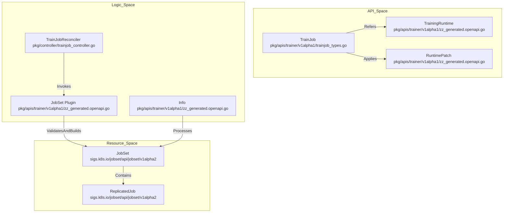
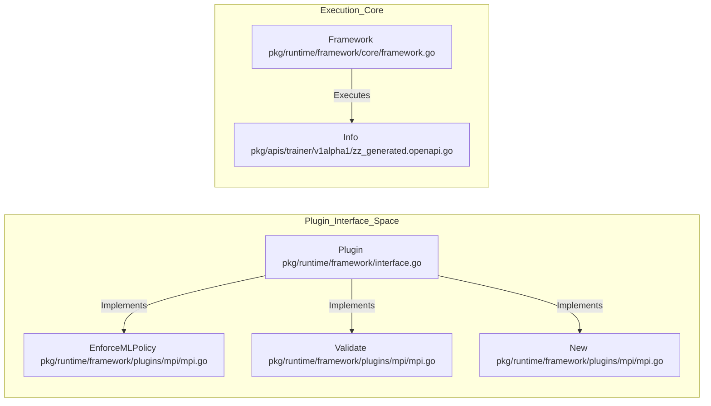

<!-- source: DeepWiki mcp.deepwiki.com · repo kubeflow/trainer · page 9 Glossary · fetched 2026-10-21 -->

# Glossary

Relevant source files

The following files were used as context for generating this wiki page:

- [api/openapi-spec/swagger.json](api/openapi-spec/swagger.json)
- [charts/kubeflow-trainer/templates/crd/trainer.kubeflow.org_trainjobs.yaml](charts/kubeflow-trainer/templates/crd/trainer.kubeflow.org_trainjobs.yaml)
- [manifests/base/crds/trainer.kubeflow.org_trainjobs.yaml](manifests/base/crds/trainer.kubeflow.org_trainjobs.yaml)
- [pkg/apis/trainer/v1alpha1/trainjob_types.go](pkg/apis/trainer/v1alpha1/trainjob_types.go)
- [pkg/apis/trainer/v1alpha1/zz_generated.deepcopy.go](pkg/apis/trainer/v1alpha1/zz_generated.deepcopy.go)
- [pkg/apis/trainer/v1alpha1/zz_generated.openapi.go](pkg/apis/trainer/v1alpha1/zz_generated.openapi.go)
- [pkg/constants/constants.go](pkg/constants/constants.go)
- [pkg/data_cache/Cargo.lock](pkg/data_cache/Cargo.lock)
- [pkg/data_cache/Cargo.toml](pkg/data_cache/Cargo.toml)
- [pkg/data_cache/cmd/head/main.rs](pkg/data_cache/cmd/head/main.rs)
- [pkg/data_cache/src/config/config.rs](pkg/data_cache/src/config/config.rs)
- [pkg/data_cache/src/head/head_service.rs](pkg/data_cache/src/head/head_service.rs)
- [pkg/data_cache/src/head/provider.rs](pkg/data_cache/src/head/provider.rs)
- [pkg/data_cache/src/head/writer.rs](pkg/data_cache/src/head/writer.rs)
- [pkg/data_cache/src/worker/worker_datasource.rs](pkg/data_cache/src/worker/worker_datasource.rs)
- [pkg/data_cache/src/worker/worker_service.rs](pkg/data_cache/src/worker/worker_service.rs)
- [pkg/data_cache/test/Cargo.lock](pkg/data_cache/test/Cargo.lock)
- [pkg/data_cache/test/Cargo.toml](pkg/data_cache/test/Cargo.toml)
- [pkg/runtime/framework/plugins/mpi/mpi.go](pkg/runtime/framework/plugins/mpi/mpi.go)
- [pkg/runtime/framework/plugins/mpi/mpi_test.go](pkg/runtime/framework/plugins/mpi/mpi_test.go)
- [test/integration/webhooks/trainjob_test.go](test/integration/webhooks/trainjob_test.go)

## Purpose and Scope
This page provides definitions for codebase-specific terms, jargon, abbreviations, and domain concepts used across the Kubeflow Trainer project (`https://github.com/kubeflow/trainer`). It acts as an authoritative reference linking high-level architectural ideas to their specific Go, Python, and Rust code implementations and file locations.

---

## Custom Resources and APIs

### TrainJob
The primary user-facing Custom Resource Definition (CRD) that defines a distributed training workload. It abstracts infrastructure and machine learning framework complexities by referencing a `TrainingRuntime` or `ClusterTrainingRuntime`, managing the end-to-end lifecycle including dataset/model initialization, execution coordination, and status reporting.
*   **Code Pointer:** `type TrainJob struct` [pkg/apis/trainer/v1alpha1/trainjob_types.go:40-54]()
*   **Lifecycle States:** Reconciled by `TrainJobReconciler` to manage conditions such as `Suspended`, `Complete`, and `Failed` [pkg/apis/trainer/v1alpha1/trainjob_types.go:56-65]()

Sources: [pkg/apis/trainer/v1alpha1/trainjob_types.go:40-65]()

### TrainingRuntime / ClusterTrainingRuntime
Runtime templates defining how specific machine learning jobs are instantiated on Kubernetes. A `TrainingRuntime` is namespaced, whereas a `ClusterTrainingRuntime` is cluster-scoped. Both contain `JobSet` templates, ML framework policy bindings, and container image definitions.
*   **Code Pointer (ClusterTrainingRuntime):** `type ClusterTrainingRuntime struct` [pkg/apis/trainer/v1alpha1/zz_generated.openapi.go:39-39]()
*   **Code Pointer (TrainingRuntime):** OpenAPI definitions under `pkg/apis/trainer/v1alpha1/zz_generated.openapi.go` [pkg/apis/trainer/v1alpha1/zz_generated.openapi.go:1-78]()

Sources: [pkg/apis/trainer/v1alpha1/zz_generated.openapi.go:1-78]()

### OptimizationJob
A CRD designed for Hyperparameter Optimization (HPO). It coordinates multiple `TrainJob` trial instances to explore a defined `SearchSpace` and optimize objectives using search algorithms like grid or random search.
*   **Code Pointer:** `type OptimizationJob struct` [pkg/apis/trainer/v1alpha1/zz_generated.openapi.go:64-64]()
*   **Environment Injection:** Injects trial-specific parameter assignments via `KUBEFLOW_TRAINER_OPT_*` environment variables.

Sources: [pkg/apis/trainer/v1alpha1/zz_generated.openapi.go:64-64]()

### RuntimePatch
A mechanism within the `TrainJob` specification allowing users or automated controllers to override or append settings inside a referenced training runtime without mutating the shared runtime template. Patches are keyed by a `manager` string to resolve ownership conflicts.
*   **Code Pointer:** `type RuntimePatch struct` [pkg/apis/trainer/v1alpha1/zz_generated.openapi.go:77-77]()
*   **Immutability Rules:** Enforced via OpenAPI validation to prevent unauthorized updates [manifests/base/crds/trainer.kubeflow.org_trainjobs.yaml:63-66]()

Sources: [manifests/base/crds/trainer.kubeflow.org_trainjobs.yaml:63-66](), [pkg/apis/trainer/v1alpha1/zz_generated.openapi.go:77-77]()

### ManagedBy
A field on `TrainJobSpec` indicating which controller or orchestration entity owns the lifecycle reconciliation of the resource. Valid values include `trainer.kubeflow.org/trainjob-controller` and `kueue.x-k8s.io/multikueue`.
*   **Code Pointer:** `ManagedBy` validation rule [pkg/apis/trainer/v1alpha1/trainjob_types.go:142-152]()

Sources: [pkg/apis/trainer/v1alpha1/trainjob_types.go:142-152]()

---

## Orchestration and Scheduling

### JobSet
The upstream Kubernetes SIG-Scheduling / JobSet project (`sigs.k8s.io/jobset`) integrated by Kubeflow Trainer to orchestrate groups of Kubernetes Jobs as a single atomic unit.
*   **Code Pointer:** `type JobSet struct` [pkg/apis/trainer/v1alpha1/zz_generated.openapi.go:53-53]()
*   **Validation:** Webhooks enforce container and volume mount constraints on `JobSet` templates [pkg/apis/trainer/v1alpha1/zz_generated.openapi.go:53-53]()

Sources: [pkg/apis/trainer/v1alpha1/zz_generated.openapi.go:53-53]()

### ReplicatedJob
A subcomponent of a `JobSet` specification representing a homogeneous group of jobs sharing a common pod template and replica count. Kubeflow Trainer maps different distributed roles (such as `launcher`, `node`, `dataset-initializer`) to distinct `ReplicatedJobs`.
*   **Code Pointer:** `ReplicatedJobPatch` [pkg/apis/trainer/v1alpha1/zz_generated.openapi.go:75-75]()

Sources: [pkg/apis/trainer/v1alpha1/zz_generated.openapi.go:75-75]()

### PodSet
An internal runtime abstraction representing a logical collection of pods sharing identical configurations, container specs, and scheduling requirements within the runtime plugin framework.
*   **Code Pointer:** `type PodSet struct` [pkg/apis/trainer/v1alpha1/zz_generated.openapi.go:71-71]()

Sources: [pkg/apis/trainer/v1alpha1/zz_generated.openapi.go:71-71]()

### Ancestor
A label marking (`trainer.kubeflow.org/trainjob-ancestor-step`) used to trace the origin of deployed pods and jobs back to their corresponding `TrainJob` component steps (e.g., dataset-initializer, model-initializer, or trainer).
*   **Code Pointer:** `LabelTrainJobAncestor` constant [pkg/constants/constants.go:36-41]()

Sources: [pkg/constants/constants.go:36-41]()

### LWS (LeaderWorkerSet)
An external Kubernetes controller (`sigs.k8s.io/lws`) used to manage groups of pods structured in a leader-worker topology, utilized primarily for the distributed data cache architecture.
*   **Helm Integration:** Declared as an optional or required chart dependency [charts/kubeflow-trainer/templates/crd/trainer.kubeflow.org_trainjobs.yaml:1-16]()

Sources: [charts/kubeflow-trainer/templates/crd/trainer.kubeflow.org_trainjobs.yaml:1-16]()

### KAI Scheduler / CoScheduling / Volcano
Gang scheduling integrations that ensure all pods belonging to a distributed training job or `PodGroup` are scheduled concurrently to prevent deadlocks during multi-node synchronization.
*   **Code Pointer:** Pod group policies under `pkg/apis/trainer/v1alpha1/zz_generated.openapi.go:42-42` and `pkg/apis/trainer/v1alpha1/zz_generated.openapi.go:70-70`

Sources: [pkg/apis/trainer/v1alpha1/zz_generated.openapi.go:42-42](), [pkg/apis/trainer/v1alpha1/zz_generated.openapi.go:70-70]()

### SSA (Server-Side Apply)
Kubernetes declarative patch and apply mechanism used extensively by the controller reconcilers (`r.client.Apply`) to manage ownership of generated resources like JobSets and ConfigMaps without race conditions.

Sources: [pkg/apis/trainer/v1alpha1/zz_generated.openapi.go:1-78]()

---

## Policies and Frameworks

### MLPolicy
The configuration structure defining framework-specific settings, environment variables, and execution parameters for backends such as PyTorch, MPI, JAX, XGBoost, and Flux.
*   **Code Pointer:** `type MLPolicy struct` [pkg/apis/trainer/v1alpha1/zz_generated.openapi.go:58-58]()

Sources: [pkg/apis/trainer/v1alpha1/zz_generated.openapi.go:58-58]()

### PodGroupPolicy
A policy section within training runtimes determining how pods are grouped together for admission and gang scheduling plugins (e.g., Coscheduling, Volcano).
*   **Code Pointer:** `type PodGroupPolicy struct` [pkg/apis/trainer/v1alpha1/zz_generated.openapi.go:70-70]()

Sources: [pkg/apis/trainer/v1alpha1/zz_generated.openapi.go:70-70]()

### torchrun and TorchTune
`torchrun` is the native PyTorch distributed training launcher utility. TorchTune is an official PyTorch library for easy, fast fine-tuning of large language models, supported directly via specialized runtime definitions and recipes.
*   **Code Pointer:** Torch policy source configurations [pkg/apis/trainer/v1alpha1/zz_generated.openapi.go:1-78]()

Sources: [pkg/apis/trainer/v1alpha1/zz_generated.openapi.go:1-78]()

### LoRA / QLoRA
Low-Rank Adaptation (LoRA) and Quantized LoRA (QLoRA) parameter-efficient fine-tuning techniques supported through the SDK dataclasses (`LoraConfig`) and TorchTune recipes.
*   **Code Pointer:** OpenAPI definitions for parameter configuration [pkg/apis/trainer/v1alpha1/zz_generated.openapi.go:1-78]()

Sources: [pkg/apis/trainer/v1alpha1/zz_generated.openapi.go:1-78]()

### PET_* Variables
PyTorch Elastic Trainer environment variables (`PET_NUM_NODES`, `PET_NPROC_PER_NODE`, `PET_NODE_RANK`) injected by the Torch plugin to configure distributed node communication and worker rank identification.
*   **Code Pointer:** Torch plugin validation and injection logic [pkg/apis/trainer/v1alpha1/zz_generated.openapi.go:1-78]()

Sources: [pkg/apis/trainer/v1alpha1/zz_generated.openapi.go:1-78]()

### envInjection
A configuration feature allowing arbitrary environment variables to be injected into designated container targets across the training runtime pods.
*   **Code Pointer:** `type EnvInjection struct` [pkg/apis/trainer/v1alpha1/zz_generated.openapi.go:45-45]()

Sources: [pkg/apis/trainer/v1alpha1/zz_generated.openapi.go:45-45]()

### Flux
An HPC workload manager and framework plugin enabling highly scalable job orchestration, broker configuration via `broker.toml`, and MiniCluster bootstrapping.
*   **Code Pointer:** `type FluxMLPolicySource struct` [pkg/apis/trainer/v1alpha1/zz_generated.openapi.go:47-47]()
*   **Constants:** `FluxInstallerImage`, `FluxNewtowkDevice`, `FluxQueuePolicy`, `FluxInstallerContainerName`, `FluxInstallVolumeName`, `FluxConfigVolumeName`, `FluxVolumePath`, `FluxCurveVolumeName`, `FluxCurveVolumePath`, `FluxMemoryVolumeName`, `FluxMemoryVolumePath`, `FluxSpackViewVolumeName`, `FluxSpackViewVolumePath` [pkg/constants/constants.go:94-131]()

Sources: [pkg/apis/trainer/v1alpha1/zz_generated.openapi.go:47-47](), [pkg/constants/constants.go:94-131]()

### Rabit and XGBoost Tracker
Rabit (Reliable Allreduce and Broadcast Interface) is the coordination library used by XGBoost for distributed training, driven by the XGBoost Tracker server communicating over designated `TRACKER_URI` and `TRACKER_PORT` environment variables.
*   **Code Pointer:** XGBoost policy definitions [pkg/apis/trainer/v1alpha1/zz_generated.openapi.go:1-78]()

Sources: [pkg/apis/trainer/v1alpha1/zz_generated.openapi.go:1-78]()

---

## Data, Caching, and Optimization

### Distributed Data Cache
A Rust-based high-performance data caching system leveraging Apache Arrow Flight, DataFusion, and Apache Iceberg integrations to execute zero-copy data transfers between cache workers and training pods.
*   **Code Pointer:** `kubeflow_data_cache` package [pkg/data_cache/Cargo.toml:2-3]()
*   **Head Service:** `head_service.rs` [pkg/data_cache/src/head/head_service.rs]()
*   **Worker Service:** `worker_service.rs` [pkg/data_cache/src/worker/worker_service.rs]()
*   **Cargo.lock:** Lists Rust dependencies for the data cache [pkg/data_cache/Cargo.lock:1-261]()

Sources: [pkg/data_cache/Cargo.toml:2-3](), [pkg/data_cache/src/head/head_service.rs](), [pkg/data_cache/src/worker/worker_service.rs](), [pkg/data_cache/Cargo.lock:1-261]()

### CACHE_INDEX_COLUMN and IndexPair
Internal indexing structures used by the distributed data cache to partition, map, and synchronize data row batches across workers.
*   **Code Pointer:** `worker_datasource.rs` for data source handling [pkg/data_cache/src/worker/worker_datasource.rs]()
*   **Code Pointer:** `provider.rs` for data provider logic [pkg/data_cache/src/head/provider.rs]()

Sources: [pkg/data_cache/src/worker/worker_datasource.rs](), [pkg/data_cache/src/head/provider.rs]()

### SearchSpace, ObjectiveDirection, and KUBEFLOW_TRAINER_OPT_*
Components of the OptimizationJob API. `SearchSpace` defines parameter boundaries (Uniform, LogUniform, Categorical), `ObjectiveDirection` specifies optimization goals (minimize/maximize), and `KUBEFLOW_TRAINER_OPT_*` represents the environment variables used to inject trial hyperparameters into training jobs.
*   **Code Pointer:** Optimization spec definitions [pkg/apis/trainer/v1alpha1/zz_generated.openapi.go:62-79]()

Sources: [pkg/apis/trainer/v1alpha1/zz_generated.openapi.go:62-79]()

---

## Runtime, Status, and SDK

### StatusServer
An internal HTTP/gRPC service (`pkg/statusserver`) that collects real-time training progress, metrics, and status telemetry from trainer containers during execution.
*   **Code Pointer:** Status server package structure and API definitions [pkg/apis/trainer/v1alpha1/zz_generated.openapi.go:80-85]()

Sources: [pkg/apis/trainer/v1alpha1/zz_generated.openapi.go:80-85]()

### ActiveDeadlineSeconds
A lifecycle constraint field on `TrainJobSpec` that bounds the maximum active duration of a training job. Once exceeded, the controller terminates running pods and sets the job status reason to `DeadlineExceeded`.
*   **Code Pointer:** `ActiveDeadlineSeconds` struct definition [pkg/apis/trainer/v1alpha1/trainjob_types.go:131-139]()
*   **Reason Constant:** `TrainJobDeadlineExceededReason` [pkg/apis/trainer/v1alpha1/trainjob_types.go:80-84]()

Sources: [pkg/apis/trainer/v1alpha1/trainjob_types.go:80-139]()

### TrainJobStatus plugin
A plugin component responsible for injecting status server credentials, authentication tokens, and reporting endpoints into trainer container environments.
*   **Code Pointer:** Plugin framework interfaces [pkg/apis/trainer/v1alpha1/zz_generated.openapi.go:1-78]()

Sources: [pkg/apis/trainer/v1alpha1/zz_generated.openapi.go:1-78]()

### LocalProcessBackendConfig and ContainerBackendConfig
Python SDK configuration classes allowing developers to switch execution backends between local native OS processes (`LocalProcessBackendConfig`) and multi-node containerized environments (`ContainerBackendConfig`) for testing and local development.

Sources: [pkg/apis/trainer/v1alpha1/zz_generated.openapi.go:1-78]()

---

## Testing and Development

### envtest
A controller-runtime testing utility used across integration tests (`test/integration`) to spin up a standalone control plane (etcd and kube-apiserver) without needing a full Kubernetes cluster.
*   **Code Pointer:** Webhook integration tests setup [test/integration/webhooks/trainjob_test.go:44-51]()

Sources: [test/integration/webhooks/trainjob_test.go:44-51]()

### Ginkgo and Gomega
The BDD testing framework and matcher library used extensively for writing Go integration, unit, and end-to-end test suites.
*   **Code Pointer:** Test suite structure [test/integration/webhooks/trainjob_test.go:22-23]()

Sources: [test/integration/webhooks/trainjob_test.go:22-23]()

---

## System Interaction Diagrams

### Diagram 1: TrainJob to JobSet Code Entity Mapping

Sources: [pkg/apis/trainer/v1alpha1/trainjob_types.go:40-153](), [pkg/apis/trainer/v1alpha1/zz_generated.openapi.go:53-53](), [pkg/apis/trainer/v1alpha1/zz_generated.openapi.go:71-71]()

### Diagram 2: Runtime Plugin Pipeline Architecture

Sources: [pkg/runtime/framework/plugins/mpi/mpi.go:59-62](), [pkg/runtime/framework/plugins/mpi/mpi.go:69-73](), [pkg/apis/trainer/v1alpha1/zz_generated.openapi.go:1-78]()