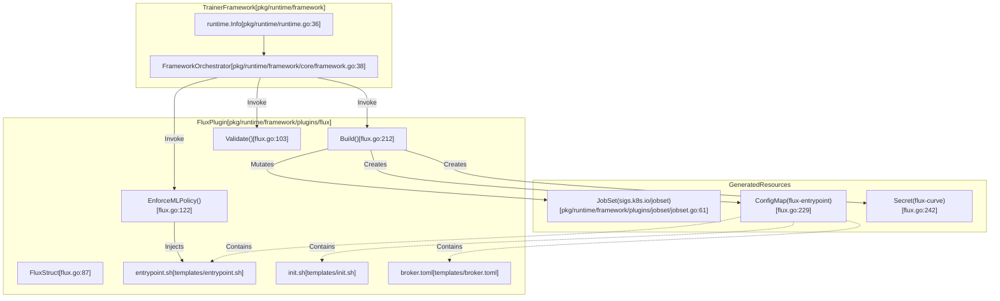
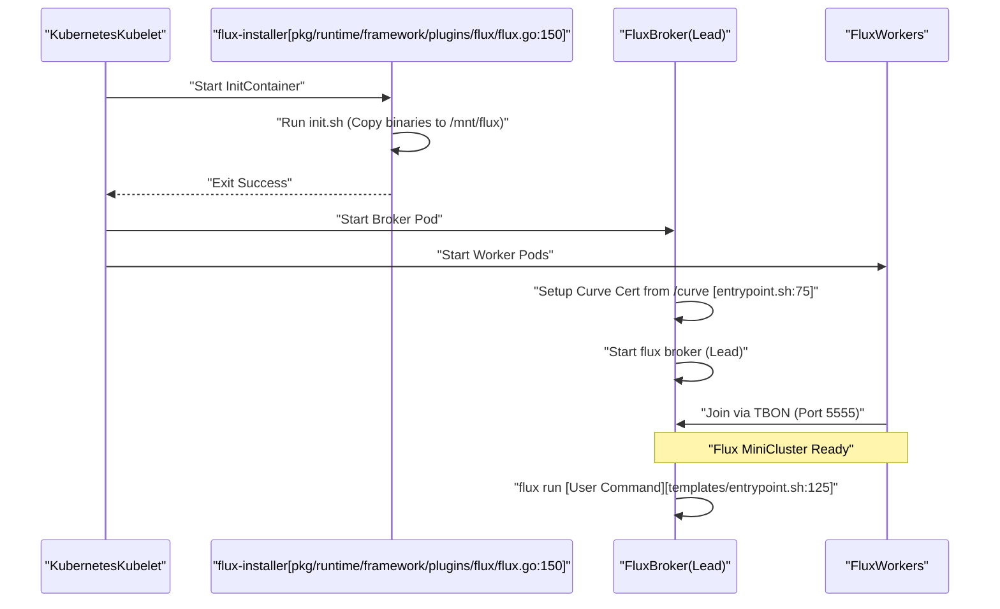

<!-- source: DeepWiki mcp.deepwiki.com · repo kubeflow/trainer · extra page Flux Plugin · fetched 2026-10-21 -->

# Flux Plugin

<details>
<summary>Relevant source files</summary>

The following files were used as context for generating this wiki page:

- [examples/flux/flux-interactive.yaml](examples/flux/flux-interactive.yaml)
- [examples/flux/flux-runtime.yaml](examples/flux/flux-runtime.yaml)
- [examples/flux/lammps-train-gpus.yaml](examples/flux/lammps-train-gpus.yaml)
- [examples/flux/lammps-train-job.yaml](examples/flux/lammps-train-job.yaml)
- [pkg/runtime/framework/plugins/flux/flux.go](pkg/runtime/framework/plugins/flux/flux.go)
- [pkg/runtime/framework/plugins/flux/flux_test.go](pkg/runtime/framework/plugins/flux/flux_test.go)
- [pkg/runtime/framework/plugins/flux/templates/entrypoint.sh](pkg/runtime/framework/plugins/flux/templates/entrypoint.sh)
- [pkg/runtime/framework/plugins/trainjobstatus/trainjobstatus.go](pkg/runtime/framework/plugins/trainjobstatus/trainjobstatus.go)

</details>


The Flux plugin enables Kubeflow Trainer to orchestrate distributed workloads using the [Flux Framework](http://flux-framework.org/), a high-performance computing (HPC) resource manager and scheduler. This plugin is particularly suited for HPC-style AI workloads, such as LAMMPS or large-scale simulations, that require advanced topology-aware scheduling and a hierarchical management structure.

## Overview

The Flux plugin implements the `EnforceMLPolicyPlugin`, `ComponentBuilderPlugin`, `WatchExtensionPlugin`, and `CustomValidationPlugin` interfaces `[pkg/runtime/framework/plugins/flux/flux.go:80-83]`. It bootstraps a Flux **MiniCluster** within a Kubernetes `JobSet`, where one node acts as the Flux broker and others join the managed session via a Tree-Based Overlay Network (TBON).

### Key Capabilities
*   **FluxMLPolicySource**: Specific configuration for Flux workloads, including `NumProcPerNode` for task distribution. The plugin validates that `NumProcPerNode` is configured correctly and reserves necessary container names `[pkg/runtime/framework/plugins/flux/flux.go:103-120]`.
*   **MiniCluster Bootstrapping**: Automated injection of an init container (`flux-installer`) and an entrypoint script (`/etc/flux-config/entrypoint.sh`) to install and initialize the Flux broker and its software environment `[pkg/runtime/framework/plugins/flux/flux.go:149-162]`.
*   **Topology-Aware Scheduling**: Leverages Flux's internal scheduler (Fluxion) by loading `sched-fluxion-resource` and `sched-fluxion-qmanager` modules to manage task placement across the allocated Kubernetes Pods `[pkg/runtime/framework/plugins/flux/templates/entrypoint.sh:53-59]`.
*   **HPC Workload Support**: Optimized for frameworks that traditionally run on HPC clusters using `flux run` or `flux submit` `[pkg/runtime/framework/plugins/flux/templates/entrypoint.sh:124-125]`.

Sources: `[pkg/runtime/framework/plugins/flux/flux.go:80-120]()`, `[pkg/runtime/framework/plugins/flux/templates/entrypoint.sh:53-125]()`

---

## System Architecture and Data Flow

The Flux plugin transforms a standard `TrainJob` into a Flux-managed MiniCluster by injecting necessary volumes, environment variables, and an installer init container.

### Code Entity Space Mapping

The following diagram shows how the Flux plugin entities interact with the core Trainer framework and the resulting Kubernetes resources.

**Flux Plugin Entity Relationship**

Sources: `[pkg/runtime/framework/plugins/flux/flux.go:80-97]()`, `[pkg/runtime/framework/plugins/flux/flux.go:122-152]()`, `[pkg/runtime/framework/plugins/flux/flux.go:49-56]()`, `[pkg/runtime/framework/plugins/flux/flux.go:212-248]()`, `[pkg/runtime/runtime.go:36]()`, `[pkg/runtime/framework/core/framework.go:38]()`

---

## Implementation Details

### ML Policy Enforcement
The `EnforceMLPolicy` function wraps the user's original command with the Flux entrypoint script `[pkg/runtime/framework/plugins/flux/flux.go:135-144]`. It captures the original `command` from the `TrainJob` and passes it as an argument to `/etc/flux-config/entrypoint.sh` `[pkg/runtime/framework/plugins/flux/flux.go:144]`. It also clears existing `Args` so that only the Flux entrypoint controls execution `[pkg/runtime/framework/plugins/flux/flux.go:145]`.

Sources: `[pkg/runtime/framework/plugins/flux/flux.go:122-145]()`

### Component Building & Bootstrapping
The plugin performs several mutations to the `JobSet` template during the `ComponentBuilder` phase:

1.  **Flux Installer Injection**: Injects an init container named `flux-installer` `[pkg/runtime/framework/plugins/flux/flux.go:149-150]`. This container uses a "Flux View" image to provide the Flux binaries and dependencies `[pkg/runtime/framework/plugins/flux/flux.go:151]`.
2.  **Volume Management**:
    *   **Flux Install Volume**: An `emptyDir` volume where Flux binaries are placed `[pkg/runtime/framework/plugins/flux/flux.go:155-156]`.
    *   **Flux Curve Volume**: A secret-backed volume containing a deterministic Curve certificate for inter-broker authentication `[pkg/runtime/framework/plugins/flux/flux.go:171-173]`.
    *   **Config Volume**: A ConfigMap containing the `broker.toml`, `entrypoint.sh`, and `init.sh` `[pkg/runtime/framework/plugins/flux/flux.go:229-234]`.
    *   **Shared Memory**: Automatically adds a `/dev/shm` mount to ensure MPI and Flux processes have efficient communication `[pkg/runtime/framework/plugins/flux/flux.go:190-192]`.
3.  **Deterministic Curve Generation**: The plugin generates a Curve certificate using the `TrainJob` UID as a seed for the SHA256 hash, ensuring that all pods in the same job share the same credentials for the Flux session `[pkg/runtime/framework/plugins/flux/flux.go:273-294]`.

Sources: `[pkg/runtime/framework/plugins/flux/flux.go:149-294]()`

### Entrypoint Script (`entrypoint.sh`)
The entrypoint script performs critical environment setup:
*   **Spack View Integration**: Links the Flux Python environment and sets `PYTHONPATH` and `LD_LIBRARY_PATH` `[pkg/runtime/framework/plugins/flux/templates/entrypoint.sh:20-69]`.
*   **Resource Encoding**: Generates host resources using `flux R encode` based on the hostlist `[pkg/runtime/framework/plugins/flux/templates/entrypoint.sh:84-87]`.
*   **Role-Based Execution**: 
    *   The **Lead Broker** (mainHost) executes `flux start ... flux run [User Command]` `[pkg/runtime/framework/plugins/flux/templates/entrypoint.sh:114-126]`.
    *   **Worker Nodes** execute `flux start` and wait to join the lead broker with a 15s retry loop `[pkg/runtime/framework/plugins/flux/templates/entrypoint.sh:129-148]`.

Sources: `[pkg/runtime/framework/plugins/flux/templates/entrypoint.sh:20-148]()`

---

## Execution Workflow

The bootstrapping process follows a sequence to ensure the MiniCluster is ready before the trainer code executes.

**Flux Bootstrapping Sequence**

Sources: `[pkg/runtime/framework/plugins/flux/templates/entrypoint.sh:75-148]()`, `[pkg/runtime/framework/plugins/flux/flux.go:149-162]()`

---

## Technical Reference

### Constants and Defaults
| Constant / Envar | Default Value / Purpose |
| :--- | :--- |
| `FLUX_VIEW_IMAGE` | Default installer image for the Spack view `[pkg/runtime/framework/plugins/flux/flux.go:73]()` |
| `FLUX_NETWORK_DEVICE` | Network interface for TBON communication `[pkg/runtime/framework/plugins/flux/flux.go:74]()` |
| `FLUX_QUEUE_POLICY` | Scheduling queue policy (e.g., fcfs) `[pkg/runtime/framework/plugins/flux/flux.go:75]()` |
| `FluxCurveVolumeName` | Volume for inter-broker authentication certs `[pkg/runtime/framework/plugins/flux/flux.go:171-173]()` |
| `FluxMemoryVolumePath`| Path for shared memory mounts `[pkg/runtime/framework/plugins/flux/flux.go:190-192]()` |

Sources: `[pkg/runtime/framework/plugins/flux/flux.go:73-75]()`, `[pkg/runtime/framework/plugins/flux/flux.go:171-192]()`

### Example Configuration
A `TrainJob` using the Flux plugin for a LAMMPS workload defines the `runtimeRef` and provides the simulation command. The plugin automatically wraps this command with `flux run`.

```yaml
apiVersion: trainer.kubeflow.org/v1alpha1
kind: TrainJob
metadata:
  name: lammps-flux
spec:
  runtimeRef:
    name: flux-distributed
  trainer:
    numNodes: 2
    numProcPerNode: 1
    image: ghcr.io/flux-framework/tutorials:gpu-lammps-hwloc
    # Command will be wrapped by entrypoint.sh
    command: [lmp_gpu, -k, "on", g, "8", "-sf", "kk", "-pk", "kokkos", "cuda/aware", "off", "newton", "on", neigh, half, -in, in.reaxff.hns]
    env:
     - name: FLUX_VIEW_IMAGE
       value: ghcr.io/converged-computing/flux-view-ubuntu:tag-jammy
```
Sources: `[examples/flux/lammps-train-gpus.yaml:30-54]()`, `[pkg/runtime/framework/plugins/flux/flux.go:144]()`

Sources: `[pkg/runtime/framework/plugins/flux/flux.go]()`, `[pkg/runtime/framework/plugins/flux/templates/entrypoint.sh]()`, `[pkg/runtime/framework/plugins/flux/templates/init.sh]()`, `[pkg/runtime/framework/plugins/flux/templates/broker.toml]()`, `[pkg/runtime/runtime.go]()`, `[pkg/runtime/framework/core/framework.go]()`

---

