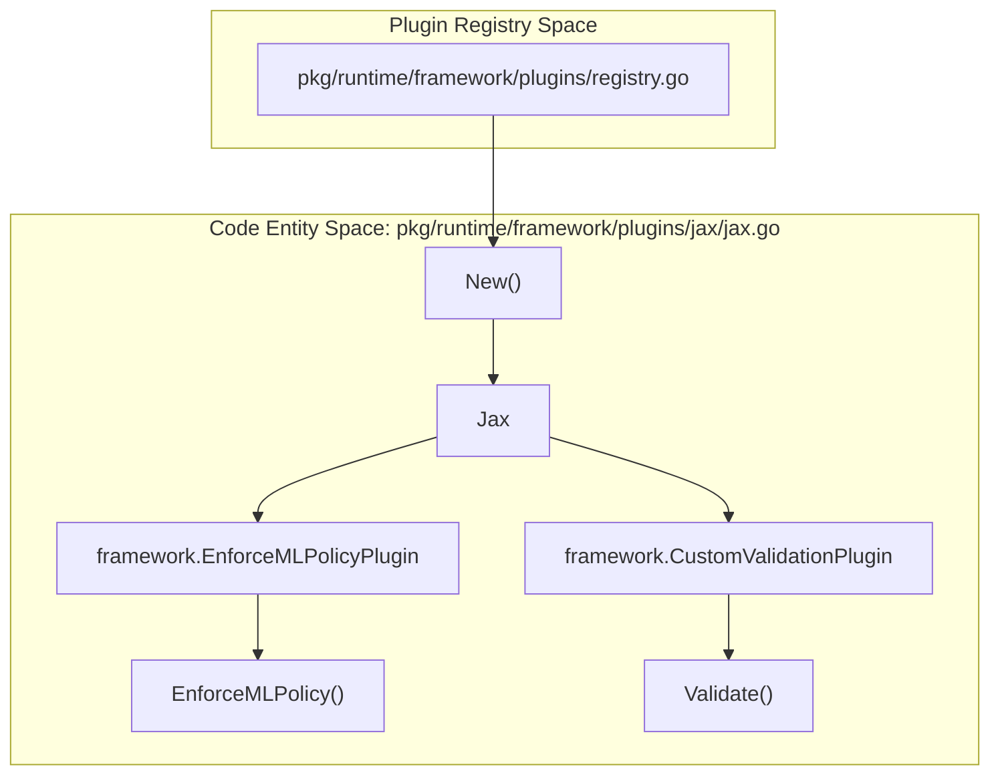
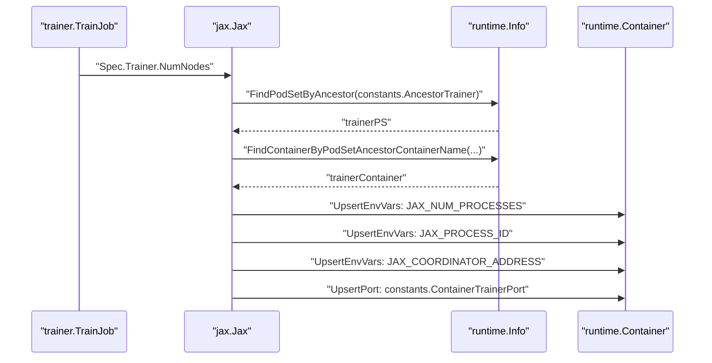

<!-- source: DeepWiki mcp.deepwiki.com · repo kubeflow/trainer · extra page JAX Plugin · fetched 2026-10-21 -->

# JAX Plugin

Relevant source files

The following files were used as context for generating this wiki page:

- [docs/user-guides/jax.md](docs/user-guides/jax.md)
- [pkg/runtime/framework/plugins/jax/jax.go](pkg/runtime/framework/plugins/jax/jax.go)
- [pkg/runtime/framework/plugins/jax/jax_test.go](pkg/runtime/framework/plugins/jax/jax_test.go)

The purpose of this page is to cover the JAX plugin implementation (`pkg/runtime/framework/plugins/jax/jax.go`) [pkg/runtime/framework/plugins/jax/jax.go:1-105](), detailing how it manages JAX-specific environment variables (`JAX_*`), `JAX_COORDINATOR_ADDRESS`, `JAX_PROCESS_ID` injection, and distributed initialization for multi-node JAX training workloads on Kubernetes.

---

## Role in the Plugin Framework

The JAX plugin is implemented in the package `pkg/runtime/framework/plugins/jax` [pkg/runtime/framework/plugins/jax/jax.go:17-17](). It defines the `Jax` struct [pkg/runtime/framework/plugins/jax/jax.go:37-37]() which implements the `framework.EnforceMLPolicyPlugin` and `framework.CustomValidationPlugin` interfaces [pkg/runtime/framework/plugins/jax/jax.go:39-40](). 

The plugin factory function `New` initializes and returns the plugin instance [pkg/runtime/framework/plugins/jax/jax.go:44-46](). The method `EnforceMLPolicy` configures the trainer container with required distributed settings [pkg/runtime/framework/plugins/jax/jax.go:56-105](), while `Validate` provides admission-time validation hooks [pkg/runtime/framework/plugins/jax/jax.go:52-54]().

**Title: JAX Plugin Architecture and Code Entity Mapping**

Sources: [pkg/runtime/framework/plugins/jax/jax.go:37-56]()

---

## Environment Variable Injection and Data Flow

When `EnforceMLPolicy` is invoked, the JAX plugin inspects the `trainer.TrainJob` specification and the runtime info (`runtime.Info`) to set up the necessary environment variables for `jax.distributed.initialize()` [pkg/runtime/framework/plugins/jax/jax.go:56-105]().

The injected environment variables and configuration properties include:
- `JAX_NUM_PROCESSES`: Total number of JAX processes, populated from `TrainJob.Spec.Trainer.NumNodes` [pkg/runtime/framework/plugins/jax/jax.go:64-80]().
- `JAX_PROCESS_ID`: Rank of the current process, derived from the Kubernetes Job completion index (`constants.JobCompletionIndexFieldPath`) using the Downward API [pkg/runtime/framework/plugins/jax/jax.go:82-88]().
- `JAX_COORDINATOR_ADDRESS`: DNS address of the rank 0 coordinator pod inside the headless service, structured as `{TrainJob.Name}-{constants.Node}-0-0.{TrainJob.Name}:{Port}` [pkg/runtime/framework/plugins/jax/jax.go:89-97]().

**Title: JAX Environment Variable Injection Data Flow**

Sources: [pkg/runtime/framework/plugins/jax/jax.go:56-102](), [pkg/runtime/framework/plugins/jax/jax_test.go:40-205]()

---

## Distributed Initialization and Coordinator Architecture

In JAX distributed workloads, processes communicate using Single Program, Multiple Data (SPMD) primitives such as `jax.pmap`, `jax.pjit`, and `jax.experimental.shard_map` [docs/user-guides/jax.md:18-20](). 

### Distributed Lifecycle Requirements
1. **Process Mapping**: The JAX runtime typically maps one Kubernetes Pod to one JAX process (`JAX_PROCESS_ID`) [docs/user-guides/jax.md:53-55]().
2. **Coordinator Pod**: Process 0 acts as the coordinator. All other worker processes connect to its address (`JAX_COORDINATOR_ADDRESS`) during startup [docs/user-guides/jax.md:142-144]().
3. **Explicit Initialization**: Training scripts must call `jax.distributed.initialize()` exactly once before executing any JAX computations, passing the injected environment variables [docs/user-guides/jax.md:97-108]().

Sources: [docs/user-guides/jax.md:18-112]()

---

## Testing and Validation

The behavior of the JAX plugin is verified via unit tests located in `pkg/runtime/framework/plugins/jax/jax_test.go` [pkg/runtime/framework/plugins/jax/jax_test.go:1-206](). These tests validate single-node and multi-node scenarios, ensuring nil-safety when `TrainJob` or trainer PodSets are missing, and confirming exact environment variable mappings for `JAX_NUM_PROCESSES`, `JAX_PROCESS_ID`, and `JAX_COORDINATOR_ADDRESS` [pkg/runtime/framework/plugins/jax/jax_test.go:40-206]().

Sources: [pkg/runtime/framework/plugins/jax/jax_test.go:40-206]()

---

