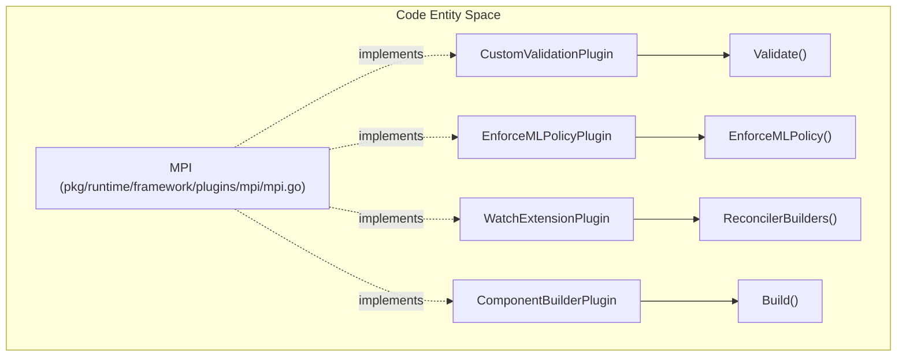
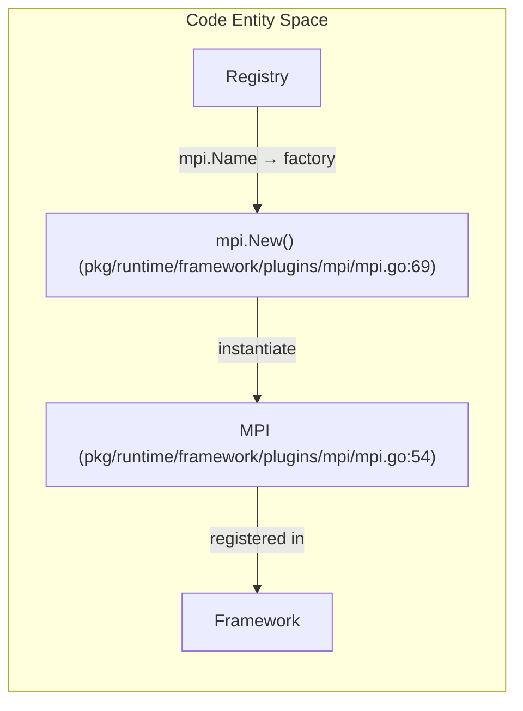
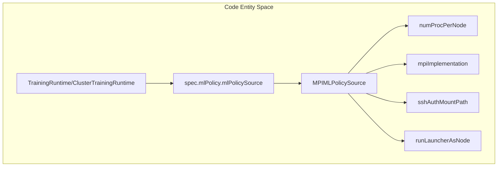
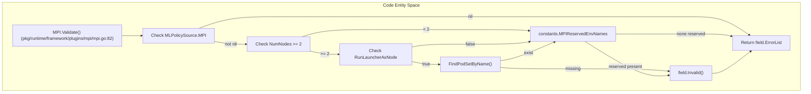
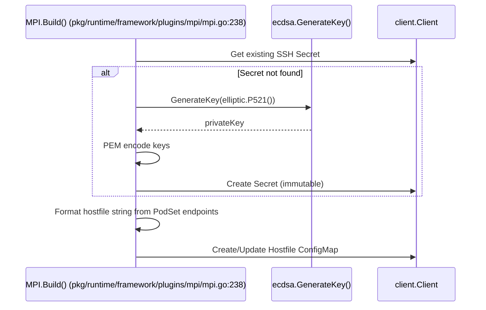

<!-- source: DeepWiki mcp.deepwiki.com · repo kubeflow/trainer · extra page MPI Plugin · fetched 2026-10-21 -->

# MPI Plugin

<details>
<summary>Relevant source files</summary>

The following files were used as context for generating this wiki page:

- [pkg/constants/constants.go](pkg/constants/constants.go)
- [pkg/runtime/framework/plugins/mpi/mpi.go](pkg/runtime/framework/plugins/mpi/mpi.go)
- [pkg/runtime/framework/plugins/mpi/mpi_test.go](pkg/runtime/framework/plugins/mpi/mpi_test.go)

</details>


The MPI Plugin enables MPI-based distributed training in Kubeflow Trainer by automatically configuring SSH authentication, hostfiles, and MPI-specific environment variables. It implements the framework plugin interfaces to integrate MPI runtime support into the training job lifecycle, supporting implementations like OpenMPI (with MPICH and Intel MPI planned).

For ML framework-specific configurations like PyTorch, see [Torch Plugin](). For JAX support, see [JAX Plugin](). For the overall plugin system architecture, see [Plugin Architecture Overview]().

---

## Purpose and Scope

The MPI Plugin serves as the `EnforceMLPolicyPlugin`, `ComponentBuilderPlugin`, and `WatchExtensionPlugin` for MPI-based distributed training. It handles:

- **SSH key pair generation** (ECDSA P-521) and distribution to training pods via ephemeral, immutable Secrets [pkg/runtime/framework/plugins/mpi/mpi.go:246-290]().
- **MPI hostfile creation** with pod endpoints and slot configuration via ConfigMaps [pkg/runtime/framework/plugins/mpi/mpi.go:296-326]().
- **OpenMPI environment variables** for communication setup, including `OMPI_MCA_plm_rsh_args` and `OMPI_MCA_orte_default_hostfile` [pkg/constants/constants.go:172-200]().
- **Node allocation** based on `numNodes` and `runLauncherAsNode` settings [pkg/runtime/framework/plugins/mpi/mpi.go:111-126]().
- **Volume mounting** of SSH credentials and hostfiles into launcher and worker pods [pkg/runtime/framework/plugins/mpi/mpi.go:141-212]().
- **Launcher dependency on worker readiness**, ensuring that the launcher schedules and executes only after worker nodes are fully initialized and registered in the hostfile.

Sources: [pkg/runtime/framework/plugins/mpi/mpi.go:1-327](), [pkg/constants/constants.go:132-178]()

---

## Plugin Interfaces Implementation

The MPI plugin implements four framework interfaces to participate in the TrainJob lifecycle (`pkg/runtime/framework/plugins/mpi/mpi.go`):



Title: MPI Plugin Interface Implementation

| Interface | Method | Purpose |
|-----------|--------|---------|
| `CustomValidationPlugin` | `Validate()` | Validates TrainJob MPI configuration consistency and reserved envs [pkg/runtime/framework/plugins/mpi/mpi.go:82-109]() |
| `EnforceMLPolicyPlugin` | `EnforceMLPolicy()` | Injects volumes, envs, and calculates node counts in `runtime.Info` [pkg/runtime/framework/plugins/mpi/mpi.go:111-215]() |
| `WatchExtensionPlugin` | `ReconcilerBuilders()` | Extends controller watches to include MPI-specific Secrets and ConfigMaps [pkg/runtime/framework/plugins/mpi/mpi.go:217-236]() |
| `ComponentBuilderPlugin` | `Build()` | Triggers generation of SSH Secrets and Hostfile ConfigMaps [pkg/runtime/framework/plugins/mpi/mpi.go:238-244]() |

Sources: [pkg/runtime/framework/plugins/mpi/mpi.go:54-62]()

---

## MPI Struct and Registration

The MPI plugin is registered in the internal plugin registry and instantiated by the framework during reconciliation:



Title: MPI Plugin Registration Flow

**Plugin Name**: `"MPI"` (constant defined at [pkg/runtime/framework/plugins/mpi/mpi.go:64]())

**Constructor Signature**:
```go
func New(_ context.Context, client client.Client, _ client.FieldIndexer, _ *configapi.Configuration) (framework.Plugin, error)
```

The `MPI` struct maintains references to the Kubernetes client and scheme to perform side-resource generation (Secrets/ConfigMaps) [pkg/runtime/framework/plugins/mpi/mpi.go:54-74]().

Sources: [pkg/runtime/framework/plugins/mpi/mpi.go:54-74](), [pkg/runtime/framework/plugins/mpi/mpi_test.go:69-74]()

---

## MPI Policy Configuration

The MPI plugin reads configuration from the `MLPolicySource.MPI` field. The behavior is influenced by the following settings:



Title: MPI Policy Source Configuration Hierarchy

**Configuration Fields**:

| Field | Type | Description | Default / Logic |
|-------|------|-------------|---------|
| `numProcPerNode` | `*int32` | MPI processes per node | Auto-detected from GPU count if set to 1 [pkg/runtime/framework/plugins/mpi/mpi.go:128-139]() |
| `mpiImplementation` | `MPIImplementation` | MPI implementation type | `"OpenMPI"` (MPICH/IntelMPI planned) [pkg/runtime/framework/plugins/mpi/mpi.go:52]() |
| `sshAuthMountPath` | `*string` | Mount path for SSH keys | Defaults to `/root/.ssh` if configured in runtime |
| `runLauncherAsNode` | `*bool` | Run launcher pod as a training slot | `false` [pkg/runtime/framework/plugins/mpi/mpi.go:89-94]() |

Sources: [pkg/runtime/framework/plugins/mpi/mpi.go:111-215](), [pkg/runtime/framework/plugins/mpi/mpi_test.go:112-114]()

---

## Validation Logic

### TrainJob Validation

The `Validate()` method ensures the `TrainJob` is consistent with the MPI runtime requirements and that users do not override internal MPI environment variables.



Title: MPI Validation Control Flow

**Validation Rules**:
1. **PodSet Integrity**: When `runLauncherAsNode=true` and `numNodes >= 2`, the runtime **must** contain both `launcher` and `node` PodSets [pkg/runtime/framework/plugins/mpi/mpi.go:89-94]().
2. **Reserved Envs**: Users cannot set environment variables reserved for MPI internals, such as `OMPI_MCA_plm_rsh_args` or `OMPI_MCA_orte_default_hostfile` [pkg/runtime/framework/plugins/mpi/mpi.go:95-107]().

Sources: [pkg/runtime/framework/plugins/mpi/mpi.go:82-109](), [pkg/constants/constants.go:175-181]()

---

## EnforceMLPolicy Execution

`EnforceMLPolicy()` transforms the `runtime.Info` object, which eventually dictates the `JobSet` specification.

### Node Count Calculation

The plugin adjusts the worker PodSet count based on the launcher's role:
- **Standard Mode**: `numNodes` workers are created [pkg/runtime/framework/plugins/mpi/mpi.go:123]().
- **Launcher-as-Node Mode**: 1 launcher pod is created, and `numNodes-1` worker pods are created (minimum 1 worker) [pkg/runtime/framework/plugins/mpi/mpi.go:119-121]().

### NumProcPerNode Auto-Detection

If `numProcPerNode` is not provided in the `TrainJob` spec and is set to 1 in the runtime, the plugin attempts to scale it to match the number of GPUs detected in the container resources using `runtime.GetNumGPUPerNode` [pkg/runtime/framework/plugins/mpi/mpi.go:128-139]().

### Volume Injection

The plugin injects SSH and Hostfile volumes into both `launcher` and `node` PodSets:
- **SSH Auth**: Mounts a Secret containing `id_rsa`, `id_rsa.pub`, and `authorized_keys` [pkg/runtime/framework/plugins/mpi/mpi.go:153-163]().
- **Hostfile**: Mounts a ConfigMap containing the generated `hostfile` to the launcher pod only [pkg/runtime/framework/plugins/mpi/mpi.go:171-188]().

Sources: [pkg/runtime/framework/plugins/mpi/mpi.go:111-212](), [pkg/constants/constants.go:132-160]()

---

## SSH Secret and Hostfile Generation

The `Build()` phase handles the creation of sidecar Kubernetes objects required for MPI communication.

### SSH Secret Generation
The `buildSSHAuthSecret` function creates a `kubernetes.io/ssh-auth` Secret. It uses ECDSA with the P-521 curve for high-security ephemeral keys [pkg/runtime/framework/plugins/mpi/mpi.go:253](). The Secret is marked as `Immutable` to prevent accidental updates during a job's lifecycle [pkg/runtime/framework/plugins/mpi/mpi.go:275]().

### Hostfile Generation
The `buildHostfileConfigMap` generates a text file formatted for MPI:
```text
<pod-fqdn> slots=<numProcPerNode>
```
It iterates through all `PodSets` in `runtime.Info`. A PodSet is considered a "node" (slot-carrying entity) if its name is `node` or if it is the `launcher` and `runLauncherAsNode` is enabled [pkg/runtime/framework/plugins/mpi/mpi.go:296-326]().

### Launcher Dependency on Worker Readiness
In distributed MPI execution, the launcher component relies on worker pod endpoints being active and reachable via SSH. Through JobSet orchestration and hostfile generation, worker pods (`node` PodSet) are initialized and assigned network FQDNs prior to the launcher initiating the `mpirun` command. This ensures that SSH connections from the launcher succeed without connection refused errors.



Title: SSH Secret and Hostfile Generation Sequence

Sources: [pkg/runtime/framework/plugins/mpi/mpi.go:246-326](), [pkg/constants/constants.go:69-92]()

---

## Container Runtime Requirements

For the MPI plugin to function, the container images used in the `TrainingRuntime` must have OpenMPI and SSH installed. Standard Kubeflow images for DeepSpeed and MLX achieve this by layering on `mpioperator/base` [cmd/runtimes/deepspeed/Dockerfile:15](), [cmd/runtimes/mlx/Dockerfile:15]().

**Base Image Configuration**:
- Installs `openssh-server`, `openssh-client`, and `libopenmpi-dev` [cmd/runtimes/deepspeed/Dockerfile:19-22]().
- Configures an `mpiuser` with appropriate home directory permissions [cmd/runtimes/deepspeed/Dockerfile:25-34]().
- Copies standard SSH configurations (`sshd_config`, `ssh_config`) from the MPI base image [cmd/runtimes/deepspeed/Dockerfile:29-31]().

Sources: [cmd/runtimes/deepspeed/Dockerfile:15-34](), [cmd/runtimes/mlx/Dockerfile:15-34]()

---

