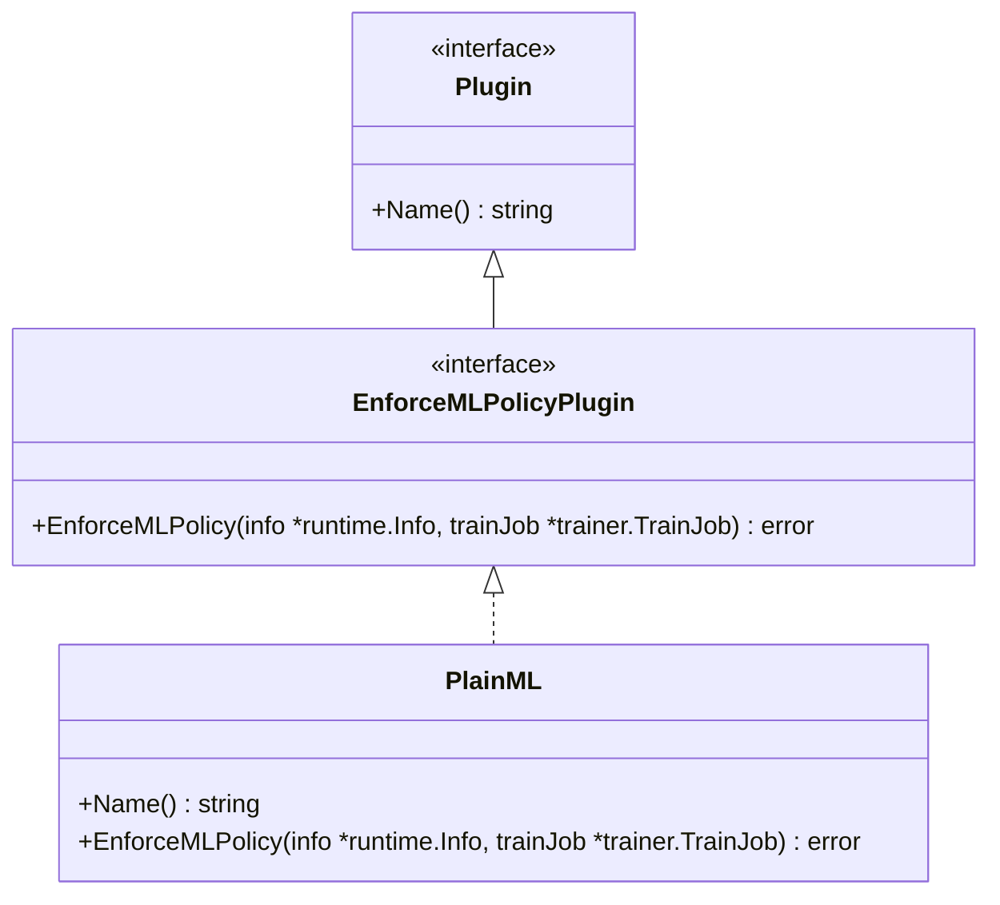
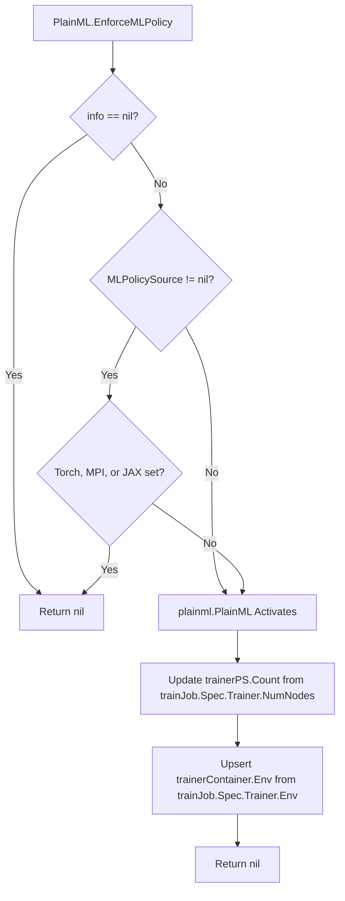
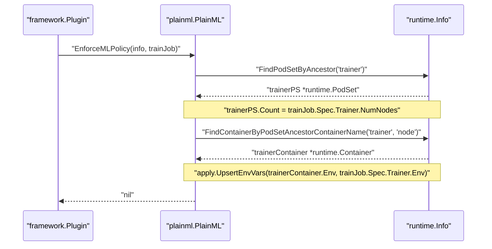

<!-- source: DeepWiki mcp.deepwiki.com · repo kubeflow/trainer · extra page PlainML Plugin · fetched 2026-10-21 -->

# PlainML Plugin

Relevant source files

The following files were used as context for generating this wiki page:

- [pkg/runtime/framework/plugins/plainml/plainml.go](pkg/runtime/framework/plugins/plainml/plainml.go)
- [pkg/runtime/framework/plugins/plainml/plainml_test.go](pkg/runtime/framework/plugins/plainml/plainml_test.go)
- [pkg/runtime/framework/plugins/torch/torch.go](pkg/runtime/framework/plugins/torch/torch.go)
- [pkg/runtime/framework/plugins/torch/torch_test.go](pkg/runtime/framework/plugins/torch/torch_test.go)
- [pkg/runtime/runtime_test.go](pkg/runtime/runtime_test.go)

This page documents the `PlainML` plugin (`pkg/runtime/framework/plugins/plainml/plainml.go`): its role in the plugin framework, the conditions under which it activates, and the specific mutations it applies to `runtime.Info`. For a general overview of all plugin interfaces and how the framework dispatches through them, see [4.1 Plugin Architecture Overview](). For the framework-specific ML policy plugins that take priority over PlainML, see the [4.2.1 Torch Plugin](), [4.2.2 MPI Plugin](), [4.2.3 JAX Plugin](), and [4.2.5 XGBoost Plugin]().

---

## Overview

`PlainML` is the generic fallback `EnforceMLPolicyPlugin` defined in `pkg/runtime/framework/plugins/plainml/plainml.go`. It executes during every `TrainJob` reconciliation pipeline but only performs mutations when the `TrainingRuntime`'s `MLPolicySource` does not specify a framework-specific policy (such as `Torch`, `MPI`, or `JAX`). When active, it applies two primary mutations to the `runtime.Info` object:

1. **Node Scaling**: Updates the trainer `PodSet` replica count (`Count`) using the value from `TrainJob.Spec.Trainer.NumNodes` [pkg/runtime/framework/plugins/plainml/plainml.go:56-60]().
2. **Environment Injection**: Merges environment variables from `TrainJob.Spec.Trainer.Env` into the trainer container [pkg/runtime/framework/plugins/plainml/plainml.go:62-70]().

It does **not** implement `CustomValidationPlugin`, `ComponentBuilderPlugin`, or any other plugin interface—it focuses strictly on `EnforceMLPolicyPlugin` [pkg/runtime/framework/plugins/plainml/plainml.go:32-34]().

Sources: [pkg/runtime/framework/plugins/plainml/plainml.go:32-40](), [pkg/runtime/framework/plugins/plainml/plainml_test.go:38-45]()

---

## Code Structure

| Symbol | Location | Role |
| :--- | :--- | :--- |
| `PlainML` (struct) | [pkg/runtime/framework/plugins/plainml/plainml.go:34]() | Plugin type, implemented as a zero-value struct. |
| `Name` (const) | [pkg/runtime/framework/plugins/plainml/plainml.go:36]() | Returns the plugin identifier string: `"PlainML"`. |
| `New` | [pkg/runtime/framework/plugins/plainml/plainml.go:38-40]() | Constructor function registered with the plugin registry. |
| `EnforceMLPolicy` | [pkg/runtime/framework/plugins/plainml/plainml.go:46-71]() | Implementation of the `EnforceMLPolicyPlugin` interface. |

The struct has no fields and requires no Kubernetes client or indexer; the `New` constructor signature accepts them for interface consistency but they are ignored [pkg/runtime/framework/plugins/plainml/plainml.go:38-40]().

Sources: [pkg/runtime/framework/plugins/plainml/plainml.go:34-44]()

---

## Interface Compliance

The `PlainML` plugin satisfies the core plugin interface and the specific policy enforcement interface.

Title: PlainML Plugin Interface Hierarchy

Sources: [pkg/runtime/framework/plugins/plainml/plainml.go:32-44](), [pkg/runtime/framework/plugins/plainml/plainml_test.go:32-35]()

---

## Activation Logic

`EnforceMLPolicy` returns early (no-op) if any framework-specific policy is detected in `runtime.Info`. This ensures that `PlainML` acts only as a fallback for generic distributed or single-node workloads [pkg/runtime/framework/plugins/plainml/plainml.go:47-53]().

Title: PlainML EnforceMLPolicy Activation Flow

Sources: [pkg/runtime/framework/plugins/plainml/plainml.go:47-53](), [pkg/runtime/framework/plugins/plainml/plainml_test.go:46-99]()

---

## EnforceMLPolicy Mutations

When active, `PlainML` performs the following operations against `runtime.Info`:

### 1. Node Count Sync
The plugin calls `info.FindPodSetByAncestor(constants.AncestorTrainer)` to locate the trainer `PodSet` [pkg/runtime/framework/plugins/plainml/plainml.go:57](). If `TrainJob.Spec.Trainer.NumNodes` is provided, it overwrites `trainerPS.Count` with that value [pkg/runtime/framework/plugins/plainml/plainml.go:58-59](). This allows the `TrainJob` to scale the number of nodes defined in the `TrainingRuntime` template.

### 2. Environment Variable Upsert
The plugin calls `info.FindContainerByPodSetAncestorContainerName(constants.AncestorTrainer, constants.Node)` to locate the specific trainer container [pkg/runtime/framework/plugins/plainml/plainml.go:65](). It then uses `apply.UpsertEnvVars` to merge variables from `TrainJob.Spec.Trainer.Env` [pkg/runtime/framework/plugins/plainml/plainml.go:66-67]().

Title: PlainML Mutation Sequence on runtime.Info

Sources: [pkg/runtime/framework/plugins/plainml/plainml.go:46-71](), [pkg/runtime/framework/plugins/plainml/plainml_test.go:101-184]()

---

## Behavior Summary Table

The following table summarizes the behavior of `EnforceMLPolicy` based on input state:

| `info` | `MLPolicySource` Framework Fields | `Trainer.NumNodes` | `Trainer.Env` | Outcome |
| :--- | :--- | :--- | :--- | :--- |
| `nil` | — | — | — | No-op [pkg/runtime/framework/plugins/plainml/plainml.go:47-49]() |
| Set | `Torch != nil` | — | — | No-op (Handled by Torch Plugin) [pkg/runtime/framework/plugins/plainml/plainml.go:50-52]() |
| Set | `MPI != nil` | — | — | No-op (Handled by MPI Plugin) [pkg/runtime/framework/plugins/plainml/plainml.go:50-52]() |
| Set | `JAX != nil` | — | — | No-op (Handled by JAX Plugin) [pkg/runtime/framework/plugins/plainml/plainml.go:50-52]() |
| Set | `nil` | `nil` | `nil` | No mutations; counts/envs from Runtime template remain |
| Set | `nil` | `200` | `nil` | Sets trainer `PodSet.Count = 200` [pkg/runtime/framework/plugins/plainml/plainml.go:59]() |
| Set | `nil` | `any` | `CONFLICT=FROM_TRAINER` | Upserts environment variable into trainer container [pkg/runtime/framework/plugins/plainml/plainml.go:66-67]() |

Sources: [pkg/runtime/framework/plugins/plainml/plainml_test.go:38-185](), [pkg/runtime/framework/plugins/plainml/plainml.go:46-71]()

---

## Precedence and Defaults

The `PlainML` plugin participates in the standard precedence chain for node counts:

1. **Highest Precedence**: `TrainJob.Spec.Trainer.NumNodes` (Applied by `PlainML` if framework-specific plugins are inactive) [pkg/runtime/framework/plugins/plainml/plainml.go:59]().
2. **Lowest Precedence**: Default value from the `TrainingRuntime` template [pkg/runtime/framework/plugins/plainml/plainml_test.go:111-114]().

This ensures that even without a specialized framework plugin, a user can override cluster-wide runtime defaults directly in their `TrainJob` specification [pkg/runtime/framework/plugins/plainml/plainml_test.go:101-134]().

Sources: [pkg/runtime/framework/plugins/plainml/plainml.go:56-60](), [pkg/runtime/framework/plugins/plainml/plainml_test.go:101-134]()

---

