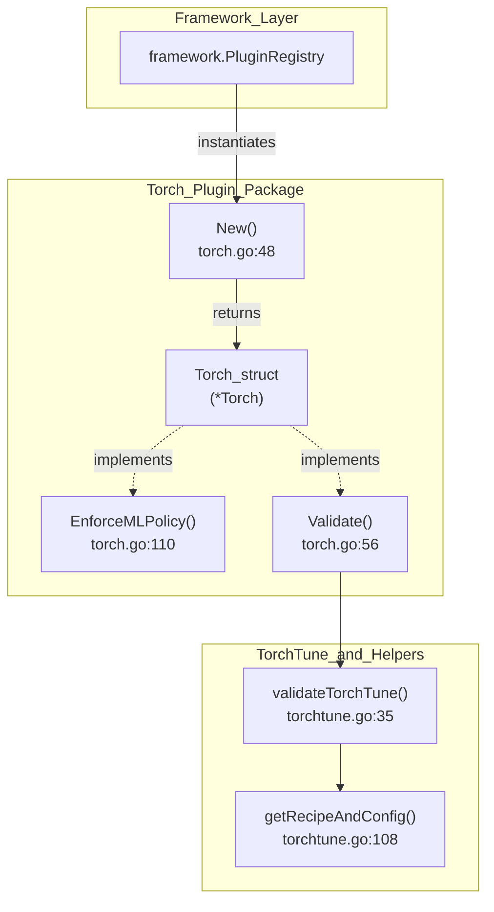
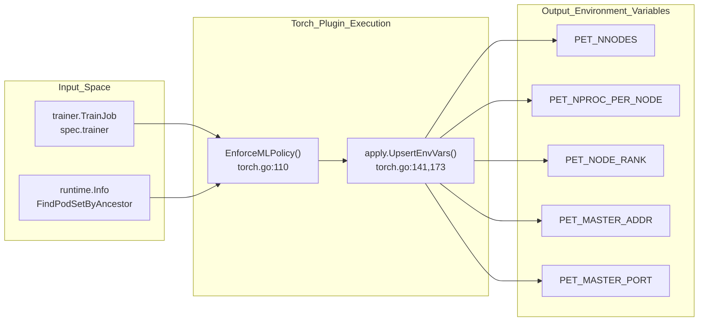
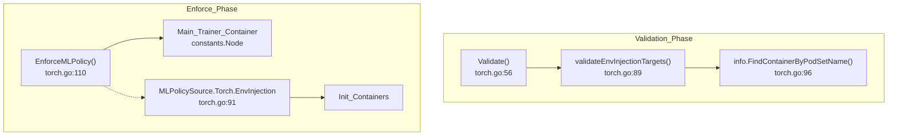

<!-- source: DeepWiki mcp.deepwiki.com · repo kubeflow/trainer · extra page Torch Plugin · fetched 2026-10-21 -->

# Torch Plugin

Relevant source files

The following files were used as context for generating this wiki page:

- [pkg/runtime/framework/plugins/plainml/plainml.go](pkg/runtime/framework/plugins/plainml/plainml.go)
- [pkg/runtime/framework/plugins/plainml/plainml_test.go](pkg/runtime/framework/plugins/plainml/plainml_test.go)
- [pkg/runtime/framework/plugins/torch/torch.go](pkg/runtime/framework/plugins/torch/torch.go)
- [pkg/runtime/framework/plugins/torch/torch_test.go](pkg/runtime/framework/plugins/torch/torch_test.go)
- [pkg/runtime/framework/plugins/torch/torchtune.go](pkg/runtime/framework/plugins/torch/torchtune.go)
- [pkg/runtime/framework/plugins/torch/torchtune_test.go](pkg/runtime/framework/plugins/torch/torchtune_test.go)
- [pkg/runtime/runtime_test.go](pkg/runtime/runtime_test.go)

## Purpose and Scope

The Torch Plugin configures PyTorch distributed training environments for `TrainJob` resources that use the `torch` ML policy. It sets the necessary environment variables for PyTorch's distributed training (`torchrun`), automatically calculates `nproc_per_node` based on GPU or CPU resources, supports TorchTune-based LLM fine-tuning workflows, and implements KEP-3416 for injecting `PET_*` environment variables into init or sidecar containers.

**Note**: PyTorch Elastic training is not yet supported. Support will be added when JobSet supports Elastic Jobs [pkg/runtime/framework/plugins/torch/torch.go:109-109]().

Sources: [pkg/runtime/framework/plugins/torch/torch.go:41-109]()

## Overview

The Torch Plugin (`torch.Torch` struct defined at [pkg/runtime/framework/plugins/torch/torch.go:41-41]()) is invoked during the `TrainJob` reconciliation process when a runtime specifies `mlPolicy.mlPolicySource.torch` in its configuration. The plugin performs four primary functions:

1. **Node Count Configuration**: Updates the trainer PodSet count from `trainJob.spec.trainer.numNodes` [pkg/runtime/framework/plugins/torch/torch.go:117-119]().
2. **Environment Variable Injection**: Sets PyTorch distributed environment variables (`PET_` prefix) required by `torchrun` [pkg/runtime/framework/plugins/torch/torch.go:145-166]().
3. **Resource-based nproc_per_node Detection**: Automatically determines processes per node based on GPU/CPU resources and policy configuration [pkg/runtime/framework/plugins/torch/torch.go:121-135]().
4. **TorchTune CLI Mutation & Validation**: Validates TorchTune commands, pretrained models, and configuration constraints [pkg/runtime/framework/plugins/torch/torch.go:81-84]().

The plugin modifies the `runtime.Info` object during the `EnforceMLPolicy` phase, adding environment variables to the trainer container at [pkg/runtime/framework/plugins/torch/torch.go:169-173]().

Sources: [pkg/runtime/framework/plugins/torch/torch.go:41-54](), [pkg/runtime/framework/plugins/torch/torch.go:110-174]()

## Plugin Interfaces

The Torch Plugin implements two plugin interfaces from the framework:

| Interface | Method | Purpose |
| :--- | :--- | :--- |
| `EnforceMLPolicyPlugin` | `EnforceMLPolicy(info, trainJob)` [pkg/runtime/framework/plugins/torch/torch.go:110-110]() | Configures PyTorch distributed parameters in the runtime info |
| `CustomValidationPlugin` | `Validate(ctx, runtimeInfo, oldObj, newObj)` [pkg/runtime/framework/plugins/torch/torch.go:56-56]() | Validates reserved envs and TorchTune configurations |

The plugin is registered in the plugin registry under the name `"Torch"` [pkg/runtime/framework/plugins/torch/torch.go:46-46]() and is instantiated via the `New()` factory function [pkg/runtime/framework/plugins/torch/torch.go:48-50]().

Title: "Torch Plugin Code Entity Integration"

Sources: [pkg/runtime/framework/plugins/torch/torch.go:41-54](), [pkg/runtime/framework/plugins/torch/torch.go:56-87](), [pkg/runtime/framework/plugins/torch/torch.go:110-174](), [pkg/runtime/framework/plugins/torch/torchtune.go:35-133]()

## Environment Variable Configuration

### PyTorch Distributed Environment Variables

The Torch Plugin sets environment variables with the `PET_` prefix (PyTorch Elastic Training) that are consumed by `torchrun`:

| Environment Variable | Source | Description |
| :--- | :--- | :--- |
| `PET_NNODES` | `trainJob.spec.trainer.numNodes` | Total number of training nodes [pkg/runtime/framework/plugins/torch/torch.go:146-148]() |
| `PET_NPROC_PER_NODE` | `trainJob.spec.trainer.numProcPerNode` or auto-detected | Number of processes per node [pkg/runtime/framework/plugins/torch/torch.go:149-151]() |
| `PET_NODE_RANK` | `metadata.annotations['batch.kubernetes.io/job-completion-index']` | Current node's rank (0-indexed) [pkg/runtime/framework/plugins/torch/torch.go:152-157]() |
| `PET_MASTER_ADDR` | `<trainjob-name>-node-0-0.<trainjob-name>` | Hostname of the master node [pkg/runtime/framework/plugins/torch/torch.go:160-162]() |
| `PET_MASTER_PORT` | `29500` (constant) | Port for distributed communication [pkg/runtime/framework/plugins/torch/torch.go:163-165]() |

These variables are inserted into the trainer container's environment using `apply.UpsertEnvVars()` at [pkg/runtime/framework/plugins/torch/torch.go:173-173]().

Title: "Environment Variable Configuration Data Flow"

Sources: [pkg/runtime/framework/plugins/torch/torch.go:110-174]()

## nproc_per_node Detection

### Calculation Logic

The `numProcPerNode` value determines how many training processes run on each node. The Torch Plugin supports automatic detection based on available hardware resources.

1. **Explicit Value**: If `trainJob.Spec.Trainer.NumProcPerNode` is set, it is used directly [pkg/runtime/framework/plugins/torch/torch.go:122-124]().
2. **"auto" (GPU-based)**: If `numProcPerNode` is `"auto"`, the plugin first checks for GPUs in the container resources using `runtime.GetNumGPUPerNode()` [pkg/runtime/framework/plugins/torch/torch.go:131-131]().
3. **"auto" (CPU-based)**: If no GPUs are found, the plugin falls back to CPU detection using `getNumCPUPerNode()` [pkg/runtime/framework/plugins/torch/torch.go:133-135]().

Sources: [pkg/runtime/framework/plugins/torch/torch.go:121-135]()

## TorchTune Support

### Validation and Recipe Selection

When the `TrainJob` uses TorchTune (detected by checking `trainJob.Spec.Trainer.Command` against `constants.TorchTuneEntrypoint` [pkg/runtime/framework/plugins/torch/torch.go:81-81]()), the plugin validates TorchTune configurations through `validateTorchTune()` [pkg/runtime/framework/plugins/torch/torchtune.go:35-35]() and selects appropriate recipes via `getRecipeAndConfig()` [pkg/runtime/framework/plugins/torch/torchtune.go:108-133]().

Key validation checks include:
* **Pretrained Models**: Ensures the model specified in `runtimeRef.name` is supported (e.g., Llama 3.2 1B/3B, Qwen 2.5 1.5B) [pkg/runtime/framework/plugins/torch/torchtune.go:42-44]().
* **Node Count Constraints**: Restricts multi-node fine-tuning appropriately depending on the model [pkg/runtime/framework/plugins/torch/torchtune.go:47-50]().
* **QLoRA Support**: Validates QLoRA applicability and resource requirements per device [pkg/runtime/framework/plugins/torch/torchtune.go:62-75]().
* **Immutable Configs**: Prevents users from overriding runtime-managed arguments in `trainer.args` such as `output_dir` or `tokenizer.path` [pkg/runtime/framework/plugins/torch/torchtune.go:91-101]().

Sources: [pkg/runtime/framework/plugins/torch/torch.go:81-84](), [pkg/runtime/framework/plugins/torch/torchtune.go:35-133]()

## KEP-3416: PET_* Env Injection into Init Containers

Proposal KEP-3416 addresses the limitation where `PET_*` environment variables were historically only injected into the main trainer container. This allows init containers or sidecars to perform preflight distributed checks (e.g., NCCL connectivity, DNS resolution of `PET_MASTER_ADDR`).

The implementation allows users to opt-in to injecting these variables into specific init or sidecar containers via `envInjection` targets defined in the `TorchMLPolicySource`. The plugin validates these targets during the `Validate` phase using `validateEnvInjectionTargets()` [pkg/runtime/framework/plugins/torch/torch.go:89-89]() to ensure specified containers exist in the runtime template [pkg/runtime/framework/plugins/torch/torch.go:63-63](), [pkg/runtime/framework/plugins/torch/torch.go:89-107]().

Title: "KEP-3416 EnvInjection Data Flow"

Sources: [pkg/runtime/framework/plugins/torch/torch.go:56-107](), [pkg/runtime/framework/plugins/torch/torch.go:110-174]()

## Validation Rules

The `Validate` function ensures the `TrainJob` specification is compatible with the Torch runtime:

| Check | Code Location | Description |
| :--- | :--- | :--- |
| **Reserved Envs** | [pkg/runtime/framework/plugins/torch/torch.go:66-77]() | Rejects `TrainJob` if it contains `PET_*` environment variables in `spec.trainer.env`. |
| **Env Injection Targets** | [pkg/runtime/framework/plugins/torch/torch.go:63-63]() | Validates that containers specified for `envInjection` exist in the runtime [pkg/runtime/framework/plugins/torch/torch.go:89-107](). |
| **TorchTune Configuration** | [pkg/runtime/framework/plugins/torch/torch.go:81-84]() | Validates model support and recipe constraints [pkg/runtime/framework/plugins/torch/torchtune.go:35-104](). |

Sources: [pkg/runtime/framework/plugins/torch/torch.go:56-87](), [pkg/runtime/framework/plugins/torch/torchtune.go:35-104]()

---

