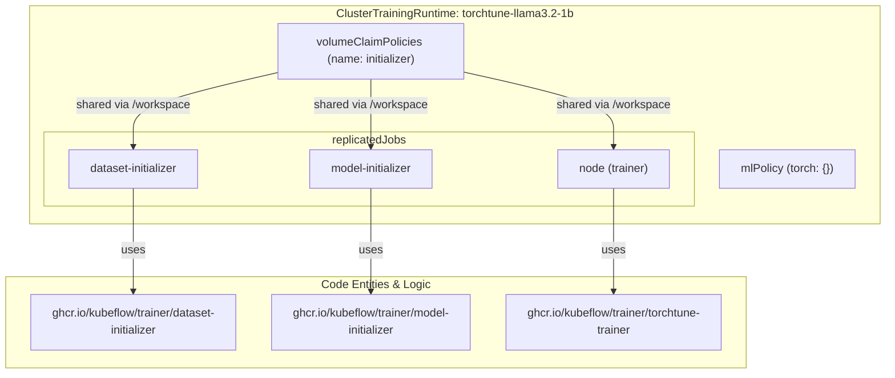
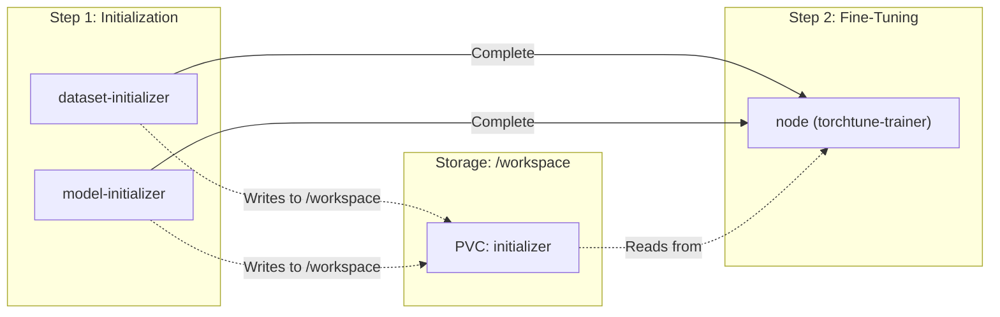
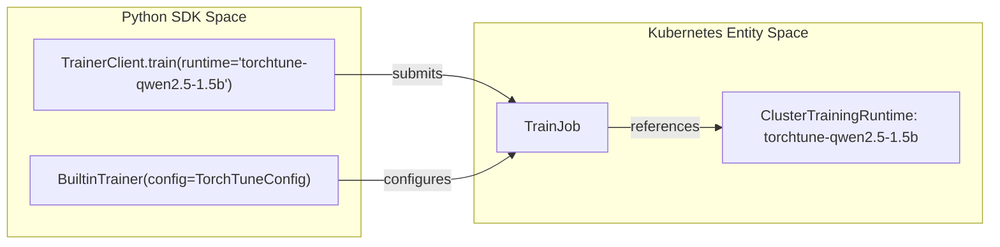

<!-- source: DeepWiki mcp.deepwiki.com · repo kubeflow/trainer · extra page TorchTune Runtime Definitions · fetched 2026-10-21 -->

# TorchTune Runtime Definitions

<details>
<summary>Relevant source files</summary>

The following files were used as context for generating this wiki page:

- [charts/kubeflow-trainer/tests/runtimes/torchtune_llama3_2_1B_test.yaml](charts/kubeflow-trainer/tests/runtimes/torchtune_llama3_2_1B_test.yaml)
- [charts/kubeflow-trainer/tests/runtimes/torchtune_llama3_2_3B_test.yaml](charts/kubeflow-trainer/tests/runtimes/torchtune_llama3_2_3B_test.yaml)
- [charts/kubeflow-trainer/tests/runtimes/torchtune_qwen2_5_1.5B_test.yaml](charts/kubeflow-trainer/tests/runtimes/torchtune_qwen2_5_1.5B_test.yaml)
- [charts/kubeflow-trainer/tests/runtimes/xgboost_distributed_test.yaml](charts/kubeflow-trainer/tests/runtimes/xgboost_distributed_test.yaml)
- [cmd/trainers/torchtune/Dockerfile](cmd/trainers/torchtune/Dockerfile)
- [cmd/trainers/torchtune/requirements.txt](cmd/trainers/torchtune/requirements.txt)
- [examples/torchtune/qwen2_5/qwen2.5-1.5B-with-alpaca.ipynb](examples/torchtune/qwen2_5/qwen2.5-1.5B-with-alpaca.ipynb)
- [manifests/base/runtimes/kustomization.yaml](manifests/base/runtimes/kustomization.yaml)
- [manifests/base/runtimes/torchtune/kustomization.yaml](manifests/base/runtimes/torchtune/kustomization.yaml)
- [manifests/base/runtimes/torchtune/llama3_2/llama3_2_1B.yaml](manifests/base/runtimes/torchtune/llama3_2/llama3_2_1B.yaml)
- [manifests/base/runtimes/torchtune/llama3_2/llama3_2_3B.yaml](manifests/base/runtimes/torchtune/llama3_2/llama3_2_3B.yaml)
- [manifests/base/runtimes/torchtune/qwen2_5/qwen2_5_1.5B.yaml](manifests/base/runtimes/torchtune/qwen2_5/qwen2_5_1.5B.yaml)
- [manifests/overlays/kubeflow-platform/kubeflow-trainer-roles.yaml](manifests/overlays/kubeflow-platform/kubeflow-trainer-roles.yaml)
- [manifests/overlays/kubeflow-platform/patches/remove-namespace.yaml](manifests/overlays/kubeflow-platform/patches/remove-namespace.yaml)
- [manifests/overlays/runtimes/kustomization.yaml](manifests/overlays/runtimes/kustomization.yaml)

</details>


## Purpose and Scope

This document details the predefined `ClusterTrainingRuntime` definitions for TorchTune-based LLM fine-tuning. TorchTune is a PyTorch-native library designed for authoring, fine-tuning, and experimenting with Large Language Models (LLMs). These runtime definitions provide pre-configured environments for foundational models such as Llama 3.2 (1B and 3B) and Qwen 2.5 (1.5B), utilizing a recipe-config design to streamline distributed fine-tuning on Kubernetes.

Sources: [manifests/base/runtimes/torchtune/llama3_2/llama3_2_1B.yaml:15-21](), [manifests/base/runtimes/torchtune/llama3_2/llama3_2_3B.yaml:15-21](), [manifests/base/runtimes/torchtune/qwen2_5/qwen2_5_1.5B.yaml:15-21]()

## Available TorchTune Runtimes

Kubeflow Trainer provides predefined `ClusterTrainingRuntime` resources under `manifests/base/runtimes/torchtune/` [manifests/base/runtimes/torchtune/kustomization.yaml:20]() that bundle initializers and the TorchTune trainer image:

| Runtime Name | Model | Model Size | Default Storage | GPU Requirement | Config Path |
|--------------|-------|------------|-----------------|-----------------|-------------|
| `torchtune-llama3.2-1b` | Llama 3.2 1B Instruct | ~2.3 GiB | 20Gi | 2 GPUs | `llama3_2/1B_full` |
| `torchtune-llama3.2-3b` | Llama 3.2 3B Instruct | ~12 GiB | 20Gi | 2 GPUs | `llama3_2/3B_full` |
| `torchtune-qwen2.5-1.5b` | Qwen 2.5 1.5B Instruct | ~3 GiB | 20Gi | 2 GPUs | `qwen2_5/1.5B_full` |

Sources: [manifests/base/runtimes/torchtune/llama3_2/llama3_2_1B.yaml:15-105](), [manifests/base/runtimes/torchtune/llama3_2/llama3_2_3B.yaml:15-105](), [manifests/base/runtimes/torchtune/qwen2_5/qwen2_5_1.5B.yaml:15-106](), [charts/kubeflow-trainer/tests/runtimes/torchtune_llama3_2_1B_test.yaml:42-49](), [charts/kubeflow-trainer/tests/runtimes/torchtune_llama3_2_3B_test.yaml:42-49](), [charts/kubeflow-trainer/tests/runtimes/torchtune_qwen2_5_1.5B_test.yaml:42-49]()

## Runtime Directory Structure

The runtimes are structured by model families within the base manifests repository and integrated through Kustomization:

```
manifests/base/runtimes/torchtune/
├── llama3_2/
│   ├── llama3_2_1B.yaml
│   └── llama3_2_3B.yaml
├── qwen2_5/
│   └── qwen2_5_1.5B.yaml
└── kustomization.yaml
```

The root runtime kustomization file `manifests/base/runtimes/kustomization.yaml` references the `torchtune` resource bundle [manifests/base/runtimes/kustomization.yaml:23-23]().

Sources: [manifests/base/runtimes/torchtune/kustomization.yaml:15-20](), [manifests/base/runtimes/torchtune/kustomization.yaml:20]()

## TorchTune Runtime Architecture

### Component Data Flow and Entity Mapping

The following diagram maps the `ClusterTrainingRuntime` specification fields to concrete runtime execution logic, bridging natural language concepts to code identifiers and container images.

**Title: TorchTune Runtime Entity Mapping**


Sources: [manifests/base/runtimes/torchtune/llama3_2/llama3_2_1B.yaml:21-105](), [manifests/base/runtimes/torchtune/llama3_2/llama3_2_1B.yaml:47-47](), [manifests/base/runtimes/torchtune/llama3_2/llama3_2_1B.yaml:64-64](), [manifests/base/runtimes/torchtune/llama3_2/llama3_2_1B.yaml:86-86]()

### Multi-Stage Workflow

TorchTune runtimes enforce strict job dependencies via `dependsOn` declarations in `replicatedJobs` to coordinate initialization before launching the distributed trainer [manifests/base/runtimes/torchtune/llama3_2/llama3_2_1B.yaml:71-76]().

**Title: TorchTune Execution Pipeline**


Sources: [manifests/base/runtimes/torchtune/llama3_2/llama3_2_1B.yaml:71-76](), [manifests/base/runtimes/torchtune/llama3_2/llama3_2_3B.yaml:71-76]()

## Core Specification Components

### ML Policy and Torch Plugin
All TorchTune runtimes define an empty `torch` configuration under `mlPolicy` [manifests/base/runtimes/torchtune/llama3_2/llama3_2_1B.yaml:22-24](). This activates the PyTorch plugin to inject framework environment variables, handling rendezvous mechanics (`--rdzv_endpoint=localhost:29500`) [manifests/base/runtimes/torchtune/llama3_2/llama3_2_1B.yaml:90-90]().

### Shared Volume Configuration
A 20Gi `ReadWriteOnce` volume named `initializer` is provisioned via `volumeClaimPolicies` [manifests/base/runtimes/torchtune/llama3_2/llama3_2_1B.yaml:27-35](). It is mounted at `/workspace` across all containers to pass datasets and checkpoints between steps [manifests/base/runtimes/torchtune/llama3_2/llama3_2_1B.yaml:52-105]().

### Dataset Initializer Step
Executes using `ghcr.io/kubeflow/trainer/dataset-initializer` with `STORAGE_URI: hf://tatsu-lab/alpaca` [manifests/base/runtimes/torchtune/llama3_2/llama3_2_1B.yaml:46-50]().

### Model Initializer Step
Executes using `ghcr.io/kubeflow/trainer/model-initializer` to download foundational model weights into `/workspace`:
- **Llama 3.2 1B**: `hf://meta-llama/Llama-3.2-1B-Instruct` [manifests/base/runtimes/torchtune/llama3_2/llama3_2_1B.yaml:67-67]()
- **Llama 3.2 3B**: `hf://meta-llama/Llama-3.2-3B-Instruct` [manifests/base/runtimes/torchtune/llama3_2/llama3_2_3B.yaml:67-67]()
- **Qwen 2.5 1.5B**: `hf://Qwen/Qwen2.5-1.5B-Instruct` [manifests/base/runtimes/torchtune/qwen2_5/qwen2_5_1.5B.yaml:67-67]()

### Trainer Container Image
The `ghcr.io/kubeflow/trainer/torchtune-trainer` image is built on `pytorch/pytorch:2.9.1-cuda12.8-cudnn9-runtime` [cmd/trainers/torchtune/Dockerfile:15-15]() and installs `torchtune==0.6.1`, `torchao==0.15.0`, and `bitsandbytes>=0.50.2` for parameter-efficient tuning (LoRA/QLoRA) [cmd/trainers/torchtune/requirements.txt:1-3]().

Sources: [manifests/base/runtimes/torchtune/llama3_2/llama3_2_1B.yaml:22-105](), [cmd/trainers/torchtune/Dockerfile:15-27](), [cmd/trainers/torchtune/requirements.txt:1-4]()

## TorchTune Recipe Selection and Commands

The runtimes invoke `tune run` with the `full_finetune_distributed` recipe [manifests/base/runtimes/torchtune/llama3_2/llama3_2_1B.yaml:87-91]().

### Llama 3.2 Command Structure
```yaml
command:
  - tune
  - run
  - --rdzv_endpoint=localhost:29500
  - full_finetune_distributed
  - --config
  - llama3_2/1B_full
  - dataset=torchtune.datasets.instruct_dataset
  - dataset.source=parquet
  - dataset.data_dir=/workspace/dataset/data
  - output_dir=/workspace/output
  - tokenizer.path=/workspace/model/original/tokenizer.model
  - checkpointer.checkpoint_dir=/workspace/model
```
Sources: [manifests/base/runtimes/torchtune/llama3_2/llama3_2_1B.yaml:87-99]()

### Qwen 2.5 Command Structure
Qwen runtimes use the `qwen2_5/1.5B_full` configuration path and map respective tokenizer assets [manifests/base/runtimes/torchtune/qwen2_5/qwen2_5_1.5B.yaml:93-100]().

Sources: [manifests/base/runtimes/torchtune/qwen2_5/qwen2_5_1.5B.yaml:93-100]()

## Resource Configuration and Constraints

Training nodes request `nvidia.com/gpu: 2` limits by default to execute distributed routines on dual accelerators [manifests/base/runtimes/torchtune/llama3_2/llama3_2_1B.yaml:101-102](). Overlays manage image tags to ensure deployments pull the appropriate container version [manifests/overlays/runtimes/kustomization.yaml:26-33]().

Sources: [manifests/base/runtimes/torchtune/llama3_2/llama3_2_1B.yaml:100-102](), [manifests/overlays/runtimes/kustomization.yaml:26-33]()

## Python SDK Integration

Users can submit TorchTune training workflows via the Python SDK using `BuiltinTrainer` and `TorchTuneConfig`.

**Title: SDK to Runtime Association**


Sources: [examples/torchtune/qwen2_5/qwen2.5-1.5B-with-alpaca.ipynb:90-112]()

---

