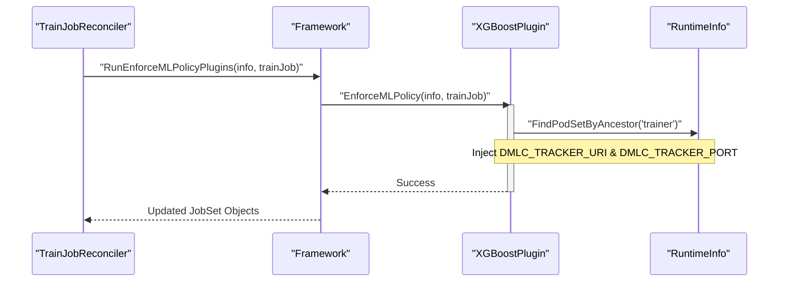

<!-- source: DeepWiki mcp.deepwiki.com · repo kubeflow/trainer · extra page XGBoost Plugin · fetched 2026-10-21 -->

# XGBoost Plugin

<details>
<summary>Relevant source files</summary>

The following files were used as context for generating this wiki page:

- [docs/user-guides/xgboost.md](docs/user-guides/xgboost.md)
- [examples/xgboost/distributed-training/xgboost-distributed.ipynb](examples/xgboost/distributed-training/xgboost-distributed.ipynb)

</details>


The XGBoost plugin enables distributed XGBoost training within the Kubeflow Trainer framework. It facilitates coordination between distributed workers using the **Rabit** (Reliable Allreduce and Broadcast Interface) protocol by injecting necessary network configuration and environment variables into the training containers.

## Overview

The plugin is responsible for:
1. **Tracker Coordination**: Configuring the XGBoost tracker URI and port for worker synchronization [docs/user-guides/xgboost.md:12-28]().
2. **ML Policy Enforcement**: Mapping `TrainJob` specifications to the underlying `TrainingRuntime` using the `XGBoostMLPolicySource` [docs/user-guides/xgboost.md:20-25]().
3. **Environment Injection**: Automatically setting `DMLC_TRACKER_URI`, `DMLC_TRACKER_PORT`, `DMLC_TASK_ID`, and `DMLC_NUM_WORKER` environment variables to facilitate Rabit-based communication [docs/user-guides/xgboost.md:23-28]().

### Data Flow and Coordination

Distributed XGBoost relies on a "Tracker" process to coordinate workers. In the Kubeflow Trainer implementation, the plugin leverages the `JobSet` architecture to ensure that nodes can communicate via the Rabit protocol. While the plugin injects the environment variables, the user's training process uses these variables to initialize the distributed environment and start the `RabitTracker` on rank 0 [docs/user-guides/xgboost.md:22-28]().

| Entity | Role in XGBoost Plugin |
| :--- | :--- |
| `XGBoostMLPolicySource` | Defines the specific policy for XGBoost distributed training in the `MLPolicy` [docs/user-guides/xgboost.md:20-28](). |
| `TRACKER_URI` / `DMLC_TRACKER_URI` | Environment variable identifying the DNS name or IP of the coordination endpoint [docs/user-guides/xgboost.md:23-25](). |
| `TRACKER_PORT` / `DMLC_TRACKER_PORT` | Environment variable identifying the Rabit communication port [docs/user-guides/xgboost.md:23-25](). |
| `Rabit` | The underlying protocol used by XGBoost for all-reduce and broadcast operations [docs/user-guides/xgboost.md:14-18](). |

**Code Entity Mapping**

Title: "XGBoost Code Entity Mapping"
```mermaid
graph TD
    subgraph "NaturalLanguageSpace"
        ["TrainJob"]
        ["XGBoostPolicy"]
        ["RabitTracker"]
        ["JobSetOrchestration"]
    end

    subgraph "CodeEntitySpace"
        ["trainer.kubeflow.org/v1alpha1.TrainJob"]
        ["XGBoostMLPolicySource"]
        ["jobset.sigs.k8s.io.JobSet"]
        ["corev1.EnvVar"]
        ["trainer.kubeflow.org/trainjob-ancestor-step"]
    end

    ["TrainJob"] --> ["trainer.kubeflow.org/v1alpha1.TrainJob"]
    ["XGBoostPolicy"] --> ["XGBoostMLPolicySource"]
    ["RabitTracker"] --> ["corev1.EnvVar"]
    ["XGBoostMLPolicySource"] --> ["jobset.sigs.k8s.io.JobSet"]
    ["trainer.kubeflow.org/v1alpha1.TrainJob"] --> ["jobset.sigs.k8s.io.JobSet"]
    ["JobSetOrchestration"] --> ["trainer.kubeflow.org/trainjob-ancestor-step"]
```

Sources:
- [docs/user-guides/xgboost.md:12-28]()

---

## Implementation Details

The XGBoost plugin implements core interfaces to integrate with the `TrainJob` lifecycle. It follows the pattern of framework-specific plugins that mutate the `JobSet` and inject environment variables.

### Key Classes and Interfaces

| Interface | Entity | Role |
|-----------|--------|------|
| `framework.Plugin` | `XGBoost` | Base plugin registration and naming. |
| `framework.EnforceMLPolicyPlugin` | `XGBoost` | Mutates the `RuntimeInfo` based on XGBoost-specific policies. |
| `framework.CustomValidationPlugin` | `XGBoost` | Validates that `TrainJob` does not conflict with XGBoost requirements. |

### Component Interaction

The following diagram illustrates how the `XGBoost` plugin entities interact with the `Framework` and `RuntimeInfo` during the reconciliation process.

Title: "XGBoost Plugin Execution Pipeline"


Sources:
- [docs/user-guides/xgboost.md:20-28]()

---

## Configuration and Environment Variables

The plugin automatically manages the lifecycle of distributed coordination variables required by the Rabit protocol.

| Environment Variable | Description | Source |
|----------------------|-------------|--------|
| `DMLC_TRACKER_URI` | The hostname/IP of the XGBoost tracker. | Injected by Plugin [docs/user-guides/xgboost.md:23-25]() |
| `DMLC_TRACKER_PORT` | The network port for Rabit communication. | Injected by Plugin [docs/user-guides/xgboost.md:23-25]() |
| `DMLC_NUM_WORKER` | Total number of workers in the distributed job. | Derived from `numNodes` [docs/user-guides/xgboost.md:23-25]() |
| `DMLC_TASK_ID` | The rank of the current worker (`0`, `1`, `2`, ...). | Injected via Index [docs/user-guides/xgboost.md:23-25]() |

### ML Policy Enforcement

The plugin ensures that the number of nodes defined in the `TrainJob` spec is propagated and that the network resolution for the tracker is correct [docs/user-guides/xgboost.md:20-46]().

1. **PodSet Identification**: It searches for the PodSet with the ancestor label `trainer` [docs/user-guides/xgboost.md:20-28]().
2. **Resource Mapping**: It maps the training nodes to the worker count [docs/user-guides/xgboost.md:34-46]().
3. **Network Resolution**: It calculates `DMLC_TRACKER_URI` based on the Service name provided by the `JobSet` [docs/user-guides/xgboost.md:23-28]().

Sources:
- [docs/user-guides/xgboost.md:20-46]()
- [examples/xgboost/distributed-training/xgboost-distributed.ipynb:53-86]()

---

## Validation Logic

The plugin performs custom validation to prevent configuration errors before resources are created on the cluster.

* **Reserved Variables**: It checks if the user has manually provided `DMLC_*` or `TRACKER_*` variables in the `TrainJob` spec to prevent conflicts with the plugin's automated injection [docs/user-guides/xgboost.md:23-28]().
* **Runtime Compatibility**: It verifies that the `mlPolicy` provided in the `TrainingRuntime` contains an `xgboost` configuration [docs/user-guides/xgboost.md:30-32]().

Sources:
- [docs/user-guides/xgboost.md:20-32]()

---

## Example ClusterTrainingRuntime

A typical `ClusterTrainingRuntime` for XGBoost defines the `mlPolicy` to use the XGBoost plugin. This configuration informs the reconciler to invoke the XGBoost plugin during object generation [docs/user-guides/xgboost.md:30-32]().

```yaml
apiVersion: trainer.kubeflow.org/v1alpha1
kind: ClusterTrainingRuntime
metadata:
  name: xgboost-distributed
  labels:
    trainer.kubeflow.org/framework: xgboost
spec:
  mlPolicy:
    numNodes: 1
    xgboost: {}
  template:
    spec:
      replicatedJobs:
        - name: node
          template:
            metadata:
              labels:
                trainer.kubeflow.org/trainjob-ancestor-step: trainer
            spec:
              template:
                spec:
                  containers:
                    - name: node
                      image: ghcr.io/kubeflow/trainer/xgboost-runtime:latest
```

Sources:
- [docs/user-guides/xgboost.md:30-32]()
- [examples/xgboost/distributed-training/xgboost-distributed.ipynb:53-142]()

---

