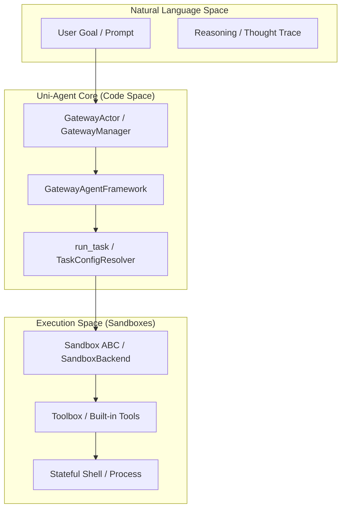
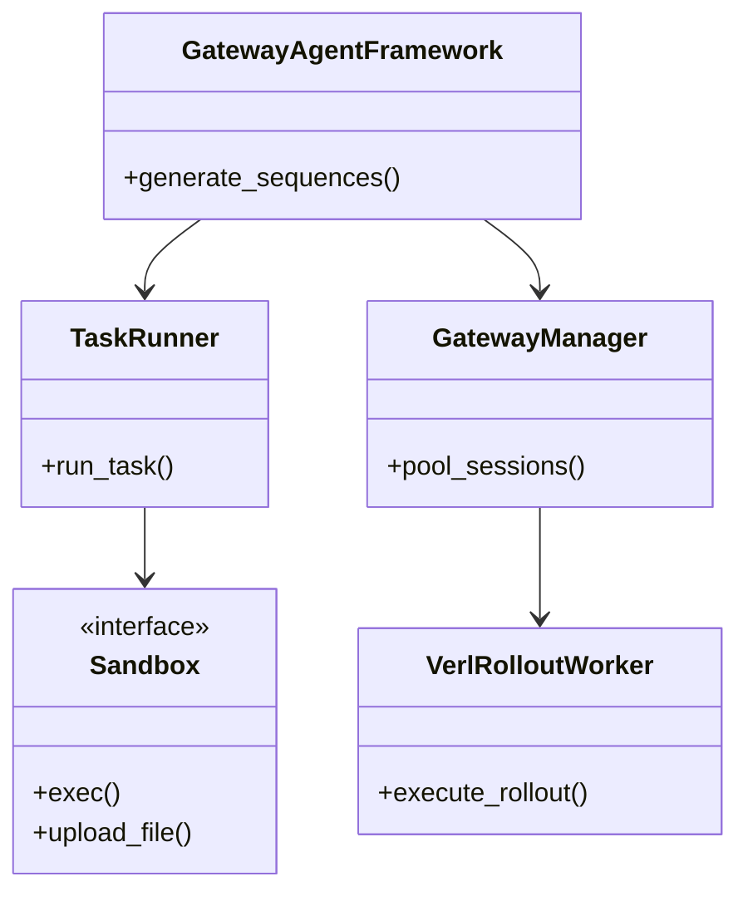

<!-- source: DeepWiki mcp.deepwiki.com · repo verl-project/uni-agent · page 1 Overview · fetched 2026-10-26 -->

# Overview

Relevant source files

The following files were used as context for generating this wiki page:

- [README.md](README.md)
- [assets/uni-agent.png](assets/uni-agent.png)
- [docs/source/assets/results_claude_code_qwen3_coder_30b.svg](docs/source/assets/results_claude_code_qwen3_coder_30b.svg)
- [docs/source/benchmark/index.md](docs/source/benchmark/index.md)
- [docs/source/benchmark/inference.md](docs/source/benchmark/inference.md)
- [docs/source/benchmark/rl-training.md](docs/source/benchmark/rl-training.md)
- [docs/source/quickstart/rl-training.md](docs/source/quickstart/rl-training.md)
- [examples/quickstart/training/task_config_claude_code.yaml](examples/quickstart/training/task_config_claude_code.yaml)
- [examples/quickstart/training/train_qwen3_moe.sh](examples/quickstart/training/train_qwen3_moe.sh)
- [examples/quickstart/training/train_qwen3p5_dense.sh](examples/quickstart/training/train_qwen3p5_dense.sh)

Uni-Agent is a unified framework designed for building, running, and training long-horizon agents at scale [README.md:1-13](). It provides a robust interaction stack that bridges standard agent harnesses (such as ReAct and Claude Code) with high-performance distributed reinforcement learning via integration with the `verl` library [README.md:11-24](), [docs/source/quickstart/rl-training.md:1-4]().

## Purpose and Scope

Uni-Agent addresses the challenges of long-horizon agent tasks (such as software engineering in SWE-bench or terminal operations) by offering:
*   **Plug-and-Play Agent Harnesses:** Connect OpenAI- or Anthropic-compatible agents through the **Uni-Agent Gateway** to translate interaction trajectories into training-ready tokens [README.md:21-24]().
*   **Decoupled Architecture:** Independently customize agent logic, execution sandboxes, evaluation tasks, and reward modules [README.md:25-28]().
*   **Large-Scale Concurrent Rollouts:** Run thousands of stateful, long-horizon sessions simultaneously using pooled gateway sessions, isolated remote/local sandboxes, and asynchronous scheduling [README.md:29-32]().
*   **verl RL Integration:** Reuse the exact rollout interaction stack for scalable reinforcement learning using Group Relative Policy Optimization (GRPO) or Group-wise Sequence Policy Optimization (GSPO) objectives [README.md:67-70](), [examples/quickstart/training/train_qwen3_moe.sh:31-133]().

For detailed setup instructions, see [Getting Started & Installation](#1.1). For a deep dive into how the harness, task, sandbox, and gateway layers interact, see [Architecture Overview](#1.2).

Sources: [README.md:1-46](), [docs/source/quickstart/rl-training.md:1-10]()

## Architecture Philosophy

The core philosophy of Uni-Agent is the strict decoupling of the agent's reasoning process, the execution environment, and the training infrastructure [README.md:25-28](). 

### Conceptual Flow: From Language to Code

The following diagram illustrates how natural language agent prompts and reasoning traces map to code entities across the system.

**System Entity Mapping**

**Sources:** [README.md:21-32](), [examples/quickstart/training/train_qwen3_moe.sh:15-22]()

### Subsystem Relationships

The architecture is composed of distinct modular layers that communicate through well-defined protocol adapters and queues.

**Class Relationship Diagram**

**Sources:** [README.md:25-32](), [examples/quickstart/training/train_qwen3_moe.sh:15-22]()

Sources: [README.md:21-32](), [examples/quickstart/training/train_qwen3_moe.sh:15-22]()

## Documentation Roadmap

Uni-Agent documentation is organized into focused child pages and thematic sections:

*   **[Getting Started & Installation](#1.1):** Install `uni-agent`, configure the bundled `verl` submodule, setup optional cloud provider SDKs, and execute quickstart inference and sandbox demos [README.md:37-46]().
*   **[Architecture Overview](#1.2):** Understand the decoupled layers of the harness, task, sandbox, and gateway, along with the end-to-end request and trajectory flow from agent to trainer [README.md:25-32]().
*   **Gateway (Section 2):** Overview of the OpenAI/Anthropic-compatible endpoint fronting rollout engines and collecting token-level trajectories.
*   **Agent Framework & RL Training (Section 3):** Details on rollout orchestration, PPO integration, and Megatron-parallel training scripts.
*   **Sandbox Layer (Section 4):** Execution boundaries, providers (veFaaS, Modal, Docker, Local), and built-in toolboxes.
*   **Agents (Section 5):** Implementations of ReAct, Claude Code, Mini-SWE-Agent, and Memory-augmented agents.
*   **Tasks & Rewards (Section 6):** Benchmarks including SWE-bench, KernelBench, and Harbor task integrations.
*   **Agent Aware Router (Section 7):** KV-cache-aware request distribution across inference replicas.
*   **Observability & Developer Operations (Section 8):** Logging, telemetry, CI conventions, and testing markers.
*   **Glossary (Section 9):** Definitions of core terms with code pointers.

Sources: [README.md:37-46]()

---

