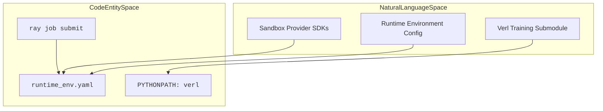
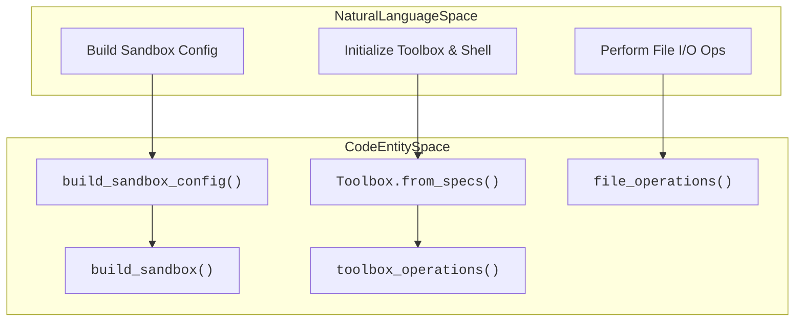

<!-- source: DeepWiki mcp.deepwiki.com · repo verl-project/uni-agent · page 1.1 Getting Started & Installation · fetched 2026-10-26 -->

# Getting Started & Installation

<details>
<summary>Relevant source files</summary>

The following files were used as context for generating this wiki page:

- [.github/workflows/ci.yml](.github/workflows/ci.yml)
- [.gitmodules](.gitmodules)
- [docs/source/quickstart/installation.md](docs/source/quickstart/installation.md)
- [docs/source/quickstart/oracle-verification.md](docs/source/quickstart/oracle-verification.md)
- [examples/inference/README.md](examples/inference/README.md)
- [examples/inference/parallel_run_oracle.py](examples/inference/parallel_run_oracle.py)
- [examples/quickstart/oracle/task_config_oracle.yaml](examples/quickstart/oracle/task_config_oracle.yaml)
- [examples/quickstart/sandbox/demo.py](examples/quickstart/sandbox/demo.py)
- [pyproject.toml](pyproject.toml)
- [requirements-test.txt](requirements-test.txt)
- [tests/uni_agent/deployment/test_host_runtime.py](tests/uni_agent/deployment/test_host_runtime.py)
- [uni_agent/__init__.py](uni_agent/__init__.py)
- [uni_agent/version/version](uni_agent/version/version)

</details>


Uni-Agent is designed as a modular extension to the `verl` reinforcement learning framework [docs/source/quickstart/installation.md:1-6](). It provides abstractions for persistent sandboxes, multi-turn tool interaction loops, and scalable agent training. This guide details the setup process for local development, optional task/sandbox provider SDKs, Ray-based distributed execution, and running quickstart inference and sandbox demos.

---

## Installation Overview

The installation process varies depending on whether you are running non-training inference/sandbox demos or deploying to a large-scale Ray cluster for RL training [docs/source/quickstart/installation.md:1-8](). 

- **Non-training workflows:** A standard Python `3.10` to `3.12` environment [pyproject.toml:22](), [docs/source/quickstart/installation.md:5]().
- **RL training:** A compatible environment with the bundled `verl` submodule and training dependencies [docs/source/quickstart/installation.md:6]().

### Core Setup & Submodule Initialization

Uni-Agent uses `verl` as its underlying training engine via a Git submodule [.gitmodules:1-3](). Clone the repository with submodules enabled and install the core and test packages [docs/source/quickstart/installation.md:10-22](), [.github/workflows/ci.yml:29-33]():

```bash
git clone --recursive https://github.com/verl-project/uni-agent.git
cd uni-agent
pip install --no-deps -e ./verl
pip install -r requirements-test.txt
```

Sources: [docs/source/quickstart/installation.md:10-22](), [.github/workflows/ci.yml:29-50](), [.gitmodules:1-3](), [requirements-test.txt:1-9]()

---

## Optional Dependencies

Uni-Agent maintains a lightweight core [docs/source/quickstart/installation.md:26](). Additional packages must be installed depending on the target sandbox provider or evaluation benchmark suite [docs/source/quickstart/installation.md:26-62]().

### Task Dependencies

Task dependencies supply task-specific datasets, verifiers, and reward implementations [docs/source/quickstart/installation.md:26-30](). For example, install `swebench` when running SWE-bench evaluation [docs/source/quickstart/installation.md:30-37]():

```bash
pip install swebench==4.1.0
```

### Sandbox Backends

The sandbox layer supports multiple backends for executing agent actions [docs/source/quickstart/installation.md:40-62]():

| Backend | Command | Purpose |
| :--- | :--- | :--- |
| **Docker** | `docker version` [docs/source/quickstart/installation.md:46-49]() | Local containerized isolation. |
| **Modal** | `pip install modal` [docs/source/quickstart/installation.md:52-56]() | Remote serverless sandboxes with high concurrency. |
| **veFaaS** | `pip install volcengine-python-sdk swe-rex` [docs/source/quickstart/installation.md:58-62]() | Volcengine Function-as-a-Service and execution runner. |
| **Host** | (Built-in via `HostRuntime`) [tests/uni_agent/deployment/test_host_runtime.py:22]() | Local process-based bash execution. |

Sources: [docs/source/quickstart/installation.md:26-62](), [tests/uni_agent/deployment/test_host_runtime.py:1-24]()

---

## Ray Runtime Environments

For distributed Ray workloads, you can use a Runtime Environment configuration file (`runtime_env.yaml`) to inject task, sandbox, and `verl` dependencies into every Ray worker node [docs/source/quickstart/installation.md:64-67]().

### Runtime Environment Mapping

Below is a diagram bridging natural language deployment concepts to the underlying Ray job submission and `PYTHONPATH` code entities (`runtime_env.yaml`, `verl`).

Title: "Ray Environment Provisioning & Code Mapping"

Sources: [docs/source/quickstart/installation.md:64-86]()

### Runtime Configuration Example

```yaml
working_dir: ./
excludes: ["/.git/"]
pip:
  packages:
    - "volcengine-python-sdk"
    - "swe-rex"
    - "swebench==4.1.0"
env_vars:
  PYTHONPATH: "verl"
```

Submit the job to the cluster [docs/source/quickstart/installation.md:81-85]():

```bash
ray job submit --runtime-env runtime_env.yaml -- python entrypoint.py
```

Sources: [docs/source/quickstart/installation.md:64-86]()

---

## Quickstart Demos

Uni-Agent provides standalone demo scripts to verify your sandbox installation and run oracle evaluations [examples/quickstart/sandbox/demo.py:1-171](), [examples/inference/parallel_run_oracle.py:1-122]().

### 1. Sandbox & Toolbox Demo

The sandbox demo (`examples/quickstart/sandbox/demo.py`) exercises the `Sandbox` configuration, persistent shell execution, `str_replace_editor`, and file I/O primitives [examples/quickstart/sandbox/demo.py:1-171]().

Title: "Sandbox Demo Execution Flow"

Sources: [examples/quickstart/sandbox/demo.py:29-170]()

Run the sandbox demo locally or via Modal:

```bash
SANDBOX_PROVIDER=local python examples/quickstart/sandbox/demo.py
```

### 2. Oracle Verification Demo

You can verify dataset instances against ground-truth oracle solutions using `parallel_run_oracle.py` [examples/inference/parallel_run_oracle.py:1-63]():

```bash
python examples/inference/parallel_run_oracle.py \
    --data-path ~/data/swe_agent/swe_bench_verified.parquet \
    --task-config examples/quickstart/oracle/task_config_oracle.yaml \
    --limit 4
```

This script instantiates `OracleEvalActor` across Ray workers to process parquet rows concurrently [examples/inference/parallel_run_oracle.py:30-63](), [examples/inference/parallel_run_oracle.py:121-157]().

Sources: [examples/inference/parallel_run_oracle.py:1-157](), [examples/quickstart/oracle/task_config_oracle.yaml:1-23]()

---

Sources:
- [docs/source/quickstart/installation.md:1-87]()
- [pyproject.toml:1-120]()
- [requirements-test.txt:1-9]()
- [.github/workflows/ci.yml:1-66]()
- [.gitmodules:1-3]()
- [examples/quickstart/sandbox/demo.py:1-171]()
- [examples/inference/parallel_run_oracle.py:1-157]()
- [examples/quickstart/oracle/task_config_oracle.yaml:1-23]()
- [tests/uni_agent/deployment/test_host_runtime.py:1-145]()

---

