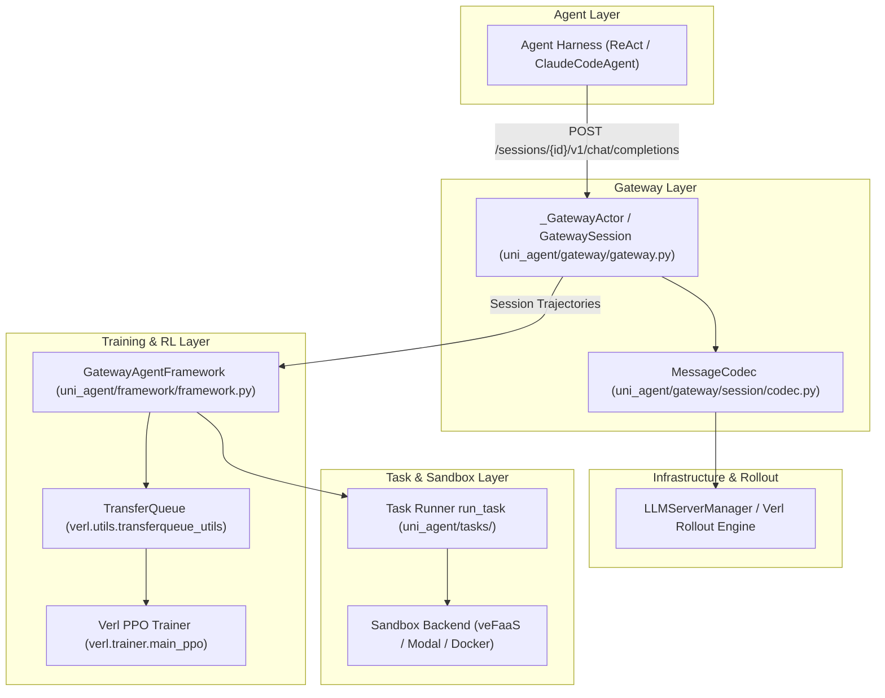
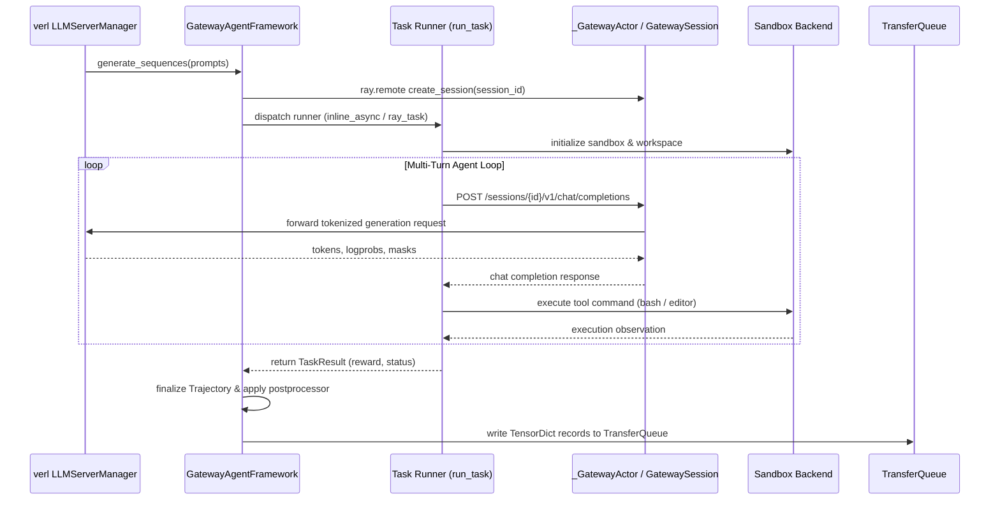
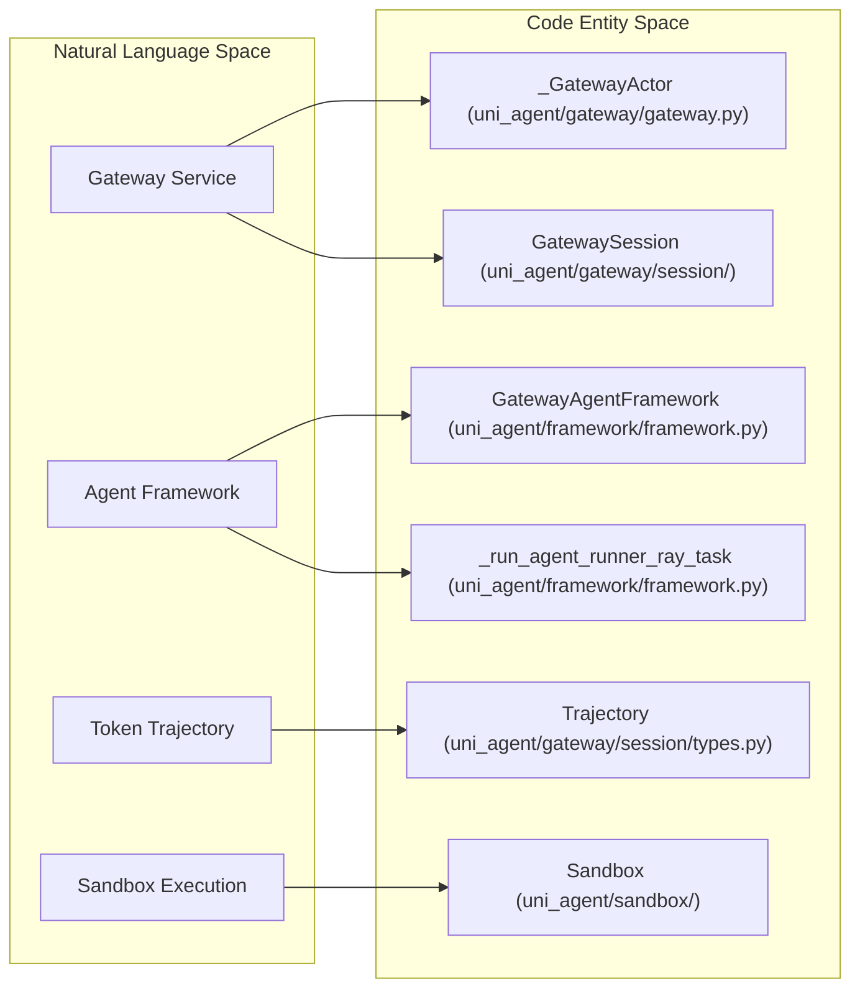

<!-- source: DeepWiki mcp.deepwiki.com · repo verl-project/uni-agent · page 1.2 Architecture Overview · fetched 2026-10-26 -->

# Architecture Overview

Relevant source files

The following files were used as context for generating this wiki page:

- [README.md](README.md)
- [docs/source/assets/results_claude_code_qwen3_coder_30b.svg](docs/source/assets/results_claude_code_qwen3_coder_30b.svg)
- [docs/source/concepts/gateway-and-trajectories.md](docs/source/concepts/gateway-and-trajectories.md)
- [docs/source/quickstart/rl-training.md](docs/source/quickstart/rl-training.md)
- [examples/quickstart/training/task_config_claude_code.yaml](examples/quickstart/training/task_config_claude_code.yaml)
- [examples/quickstart/training/train_qwen3_moe.sh](examples/quickstart/training/train_qwen3_moe.sh)
- [examples/quickstart/training/train_qwen3p5_dense.sh](examples/quickstart/training/train_qwen3p5_dense.sh)
- [tests/uni_agent/framework/test_generate_sequences_on_cpu.py](tests/uni_agent/framework/test_generate_sequences_on_cpu.py)
- [tests/uni_agent/gateway/test_debug_launcher.py](tests/uni_agent/gateway/test_debug_launcher.py)
- [uni_agent/framework/framework.py](uni_agent/framework/framework.py)
- [uni_agent/gateway/gateway.py](uni_agent/gateway/gateway.py)
- [uni_agent/gateway/session/types.py](uni_agent/gateway/session/types.py)

Uni-Agent is a scalable framework designed for running and training long-horizon agents via reinforcement learning [README.md:9-14](). The system architecture decouples agent harnesses, task environments, execution sandboxes, and model serving through a gateway-centric design, bridging standard OpenAI/Anthropic agent APIs to `verl` PPO training infrastructure [README.md:21-32](), [docs/source/concepts/gateway-and-trajectories.md:1-5]().

---

## 1. The Four-Tier Architecture Stack

The architecture is partitioned into four decoupled layers, ensuring that agent harnesses, tasks, execution environments, and rollout infrastructure can be developed, scaled, and swapped independently:

1. **Agent Harness Layer**: External or built-in agent loops (e.g., ReAct, Claude Code, Mini-SWE-Agent) that interact exclusively through OpenAI or Anthropic chat/messages HTTP endpoints [README.md:21-24](), [docs/source/concepts/gateway-and-trajectories.md:38-48]().
2. **Gateway Layer**: Manages session state, handles message codecs, parses backend tool calls, and fronts rollout engines (`vLLM`, `SGLang`, or `verl` workers) without executing inference itself [docs/source/concepts/gateway-and-trajectories.md:3-5]().
3. **Task & Sandbox Layer**: Instantiates isolated container or serverless execution environments (veFaaS, Modal, Docker, Local) to execute agent-selected shell commands, edits, and evaluations [README.md:27-31](), [examples/quickstart/training/task_config_claude_code.yaml:1-8]().
4. **Agent Framework & Trainer Layer (`GatewayAgentFramework`)**: Orchestrates ray tasks (`_run_agent_runner_ray_task`), captures token-level trajectories (`Trajectory`), applies postprocessors, computes rewards (`TaskResult`), and writes finalized records to `TransferQueue` for `verl` PPO training [tests/uni_agent/framework/test_generate_sequences_on_cpu.py:112-133](), [uni_agent/framework/framework.py:112-170](), [docs/source/concepts/gateway-and-trajectories.md:32-41]().

### Component Interaction & System Architecture

**Sources:** [README.md:21-32](), [docs/source/concepts/gateway-and-trajectories.md:3-48](), [uni_agent/framework/framework.py:112-133](), [uni_agent/gateway/gateway.py:54-93]()

---

## 2. Request and Trajectory Data Flow

When executing training rollouts or parallel evaluation, requests flow from the `verl` LLMServerManager down through the Gateway, Agent Framework, Task Runner, and back into the TransferQueue as training-ready token tensors [docs/source/concepts/gateway-and-trajectories.md:17-28]().

### End-to-End Rollout Flow

**Sources:** [docs/source/concepts/gateway-and-trajectories.md:30-74](), [uni_agent/framework/framework.py:112-170]()

---

## Code Entity Mapping

The mapping between natural language architecture components and concrete codebase entities is detailed below.

| System Concept | Code Entity | File Location | Role |
| :--- | :--- | :--- | :--- |
| **Framework Orchestrator** | `GatewayAgentFramework` | `uni_agent/framework/framework.py` | Implements `AgentFramework`, dispatches runners, and materializes `TransferQueue` batches. |
| **Ray Runner Worker** | `_run_agent_runner_ray_task` | `uni_agent/framework/framework.py` | Executes user agent runners inside isolated Ray tasks. |
| **Gateway Router Actor** | `_GatewayActor` | `uni_agent/gateway/gateway.py` | FastAPI/Ray actor managing endpoints, exception handlers, and session lifecycles. |
| **Session State & Codec** | `GatewaySession` & `MessageCodec` | `uni_agent/gateway/session/` | Manages message history, chain branching, prompt application, and tool parsing. |
| **Token Trajectory** | `Trajectory` | `uni_agent/gateway/session/types.py` | Encapsulates prompt IDs, response IDs, response masks, logprobs, and reward metrics. |
| **Sandbox Execution** | `Sandbox` / `SandboxBackend` | `uni_agent/sandbox/` | Abstract deployment interface for container and cloud execution environments. |

### Natural Language to Code Entity Space

**Sources:** [uni_agent/framework/framework.py:44-134](), [uni_agent/gateway/gateway.py:54-93](), [uni_agent/gateway/session/types.py:40-79]()

---

