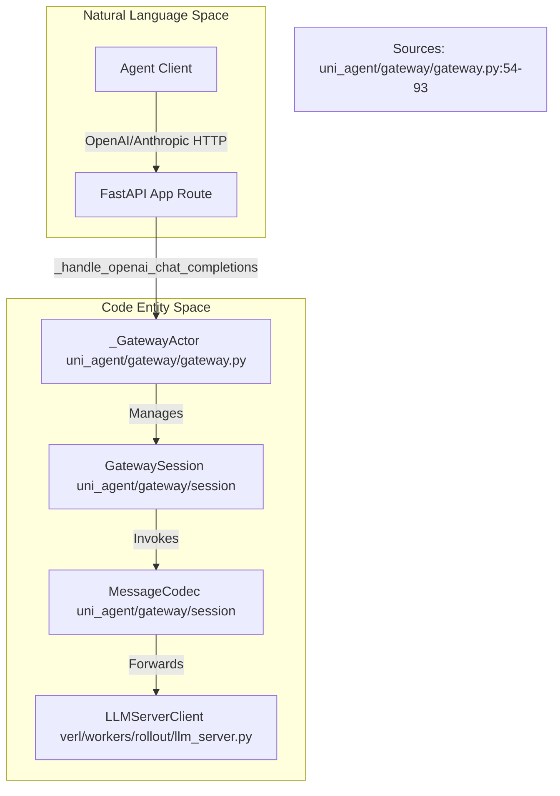
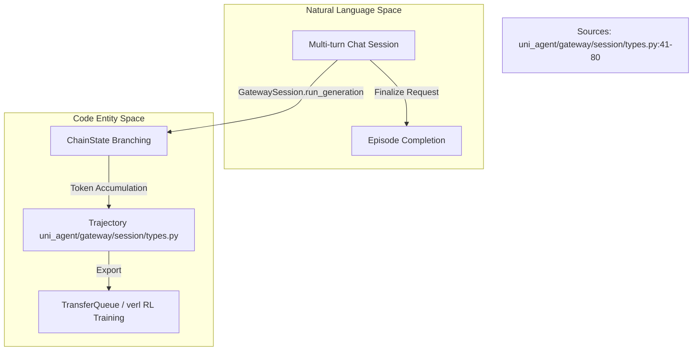

<!-- source: DeepWiki mcp.deepwiki.com · repo verl-project/uni-agent · page 2 Gateway · fetched 2026-10-26 -->

# Gateway

Relevant source files

The following files were used as context for generating this wiki page:

- [tests/__init__.py](tests/__init__.py)
- [tests/uni_agent/__init__.py](tests/uni_agent/__init__.py)
- [tests/uni_agent/gateway/test_debug_launcher.py](tests/uni_agent/gateway/test_debug_launcher.py)
- [uni_agent/gateway/__init__.py](uni_agent/gateway/__init__.py)
- [uni_agent/gateway/gateway.py](uni_agent/gateway/gateway.py)
- [uni_agent/gateway/manager.py](uni_agent/gateway/manager.py)
- [uni_agent/gateway/session/types.py](uni_agent/gateway/session/types.py)

The Uni-Agent Gateway is a thin FastAPI and Ray-actor-based service layer that fronts inference rollout engines (such as vLLM or SGLang) and provides OpenAI and Anthropic compatible endpoints (`[uni_agent/gateway/gateway.py:1-6]()`). It manages multi-turn agent sessions, normalizes distinct client wire formats into internal generation payloads (`[uni_agent/gateway/session/types.py:13-24]()`), and materializes token-level `Trajectory` records required for reinforcement learning training (`[uni_agent/gateway/session/types.py:41-79]()`).

As a PARENT page, this section provides a high-level overview of the gateway components. For deep technical details, refer to the child pages linked below.

---

---

## 2.1 Gateway Actor, Manager & Configuration

The gateway architecture divides responsibilities between driver-side scaling management (`GatewayManager`) and worker-side request handling (`_GatewayActor` / `GatewayActor`) (`[uni_agent/gateway/gateway.py:54-61](), [uni_agent/gateway/manager.py:18-24]()`). `GatewayManager` spawns a pool of `GatewayActor` instances across available CPU nodes using Ray affinity scheduling, balances session creation load based on active session counts, and routes termination calls (`[uni_agent/gateway/manager.py:39-93]()`).

Inside each actor, a FastAPI application exposes provider-compatible routes for sessions (`[uni_agent/gateway/gateway.py:88-141]()`). Configuration options like `GatewayActorConfig` control sampling allowlists, prefix-hash coalescing, and assistant rollback behavior.

For details, see [Gateway Actor, Manager & Configuration](#2.1).

Sources: `uni_agent/gateway/gateway.py:54-141`, `uni_agent/gateway/manager.py:18-117`

---

## 2.2 Sessions, Chains & Trajectories

Stateful agent interactions are managed via `GatewaySession` instances mapped to unique `session_id` strings (`[uni_agent/gateway/gateway.py:87](), [uni_agent/gateway/session/types.py:27-38]()`). Each session supports conversation branching through `ChainState`, prefix-hashing for KV-cache optimization, and assistant response rollbacks. 

When a session finalizes, the gateway packages accumulated tokens, prompt masks, and reward metrics into a `Trajectory` record, which is subsequently consumed by the training framework (`[uni_agent/gateway/session/types.py:41-79]()`).

For details, see [Sessions, Chains & Trajectories](#2.2).

Sources: `uni_agent/gateway/session/types.py:41-80`

---

## 2.3 Message Codec & Tool Parsing

The `MessageCodec` class translates normalized conversation messages and tool schemas into the continuous token sequences and prompt tensors expected by underlying rollout engines (`[uni_agent/gateway/gateway.py:67-78]()`). It handles backend-specific chat templates, multimodal vision extraction, and specialized tool-call parsers for engines like sglang, vllm, and verl, complete with an internal parser cache.

For details, see [Message Codec & Tool Parsing](#2.3).

Sources: `uni_agent/gateway/gateway.py:67-78`

---

## 2.4 Protocol Adapters (OpenAI & Anthropic)

To support diverse agent frameworks without modification, the gateway implements dual protocol adapters for OpenAI chat-completions and Anthropic messages requests (`[uni_agent/gateway/gateway.py:18-29]()`). These adapters translate incoming wire formats into `InternalGenerationRequest` typed structures and format model outputs back into provider-compliant streaming Server-Sent Events (SSE) or JSON responses (`[uni_agent/gateway/gateway.py:155-159](), [uni_agent/gateway/session/types.py:13-24]()`).

For details, see [Protocol Adapters (OpenAI & Anthropic)](#2.4).

Sources: `uni_agent/gateway/gateway.py:18-29`, `uni_agent/gateway/session/types.py:13-24`

---

