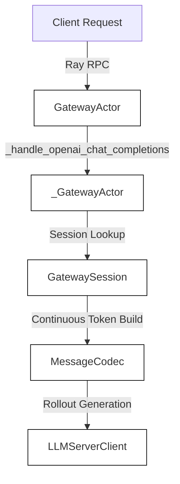
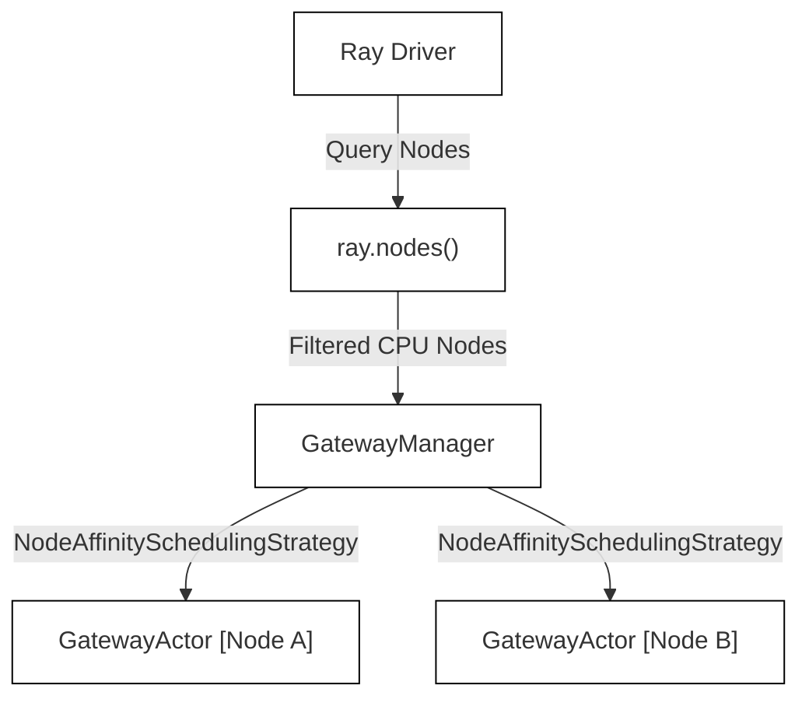

<!-- source: DeepWiki mcp.deepwiki.com · repo verl-project/uni-agent · page 2.1 Gateway Actor, Manager & Configuration · fetched 2026-10-26 -->

# Gateway Actor, Manager & Configuration

Relevant source files

The following files were used as context for generating this wiki page:

- [tests/__init__.py](tests/__init__.py)
- [tests/uni_agent/__init__.py](tests/uni_agent/__init__.py)
- [tests/uni_agent/gateway/test_gateway_actor_on_cpu.py](tests/uni_agent/gateway/test_gateway_actor_on_cpu.py)
- [tests/uni_agent/gateway/test_gateway_manager_on_cpu.py](tests/uni_agent/gateway/test_gateway_manager_on_cpu.py)
- [tests/uni_agent/support.py](tests/uni_agent/support.py)
- [uni_agent/gateway/__init__.py](uni_agent/gateway/__init__.py)
- [uni_agent/gateway/config.py](uni_agent/gateway/config.py)
- [uni_agent/gateway/manager.py](uni_agent/gateway/manager.py)

## Purpose and Scope

This page details the core infrastructure of the Uni-Agent gateway tier: **`GatewayActor`**, **`GatewayManager`**, and **`GatewayActorConfig`**. The gateway acts as an OpenAI/Anthropic-compatible endpoint fronting rollout inference engines (`LLMServerClient`), parsing continuous tokens and tools, and managing multi-turn session states and token-level trajectory collections. 

Specifically, this documentation covers:
- Actor-level request multiplexing and session management via `_GatewayActor` and its Ray wrapper `GatewayActor` [uni_agent/gateway/__init__.py:1-7]().
- Driver-side pool coordination, CPU affinity scheduling, and load-balanced routing via `GatewayManager` [uni_agent/gateway/manager.py:18-116]().
- Actor configuration flags, validation constraints, and options governing assistant rollbacks, exact-request coalescing, and sampling parameters via `GatewayActorConfig` [uni_agent/gateway/config.py:16-83]().

---

## GatewayActor & Request Handling

The gateway actor encapsulates chat-completion execution, session lifecycles, and trajectory accumulation. It is implemented as a Ray actor (`GatewayActor`) wrapping an internal stateful engine (`_GatewayActor`) [tests/uni_agent/gateway/test_gateway_actor_on_cpu.py:93-99]().

### Request Multiplexing & Session Routing

Each gateway actor maintains a dictionary of active sessions (`_sessions`) indexed by session identifiers [tests/uni_agent/gateway/test_gateway_actor_on_cpu.py:103](). When an OpenAI chat completion request arrives (`_handle_openai_chat_completions`), the actor resolves the appropriate session, validates token capacities, and forwards sampling options to the underlying rollout backend [tests/uni_agent/gateway/test_gateway_actor_on_cpu.py:125]().

*Sources: `uni_agent/gateway/config.py`, `tests/uni_agent/gateway/test_gateway_actor_on_cpu.py`*

### Token Capacity and Clamping

The gateway enforces total trajectory token limits defined by `prompt_length` and `response_length` [uni_agent/gateway/config.py:38-40](). During generation, `max_tokens` (or `max_completion_tokens`) requested by the agent is automatically clamped to the remaining trajectory capacity:

$$\text{ClampedMaxTokens} = (\text{prompt\_length} + \text{response\_length}) - \text{TokenCount}(\text{PromptIDs})$$

If a trajectory exhausts its token budget, subsequent generation requests close without invoking the backend [tests/uni_agent/gateway/test_gateway_actor_on_cpu.py:185-190]().

Sources: `uni_agent/gateway/config.py:38-64`, `tests/uni_agent/gateway/test_gateway_actor_on_cpu.py:140-180`

---

## GatewayManager Pooling & Load-Balanced Routing

The **`GatewayManager`** runs on the Ray driver, instantiating and overseeing a pool of `GatewayActor` instances [uni_agent/gateway/manager.py:18-55]().

### Actor Placement and CPU Affinity

To prevent gateway actors from packing onto the main driver node under Ray's default scheduling policies, `GatewayManager` inspects alive cluster nodes, filters for CPU availability, and distributes actors across them using soft node-affinity strategies [uni_agent/gateway/manager.py:39-54]().

*Sources: `uni_agent/gateway/manager.py:39-55`*

### Least-Loaded Routing and Synchronization

Sessions are assigned to gateway actors via a least-loaded strategy (`_select_gateway_index`) [uni_agent/gateway/manager.py:60-64](). To avoid race conditions during bursty concurrent session creations, load counters are reserved *synchronously* before awaiting the asynchronous remote actor initialization [uni_agent/gateway/manager.py:75-92]().

| Method | Role | Code Pointer |
| :--- | :--- | :--- |
| `__init__` | Spawns `gateway_count` actors with round-robin CPU affinity | `uni_agent/gateway/manager.py:25-55` |
| `_select_gateway_index` | Selects the actor index with minimal active sessions | `uni_agent/gateway/manager.py:60-64` |
| `create_session` | Reserves slot, invokes remote actor, rolls back on failure | `uni_agent/gateway/manager.py:75-92` |
| `finalize_session` | Collects trajectories from owning actor and releases slot | `uni_agent/gateway/manager.py:94-100` |
| `abort_session` | Aborts session on owning actor and releases slot | `uni_agent/gateway/manager.py:102-108` |

Sources: `uni_agent/gateway/manager.py:18-117`, `tests/uni_agent/gateway/test_gateway_manager_on_cpu.py:48-71`

---

## GatewayActorConfig Options & Validation

The `GatewayActorConfig` dataclass defines model parameters, tokenizer wrappers, caching policies, and session flags passed down to gateway actors [uni_agent/gateway/config.py:16-47]().

### Configuration Attributes

- **`tokenizer` & `processor`**: Tokenizer and multimodal processor instances used by the message codec [uni_agent/gateway/config.py:49-50]().
- **`tool_parser_name` & `rollout_backend`**: Identifies backend-specific parsers (e.g., SGLang, vLLM) or verl registries [uni_agent/gateway/config.py:51-54]().
- **`enable_tool_parser_cache`**: Controls whether parser instances are reused within an actor-scoped codec (`True` by default) [uni_agent/gateway/config.py:25-27, 53]().
- **`enable_last_assistant_rollback`**: Permits rollbacks when the latest assistant turn is rewritten, reusing existing chain branches (`True` by default) [uni_agent/gateway/config.py:41-42, 62]().
- **`coalesce_reserved_exact_requests`**: Enables single-flight merging of exact duplicate provider-normalized requests within the same session (`True` by default) [uni_agent/gateway/config.py:43-46, 63]().
- **`prompt_length` & `response_length`**: Optional token limits enforced across the session trajectory [uni_agent/gateway/config.py:38-40, 60-61]().

### Validation Rules (`__post_init__`)

`GatewayActorConfig.__post_init__` validates argument types and value bounds, raising a `ValueError` under invalid configurations [uni_agent/gateway/config.py:65-83]().

- Boolean options (`enable_tool_parser_cache`, `enable_last_assistant_rollback`, `coalesce_reserved_exact_requests`) must be valid booleans [uni_agent/gateway/config.py:66-79]().
- `prompt_length` and `response_length` must be strictly positive integers when provided [uni_agent/gateway/config.py:80-83]().

Sources: `uni_agent/gateway/config.py:16-84`, `tests/uni_agent/gateway/test_gateway_actor_on_cpu.py:49-78`

---

## Debug Launcher & Testing Utilities

The gateway includes dedicated test suites verifying actor configuration constraints, concurrency safety, rollback mechanics, and multi-actor routing:
- **`tests/uni_agent/gateway/test_gateway_actor_on_cpu.py`**: Validates configuration validation rules, assistant rollback accounting, token clamping against trajectory limits, and singleflight request coalescing [tests/uni_agent/gateway/test_gateway_actor_on_cpu.py:46-190]().
- **`tests/uni_agent/gateway/test_gateway_manager_on_cpu.py`**: Verifies load distribution across concurrent session creations, node-affinity placement logic, and proper session finalization routing across multiple gateway actors [tests/uni_agent/gateway/test_gateway_manager_on_cpu.py:48-180]().

Sources: `tests/uni_agent/gateway/test_gateway_actor_on_cpu.py:1-190`, `tests/uni_agent/gateway/test_gateway_manager_on_cpu.py:1-180`

---

