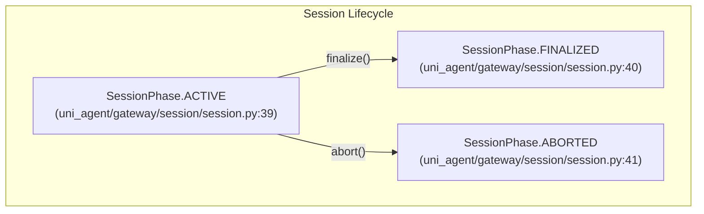
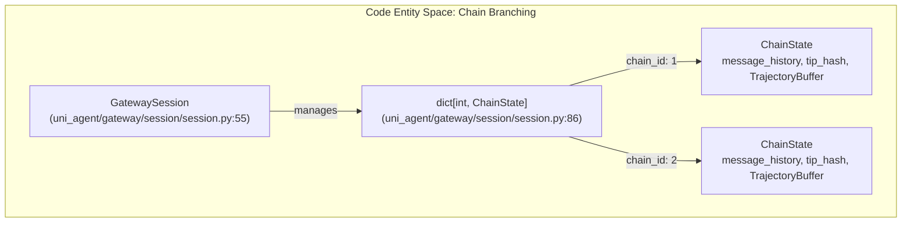
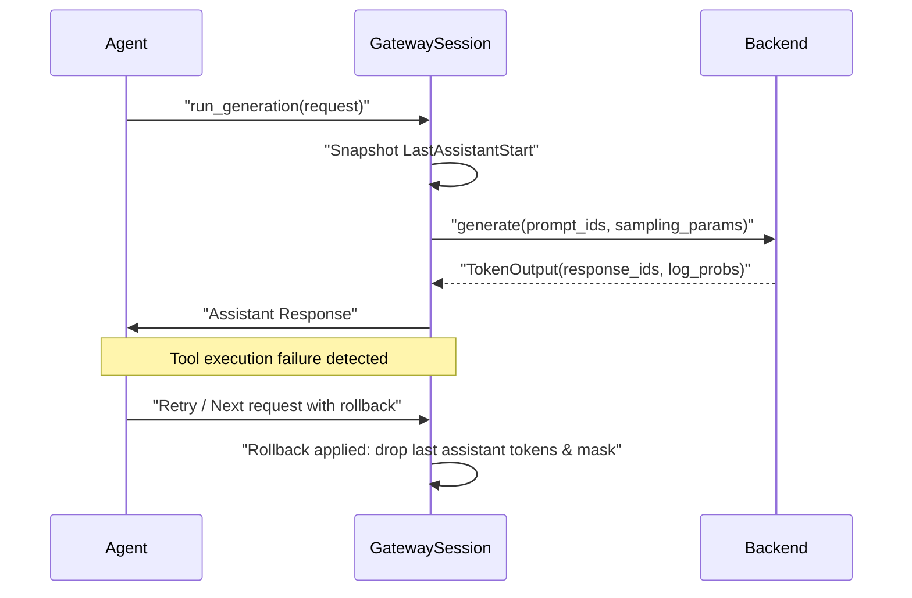
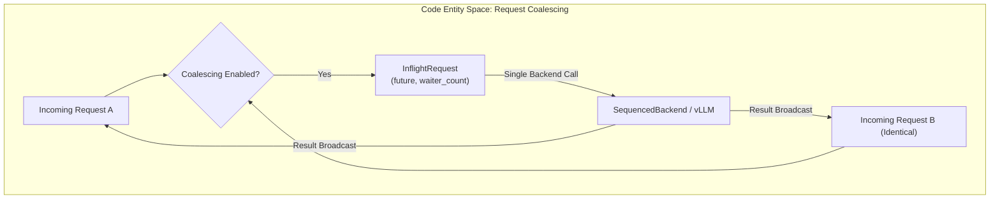
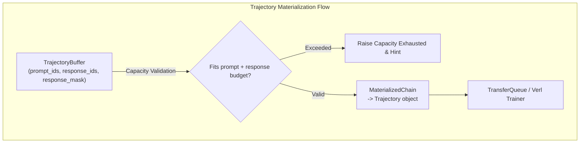

<!-- source: DeepWiki mcp.deepwiki.com · repo verl-project/uni-agent · page 2.2 Sessions, Chains & Trajectories · fetched 2026-10-26 -->

# Sessions, Chains & Trajectories

<details>
<summary>Relevant source files</summary>

The following files were used as context for generating this wiki page:

- [tests/uni_agent/gateway/test_debug_launcher.py](tests/uni_agent/gateway/test_debug_launcher.py)
- [tests/uni_agent/gateway/test_session_multiple_chains_on_cpu.py](tests/uni_agent/gateway/test_session_multiple_chains_on_cpu.py)
- [uni_agent/gateway/gateway.py](uni_agent/gateway/gateway.py)
- [uni_agent/gateway/session/session.py](uni_agent/gateway/session/session.py)
- [uni_agent/gateway/session/types.py](uni_agent/gateway/session/types.py)

</details>


This page details the core state management within the Uni-Agent gateway: the `GatewaySession` lifecycle, linear `ChainState` branching, prefix hashing, assistant rollbacks, request coalescing, and token-level trajectory materialization (`Trajectory`) with strict capacity budgeting.

---

## 1. GatewaySession Lifecycle & Phases

A `GatewaySession` represents a conversation thread and execution session owned by the gateway (`[uni_agent/gateway/gateway.py:54-93]()`). Sessions progress through distinct lifecycle phases defined by `SessionPhase` (`[uni_agent/gateway/session/session.py:30-42]()`):

- **`ACTIVE`**: The session is live, accepting generation requests, appending user/assistant messages, and accumulating tokens into active trajectory chains.
- **`FINALIZED`**: All active chains have been closed, materializing final token trajectories (`Trajectory`) that are ready for training ingestion.
- **`ABORTED`**: The session was cancelled or terminated abnormally; it halts generation and discards or flags pending trajectories.


*Sources: [uni_agent/gateway/session/session.py:30-42](), [uni_agent/gateway/gateway.py:54-93]()*

---

## 2. ChainState Branching & Prefix Hashing

To support multi-turn agent execution, parallel sub-agents, or branching task explorations, a session maintains multiple linear trajectories via `ChainState` structures (`[uni_agent/gateway/session/session.py:86-101]()`).

Each chain records:
- `chain_id`: Unique integer identifier (`[uni_agent/gateway/session/session.py:89]()`).
- `message_history`: Normalized list of conversation turns (`[uni_agent/gateway/session/session.py:90]()`).
- `message_tip_hash`: Cryptographic hash representing the prefix message history tip (`[uni_agent/gateway/session/session.py:91]()`).
- `buffer`: A `TrajectoryBuffer` accumulating prompt IDs, response IDs, response masks, and log probabilities (`[uni_agent/gateway/session/session.py:45-72]()`).


*Sources: [uni_agent/gateway/session/session.py:45-101]()*

---

## 3. Assistant Rollback & Version Tracking

When an agent encounters a tool failure, syntax error, or needs to recover from an invalid completion, `GatewaySession` supports assistant rollback (`enable_last_assistant_rollback`). 

The session snapshots lengths immediately before the latest assistant response using `LastAssistantStart` (`[uni_agent/gateway/session/session.py:75-83]()`). When a rollback is triggered during request re-encoding (`EncodedData` with `rollback_applied=True`), the gateway drops the last assistant's tokens and trainable mask marks (`response_mask == 1`), rolling back the message history to the pre-assistant tip (`[uni_agent/gateway/session/session.py:146-165]()`).


*Sources: [uni_agent/gateway/session/session.py:75-165]()*

---

## 4. Request Coalescing

To prevent duplicate concurrent generation requests (e.g., identical tool prompts or redundant parallel retries), `GatewaySession` implements request coalescing (`coalesce_reserved_exact_requests`). 

Identical incoming requests share an `InflightRequest` future (`[uni_agent/gateway/session/session.py:104-108]()`). The first request triggers backend execution while subsequent identical requests attach as waiters (`waiter_count`), receiving the identical generation outcome once committed.


*Sources: [uni_agent/gateway/session/session.py:104-108]()*

---

## 5. Trajectory Materialization and Capacity Limits

When a session finalizes or chains complete, the gateway materializes token buffers into a structured `Trajectory` (`[uni_agent/gateway/session/types.py:41-79]()`).

Trajectories enforce strict capacity limits based on prompt and response budgets (`prompt_length` + `response_length`). As documented in `_TRAJECTORY_CAPACITY_HINT` (`[uni_agent/gateway/session/session.py:22-27]()`), exceeding capacity raises a budget exhaustion error:

```python
_TRAJECTORY_CAPACITY_HINT = (
    "The trajectory limit is prompt_length + response_length. "
    "For this event, Claude Code's output-token-limit error is misleading: increasing "
    "CLAUDE_CODE_MAX_OUTPUT_TOKENS alone will not help. Check the rollout prompt_length/response_length "
    "budget or compact context earlier; the episode may be unfinished."
)
```

| Field Name | Type | Description |
| :--- | :--- | :--- |
| `prompt_ids` | `list[int]` | Token IDs used to seed the trajectory (`[uni_agent/gateway/session/types.py:68]`). |
| `response_ids` | `list[int]` | Generated response tokens and continuation turns (`[uni_agent/gateway/session/types.py:69]`). |
| `response_mask` | `list[int]` | Per-token flags: `1` for model output, `0` for context tokens (`[uni_agent/gateway/session/types.py:70]`). |
| `response_logprobs` | `list[float]` | Token log probabilities aligned with `response_ids` (`[uni_agent/gateway/session/types.py:71]`). |
| `finished` | `bool` | Episode completion status (`[uni_agent/gateway/session/types.py:72]`). |
| `reward_score` | `float` | Scalar reward assigned by the agent framework (`[uni_agent/gateway/session/types.py:73]`). |


*Sources: [uni_agent/gateway/session/session.py:22-73](), [uni_agent/gateway/session/types.py:41-79]()*

---

## Sources
- `uni_agent/gateway/gateway.py`
- `uni_agent/gateway/session/session.py`
- `uni_agent/gateway/session/types.py`
- `tests/uni_agent/gateway/test_session_multiple_chains_on_cpu.py`

---

