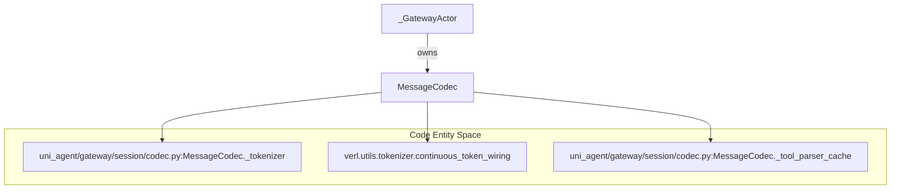
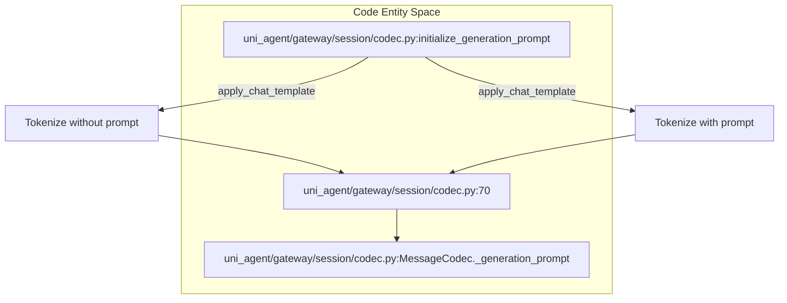
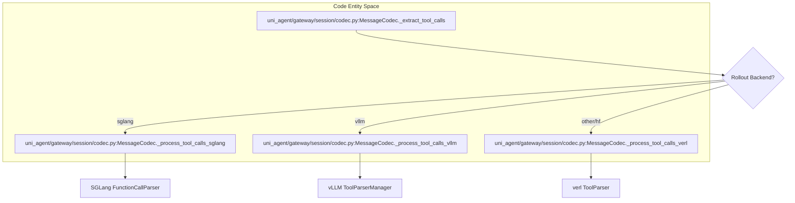

<!-- source: DeepWiki mcp.deepwiki.com · repo verl-project/uni-agent · page 2.3 Message Codec & Tool Parsing · fetched 2026-10-26 -->

# Message Codec & Tool Parsing

Relevant source files

The following files were used as context for generating this wiki page:

- [tests/uni_agent/gateway/test_message_codec_continuous_token.py](tests/uni_agent/gateway/test_message_codec_continuous_token.py)
- [tests/uni_agent/gateway/test_message_codec_initialization.py](tests/uni_agent/gateway/test_message_codec_initialization.py)
- [tests/uni_agent/gateway/test_message_codec_parser_cache.py](tests/uni_agent/gateway/test_message_codec_parser_cache.py)
- [tests/uni_agent/gateway/test_message_codec_qwen3_complete.py](tests/uni_agent/gateway/test_message_codec_qwen3_complete.py)
- [tests/uni_agent/gateway/test_message_codec_tool_dispatch.py](tests/uni_agent/gateway/test_message_codec_tool_dispatch.py)
- [tests/uni_agent/tools/test_shell_channel.py](tests/uni_agent/tools/test_shell_channel.py)
- [tests/uni_agent/tools/test_toolbox_call_errors.py](tests/uni_agent/tools/test_toolbox_call_errors.py)
- [uni_agent/gateway/session/codec.py](uni_agent/gateway/session/codec.py)

## Purpose and Scope

The `MessageCodec` layer resides entirely within the model boundary [uni_agent/gateway/session/codec.py:1-5] and serves as the translation bridge between the Gateway's abstract message/tool-call representations and backend-specific tokenizer/processor/parser execution primitives. It handles chat template rendering, continuous token wiring, multimodal data extraction, backend-specific tool-call parsing across engines (`sglang`, `vllm`, and `verl`), and parser caching.

---

## 1. MessageCodec Architecture & Initialization

`MessageCodec` is initialized and owned by `_GatewayActor` (one instance per actor) and injected into `GatewaySession` instances [uni_agent/gateway/session/codec.py:74-81]. It operates statelessly regarding session history, focusing exclusively on codec operations.

*Diagram: Architecture bridging actor ownership to `MessageCodec` components.*

Sources: `uni_agent/gateway/session/codec.py:74-135`

---

## 2. Chat Templates & Continuous Token Building

The codec manages chat template application using `verl` utilities. It extracts token suffixes for generation prompts and inter-turn separators upon initialization [uni_agent/gateway/session/codec.py:51-122]:

* `initialize_generation_prompt`: Compares tokenization with and without `add_generation_prompt=True` to isolate a stable generation suffix [uni_agent/gateway/session/codec.py:51-72].
* `initialize_turn_separator`: Determines inter-turn separators [uni_agent/gateway/session/codec.py:19].
* Continuous token wiring: Integrates `create_continuous_token_builder` for models (like DeepSeek-V4) that bypass standard template files or use specialized token layouts [uni_agent/gateway/session/codec.py:20,103-109].

*Diagram: Generation prompt initialization flow.*

Sources: `uni_agent/gateway/session/codec.py:17-21`, `uni_agent/gateway/session/codec.py:51-72`, `uni_agent/gateway/session/codec.py:103-122`

---

## 3. Multimodal Data Extraction

For vision and multi-modal tasks, `MessageCodec` provides `extract_multi_modal_data` (invoking `_vision_info_extractor` or defaulting to `qwen_vl_utils.process_vision_info`) [uni_agent/gateway/session/codec.py:98-168]. 

* It uses `mm_processor_kwargs` shared between continuous token rendering and inference pipelines [uni_agent/gateway/session/codec.py:102,137-139].
* Defays imports of multi-modal utilities (`qwen_vl_utils`) so purely text-based workloads avoid unneeded dependencies [uni_agent/gateway/session/codec.py:158-162].

Sources: `uni_agent/gateway/session/codec.py:98-169`

---

## 4. Backend-Specific Tool-Call Parsing

`MessageCodec` handles parsing tool calls generated by models across three different rollout backends via unified dispatch (`_extract_tool_calls`):

| Backend | Tool Parser Source / Alias Map | Notes |
| :--- | :--- | :--- |
| **SGLang** | `sglang.srt.function_call.function_call_parser` | Uses aliases like `qwen3_xml` $\rightarrow$ `qwen3_coder` [uni_agent/gateway/session/codec.py:34-36]. |
| **vLLM** | `vllm.tool_parsers.ToolParserManager` | Maps `qwen`, `qwen25`, `qwen3` $\rightarrow$ `qwen3_xml` [uni_agent/gateway/session/codec.py:38-42]. Supports constructor-level tool schema binding. |
| **verl / Other** | `verl.experimental.agent_loop.tool_parser.ToolParser` | Native `verl` experiment loop parser fallback [tests/uni_agent/gateway/test_message_codec_parser_cache.py:112-137]. |

*Diagram: Backend tool parsing dispatch router.*

Finish reasons from backends are normalized via `_FINISH_REASON_MAP` to translate engine-specific statuses (`completed`, `matched_stop`, `max_tokens`, etc.) into standard gateway tokens (`stop`, `length`) [uni_agent/gateway/session/codec.py:23-32].

Sources: `uni_agent/gateway/session/codec.py:23-43`, `tests/uni_agent/gateway/test_message_codec_tool_dispatch.py:111-194`

---

## 5. Parser Cache & Schema Normalization

Because constructing backend tool parsers is computationally expensive, `MessageCodec` maintains an actor-scoped parser cache (`_tool_parser_cache`) [uni_agent/gateway/session/codec.py:126-134]:

* **Canonical Hash**: Tool schemas are normalized into a stable JSON string (`sort_keys=True`, `ensure_ascii=False`) and hashed using SHA-256 (`_canonical_tools_hash`) to ensure equivalent tool definitions share cached parser instances regardless of key ordering [uni_agent/gateway/session/codec.py:45-48].
* **Toggle**: Caching can be disabled by setting `enable_tool_parser_cache=False` for parsers requiring strict request-scoped isolation [uni_agent/gateway/session/codec.py:92,129-133].

Sources: `uni_agent/gateway/session/codec.py:45-48`, `uni_agent/gateway/session/codec.py:126-135`, `tests/uni_agent/gateway/test_message_codec_parser_cache.py:141-201`

---

