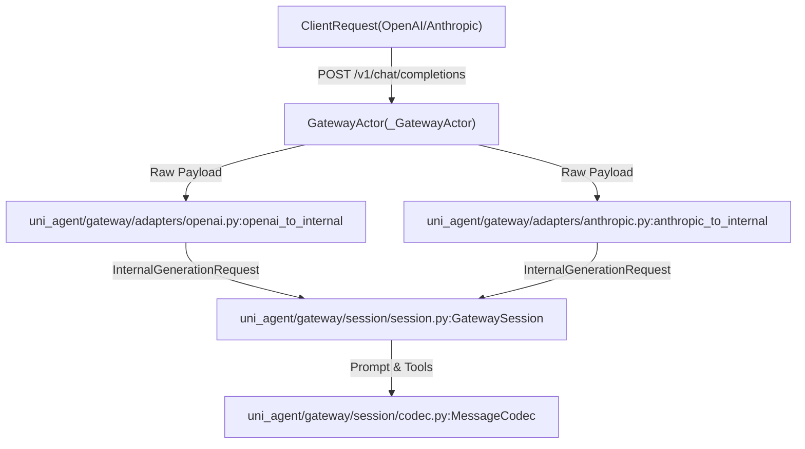
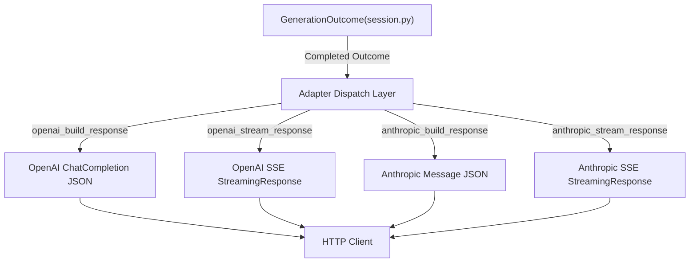

<!-- source: DeepWiki mcp.deepwiki.com · repo verl-project/uni-agent · page 2.4 Protocol Adapters (OpenAI & Anthropic) · fetched 2026-10-26 -->

# Protocol Adapters (OpenAI & Anthropic)

Relevant source files

The following files were used as context for generating this wiki page:

- [examples/gateway/debug_launcher.py](examples/gateway/debug_launcher.py)
- [tests/uni_agent/gateway/adapters/test_openai_adapter.py](tests/uni_agent/gateway/adapters/test_openai_adapter.py)
- [uni_agent/gateway/adapters/anthropic.py](uni_agent/gateway/adapters/anthropic.py)
- [uni_agent/gateway/adapters/openai.py](uni_agent/gateway/adapters/openai.py)
- [uni_agent/gateway/adapters/types.py](uni_agent/gateway/adapters/types.py)

The protocol adapter layer sits at the edge of the Uni-Agent Gateway, translating external API payloads from OpenAI (`POST /v1/chat/completions`) and Anthropic (`POST /v1/messages`) formats into internal generation requests (`InternalGenerationRequest`). Conversely, it serializes completed `GenerationOutcome` objects or event streams back into the corresponding wire formats expected by agent harnesses and clients.

Sources: [uni_agent/gateway/adapters/openai.py:1-4](), [uni_agent/gateway/adapters/anthropic.py:1-2]()

---

## Architecture & Data Flow

The adapter layer decouples external agent client harnesses from the internal session and message codec mechanisms. Incoming wire requests pass through protocol-specific parsing functions (`openai_to_internal` or equivalent Anthropic parsing) to produce a normalized dictionary structure consumed by `GatewayActor` and `GatewaySession`.

### Request Translation Flow

Sources: [uni_agent/gateway/adapters/openai.py:1-4](), [uni_agent/gateway/adapters/anthropic.py:1-2]()

### Response & Stream Serialization Flow

Sources: [uni_agent/gateway/adapters/openai.py:78-134](), [uni_agent/gateway/adapters/anthropic.py:115-173]()

---

## OpenAI Adapter Implementation

The OpenAI adapter (`[uni_agent/gateway/adapters/openai.py]()`) processes incoming Chat Completions requests, normalizes parameters such as `max_tokens` and `max_completion_tokens`, and formats outbound non-streaming and Server-Sent Events (SSE) streaming responses.

### Key Functions and Behaviors

- **Output Limit Aliasing**: Supports both `max_tokens` and the newer `max_completion_tokens` parameter. It validates that if both are specified, they match, and enforces that limits are positive integers [tests/uni_agent/gateway/adapters/test_openai_adapter.py:14-63]().
- **Tool Argument Serialization**: `_message_to_openai_wire` serializes canonical internal dictionary tool arguments into JSON strings expected by the OpenAI wire contract [uni_agent/gateway/adapters/openai.py:53-76]().
- **Response Construction**: `openai_build_response` constructs a standard `chat.completion` envelope including generated choices, finish reasons, unique IDs (`chatcmpl-*`), and `usage` statistics [uni_agent/gateway/adapters/openai.py:78-96]().
- **Streaming Response**: `openai_stream_response` returns a FastAPI `StreamingResponse` emitting `chat.completion.chunk` events, supporting reasoning content (`reasoning_content`), text content, tool calls, final usage stats, and `[data: [DONE]]` [uni_agent/gateway/adapters/openai.py:99-134]().
- **Error Mapping**: `openai_error_body` maps internal HTTP status codes (such as `400` and `409`) to OpenAI-compatible error types (`invalid_request_error`, `conflict_error`) [uni_agent/gateway/adapters/openai.py:28-50]().

Sources: [uni_agent/gateway/adapters/openai.py:1-176](), [tests/uni_agent/gateway/adapters/test_openai_adapter.py:1-181]()

---

## Anthropic Adapter Implementation

The Anthropic adapter (`[uni_agent/gateway/adapters/anthropic.py]`) transforms Anthropic Messages API structures into internal representations and serializes `GenerationOutcome` results back into Anthropic message objects and SSE streams.

### Key Functions and Behaviors

- **Stop Reason Mapping**: `_STOP_REASON_MAP` translates internal finish reasons (`stop`, `length`, `tool_calls`) into Anthropic equivalents (`end_turn`, `max_tokens`, `tool_use`) [uni_agent/gateway/adapters/anthropic.py:23-29]().
- **Content Block Parsing**: `_outcome_to_blocks` inspects the assistant message and converts text content and tool calls into Anthropic content blocks (`type: text`, `type: tool_use`) with robust JSON argument parsing via `_tool_call_input` [uni_agent/gateway/adapters/anthropic.py:64-112]().
- **Message Response Construction**: `anthropic_build_response` generates a `message` object with randomized identifiers (`msg_*`), stop reasons, and input/output token usage [uni_agent/gateway/adapters/anthropic.py:115-125]().
- **Streaming Response**: `anthropic_stream_response` synthesizes an Anthropic-compliant event stream sequence, emitting `message_start`, `content_block_start`, `content_block_delta`, `content_block_stop`, `message_delta`, and `message_stop` events [uni_agent/gateway/adapters/anthropic.py:128-173]().
- **Error Formatting**: `anthropic_error_body` wraps error messages using `ANTHROPIC_ERROR_TYPE_BY_STATUS` [uni_agent/gateway/adapters/anthropic.py:47-61]().

Sources: [uni_agent/gateway/adapters/anthropic.py:1-173]()

---

## Types & Error Handling

Shared adapter types and request-lowering exceptions are defined in `[uni_agent/gateway/adapters/types.py]()`.

- **`MalformedRequestError`**: Inherits from `ValueError` and is raised when request lowering rejects an invalid client payload [uni_agent/gateway/adapters/types.py:13-16]().
- **TypedDict Definitions**: Includes protocol-specific type definitions such as `OpenAIChatCompletionRequest`, `OpenAIChatMessage`, `AnthropicRequest`, and `AnthropicMessage` to document expected wire structures [uni_agent/gateway/adapters/types.py:19-131]().

Sources: [uni_agent/gateway/adapters/types.py:1-131]()

---

