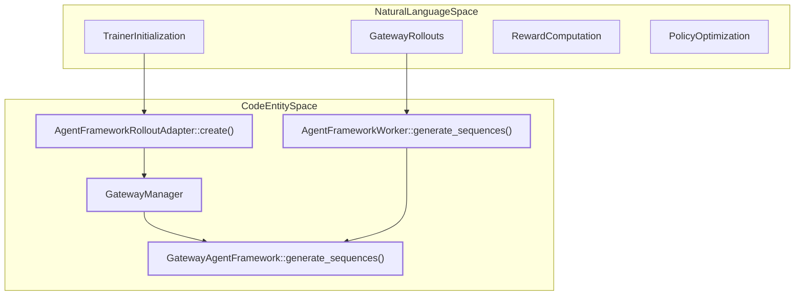
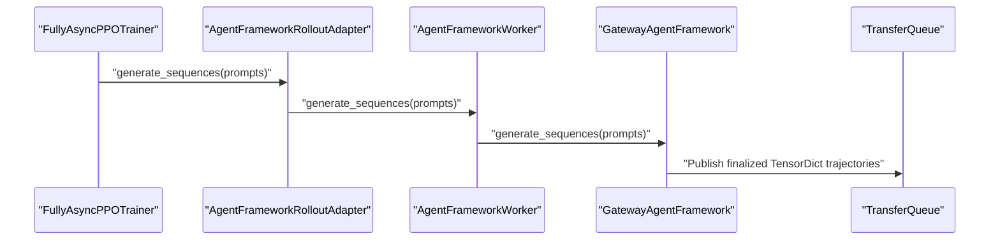

<!-- source: DeepWiki mcp.deepwiki.com · repo verl-project/uni-agent · page 3 Agent Framework & RL Training · fetched 2026-10-26 -->

# Agent Framework & RL Training

Relevant source files

The following files were used as context for generating this wiki page:

- [uni_agent/framework/__init__.py](uni_agent/framework/__init__.py)
- [uni_agent/framework/base.py](uni_agent/framework/base.py)
- [uni_agent/framework/entry.py](uni_agent/framework/entry.py)

Uni-Agent connects multi-turn agent interaction loops to the `verl` reinforcement learning framework. This integration allows training policies by orchestrating gateway sessions, executing sandboxed tasks, computing task rewards, and feeding finalized trajectories back into RL training algorithms via TransferQueues. 

This page provides a high-level overview of rollout orchestration and training integration. For deep technical details, refer to the child pages linked below.

**Sources:** [uni_agent/framework/entry.py:32-160](), [uni_agent/framework/base.py:26-41]()

---

## 3.1 GatewayAgentFramework & TransferQueue

The `GatewayAgentFramework` serves as the core orchestrator for running agent episodes and publishing generated trajectories to the training queue. It manages runner dispatch modes (`inline_async` or `ray_task`), executes trajectory postprocessors, handles reward routing, and publishes finalized tensors to `verl`'s `TransferQueue`.

For details, see [GatewayAgentFramework & TransferQueue](#3.1).

**Sources:** [uni_agent/framework/base.py:26-41](), [uni_agent/framework/entry.py:96-160]()

---

## 3.2 Task Runner & Rollout Adapter

The `AgentFrameworkRolloutAdapter` implements the `verl` `agent_loop_manager_class` contract, acting as the primary bridge between the reinforcement learning trainer and the agent framework stack [uni_agent/framework/entry.py:8-13](). It manages driver-side gateway pools (`GatewayManager`), coordinates task execution paths, resolves configurations via `TaskConfigResolver`, and handles task results and trajectory masking.

For details, see [Task Runner & Rollout Adapter](#3.2).

**Sources:** [uni_agent/framework/entry.py:32-160]()

---

## 3.3 RL Training Recipes & Launch Scripts

RL training recipes configure large-scale training runs, utilizing Megatron-LM parallelism, hybrid rollout strategies (`colocate_async` vs `separate_async`), and specialized reinforcement learning algorithms such as GSPO and GRPO. These launch scripts coordinate multi-node environments, router replay caches, and NPU/GPU execution nodes.

For details, see [RL Training Recipes & Launch Scripts](#3.3).

**Sources:** [uni_agent/framework/entry.py:32-73]()

---

## 3.4 Parallel Inference & Benchmarking

Parallel inference utilities and benchmarking scripts (such as parallel evaluation drivers) enable oracle verification runs and performance evaluation of trained agent policies against standard benchmarks before deploying full RL training loops.

For details, see [Parallel Inference & Benchmarking](#3.4).

**Sources:** [uni_agent/framework/entry.py:96-160](), [uni_agent/framework/base.py:38-41]()

---

