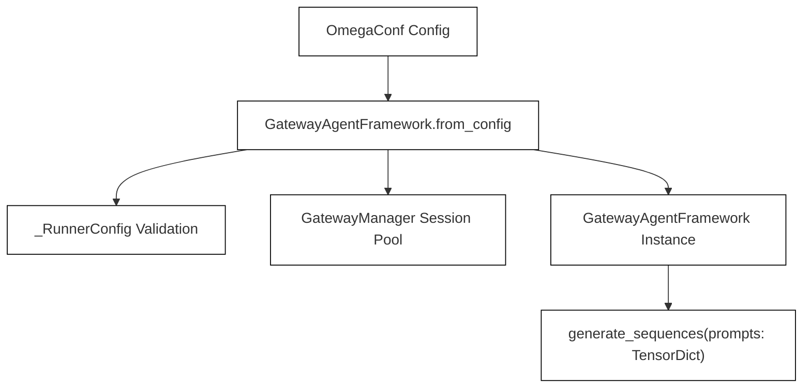
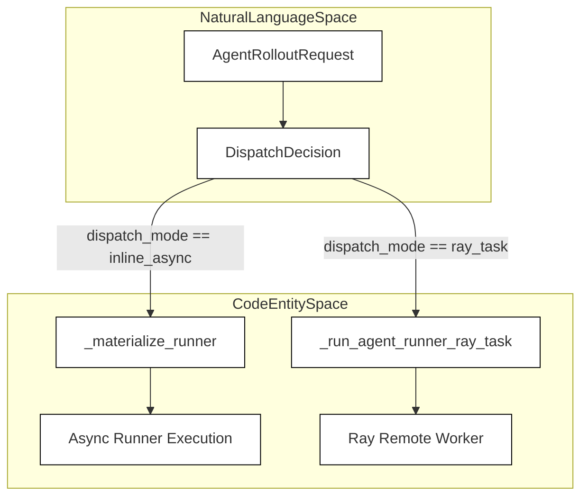
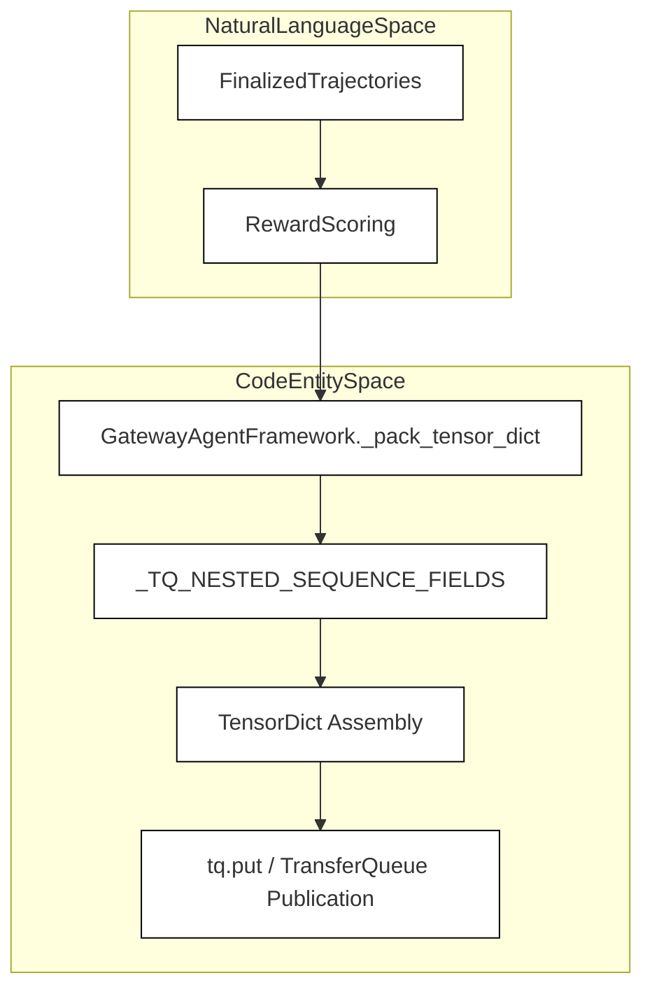

<!-- source: DeepWiki mcp.deepwiki.com · repo verl-project/uni-agent · page 3.1 GatewayAgentFramework & TransferQueue · fetched 2026-10-26 -->

# GatewayAgentFramework & TransferQueue

<details>
<summary>Relevant source files</summary>

The following files were used as context for generating this wiki page:

- [docs/source/concepts/gateway-and-trajectories.md](docs/source/concepts/gateway-and-trajectories.md)
- [tests/uni_agent/framework/test_generate_sequences_on_cpu.py](tests/uni_agent/framework/test_generate_sequences_on_cpu.py)
- [tests/uni_agent/framework/test_multi_modal_postprocess_on_cpu.py](tests/uni_agent/framework/test_multi_modal_postprocess_on_cpu.py)
- [uni_agent/framework/__init__.py](uni_agent/framework/__init__.py)
- [uni_agent/framework/base.py](uni_agent/framework/base.py)
- [uni_agent/framework/framework.py](uni_agent/framework/framework.py)

</details>


## Purpose and Scope

This page covers the technical implementation of `GatewayAgentFramework` [uni_agent/framework/framework.py:35](), the primary orchestrator that connects `verl` reinforcement learning training loops with the Uni-Agent Gateway. It details the `generate_sequences` execution pipeline, runner dispatch modes (`inline_async` and `ray_task`), trajectory postprocessing hooks, reward routing from `TaskResult` objects, multimodal token and vision input postprocessing, and final publication to the `verl` `TransferQueue`.

---

## GatewayAgentFramework Architecture & Initialization

`GatewayAgentFramework` implements the `AgentFramework` abstract base class [uni_agent/framework/base.py:26](). It is initialized from configuration dictionaries or OmegaConf structures via `GatewayAgentFramework.from_config()`, establishing connections to the `GatewayManager` and optional reward loop worker handles [tests/uni_agent/framework/test_generate_sequences_on_cpu.py:169-173]().

The framework configuration schema defines agent runners, maximum concurrency, fallback timeout policies, and optional postprocessors under `actor_rollout_ref.rollout.custom.agent_framework` [tests/uni_agent/framework/test_generate_sequences_on_cpu.py:137-163]().



*Sources: [uni_agent/framework/framework.py:35](), [tests/uni_agent/framework/test_generate_sequences_on_cpu.py:137-173]()*

---

## Runner Dispatch Modes (`inline_async` vs `ray_task`)

Agent execution is managed per sample or session using configured runner routines (`runner_fqn`). The `_RunnerConfig` data class validates configuration parameters such as `dispatch_mode`, `max_concurrent_sessions`, `trajectory_selection`, and `session_timeout_seconds` [uni_agent/framework/framework.py:45-64]().

### Dispatch Strategies

1. **`inline_async`**: Executes the agent runner function directly within the framework's event loop asynchronously. This minimizes Ray object store overhead and is ideal when runners share state or execute light-weight tasks.
2. **`ray_task`**: Dispatches the runner execution to an isolated Ray remote function (`_run_agent_runner_ray_task`), passing the serialized session handle, raw prompt, and tool configurations [uni_agent/framework/framework.py:112-134]().



*Sources: [uni_agent/framework/framework.py:45-134]()*

---

## Trajectory Postprocessors

Before trajectories are scored and published, the framework applies selection policies (`_select_session_trajectories`) and custom user-defined postprocessors (`TrajectoryPostprocessor`) [uni_agent/framework/framework.py:41](), [uni_agent/framework/framework.py:143-171]().

### Selection Policies
- **`all`**: Retains all generated trajectory paths from the session.
- **`longest`**: Selects the single trajectory with the highest token count, response mask sum, and turn count [uni_agent/framework/framework.py:152-160]().

### Postprocessor Hook Contract
If `trajectory_postprocessor_fqn` is specified in the config, the framework loads the callable and executes it with a deep copy of the `TaskResult` [docs/source/concepts/gateway-and-trajectories.md:79-110]():

```python
TrajectoryPostprocessor = Callable[..., list[Trajectory] | Awaitable[list[Trajectory]]]
```

Postprocessors must preserve token array alignment and finalized session metadata. Using `dataclasses.replace` is recommended when modifying trajectory attributes [docs/source/concepts/gateway-and-trajectories.md:112-118]().

*Sources: [uni_agent/framework/framework.py:41](), [uni_agent/framework/framework.py:143-171](), [docs/source/concepts/gateway-and-trajectories.md:65-125]*

---

## Reward Routing & TaskResult Integration

When an agent runner completes execution, it yields a `TaskResult` object containing execution status, reward values, accuracy metrics, and arbitrary metadata (`extra_info`) [tests/uni_agent/framework/test_generate_sequences_on_cpu.py:37-43]().

The framework extracts these fields and propagates them to the session trajectories:
- **Reward Scoring**: Assigns scalar reward scores to the finalized tensor representations.
- **Unfinished Episode Masking**: If `mask_unfinished_episode` is enabled and a task fails or does not complete (`finished=False`), response masks or loss masks can be zeroed out to prevent penalizing the model on incomplete trajectories.

*Sources: [tests/uni_agent/framework/test_generate_sequences_on_cpu.py:122-134](), [docs/source/concepts/gateway-and-trajectories.md:40-42]*

---

## TransferQueue Publication (`TransferQueue`)

Finalized trajectories are converted into tensordicts and published to the `verl` TransferQueue (`tq`) [uni_agent/framework/framework.py:33](). 

The framework constructs structured sequence dictionaries covering nested fields defined in `_TQ_NESTED_SEQUENCE_FIELDS` [uni_agent/framework/framework.py:173-186]():

```python
_TQ_NESTED_SEQUENCE_FIELDS = {
    "prompts",
    "responses",
    "response_mask",
    "loss_mask",
    "input_ids",
    "attention_mask",
    "position_ids",
    "rollout_log_probs",
    "routed_experts",
    "rm_scores",
    "teacher_logprobs",
    "teacher_ids",
}
```



*Sources: [uni_agent/framework/framework.py:33](), [uni_agent/framework/framework.py:173-186]*

---

## Multimodal Postprocess Integration

For multimodal agent sessions, visual inputs (images, video tokens) require specialized tensor preparation. The framework invokes `compute_multi_modal_inputs` and `compute_position_ids` from `uni_agent.framework.multi_modal_postprocess` [uni_agent/framework/framework.py:36]().

- **`compute_multi_modal_inputs`**: Extracts pixel values, image grid dimensions (`image_grid_thw`), video grid dimensions, and sequence lengths while stripping raw text fields where necessary [tests/uni_agent/framework/test_multi_modal_postprocess_on_cpu.py:31-42]().
- **`compute_position_ids`**: Combines standard text position tracking with processor-provided vision RoPE multi-dimensional indices when multi-modal token types are present [tests/uni_agent/framework/test_multi_modal_postprocess_on_cpu.py:66-87]().

*Sources: [uni_agent/framework/framework.py:36](), [tests/uni_agent/framework/test_multi_modal_postprocess_on_cpu.py:11-87]*

---

