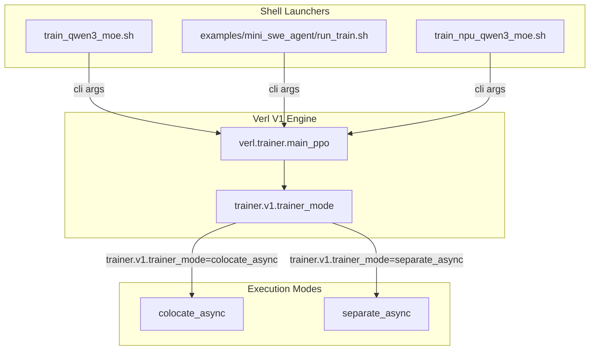
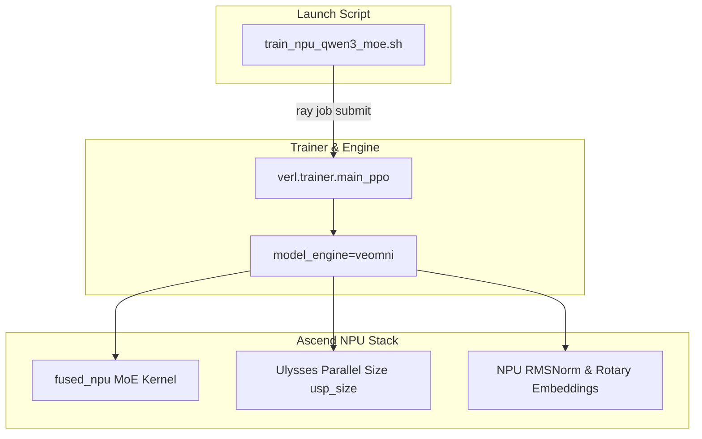
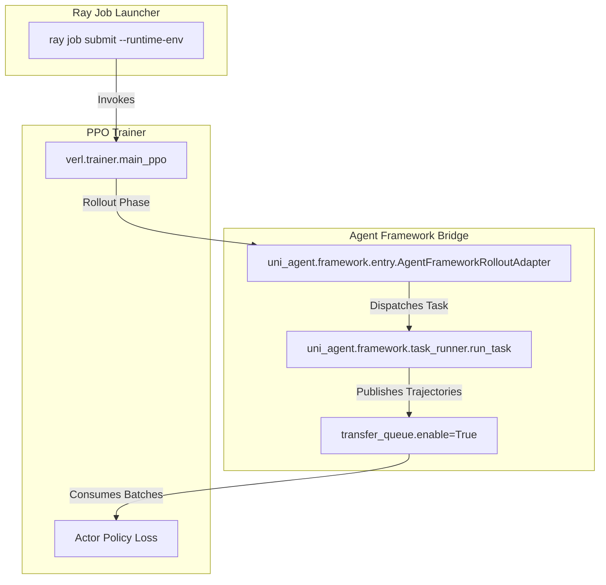

<!-- source: DeepWiki mcp.deepwiki.com · repo verl-project/uni-agent · page 3.3 RL Training Recipes & Launch Scripts · fetched 2026-10-26 -->

# RL Training Recipes & Launch Scripts

Relevant source files

The following files were used as context for generating this wiki page:

- [README.md](README.md)
- [docs/source/assets/results_claude_code_qwen3_coder_30b.svg](docs/source/assets/results_claude_code_qwen3_coder_30b.svg)
- [docs/source/assets/results_qwen3_coder_30b.svg](docs/source/assets/results_qwen3_coder_30b.svg)
- [docs/source/quickstart/npu-training.md](docs/source/quickstart/npu-training.md)
- [docs/source/quickstart/rl-training.md](docs/source/quickstart/rl-training.md)
- [examples/claude_code_swe_task/Dockerfile.claude-code-tool](examples/claude_code_swe_task/Dockerfile.claude-code-tool)
- [examples/claude_code_swe_task/build_tool.sh](examples/claude_code_swe_task/build_tool.sh)
- [examples/claude_code_swe_task/run_train.sh](examples/claude_code_swe_task/run_train.sh)
- [examples/mini_swe_agent/run_train.sh](examples/mini_swe_agent/run_train.sh)
- [examples/quickstart/training/task_config_claude_code.yaml](examples/quickstart/training/task_config_claude_code.yaml)
- [examples/quickstart/training/train_npu_qwen3_moe.sh](examples/quickstart/training/train_npu_qwen3_moe.sh)
- [examples/quickstart/training/train_qwen3_moe.sh](examples/quickstart/training/train_qwen3_moe.sh)
- [examples/quickstart/training/train_qwen3p5_dense.sh](examples/quickstart/training/train_qwen3p5_dense.sh)
- [mkdocs.yml](mkdocs.yml)
- [tests/uni_agent/agents/test_mini_swe_agent_agent.py](tests/uni_agent/agents/test_mini_swe_agent_agent.py)
- [tests/uni_agent/sandbox/test_openyuanrong_reverse_tunnel.py](tests/uni_agent/sandbox/test_openyuanrong_reverse_tunnel.py)
- [uni_agent/agents/mini_swe_agent/agent.py](uni_agent/agents/mini_swe_agent/agent.py)

## Purpose and Scope

This wiki page details the reinforcement learning (RL) training recipes and launch scripts provided by Uni-Agent, including `train_qwen3_moe.sh`, `train_qwen3_p5_dense.sh` [README.md:67-81](), `examples/mini_swe_agent/run_train.sh` [examples/mini_swe_agent/run_train.sh:1-15]() and `train_npu_qwen3_moe.sh` [examples/quickstart/training/train_npu_qwen3_moe.sh:1-146](). It covers the underlying Megatron parallelism topologies, `colocate_async` versus `separate_async` training modes, advanced algorithm settings such as GRPO and GSPO, MoE router replay mechanisms, and NPU execution paths.

Sources: [README.md:67-81](), [examples/mini_swe_agent/run_train.sh:1-15](), [examples/quickstart/training/train_qwen3_moe.sh:1-143](), [examples/quickstart/training/train_npu_qwen3_moe.sh:1-146]()

---

## Topology Modes: `colocate_async` vs `separate_async`

Uni-Agent supports two primary asynchronous execution topologies managed via `verl`'s V1 trainer engine (`trainer.use_v1=True`) [examples/quickstart/training/train_qwen3_moe.sh:117-119]():

| Topology Mode | Description | Resource Allocation | Weight Synchronization |
| :--- | :--- | :--- | :--- |
| `colocate_async` | Actor and rollout workers share the same physical GPUs [examples/quickstart/training/train_qwen3_moe.sh:79-84](). Rollout replicas sleep or yield compute during training updates. | Total nodes defined by `NNODES` and `NGPUS_PER_NODE` [examples/quickstart/training/train_qwen3_moe.sh:82-83]() | In-memory or direct parameter bucket handoff without inter-node network transfer. |
| `separate_async` | Dedicated nodes/GPUs for generation vs. policy optimization training steps [examples/mini_swe_agent/run_train.sh:32-50](). | Separated `ROLLOUT_NNODES` and training `NNODES` pools [examples/mini_swe_agent/run_train.sh:40-49](). | Asynchronous weight transmission via Ray object store or TransferQueue. |

In `colocate_async`, `num_warmup_batches` pre-fills the rollout queue before triggering the first training gradient step [examples/quickstart/training/train_qwen3_moe.sh:85-91]().

Title: Launcher and Topology Entity Flow

Sources: [examples/mini_swe_agent/run_train.sh:32-50](), [examples/quickstart/training/train_qwen3_moe.sh:114-120](), [examples/quickstart/training/train_npu_qwen3_moe.sh:84-89]()

Sources: [examples/mini_swe_agent/run_train.sh:32-50](), [examples/quickstart/training/train_qwen3_moe.sh:79-120](), [examples/quickstart/training/train_npu_qwen3_moe.sh:84-89]()

---

## Megatron Parallelism & Hardware Configuration

For large-scale dense and Mixture-of-Experts (MoE) models, the launch scripts configure Megatron-LM parallelism parameters to partition tensors, pipelines, contexts, and expert networks across distributed GPU/NPU clusters [examples/quickstart/training/train_qwen3_moe.sh:62-71]().

*   **Tensor Parallelism (`train_tp` / `GEN_TP`)**: Splits weight matrices across multiple accelerators [examples/quickstart/training/train_qwen3_moe.sh:63-64]().
*   **Pipeline Parallelism (`train_pp`)**: Distributes sequential transformer layers across pipeline stages [examples/quickstart/training/train_qwen3_moe.sh:65]().
*   **Context Parallelism (`train_cp`)**: Handles ultra-long context windows (up to 128K-256K tokens) by splitting sequence dimensions [examples/quickstart/training/train_qwen3_moe.sh:66]().
*   **Expert Parallelism (`train_ep`) & Expert Tensor Parallelism (`train_etp`)**: Distributes MoE expert networks across workers for models like Qwen3-Coder-30B-A3B [examples/quickstart/training/train_qwen3_moe.sh:67-68]().
*   **Mbridge (`USE_MBRIDGE`)**: Bridges vLLM rollout engines with Megatron weight updates, enabling zero-copy weight synchronization buckets (`update_weights_bucket_mb`) [examples/mini_swe_agent/run_train.sh:82-95]().

Sources: [examples/mini_swe_agent/run_train.sh:82-95](), [examples/quickstart/training/train_qwen3_moe.sh:60-78]()

---

## Algorithms & Objectives: GRPO, GSPO & Rollout Correction

The training recipes support multiple advantage estimators and loss calculation modes, configured via environmental flags and CLI arguments [examples/mini_swe_agent/run_train.sh:52-65](), [examples/quickstart/training/train_qwen3_moe.sh:30-51]().

*   **Advantage Estimator (`ADV_ESTIMATOR`)**: Defaults to group relative policy optimization (`grpo`), normalizing rewards across sampled responses per prompt [examples/mini_swe_agent/run_train.sh:53](), [examples/quickstart/training/train_qwen3_moe.sh:31]().
*   **Loss Mode (`LOSS_MODE`)**: Supports `vanilla` PPO, Group Sequence Policy Optimization (`gspo`), and token-mean loss aggregation modes [examples/mini_swe_agent/run_train.sh:63-64](), [examples/quickstart/training/train_qwen3_moe.sh:49-50]().
*   **Rollout Correction**: Configures behavior-anchor or decoupled rollout-correction parameters (`bypass_mode`, `rollout_is`, `rollout_is_threshold`, `rollout_rs`) to stabilize off-policy learning over long trajectories [examples/quickstart/training/train_qwen3_moe.sh:100-106]().

Sources: [examples/mini_swe_agent/run_train.sh:52-65](), [examples/quickstart/training/train_qwen3_moe.sh:30-51], [examples/quickstart/training/train_npu_qwen3_moe.sh:72-79]()

---

## Router Replay & Advanced Features

For MoE models, routing decisions made during rollout can diverge from training-step re-evaluations. The launcher scripts implement MoE Router Replay (`router_replay_mode`) to record and replay router logits or expert routing paths [examples/quickstart/training/train_qwen3_moe.sh:109-112]():

*   `router_replay_mode=disabled`: Standard MoE execution without replay [examples/quickstart/training/train_qwen3_moe.sh:111]().
*   `router_replay_mode=R2` / `R3`: Captures token routing selections during generation and forces identical routing during actor loss computation to eliminate gradient divergence caused by asynchronous routing changes.

Sources: [examples/quickstart/training/train_qwen3_moe.sh:109-112]()

---

## NPU Training Recipes (`train_npu_qwen3_moe.sh`)

Huawei Ascend NPU training is supported via `train_npu_qwen3_moe.sh`, which integrates the `veomni` model engine [examples/quickstart/training/train_npu_qwen3_moe.sh:117]().

Title: NPU and VeOmni Training Flow

Sources: [examples/quickstart/training/train_npu_qwen3_moe.sh:84-128]()

Key NPU-specific parameters include:
*   `trainer.device=npu` [examples/quickstart/training/claude_code_swe_task/run_train.sh:121]()
*   `model_engine=veomni` [examples/quickstart/training/train_npu_qwen3_moe.sh:117]()
*   `actor_rollout_ref.actor.veomni.moe_implementation=fused_npu` [examples/quickstart/training/train_npu_qwen3_moe.sh:123]()
*   `actor_rollout_ref.actor.veomni.ulysses_parallel_size=${usp_size}` [examples/quickstart/training/train_npu_qwen3_moe.sh:121]()

Sources: [examples/quickstart/training/train_npu_qwen3_moe.sh:1-146]()

---

## Launch Script Reference & Execution Flow

All training recipes rely on Ray job submission, packaging both `verl/` and `uni_agent/` libraries through a `runtime_env.yaml` specification [examples/quickstart/training/train_qwen3_moe.sh:14-114]().

Title: Training Execution and Data Flow

Sources: [examples/mini_swe_agent/run_train.sh:118-126](), [examples/quickstart/training/train_qwen3_moe.sh:114-121](), [examples/quickstart/training/train_npu_qwen3_moe.sh:143-146]()

Sources: [examples/mini_swe_agent/run_train.sh:118-129](), [examples/quickstart/training/train_qwen3_moe.sh:114-121](), [examples/quickstart/training/train_npu_qwen3_moe.sh:143-146]()

---

