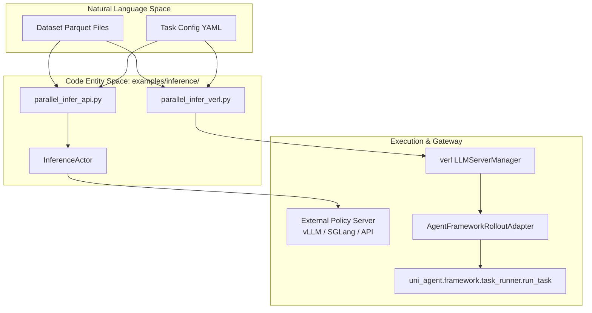
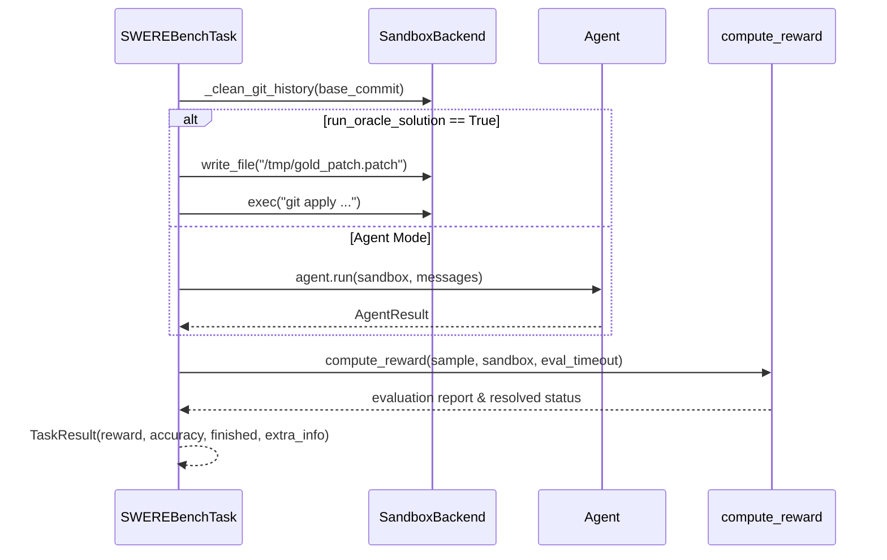

<!-- source: DeepWiki mcp.deepwiki.com · repo verl-project/uni-agent · page 3.4 Parallel Inference & Benchmarking · fetched 2026-10-26 -->

# Parallel Inference & Benchmarking

Relevant source files

The following files were used as context for generating this wiki page:

- [docs/source/benchmark/index.md](docs/source/benchmark/index.md)
- [docs/source/benchmark/inference.md](docs/source/benchmark/inference.md)
- [docs/source/benchmark/rl-training.md](docs/source/benchmark/rl-training.md)
- [examples/inference/parallel_infer_api.py](examples/inference/parallel_infer_api.py)
- [examples/inference/parallel_infer_verl.py](examples/inference/parallel_infer_verl.py)
- [examples/quickstart/inference/run_infer_claude_code.sh](examples/quickstart/inference/run_infer_claude_code.sh)
- [examples/quickstart/inference/run_infer_react.sh](examples/quickstart/inference/run_infer_react.sh)
- [uni_agent/agents/base.py](uni_agent/agents/base.py)
- [uni_agent/tasks/swe_rebench/task.py](uni_agent/tasks/swe_rebench/task.py)

## Purpose and Scope
This page details parallel agent inference, verification, and benchmark evaluation using Uni-Agent. It covers two primary execution paths:
1. **External API Mode** (`parallel_infer_api.py`): Direct execution against a standalone OpenAI-compatible endpoint [examples/inference/parallel_infer_api.py:1-22]().
2. **verl-Managed Rollout Mode** (`parallel_infer_verl.py`): Full integration with the verl training stack and the `TransferQueue`, routing agent rollouts through gateway sessions and the agent framework [examples/inference/parallel_infer_verl.py:1-17]().

---

## 1. Inference Entry Points & Modes

Uni-Agent provides parallel inference scripts under `examples/inference/` to evaluate agents across long-horizon benchmarks like SWE-bench, SWE-reBench, and Terminal-Bench.

### `parallel_infer_api.py` (External API Mode)
- Talks directly to a user-provided OpenAI-compatible policy server [examples/inference/parallel_infer_api.py:1-5]() without requiring GPUs on the driver.
- Uses Ray actors (`InferenceActor`) and an `asyncio.Semaphore` to manage concurrency limits across tasks [examples/inference/parallel_infer_api.py:48-53]().
- Resolves each sample's configuration via `TaskConfigResolver` and evaluates tasks using `get_task(task).run()` [examples/inference/parallel_infer_api.py:38-57]().

### `parallel_infer_verl.py` (verl Rollout Mode)
- Integrates with `verl`'s `LLMServerManager` (supporting vLLM and SGLang) to bring up the policy engine [examples/inference/parallel_infer_verl.py:7-54]().
- Routes requests through the exact training stack: `AgentFrameworkRolloutAdapter.generate_sequences` -> `TransferQueue` (TQ) -> Gateway sessions -> `uni_agent.framework.task_runner.run_task` [examples/inference/parallel_infer_verl.py:5-17]().
- Collects per-trajectory `rm_scores` written back from the trainer's TransferQueue [examples/inference/parallel_infer_verl.py:13-16]().

### Data Flow Diagram: Inference Modes

Sources: [examples/inference/parallel_infer_api.py:34-57](), [examples/inference/parallel_infer_verl.py:7-17]()

---

## 2. Oracle Verification and Task Execution

Tasks like `swe_rebench` support oracle verification runs where the agent loop is bypassed and the gold patch is applied directly to test sandbox correctness and reward computation [uni_agent/tasks/swe_rebench/task.py:64-103]().

### Task Execution Steps in `SWEREBenchTask`
1. **Git History Sanitation**: Sanitizes the `/testbed` repository state at `base_commit` using `_clean_git_history` [uni_agent/tasks/swe_rebench/task.py:52-61,97]() to remove unneeded commits, remotes, and reflog entries [uni_agent/tasks/swe_rebench/task.py:23-47]().
2. **Oracle vs Agent Execution**: 
   - If `run_oracle_solution` is enabled, applies `/tmp/gold_patch.patch` directly to `/testbed` [uni_agent/tasks/swe_rebench/task.py:99-103]().
   - Otherwise, invokes the registered agent harness (`agent.run(...)`) [uni_agent/tasks/swe_rebench/task.py:105-112]().
3. **Reward Computation**: Evaluates the sandbox state via `compute_reward` and returns a `TaskResult` containing reward, accuracy, completion status, and evaluation reports [uni_agent/tasks/swe_rebench/task.py:115-129]().

Sources: [uni_agent/tasks/swe_rebench/task.py:52-129]()

---

## 3. Published Benchmark Results

Uni-Agent provides reproducible reference evaluations across SWE-bench Verified, SWE-bench Multilingual, and Terminal-Bench [docs/source/benchmark/inference.md:5-34]().

### SWE-Bench Verified Reference Results

| Agent | Model | Rollouts | Setting | Score |
| --- | --- | :---: | --- | ---: |
| ReAct | Qwen3-Coder-30B-A3B-Instruct | Avg@4 | 100 turns, 128K context | **49.2** |
| ReAct | Qwen3-Coder-480B-A35B-Instruct | Avg@4 | 500 turns, 256K context | **64.2** |
| ReAct | Qwen3-Coder-Next | Avg@4 | 300 turns, 128K context | **67.6** |
| ReAct | Qwen3.5-4B | Avg@1 | 100 turns, 64K context | **45.2** |
| ReAct | Qwen3.5-9B | Avg@1 | 100 turns, 64K context | **53.8** |
| ReAct | Qwen3.5-9B | Avg@1 | 200 turns, 128K context | **63.8** |
| Claude Code | Qwen3.5-9B | Avg@1 | 200 turns, 128K context | **51.0** |
| ReAct | Qwen3.5-35B-A3B | Avg@1 | 200 turns, 128K context | **68.4** |

Sources: [docs/source/benchmark/inference.md:5-17]()

### RL Training & Asynchronous Rollout Performance

Training agents via reinforcement learning (GSPO/GRPO) yields significant performance gains across long-horizon agent tasks:

| Model | Dataset | Method | Setting | Base | RL | Delta |
| --- | --- | --- | --- | ---: | ---: | ---: |
| Qwen3-30B-A3B-Instruct | R2E-Gym | GSPO | Fully Async, 100 turns, 128K | 22.2 | **36.8** | +14.6 |
| Qwen3-Coder-30B-A3B-Instruct | R2E-Gym | GSPO | Fully Async, 100 turns, 128K | 46.2 | **52.0** | +5.8 |
| Qwen3.5-9B | SWE-reBench | GRPO | Fully Async, 100 turns, 128K | 53.8 | **59.2** | +5.4 |
| Qwen3-Coder-30B-A3B-Instruct | SWE-reBench | GSPO | Colocate Async, 200 turns, 128K | 47.4 | **54.2** | +6.8 |

Sources: [docs/source/benchmark/rl-training.md:5-13]()

---

## 4. Reporting Checklist and Reproduction

When publishing benchmark results or running reproducible evaluations, ensure the following metadata is recorded:
- Exact model identifier and checkpoint revision [docs/source/benchmark/inference.md:46-48]()
- Agent implementation or harness (`ReAct`, `ClaudeCodeAgent`, etc.) [docs/source/benchmark/inference.md:49-49]()
- Sandbox backend and image configuration [docs/source/benchmark/inference.md:50-50]()
- Sampling parameters (`temperature`, `top_p`, `top_k`) and token budgets [docs/source/benchmark/inference.md:51-52]()
- Rollout count (`Avg@N` or `Pass@1`) [docs/source/benchmark/inference.md:53-53]()
- Benchmark version, split, and verifier script [docs/source/benchmark/inference.md:54-54]()

Sources: [docs/source/benchmark/inference.md:44-55](), [docs/source/benchmark/index.md:17-31]()

---
Sources:
- [examples/inference/parallel_infer_verl.py:1-164]()
- [examples/inference/parallel_infer_api.py:1-163]()
- [uni_agent/tasks/swe_rebench/task.py:1-129]()
- [docs/source/benchmark/inference.md:1-55]()
- [docs/source/benchmark/rl-training.md:1-56]()
- [docs/source/benchmark/index.md:1-36]()

---

