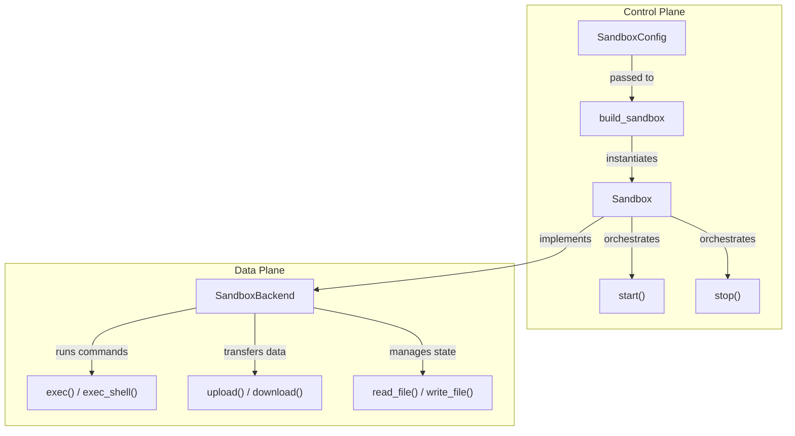
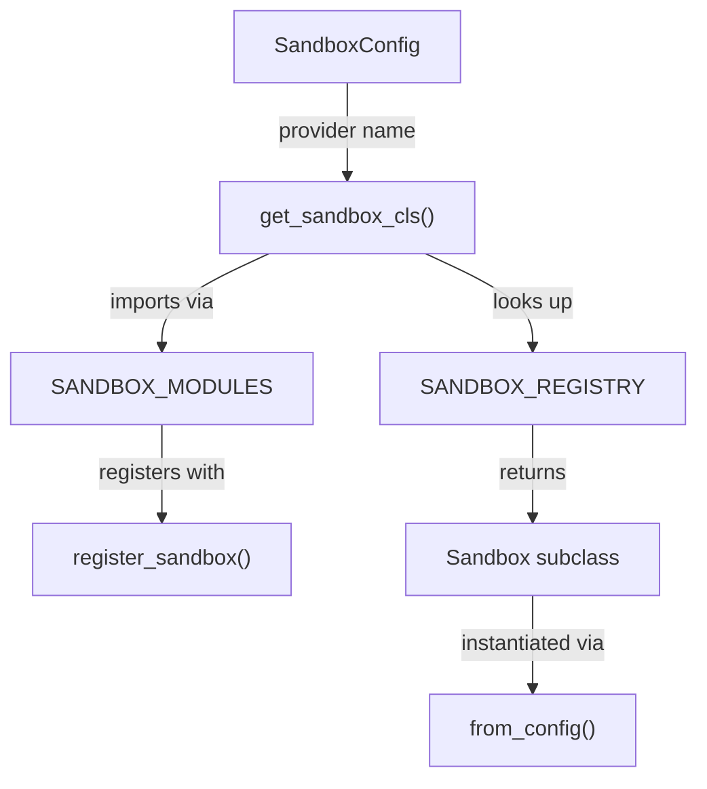

<!-- source: DeepWiki mcp.deepwiki.com · repo verl-project/uni-agent · page 4 Sandbox Layer · fetched 2026-10-26 -->

# Sandbox Layer

Relevant source files

The following files were used as context for generating this wiki page:

- [docs/source/concepts/sandbox.md](docs/source/concepts/sandbox.md)
- [examples/quickstart/sandbox/README.md](examples/quickstart/sandbox/README.md)
- [uni_agent/sandbox/__init__.py](uni_agent/sandbox/__init__.py)
- [uni_agent/sandbox/base.py](uni_agent/sandbox/base.py)
- [uni_agent/sandbox/registry.py](uni_agent/sandbox/registry.py)
- [uni_agent/sandbox/vefaas.py](uni_agent/sandbox/vefaas.py)

## Purpose and Scope
The sandbox layer provides the execution boundary for agent episodes within Uni-Agent. It owns the runtime lifecycle, configuration model, and a unified data plane for command execution, file transfers, and port exposure. Tasks and agents interact with a high-level `Sandbox` interface, while tools depend on the narrow `SandboxBackend` protocol [docs/source/concepts/sandbox.md:3-5](). 

This page provides a high-level overview of the sandbox control plane, configuration model, providers, and integration with tools. For detailed technical specifications, consult the child pages:
- Sandbox base classes, configuration schemas, and error policies: see [Sandbox Base, Config & Error Policy](#4.1)
- Provider implementations (OpenYuanrong, veFaaS, Modal, Docker, Local): see [Sandbox Providers](#4.2)
- Toolbox schema exposure and built-in tools: see [Toolbox & Built-in Tools](#4.3)

---

## Control Plane vs. Data Plane Architecture
The sandbox architecture cleanly separates lifecycle orchestration (control plane) from interaction operations (data plane). The control plane manages container or cloud environment provisioning, startup concurrency limits, health checks, and cleanup [docs/source/concepts/sandbox.md:80-88](). The data plane exposes portable methods for command execution, file manipulation, and stream handling [docs/source/concepts/sandbox.md:3-4]().

Diagram: Control vs Data Plane Architecture

Sources: [uni_agent/sandbox/base.py:132-195](), [uni_agent/sandbox/registry.py:64-66](), [docs/source/concepts/sandbox.md:3-5]()

For details on base lifecycle implementations and error policies, see [Sandbox Base, Config & Error Policy](#4.1).

---

## Configuration Model
Sandboxes are configured declaratively using `SandboxConfig`, which selects the provider backend and specifies runtime parameters such as timeouts, container images, image rewriting rules, mounted filesystems, and exposed executables [docs/source/concepts/sandbox.md:9-34]().

Diagram: Sandbox Provider Resolution and Configuration

Sources: [uni_agent/sandbox/registry.py:15-66]()

Key configuration components include:
- **`SandboxConfig`**: Defines `provider`, `runtime_timeout`, `image`, `image_map`, `image_mounts`, `executable_paths`, and `sandbox_kwargs` [uni_agent/sandbox/base.py:132-166]().
- **`ImageMap`**: Glob-based rewriting rules (supporting `**` captures) to map public dataset image names to cluster-accessible registry paths without modifying dataset parquets [docs/source/concepts/sandbox.md:36-53]().
- **`ImageMount`**: Allows mounting secondary container root filesystems at absolute paths inside the primary sandbox [uni_agent/sandbox/base.py:98-130]().

For detailed configuration parsing rules and error handling policies, see [Sandbox Base, Config & Error Policy](#4.1).

---

## Sandbox Providers
Uni-agent supports multiple execution backends through a modular registry pattern (`SANDBOX_REGISTRY` and `SANDBOX_MODULES`) [uni_agent/sandbox/registry.py:15-24](). Optional cloud SDKs are loaded lazily so that uninstalled providers do not disrupt execution on local or alternative backends [uni_agent/sandbox/registry.py:40-52]().

Supported provider backends include:
- **Local (`LocalSandbox`)**: Executes directly on the host filesystem and shell [uni_agent/sandbox/__init__.py:14]().
- **Docker (`docker`)**: Manages local container instances via Docker SDK.
- **Modal (`modal`)**: Provisions serverless cloud sandboxes on the Modal platform [docs/source/concepts/sandbox.md:14-19]().
- **veFaaS (`vefaas`)**: Integrates with Volcengine FaaS serverless infrastructure [uni_agent/sandbox/vefaas.py:26-42]().
- **OpenYuanrong (`openyuanrong`)**: Supports Yuanrong cloud infrastructure with reverse tunneling and PATH extensions.

For implementation specifics, setup instructions, and provider-unique features, see [Sandbox Providers](#4.2).

---

## Toolbox & Built-in Tools
Tools interact exclusively with the narrow `SandboxBackend` protocol, making them decoupled from lifecycle management [docs/source/concepts/sandbox.md:5](). The toolbox exposes schema definitions to agents, parses model tool calls, and routes execution to the active sandbox backend.

Built-in tools include:
- **`stateful_shell`**: Persistent bash shell wrapper maintaining working directory and environment variables across execution steps.
- **`str_replace_editor`**: File viewing, string replacement, and code editing utility.
- **`submit` and `finish`**: Episode completion markers.

For detailed schema descriptions, tool dispatch mechanics, and error handling protocols, see [Toolbox & Built-in Tools](#4.3).

---

