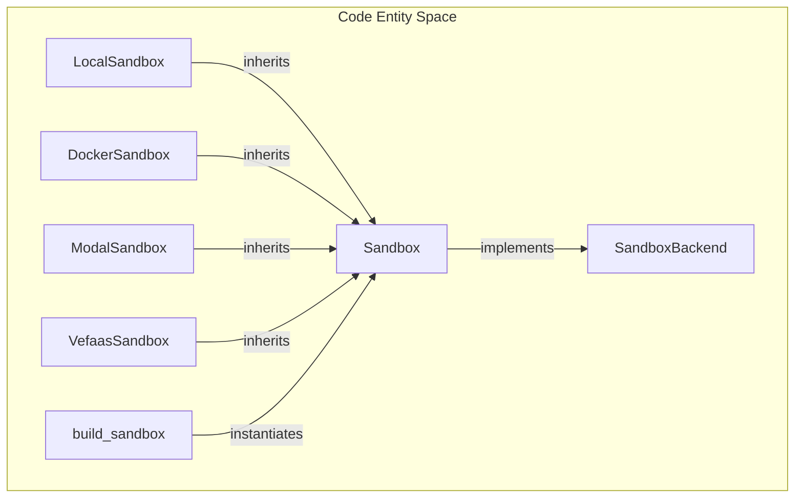
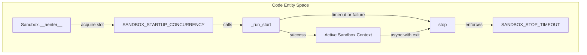

<!-- source: DeepWiki mcp.deepwiki.com · repo verl-project/uni-agent · page 4.1 Sandbox Base, Config & Error Policy · fetched 2026-10-26 -->

# Sandbox Base, Config & Error Policy

<details>
<summary>Relevant source files</summary>

The following files were used as context for generating this wiki page:

- [docs/source/concepts/sandbox.md](docs/source/concepts/sandbox.md)
- [examples/quickstart/sandbox/README.md](examples/quickstart/sandbox/README.md)
- [tests/uni_agent/sandbox/test_startup_cleanup.py](tests/uni_agent/sandbox/test_startup_cleanup.py)
- [uni_agent/sandbox/__init__.py](uni_agent/sandbox/__init__.py)
- [uni_agent/sandbox/base.py](uni_agent/sandbox/base.py)
- [uni_agent/sandbox/registry.py](uni_agent/sandbox/registry.py)
- [uni_agent/sandbox/vefaas.py](uni_agent/sandbox/vefaas.py)

</details>


## Purpose and Scope
This page details the foundation of the Uni-Agent sandbox subsystem: the abstract base classes (`Sandbox` ABC and `SandboxBackend` protocol), configuration models (`SandboxConfig`, `ImageMap`, `ImageMount`), startup concurrency controls, timeout behaviors, error policies, and file transfer primitives [uni_agent/sandbox/base.py:1-195](), [docs/source/concepts/sandbox.md:1-177](). The sandbox layer serves as the secure execution boundary for agent episodes, decoupling tool execution and data plane management from higher-level agent loops and task orchestrators.

---

## 1. Sandbox ABC & `SandboxBackend` Protocol

The sandbox architecture separates lifecycle control from data plane operations. Tools interact exclusively with the narrow `SandboxBackend` protocol, whereas tasks and agents interact with the broader `Sandbox` abstract base class (`Sandbox`), which handles provider lifecycle and high-level execution wrappers [docs/source/concepts/sandbox.md:3-6]().


*Sources: [uni_agent/sandbox/base.py:1-195](), [uni_agent/sandbox/registry.py:1-66]()*

The `Sandbox` abstract class wraps concrete backend implementations. Subclasses are expected to implement `start()`, `stop()`, and `_exec()` rather than overriding the public execution entrypoints directly [docs/source/concepts/sandbox.md:116-121]().

### Core Protocol and Base Methods
- `start()`: Initializes the sandbox instance and runtime environment.
- `stop()`: Tears down the runtime and releases underlying resources.
- `is_alive()`: Health probe returning a boolean indicating if the backend container or runtime is active [docs/source/concepts/sandbox.md:88]().
- `_exec(argv, *, timeout, workdir, env)`: Provider-specific primitive executed within the sandbox.
- `exec(argv, *, timeout, workdir, env)`: Public wrapper enforcing standard error and timeout translation policies.
- `exec_shell(script, *, timeout, workdir, env)`: Executes a shell script string by dispatching to `exec()`.
- File transfer primitives: `read_file()`, `write_file()`, `upload()`, and `download()`.

*Sources: [uni_agent/sandbox/base.py:1-195](), [docs/source/concepts/sandbox.md:3-105]()*

---

## 2. Configuration Models: `SandboxConfig`, `ImageMap`, & `ImageMount`

Sandbox construction is governed by declarative Pydantic models defined in [uni_agent/sandbox/base.py:65-195]().

```yaml
sandbox:
  provider: "docker"
  runtime_timeout: 3600.0
  image: "python:3.12"
  image_map:
    - from: "swebench/**:latest"
      to: "registry.internal/swe-bench/**:v2"
  image_mounts:
    - image: "registry.internal/toolset:1.0"
      mount_path: "/opt/tools"
  executable_paths:
    tool_cli: "/opt/tools/bin/cli"
  sandbox_kwargs:
    network_disabled: false
```

### Configuration Classes
- `SandboxConfig`: The root configuration schema holding `provider`, `runtime_timeout`, `image`, `image_map`, `image_mounts`, `executable_paths`, and provider-specific `sandbox_kwargs` [uni_agent/sandbox/base.py:132-167](). Extra fields are strictly forbidden (`extra="forbid"`).
- `ImageMap`: Handles glob-based rewriting of dataset container images (`from` -> `to`) using `**` wildcard capturing [uni_agent/sandbox/base.py:65-96](). Useful for redirecting public benchmark images (e.g., SWE-bench) to private registries or local mirrors without modifying dataset parquet files [docs/source/concepts/sandbox.md:36-52]().
- `ImageMount`: Defines secondary container images whose root filesystems are mounted at absolute non-root paths inside the sandbox (`mount_path`) [uni_agent/sandbox/base.py:98-130]().

*Sources: [uni_agent/sandbox/base.py:65-195](), [docs/source/concepts/sandbox.md:7-70]()*

---

## 3. Startup Concurrency, Timeouts & Lifecycle Management

Sandboxes are designed to be used as asynchronous context managers [docs/source/concepts/sandbox.md:73-76](). Entering the context triggers instance startup, while exiting guarantees that `stop()` is called even if execution raises an exception [docs/source/concepts/sandbox.md:76-80]().


*Sources: [uni_agent/sandbox/base.py:1-195](), [tests/uni_agent/sandbox/test_startup_cleanup.py:1-74]()*

### Lifecycle Controls and Environment Variables
- `SANDBOX_STARTUP_TIMEOUT`: Maximum allotted time for a sandbox backend to boot (default: `600.0` seconds) [docs/source/concepts/sandbox.md:84]().
- `SANDBOX_STARTUP_CONCURRENCY`: Process-wide concurrency ceiling limiting simultaneous sandbox initializations (default: `64`) [docs/source/concepts/sandbox.md:85]().
- `SANDBOX_STOP_TIMEOUT`: Grace period enforced during cleanup `stop()` calls following startup failures or cancellations (default: `120.0` seconds) [docs/source/concepts/sandbox.md:86](). If cancellation occurs, cleanup waits for this bound to prevent hung providers from blocking execution indefinitely [docs/source/concepts/sandbox.md:86]().

*Sources: [uni_agent/sandbox/base.py:1-195](), [docs/source/concepts/sandbox.md:71-89](), [tests/uni_agent/sandbox/test_startup_cleanup.py:1-74]()*

---

## 4. Execution Error Policy

To prevent rogue agent commands from crashing an entire training episode while still surfacing real infrastructure failures, all providers adhere to a unified error policy implemented within the public `Sandbox.exec()` wrapper [docs/source/concepts/sandbox.md:106-114]().

| Error Condition | Handled Result / Action |
| :--- | :--- |
| **Command Timeout** | Captured and translated into `ExecResult(exit_code=-1, stdout=..., stderr=...)` [docs/source/concepts/sandbox.md:110](). |
| **Runtime / Command Error** (while sandbox alive) | Captured as standard failure, returned with `exit_code=127` (or corresponding nonzero exit code) [docs/source/concepts/sandbox.md:111](). |
| **Infrastructure Error** (sandbox dead/unreachable) | Re-raised immediately to signal unrecoverable backend failure [docs/source/concepts/sandbox.md:112](). |

Custom providers implement `_exec()`. Direct overrides of `exec()` are prohibited to preserve cross-provider error invariant guarantees [docs/source/concepts/sandbox.md:116-118]().

*Sources: [uni_agent/sandbox/base.py:1-195](), [docs/source/concepts/sandbox.md:106-118]()*

---

## 5. File Transfer Primitives & Data Plane

The base `Sandbox` class provides portable, fallback implementations for file read/write and directory upload/download operations using underlying archive packing primitives [uni_agent/sandbox/base.py:21-26]() (`pack_dir_to_file`, `extract_dir_from_file`, `remote_pack_command`, `remote_unpack_command`). 

Providers with native data-plane optimizations override these methods [docs/source/concepts/sandbox.md:104-105]():
- **Local Provider**: Directly accesses the host filesystem [docs/source/concepts/sandbox.md:104]().
- **Docker Provider**: Leverages host-container file copy mechanisms (`docker cp`) [docs/source/concepts/sandbox.md:104]().
- **Modal Provider**: Utilizes its native filesystem API for absolute paths [docs/source/concepts/sandbox.md:104]().

*Sources: [uni_agent/sandbox/base.py:1-26](), [docs/source/concepts/sandbox.md:90-105]()*

---

