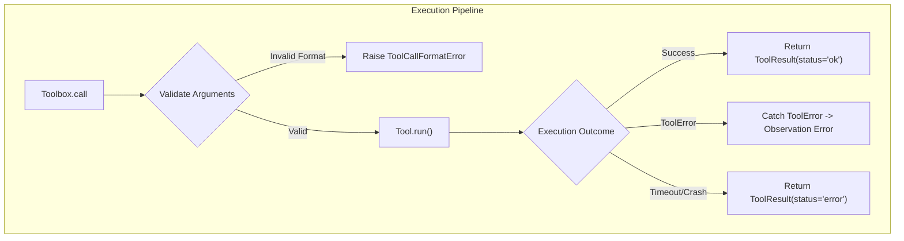

<!-- source: DeepWiki mcp.deepwiki.com · repo verl-project/uni-agent · page 4.3 Toolbox & Built-in Tools · fetched 2026-10-26 -->

# Toolbox & Built-in Tools

<details>
<summary>Relevant source files</summary>

The following files were used as context for generating this wiki page:

- [tests/uni_agent/logging/test_redaction.py](tests/uni_agent/logging/test_redaction.py)
- [tests/uni_agent/tools/test_edit_file_arguments.py](tests/uni_agent/tools/test_edit_file_arguments.py)
- [uni_agent/tools/__init__.py](uni_agent/tools/__init__.py)
- [uni_agent/tools/base.py](uni_agent/tools/base.py)
- [uni_agent/tools/edit_file.py](uni_agent/tools/edit_file.py)
- [uni_agent/tools/shell.py](uni_agent/tools/shell.py)

</details>


This page covers the toolbox schema exposure, execution framework, and built-in tools (`stateful_shell`, `str_replace_editor`, `submit`, and `finish`) within Uni-Agent. It details how host-side tools interface with sandbox backends through the data plane, manage state, and handle execution or format errors.

## Purpose and Scope

The tool layer provides host-side capabilities that allow an agent running outside the task container to interact with the sandbox environment. Each tool pairs an OpenAI-compatible JSON schema with an asynchronous execution routine (`run`) that drives the container via the `SandboxBackend` data plane [uni_agent/tools/base.py:1-9](). 

Sources: [uni_agent/tools/base.py:1-9]()

## Tool Infrastructure & Toolbox

All host-side tools inherit from the `Tool` abstract base class [uni_agent/tools/base.py:133-141](). A `Tool` encapsulates configuration parsing via Pydantic (`config_model`), argument validation (`args_model`), and schema exposure (`schema()`) [uni_agent/tools/base.py:136-169]().

The `Toolbox` class manages a collection of tools bound to a single `SandboxBackend` instance, handling dispatch, schema generation, and exception translation.

### Data Structures & Normalization
* **`ToolResult`**: Represents a normalized outcome containing a `text` observation string and a `status` (`"ok"`, `"format_error"`, `"error"`, `"timeout"`) [uni_agent/tools/base.py:30-44](). It provides observation truncation (`to_observation`) when output exceeds maximum length limits [uni_agent/tools/base.py:48-59]().
* **Schema Normalization**: Pydantic JSON schemas are normalized via `_normalize_json_schema` to remove titles, collapse optional variants, and enforce standard parameter ordering for model compatibility [uni_agent/tools/base.py:78-118]().

**Natural Language Space to Code Entity Mapping (Toolbox & Tools)**
```mermaid
graph TD
    subgraph "Natural Language Space"
        A["LLM Function Call / Tool Request"]
    end

    subgraph "Code Entity Space"
        B["Toolbox"]
        C["Tool (ABC)"]
        D["ShellTool (stateful_shell)"]
        E["EditFileTool (str_replace_editor)"]
        F["SubmitTool (submit)"]
        G["ToolResult"]
    end

    A -- "dispatches to" --> B
    B -- "invokes run()" --> C
    C <|-- D
    C <|-- E
    C <|-- F
    C -- "returns" --> G
```
Sources: [uni_agent/tools/base.py:33-59](), [uni_agent/tools/base.py:133-141](), [uni_agent/tools/__init__.py:1-19]()

Sources: [uni_agent/tools/base.py:30-169](), [uni_agent/tools/__init__.py:1-19]()

## Built-in Tools

Uni-Agent registers core built-in tools upon importing `uni_agent.tools` [uni_agent/tools/__init__.py:32-33]().

### Stateful Shell (`stateful_shell` / `shell`)
The `ShellTool` exposes a persistent shell session to the model under the name `shell` [uni_agent/tools/shell.py:1-12](). It delegates execution to a underlying `Shell` implementation:
* **`SandboxShell`**: Uses native container session handles (`backend.open_shell()`) when supported by the sandbox backend [uni_agent/tools/shell.py:61-120]().
* **`TmuxShell`**: Acts as a fallback for backends supporting only one-shot execution, managing a detached `tmux` session over `SandboxBackend.exec` [uni_agent/tools/shell.py:9-125]().

### File Editor (`str_replace_editor`)
Implemented by `EditFileTool`, this tool handles viewing (`cat -n`), creating, replacing (`str_replace`), inserting, and undoing edits on remote files [uni_agent/tools/edit_file.py:1-44](). All file I/O operations go through `sandbox.read_file` and `sandbox.write_file`, while undo history is maintained locally on the tool instance (`self._history`) rather than inside the container [uni_agent/tools/edit_file.py:3-8, 105-110]().

### Control Tools (`submit` & `finish`)
Control tools have no sandbox side effects. When the model invokes `submit` or `finish`, the ReAct rollout loop detects the sentinel call and terminates the episode [uni_agent/tools/__init__.py:17-18]().

**Tool Execution and Dispatch Flow**

Sources: [uni_agent/tools/base.py:61-75](), [uni_agent/tools/base.py:133-141](), [uni_agent/tools/edit_file.py:130-133](), [uni_agent/tools/shell.py:71-101]()

Sources: [uni_agent/tools/edit_file.py:1-145](), [uni_agent/tools/shell.py:1-126]()

## Call-Error Handling

Tool execution errors are handled gracefully to prevent rolling episodes from crashing:
* **`ToolCallFormatError`**: Raised when tool arguments fail schema decoding or name resolution. `Toolbox.call` captures this and returns an error observation to the policy so it can self-correct [uni_agent/tools/base.py:70-75]().
* **`ToolError`**: Raised during runtime failures (e.g., refocussing or bad paths). `Toolbox.call` converts this into an `"Error: ..."` observation string for the model [uni_agent/tools/base.py:61-67]().

Sources: [uni_agent/tools/base.py:61-77]()

---

